# Volume V03.1 · Reality and Reasoning (part 1 of 2)

**Part of** [the master document](../UCOS-MASTER.md) · **Category** C03 · **Projected from** `_registry/` — never edit this file: change the registry and run `npm run registry`.

**Parts:** **V03.1** · [V03.2](V03.2-reality-and-reasoning.md)

> How reality is observed, evidenced, explained, simulated and changed.

## Contents

- [D-OBS Observation](#d-obs)
  - [UCOS-OBS-000001 Observation Architecture](#ucos-obs-000001)
- [D-EVD Evidence](#d-evd)
  - [UCOS-EVD-000001 Evidence Architecture](#ucos-evd-000001)
- [D-INF Inference](#d-inf)
  - [UCOS-INF-000001 Inference Architecture](#ucos-inf-000001)
  - [UCOS-UNC-000001 Uncertainty Architecture](#ucos-unc-000001)
- [D-RSN Reasoning](#d-rsn)
  - [UCOS-RSN-000001 Reasoning Architecture](#ucos-rsn-000001)
  - [UCOS-CONTR-000001 Contradiction Architecture](#ucos-contr-000001)
- [D-SIM Simulation](#d-sim)
  - [UCOS-SIM-000001 Simulation Architecture](#ucos-sim-000001)
- [D-CAU Causality](#d-cau)
  - [UCOS-CAU-000001 Causality Architecture](#ucos-cau-000001)
- [D-PER Perspective](#d-per)
  - [UCOS-PER-000001 Perspective Architecture](#ucos-per-000001)
- [D-POS Possibility](#d-pos)
  - [UCOS-REA-000001 Multi-Reality Architecture](#ucos-rea-000001)
  - [UCOS-POSS-000001 Possibility Architecture](#ucos-poss-000001)
- [D-EVO Evolution](#d-evo)
  - [UCOS-EVO-000001 Evolution Architecture](#ucos-evo-000001)
  - [UCOS-EMG-000001 Emergence Architecture](#ucos-emg-000001)

---

<a id="d-obs"></a>
### D-OBS · Observation

| | |
|---|---|
| **Category** | C03 Reality and Reasoning |
| **Owns** | [Observation](../UCOS-MASTER.md#t-observation), [Data](../UCOS-MASTER.md#t-data), [Information](../UCOS-MASTER.md#t-information) |
| **Responsible for** | Capture, Collection, Measurement |
| **Not responsible for** | Inference, Reasoning, Decision Making |
| **Contract** | [UCOS-OBS-000001 Observation Architecture](#ucos-obs-000001) |
| **Artifacts** | [UCOS-OBS-000001](#ucos-obs-000001) |
| **Concepts** | 226 — `node _registry/compile.js --search <words> --kind concept --owner "Observation"` |
| **Code** | — |
| **Managed in** | `_registry/domains.json` → `D-OBS` |

<a id="ucos-obs-000001"></a>
#### UCOS-OBS-000001 · Observation Architecture

Owner [Observation](#d-obs) · managed in `_registry/manifest.json` → `UCOS-OBS-000001`, content `_registry/content-core.json` → `OBS` · inherits the [standard contract](../UCOS-MASTER.md#standard-contract)

<a id="ucos-obs-000001-concepts"></a>
##### Concepts

Observation is captured reality at a point in time. Observation ≠ Inference: it is what was sensed, never what was derived. Observations are the raw feed from which Knowledge, Trust, and Twins derive.

<a id="ucos-obs-000001-ontology"></a>
##### Ontology

Observation has a Source, a captured Payload, a Timestamp, and a Context. Sources: Transactions, Logs, Events, Documents, Images, Video, Voice, IoT, External APIs, Human Inputs, Agent Inputs — all registry-driven and extensible.

<a id="ucos-obs-000001-taxonomy"></a>
##### Taxonomy

By source: Machine / Human / Agent / External. By nature: Discrete / Continuous / Composite. By fidelity: Raw / Normalized / Enriched.

<a id="ucos-obs-000001-data-model"></a>
##### Data Model

```yaml
Observation:
  observationId: <Identity>
  source: <Identity>
  sourceType: <registry id>
  capturedAt: <Time>
  context: <Context>
  payload: <content-addressed>
  fidelity: <Raw|Normalized|Enriched>
  metadata: <Metadata>
```

<a id="ucos-obs-000001-graph-model"></a>
##### Graph Model

(:Observation)-[:CAPTURED_BY]->(:Identity); (:Observation)-[:OBSERVED_IN]->(:Context); (:Observation)-[:FEEDS]->(:Evidence|:Knowledge|:Twin)

<a id="ucos-obs-000001-apis"></a>
##### APIs

- POST /observation.v1.ingest
- GET  /observation.v1/{id}
- POST /observation.v1.query
- GET  /observation.v1.stream

<a id="ucos-obs-000001-events"></a>
##### Events

- ObservationIngested
- ObservationNormalized
- ObservationEnriched
- ObservationQuarantined
- ObservationReplayed

<a id="ucos-obs-000001-commands"></a>
##### Commands

- observation.ingest
- observation.normalize
- observation.enrich
- observation.replay
- observation.quarantine

<a id="ucos-obs-000001-queries"></a>
##### Queries

- observation.byId
- observation.bySource
- observation.byTimeWindow
- observation.byContext
- observation.stream

<a id="ucos-obs-000001-state-machines"></a>
##### State Machines

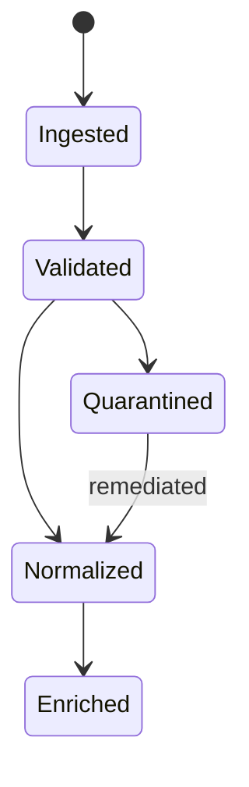

<a id="ucos-obs-000001-workflows"></a>
##### Workflows

- ingest → schema-validate against source type → normalize → enrich with context → publish to stream → persist content-addressed

<a id="ucos-obs-000001-authorities"></a>
##### Authorities

- Source Authority (authorized ingest endpoint)
- Platform Authority (quarantine release)

<a id="ucos-obs-000001-permissions"></a>
##### Permissions

- observation.ingest (authorized source)
- observation.read (context-scoped)
- observation.quarantine (platform authority)

<a id="ucos-obs-000001-privacy-model"></a>
##### Privacy Model

Observations of persons are privacy-sensitive by default; enrichment of personal data requires consent scope and purpose limitation.

<a id="ucos-obs-000001-audit-model"></a>
##### Audit Model

Every ingest records source, timestamp, context, and validation outcome. Quarantine reasons are mandatory and reviewable.

<a id="ucos-obs-000001-digital-twin-model"></a>
##### Digital Twin Model

Observation is the primary synchronization feed into Digital Twins — the 'reality' side of the twin loop.

<a id="ucos-obs-000001-agent-model"></a>
##### Agent Model

Observation Agent detects anomalies, drift, and source degradation, quarantining suspicious feeds under governance.

<a id="ucos-obs-000001-runtime-model"></a>
##### Runtime Model

Ingest is a high-throughput append-only stream; enrichment is a pipeline stage; replay is first-class for recovery.

<a id="ucos-obs-000001-scaling-model"></a>
##### Scaling Model

Partition by source and time bucket; retention is policy-driven per source type; cold storage is registry-configured.

<a id="ucos-obs-000001-multi-tenant-model"></a>
##### Multi-Tenant Model

Observations are tenant-scoped at ingest; a source cannot write into another tenant's stream.

<a id="ucos-obs-000001-geo-distribution-model"></a>
##### Geo-Distribution Model

Ingest endpoints are region-local for latency; residency follows the source's Context, enforced at write time.

<a id="ucos-obs-000001-failure-model"></a>
##### Failure Model

Schema violation, source spoofing, backpressure overload, clock skew, duplicate ingest.

<a id="ucos-obs-000001-recovery-model"></a>
##### Recovery Model

Idempotent ingest via source-assigned sequence numbers; replay rebuilds downstream projections exactly.

<a id="ucos-obs-000001-certification-model"></a>
##### Certification Model

Observation must pass source authorization, schema validity, timestamp sanity, and context binding.

<a id="ucos-obs-000001-migration-model"></a>
##### Migration Model

New source types are registry additions; the ingest pipeline dispatches by type without code change.

<a id="ucos-obs-000001-implementation-blueprint"></a>
##### Implementation Blueprint

Build order for OBS: (1) define registry entries — this domain owns by source: machine / human / agent / external as registry truth, not code; (2) implement the contract surface first (observation.ingest, observation.normalize, observation.enrich) and validate against OBS boundaries; (3) event-source all state so history is reconstructable; (4) wire the enforcement points — authority check, policy guard, evidence binding, trace — in-line, with no bypass path; (5) add tests per the Testing Architecture, citing evidence per gate; (6) obtain Verification and Certification before activation. Acceptance: the Zero Partial and Law 001 audits pass, every action answers the seven explainability questions, and this domain mutates no other domain internals.

<a id="ucos-obs-000001-sequence-diagrams"></a>
##### Sequence Diagrams

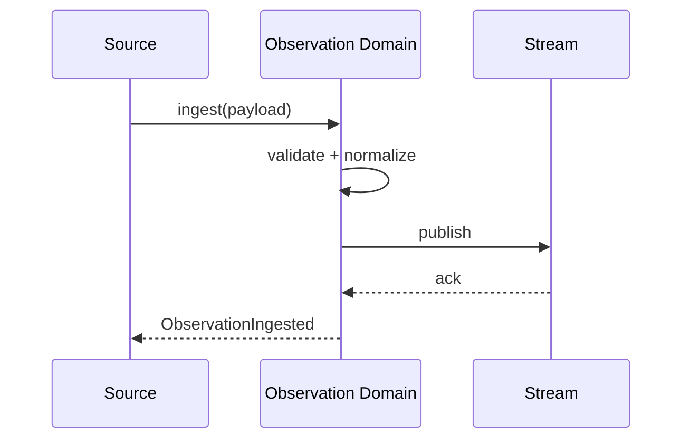

<a id="ucos-obs-000001-state-diagrams"></a>
##### State Diagrams

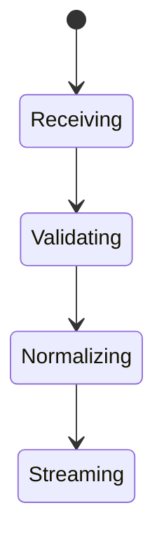

---

<a id="d-evd"></a>
### D-EVD · Evidence

| | |
|---|---|
| **Category** | C03 Reality and Reasoning |
| **Owns** | [Evidence](../UCOS-MASTER.md#t-evidence) |
| **Responsible for** | Evidence Capture, Evidence Validity, Evidence Chain |
| **Not responsible for** | Trust Computation, Decision |
| **Contract** | [UCOS-EVD-000001 Evidence Architecture](#ucos-evd-000001) |
| **Artifacts** | [UCOS-EVD-000001](#ucos-evd-000001) |
| **Concepts** | 146 — `node _registry/compile.js --search <words> --kind concept --owner "Evidence"` |
| **Code** | — |
| **Managed in** | `_registry/domains.json` → `D-EVD` |

<a id="ucos-evd-000001"></a>
#### UCOS-EVD-000001 · Evidence Architecture

Owner [Evidence](#d-evd) · managed in `_registry/manifest.json` → `UCOS-EVD-000001`, content `_registry/content-core.json` → `EVD` · inherits the [standard contract](../UCOS-MASTER.md#standard-contract)

<a id="ucos-evd-000001-concepts"></a>
##### Concepts

Evidence is proof supporting an assertion. Evidence ≠ Knowledge and Evidence ≠ Trust: it supports knowledge and feeds trust; it is not itself understanding. Nothing exists without evidence.

<a id="ucos-evd-000001-ontology"></a>
##### Ontology

Evidence has a Source, a Proof payload, Validity, and Confidence. Evidence types: Document / Signature / Timestamp / Attestation / Observation / Receipt / Hash-witness / Future type — all registry-driven.

<a id="ucos-evd-000001-taxonomy"></a>
##### Taxonomy

By strength: Cryptographic / Attested / Observed / Claimed (weakest). By permanence: Immutable / Temporal / Revocable.

<a id="ucos-evd-000001-data-model"></a>
##### Data Model

```yaml
Evidence:
  evidenceId: <Identity>
  type: <registry id>
  source: <Identity|Authority>
  proof: <content-addressed payload reference>
  validity: {verifiedAt, method, expiresAt}
  confidence: <0..1>
  chain: [parent evidence]
  metadata: <Metadata>
```

<a id="ucos-evd-000001-graph-model"></a>
##### Graph Model

(:Evidence)-[:SUPPORTS]->(:Knowledge); (:Evidence)-[:SIGNED_BY]->(:Authority); (:Evidence)-[:DERIVED_FROM]->(:Evidence); (:Evidence)-[:REVOKED_BY]->(:Authority)

<a id="ucos-evd-000001-apis"></a>
##### APIs

- POST /evidence.v1.submit
- GET  /evidence.v1/{id}
- POST /evidence.v1.verify
- POST /evidence.v1.revoke
- GET  /evidence.v1.chain/{id}

<a id="ucos-evd-000001-events"></a>
##### Events

- EvidenceSubmitted
- EvidenceVerified
- EvidenceRevoked
- EvidenceChained
- EvidenceExpired

<a id="ucos-evd-000001-commands"></a>
##### Commands

- evidence.submit
- evidence.verify
- evidence.revoke
- evidence.chain
- evidence.archive

<a id="ucos-evd-000001-queries"></a>
##### Queries

- evidence.byId
- evidence.supporting
- evidence.bySource
- evidence.revoked
- evidence.chain

<a id="ucos-evd-000001-state-machines"></a>
##### State Machines

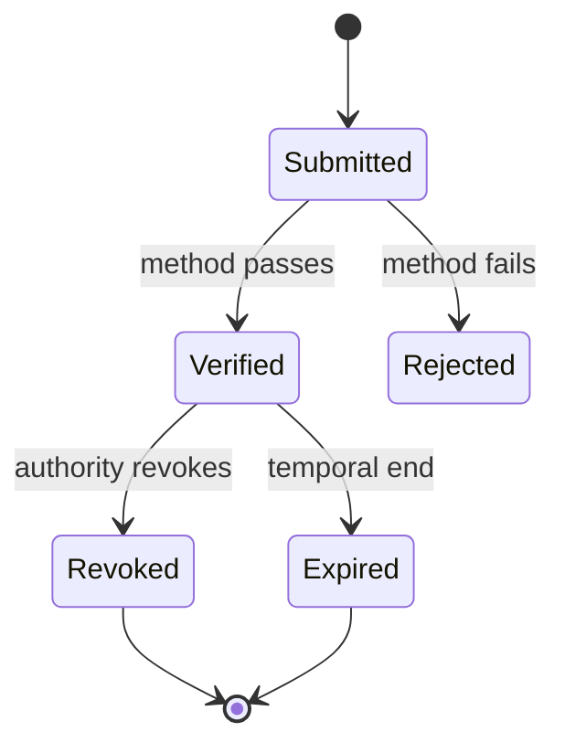

<a id="ucos-evd-000001-workflows"></a>
##### Workflows

- submit → select verification method from registry → verify → chain to parent evidence → publish → schedule expiry

<a id="ucos-evd-000001-authorities"></a>
##### Authorities

- Source Authority (submits)
- Verification Authority (attests method)
- Revocation Authority (original signer or higher)

<a id="ucos-evd-000001-permissions"></a>
##### Permissions

- evidence.submit (authenticated)
- evidence.verify (verification authority)
- evidence.revoke (revocation authority)

<a id="ucos-evd-000001-privacy-model"></a>
##### Privacy Model

Proof payloads are content-addressed and access-scoped; personal evidence follows the Consent Architecture's retention and erasure policy.

<a id="ucos-evd-000001-audit-model"></a>
##### Audit Model

Every verification records method, verifier, timestamp, and result. Revocation never deletes — it invalidates downstream support and is logged.

<a id="ucos-evd-000001-digital-twin-model"></a>
##### Digital Twin Model

Evidence Twin mirrors real-world proof status (e.g., a license expiring) and propagates expiry to dependent Knowledge.

<a id="ucos-evd-000001-agent-model"></a>
##### Agent Model

Evidence Agent detects expiring and weak-chain evidence, triggering re-verification before downstream trust degrades.

<a id="ucos-evd-000001-runtime-model"></a>
##### Runtime Model

Verification is method-dispatched from the registry; hot path caches verification results keyed by content hash.

<a id="ucos-evd-000001-scaling-model"></a>
##### Scaling Model

Payloads are stored once, content-addressed; verification results are cached and invalidated on EvidenceRevoked.

<a id="ucos-evd-000001-multi-tenant-model"></a>
##### Multi-Tenant Model

Evidence is tenant-scoped; cross-tenant citation requires explicit published relationship.

<a id="ucos-evd-000001-geo-distribution-model"></a>
##### Geo-Distribution Model

Proof payloads follow Data Sovereignty residency; verification method availability varies by jurisdiction (e.g., eIDAS vs. eID).

<a id="ucos-evd-000001-failure-model"></a>
##### Failure Model

Method unavailability, chain breakage, hash collision (mitigated by algorithm agility), revocation storm.

<a id="ucos-evd-000001-recovery-model"></a>
##### Recovery Model

Content-addressed storage is self-verifying; recovery re-verifies hashes. Revoked evidence stays invalid — integrity over recoverability.

<a id="ucos-evd-000001-certification-model"></a>
##### Certification Model

Evidence must pass method verification, chain integrity, non-expiration, and source authority validity.

<a id="ucos-evd-000001-migration-model"></a>
##### Migration Model

New verification methods are registry additions; existing evidence re-verifies on method activation.

<a id="ucos-evd-000001-implementation-blueprint"></a>
##### Implementation Blueprint

Build order for EVD: (1) define registry entries — this domain owns by strength: cryptographic / attested / observed / claimed (weakest) as registry truth, not code; (2) implement the contract surface first (evidence.submit, evidence.verify, evidence.revoke) and validate against EVD boundaries; (3) event-source all state so history is reconstructable; (4) wire the enforcement points — authority check, policy guard, evidence binding, trace — in-line, with no bypass path; (5) add tests per the Testing Architecture, citing evidence per gate; (6) obtain Verification and Certification before activation. Acceptance: the Zero Partial and Law 001 audits pass, every action answers the seven explainability questions, and this domain mutates no other domain internals.

<a id="ucos-evd-000001-sequence-diagrams"></a>
##### Sequence Diagrams

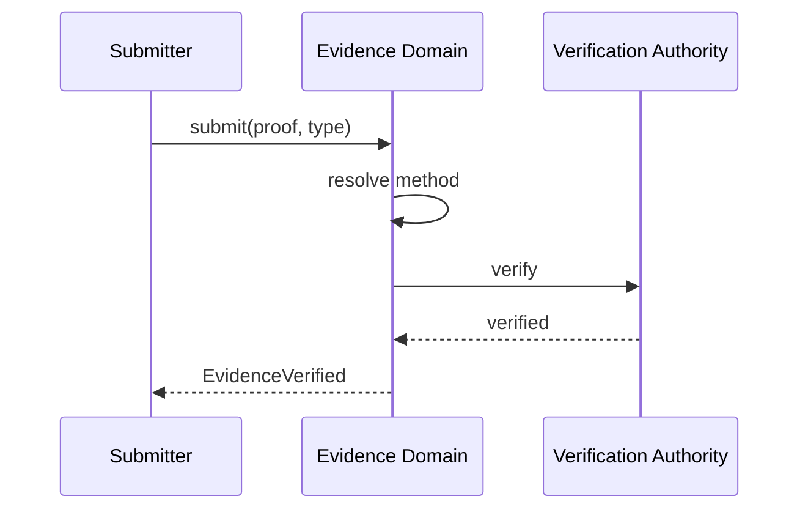

<a id="ucos-evd-000001-state-diagrams"></a>
##### State Diagrams

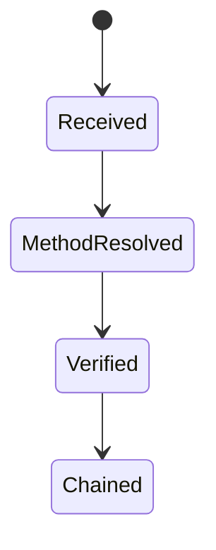

---

<a id="d-inf"></a>
### D-INF · Inference

| | |
|---|---|
| **Category** | C03 Reality and Reasoning |
| **Owns** | [Inference](../UCOS-MASTER.md#t-inference) |
| **Responsible for** | Knowledge Discovery, Relationship Discovery, Pattern Discovery |
| **Not responsible for** | Policy, Authority, Governance |
| **Contract** | [UCOS-INF-000001 Inference Architecture](#ucos-inf-000001) |
| **Artifacts** | [UCOS-INF-000001](#ucos-inf-000001), [UCOS-UNC-000001](#ucos-unc-000001) |
| **Concepts** | 707 — `node _registry/compile.js --search <words> --kind concept --owner "Inference"` |
| **Code** | — |
| **Managed in** | `_registry/domains.json` → `D-INF` |

<a id="ucos-inf-000001"></a>
#### UCOS-INF-000001 · Inference Architecture

Owner [Inference](#d-inf) · managed in `_registry/manifest.json` → `UCOS-INF-000001`, content `_registry/content-core.json` → `INF` · inherits the [standard contract](../UCOS-MASTER.md#standard-contract)

<a id="ucos-inf-000001-concepts"></a>
##### Concepts

Inference is derived reality — discovery without explicit definition. Inference ≠ Observation: it is what was concluded, not what was sensed. Inferences carry lower trust by default and are always labeled as derived.

<a id="ucos-inf-000001-ontology"></a>
##### Ontology

Inference has a Method, input Observations/Knowledge, a derived output, and a Confidence. Methods: Statistical / Graph / Semantic / Causal / Neural / Hybrid — registry-driven.

<a id="ucos-inf-000001-taxonomy"></a>
##### Taxonomy

By output: New Relationship / New Knowledge / New Risk / New Capability / New Pattern. By method: Deductive-projected / Inductive / Abductive / Analogical.

<a id="ucos-inf-000001-data-model"></a>
##### Data Model

```yaml
Inference:
  inferenceId: <Identity>
  method: <registry id>
  inputs: [<Observation|Knowledge>]
  output: <Relationship|Knowledge|Risk|Pattern>
  confidence: <0..1>
  trust: <Trust, reduced by default>
  context: <Context>
  reproducible: <bool>
```

<a id="ucos-inf-000001-graph-model"></a>
##### Graph Model

(:Inference)-[:DERIVED_FROM]->(:Observation|:Knowledge); (:Inference)-[:PRODUCED]->(:Relationship|:Knowledge); (:Inference)-[:METHOD]->(:RegistryEntry)

<a id="ucos-inf-000001-apis"></a>
##### APIs

- POST /inference.v1.run
- GET  /inference.v1/{id}
- POST /inference.v1.promote
- GET  /inference.v1.candidates

<a id="ucos-inf-000001-events"></a>
##### Events

- InferenceProduced
- InferencePromoted
- InferenceRejected
- InferenceConfidenceLow
- InferenceReproduced

<a id="ucos-inf-000001-commands"></a>
##### Commands

- inference.run
- inference.promote
- inference.reject
- inference.explain
- inference.rerun

<a id="ucos-inf-000001-queries"></a>
##### Queries

- inference.byId
- inference.candidates
- inference.byMethod
- inference.lowConfidence
- inference.explain

<a id="ucos-inf-000001-state-machines"></a>
##### State Machines

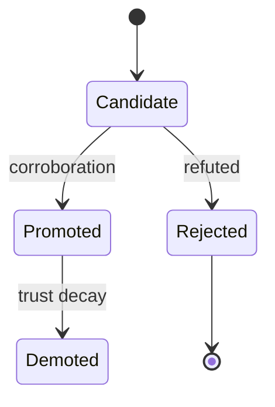

<a id="ucos-inf-000001-workflows"></a>
##### Workflows

- select method → gather inputs within consent scope → run → assign reduced trust → present as candidate → promote on corroboration

<a id="ucos-inf-000001-authorities"></a>
##### Authorities

- Inference Authority (runs methods under governance)
- Promotion Authority (domain authority in output scope)

<a id="ucos-inf-000001-permissions"></a>
##### Permissions

- inference.run (inference authority)
- inference.promote (domain authority)
- inference.read (context-scoped)

<a id="ucos-inf-000001-privacy-model"></a>
##### Privacy Model

Inferences about persons are sensitive; no inference over personal data without consent scope covering the method's purpose.

<a id="ucos-inf-000001-audit-model"></a>
##### Audit Model

Every inference records method, inputs, confidence, and is reproducible or void. Inferences are never presented as observations.

<a id="ucos-inf-000001-digital-twin-model"></a>
##### Digital Twin Model

Inference feeds Twins with predicted states, clearly separated from observed twin state.

<a id="ucos-inf-000001-agent-model"></a>
##### Agent Model

Inference Agent is the primary autonomous discovery mechanism, governed by Agent Safety and the constitution.

<a id="ucos-inf-000001-runtime-model"></a>
##### Runtime Model

Methods are registry-dispatched plugins running in a sandbox with resource limits; outputs never mutate reality directly.

<a id="ucos-inf-000001-scaling-model"></a>
##### Scaling Model

Inference is a batch/stream job; candidates queue for promotion; hot methods are pre-warmed.

<a id="ucos-inf-000001-multi-tenant-model"></a>
##### Multi-Tenant Model

Inferences never cross tenant boundaries; cross-tenant inference requires published relationship and policy.

<a id="ucos-inf-000001-geo-distribution-model"></a>
##### Geo-Distribution Model

Inference over regulated data runs in-jurisdiction; method availability respects local regulation.

<a id="ucos-inf-000001-failure-model"></a>
##### Failure Model

Method drift, input starvation, unreproducible output, confidence inflation.

<a id="ucos-inf-000001-recovery-model"></a>
##### Recovery Model

Inferences are re-derivable; promotion is reversible to candidate. Unreproducible inferences are auto-rejected.

<a id="ucos-inf-000001-certification-model"></a>
##### Certification Model

Inference must be reproducible, method-registered, consent-scoped, and below promotion threshold until corroborated.

<a id="ucos-inf-000001-migration-model"></a>
##### Migration Model

New methods are registry additions; rerun on method version change.

<a id="ucos-inf-000001-implementation-blueprint"></a>
##### Implementation Blueprint

Build order for INF: (1) define registry entries — this domain owns by output: new relationship / new knowledge / new risk / new capability / new pattern as registry truth, not code; (2) implement the contract surface first (inference.run, inference.promote, inference.reject) and validate against INF boundaries; (3) event-source all state so history is reconstructable; (4) wire the enforcement points — authority check, policy guard, evidence binding, trace — in-line, with no bypass path; (5) add tests per the Testing Architecture, citing evidence per gate; (6) obtain Verification and Certification before activation. Acceptance: the Zero Partial and Law 001 audits pass, every action answers the seven explainability questions, and this domain mutates no other domain internals.

<a id="ucos-inf-000001-sequence-diagrams"></a>
##### Sequence Diagrams

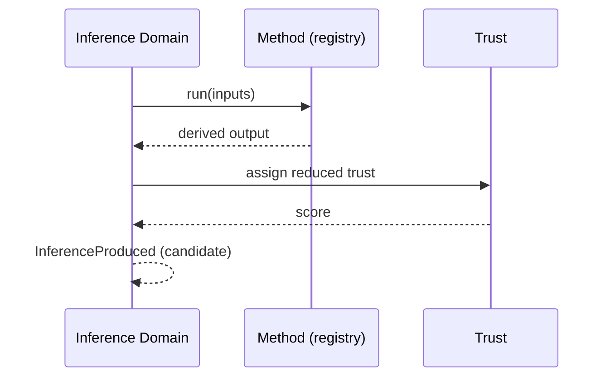

<a id="ucos-inf-000001-state-diagrams"></a>
##### State Diagrams

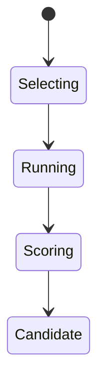

<a id="ucos-unc-000001"></a>
#### UCOS-UNC-000001 · Uncertainty Architecture

Owner [Inference](#d-inf) · managed in `_registry/manifest.json` → `UCOS-UNC-000001`, content `_registry/content-ext.json` → `UNC` · inherits the [standard contract](../UCOS-MASTER.md#standard-contract)

<a id="ucos-unc-000001-concepts"></a>
##### Concepts

Uncertainty is first-class. Confidence, probability, ambiguity, competing truths, incomplete knowledge, and unknown knowledge are all modeled explicitly — never hidden behind false precision.

<a id="ucos-unc-000001-ontology"></a>
##### Ontology

Uncertainty attaches to any assertion as a distribution or interval, not a point value. Unknown-ness is a state, not an error: 'we do not know' is a valid, recorded answer.

<a id="ucos-unc-000001-taxonomy"></a>
##### Taxonomy

By kind: Aleatoric (inherent) / Epistemic (knowledge gap) / Ambiguity (multiple readings) / Conflict (competing truths). By representation: Probability / Interval / Fuzzy / Qualitative.

<a id="ucos-unc-000001-data-model"></a>
##### Data Model

```yaml
Uncertainty:
  uncertaintyId: <Identity>
  subject: <Identity>
  kind: <registry id>
  representation: <Probability|Interval|Fuzzy|Qualitative>
  parameters: <registry expression>
  confidence: <0..1>
  alternatives: [<alternative assertions>]
  ambiguity: <registry measure>
  asOf: <Time>
```

<a id="ucos-unc-000001-graph-model"></a>
##### Graph Model

(:Uncertainty)-[:QUALIFIES]->(:Knowledge|:Assertion); (:Uncertainty)-[:ALTERNATIVE]->(:Knowledge); (:Uncertainty)-[:MEASURED_AT]->(:Time)

<a id="ucos-unc-000001-apis"></a>
##### APIs

- POST /uncertainty.v1.attach
- GET  /uncertainty.v1/{id}
- GET  /uncertainty.v1.bySubject/{subjectId}
- POST /uncertainty.v1.propagate

<a id="ucos-unc-000001-events"></a>
##### Events

- UncertaintyAttached
- UncertaintyRefined
- UncertaintyPropagated
- UncertaintyEscalated

<a id="ucos-unc-000001-commands"></a>
##### Commands

- uncertainty.attach
- uncertainty.refine
- uncertainty.propagate
- uncertainty.escalate

<a id="ucos-unc-000001-queries"></a>
##### Queries

- uncertainty.bySubject
- uncertainty.lowConfidence
- uncertainty.alternatives
- uncertainty.byKind

<a id="ucos-unc-000001-state-machines"></a>
##### State Machines

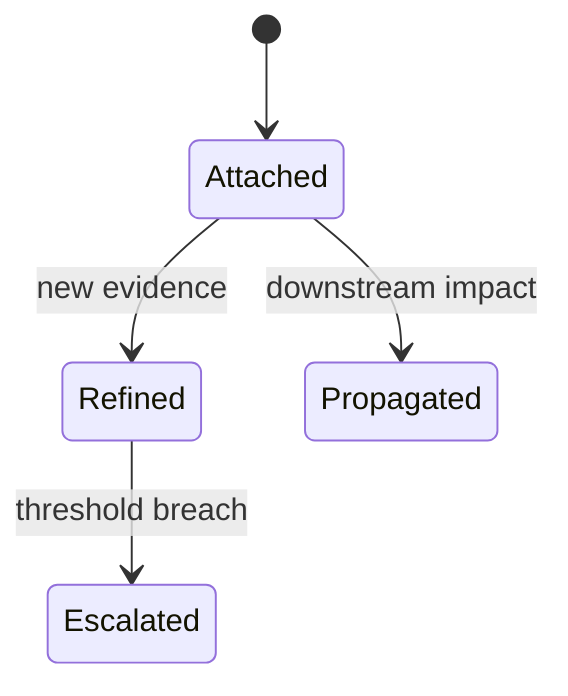

<a id="ucos-unc-000001-workflows"></a>
##### Workflows

- attach uncertainty to assertion → propagate through dependents → refine on evidence → escalate on threshold breach

<a id="ucos-unc-000001-authorities"></a>
##### Authorities

- Domain Authority (attachment); escalation routed to the owning domain's governance.

<a id="ucos-unc-000001-permissions"></a>
##### Permissions

- uncertainty.attach (domain authority)
- uncertainty.read (context-scoped)

<a id="ucos-unc-000001-privacy-model"></a>
##### Privacy Model

Uncertainty over personal subjects uses aggregated parameters; individual-level distributions require consent.

<a id="ucos-unc-000001-audit-model"></a>
##### Audit Model

Every refinement records the evidence that moved the estimate — uncertainty provenance is fully traceable.

<a id="ucos-unc-000001-digital-twin-model"></a>
##### Digital Twin Model

Twins expose uncertainty alongside state; a twin that reports certainty without justification is non-compliant.

<a id="ucos-unc-000001-agent-model"></a>
##### Agent Model

Uncertainty Agent monitors thresholds and escalates before downstream decisions over-trust weak assertions.

<a id="ucos-unc-000001-runtime-model"></a>
##### Runtime Model

Propagation is a graph traversal recomputing dependent confidences; cached per assertion version.

<a id="ucos-unc-000001-scaling-model"></a>
##### Scaling Model

Propagation batches on evidence events; hot assertions are pre-propagated.

<a id="ucos-unc-000001-multi-tenant-model"></a>
##### Multi-Tenant Model

Uncertainty never crosses tenants; shared assertions carry shared uncertainty.

<a id="ucos-unc-000001-geo-distribution-model"></a>
##### Geo-Distribution Model

Estimation standards are jurisdiction-aware; regulatory contexts may require conservative bounds.

<a id="ucos-unc-000001-failure-model"></a>
##### Failure Model

Propagation cycle, over-precise collapse, threshold storm, contradiction with recorded certainty.

<a id="ucos-unc-000001-recovery-model"></a>
##### Recovery Model

Estimates recompute from evidence history; attaching uncertainty is reversible by refinement.

<a id="ucos-unc-000001-certification-model"></a>
##### Certification Model

Assertion must declare uncertainty to be used in automated decisions — silent certainty is prohibited.

<a id="ucos-unc-000001-migration-model"></a>
##### Migration Model

New kinds/representations are registry additions; existing estimates re-propagate on kind change.

<a id="ucos-unc-000001-implementation-blueprint"></a>
##### Implementation Blueprint

Build order for UNC: (1) define registry entries — this domain owns by kind: aleatoric (inherent) / epistemic (knowledge gap) / ambiguity (multiple readings) / conflict (competing truths) as registry truth, not code; (2) implement the contract surface first (uncertainty.attach, uncertainty.refine, uncertainty.propagate) and validate against UNC boundaries; (3) event-source all state so history is reconstructable; (4) wire the enforcement points — authority check, policy guard, evidence binding, trace — in-line, with no bypass path; (5) add tests per the Testing Architecture, citing evidence per gate; (6) obtain Verification and Certification before activation. Acceptance: the Zero Partial and Law 001 audits pass, every action answers the seven explainability questions, and this domain mutates no other domain internals.

<a id="ucos-unc-000001-sequence-diagrams"></a>
##### Sequence Diagrams

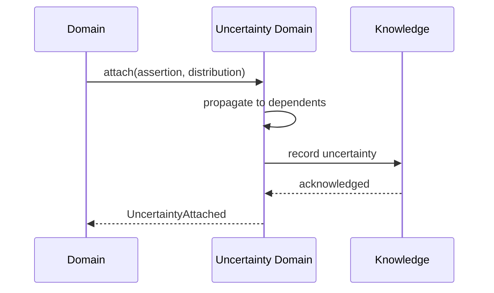

<a id="ucos-unc-000001-state-diagrams"></a>
##### State Diagrams

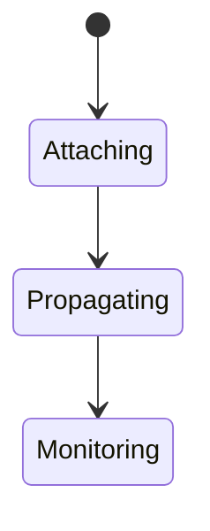

---

<a id="d-rsn"></a>
### D-RSN · Reasoning

| | |
|---|---|
| **Category** | C03 Reality and Reasoning |
| **Owns** | [Reasoning](../UCOS-MASTER.md#t-reasoning) |
| **Responsible for** | Deductive/Inductive/Abductive/Constraint/Policy/Semantic/Causal Reasoning |
| **Not responsible for** | Observation Capture, Policy Approval |
| **Contract** | [UCOS-RSN-000001 Reasoning Architecture](#ucos-rsn-000001) |
| **Artifacts** | [UCOS-RSN-000001](#ucos-rsn-000001), [UCOS-CONTR-000001](#ucos-contr-000001) |
| **Concepts** | 1437 — `node _registry/compile.js --search <words> --kind concept --owner "Reasoning"` |
| **Code** | — |
| **Managed in** | `_registry/domains.json` → `D-RSN` |

<a id="ucos-rsn-000001"></a>
#### UCOS-RSN-000001 · Reasoning Architecture

Owner [Reasoning](#d-rsn) · managed in `_registry/manifest.json` → `UCOS-RSN-000001`, content `_registry/content-core.json` → `RSN` · inherits the [standard contract](../UCOS-MASTER.md#standard-contract)

<a id="ucos-rsn-000001-concepts"></a>
##### Concepts

Reasoning is the deliberate derivation of conclusions under governance. Reasoning ≠ Inference: reasoning is explainable, step-wise, and auditable; inference may be statistical and opaque. Every reasoning chain is reconstructable.

<a id="ucos-rsn-000001-ontology"></a>
##### Ontology

Reasoning has a Mode (Deductive / Inductive / Abductive / Constraint / Policy / Semantic / Causal), a chain of steps, premises, and a conclusion. Each step is itself recorded.

<a id="ucos-rsn-000001-taxonomy"></a>
##### Taxonomy

By mode: Deductive / Inductive / Abductive / Constraint-satisfaction / Policy-based / Semantic / Causal. By purpose: Explanation / Prediction / Diagnosis / Planning / Justification.

<a id="ucos-rsn-000001-data-model"></a>
##### Data Model

```yaml
Reasoning:
  reasoningId: <Identity>
  mode: <registry id>
  premises: [<Knowledge|Observation>]
  steps:
    - stepNo: <int>
      rule: <Rule|registry inference rule>
      input: <facts>
      output: <fact>
  conclusion: <Knowledge|Decision>
  explainable: true   # mandatory
  context: <Context>
```

<a id="ucos-rsn-000001-graph-model"></a>
##### Graph Model

(:Reasoning)-[:FROM_PREMISE]->(:Knowledge); (:Reasoning)-[:STEP*]->(:ReasoningStep); (:Reasoning)-[:CONCLUDED]->(:Knowledge|:Decision); (:Reasoning)-[:MODE]->(:RegistryEntry)

<a id="ucos-rsn-000001-apis"></a>
##### APIs

- POST /reasoning.v1.run
- GET  /reasoning.v1/{id}
- GET  /reasoning.v1/{id}/chain
- POST /reasoning.v1.explain

<a id="ucos-rsn-000001-events"></a>
##### Events

- ReasoningCompleted
- ReasoningValidated
- ReasoningInvalid
- ReasoningExplained

<a id="ucos-rsn-000001-commands"></a>
##### Commands

- reasoning.run
- reasoning.explain
- reasoning.validate
- reasoning.replay

<a id="ucos-rsn-000001-queries"></a>
##### Queries

- reasoning.byId
- reasoning.chain
- reasoning.byMode
- reasoning.conclusions

<a id="ucos-rsn-000001-state-machines"></a>
##### State Machines

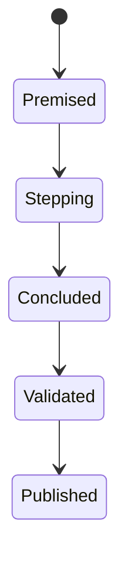

<a id="ucos-rsn-000001-workflows"></a>
##### Workflows

- load premises within scope → apply mode → record each step → conclude → validate chain → publish with explanation

<a id="ucos-rsn-000001-authorities"></a>
##### Authorities

- Reasoning Authority (runs modes); conclusion authority follows the Knowledge/Decision domain rules.

<a id="ucos-rsn-000001-permissions"></a>
##### Permissions

- reasoning.run (reasoning authority)
- reasoning.read (context-scoped)
- reasoning.explain (any stakeholder)

<a id="ucos-rsn-000001-privacy-model"></a>
##### Privacy Model

Premises containing personal data require consent scope; explanations minimize exposed facts while remaining reconstructable.

<a id="ucos-rsn-000001-audit-model"></a>
##### Audit Model

The chain is the audit. A conclusion without a reconstructable chain is constitutionally void.

<a id="ucos-rsn-000001-digital-twin-model"></a>
##### Digital Twin Model

Reasoning produces explanations for twin state divergence — why the twin differs from observed reality.

<a id="ucos-rsn-000001-agent-model"></a>
##### Agent Model

Reasoning Agent is the explainable counterpart to the Inference Agent, justifying autonomous conclusions.

<a id="ucos-rsn-000001-runtime-model"></a>
##### Runtime Model

Step-wise execution with checkpointing; long chains are resumable. Every step is persisted before the next runs.

<a id="ucos-rsn-000001-scaling-model"></a>
##### Scaling Model

Chains are partitioned by conclusion subject; step storage is append-only and deduplicated by hash.

<a id="ucos-rsn-000001-multi-tenant-model"></a>
##### Multi-Tenant Model

Reasoning never mixes premises across tenants.

<a id="ucos-rsn-000001-geo-distribution-model"></a>
##### Geo-Distribution Model

Reasoning over jurisdiction-scoped knowledge stays in jurisdiction.

<a id="ucos-rsn-000001-failure-model"></a>
##### Failure Model

Step invalidation, premise revocation mid-chain, mode unavailability, unbounded chain length.

<a id="ucos-rsn-000001-recovery-model"></a>
##### Recovery Model

Chains are replayable; a revoked premise invalidates downstream steps deterministically and re-triggers reasoning.

<a id="ucos-rsn-000001-certification-model"></a>
##### Certification Model

Reasoning must be fully reconstructable, mode-registered, scope-valid, and step-auditable.

<a id="ucos-rsn-000001-migration-model"></a>
##### Migration Model

New modes are registry additions; existing chains preserve their mode version.

<a id="ucos-rsn-000001-implementation-blueprint"></a>
##### Implementation Blueprint

Build order for RSN: (1) define registry entries — this domain owns by mode: deductive / inductive / abductive / constraint-satisfaction / policy-based / semantic / causal as registry truth, not code; (2) implement the contract surface first (reasoning.run, reasoning.explain, reasoning.validate) and validate against RSN boundaries; (3) event-source all state so history is reconstructable; (4) wire the enforcement points — authority check, policy guard, evidence binding, trace — in-line, with no bypass path; (5) add tests per the Testing Architecture, citing evidence per gate; (6) obtain Verification and Certification before activation. Acceptance: the Zero Partial and Law 001 audits pass, every action answers the seven explainability questions, and this domain mutates no other domain internals.

<a id="ucos-rsn-000001-sequence-diagrams"></a>
##### Sequence Diagrams

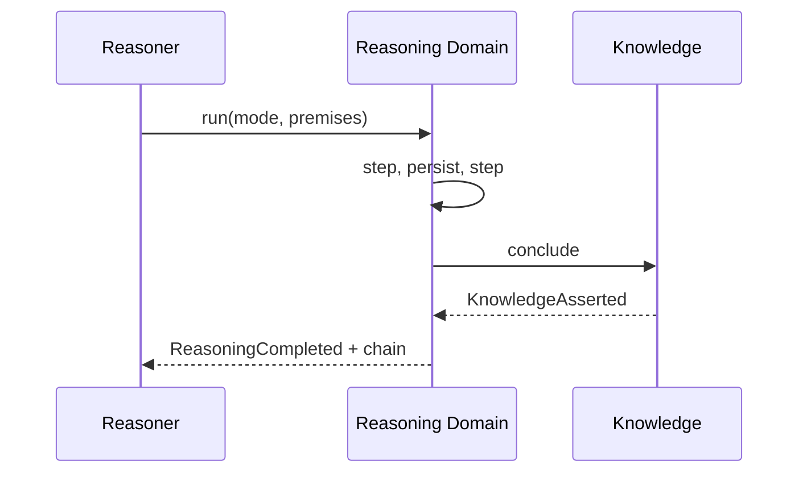

<a id="ucos-rsn-000001-state-diagrams"></a>
##### State Diagrams

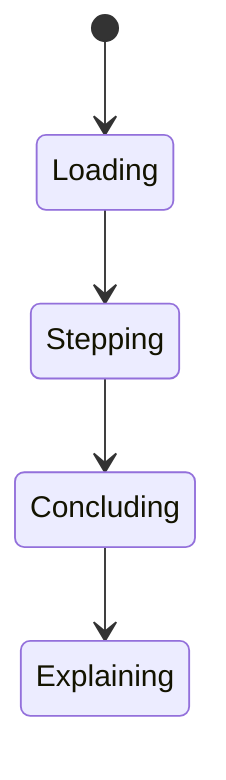

<a id="ucos-contr-000001"></a>
#### UCOS-CONTR-000001 · Contradiction Architecture

Owner [Reasoning](#d-rsn) · managed in `_registry/manifest.json` → `UCOS-CONTR-000001`, content `_registry/content-ext.json` → `CONTR` · inherits the [standard contract](../UCOS-MASTER.md#standard-contract)

<a id="ucos-contr-000001-concepts"></a>
##### Concepts

Contradiction is stored, not erased. 'Regulator: Approved' and 'Auditor: Rejected' coexist and both remain valid until governed resolution. Suppressing a contradiction destroys evidence.

<a id="ucos-contr-000001-ontology"></a>
##### Ontology

Contradiction has two or more Assertions, each with its own Authority and Context, plus a resolution state. Contradiction is a relationship among truths, not an error.

<a id="ucos-contr-000001-taxonomy"></a>
##### Taxonomy

By resolution state: Open / Resolved / Unresolvable-by-policy. By severity: Informational / Blocking / Critical. By scope: Local / Cross-jurisdiction / Cross-reality.

<a id="ucos-contr-000001-data-model"></a>
##### Data Model

```yaml
Contradiction:
  contradictionId: <Identity>
  assertions: [{assertion, authority, context}]
  severity: <registry level>
  resolutionState: <Open|Resolved|Unresolvable>
  resolution: <Policy|Decision|null>
  detectedAt: <Time>
  evidence: [<Evidence>]
```

<a id="ucos-contr-000001-graph-model"></a>
##### Graph Model

(:Contradiction)-[:BETWEEN]->(:Assertion); (:Contradiction)-[:DETECTED_BY]->(:Observation|:Agent); (:Contradiction)-[:RESOLVED_BY]->(:Policy|:Decision)

<a id="ucos-contr-000001-apis"></a>
##### APIs

- POST /contradiction.v1.detect
- GET  /contradiction.v1/{id}
- POST /contradiction.v1.resolve
- GET  /contradiction.v1.open

<a id="ucos-contr-000001-events"></a>
##### Events

- ContradictionDetected
- ContradictionResolved
- ContradictionEscalated
- ContradictionClosed

<a id="ucos-contr-000001-commands"></a>
##### Commands

- contradiction.detect
- contradiction.resolve
- contradiction.escalate
- contradiction.close

<a id="ucos-contr-000001-queries"></a>
##### Queries

- contradiction.open
- contradiction.byId
- contradiction.bySubject
- contradiction.bySeverity

<a id="ucos-contr-000001-state-machines"></a>
##### State Machines

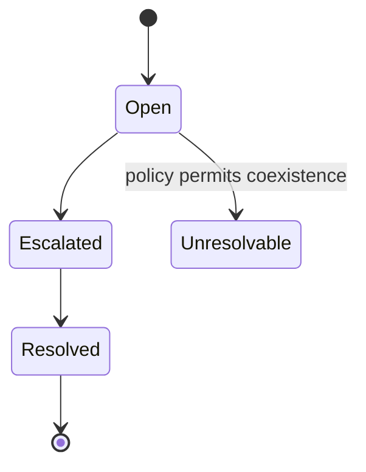

<a id="ucos-contr-000001-workflows"></a>
##### Workflows

- detect across assertions → classify severity → route to resolver authority → resolve or declare coexistence → publish

<a id="ucos-contr-000001-authorities"></a>
##### Authorities

- Each assertion's authority stands; resolution requires an authority superior to all parties or their consent.

<a id="ucos-contr-000001-permissions"></a>
##### Permissions

- contradiction.detect (any authority)
- contradiction.resolve (superior or consented authority)
- contradiction.read (context-scoped)

<a id="ucos-contr-000001-privacy-model"></a>
##### Privacy Model

Contradictions involving personal data are access-restricted; the fact of contradiction is auditable, contents are scoped.

<a id="ucos-contr-000001-audit-model"></a>
##### Audit Model

Both sides of every contradiction are preserved with full evidence, even after resolution. Resolution rationale is mandatory.

<a id="ucos-contr-000001-digital-twin-model"></a>
##### Digital Twin Model

Contradiction explains twin divergence across realities — the twin system never silently picks one truth.

<a id="ucos-contr-000001-agent-model"></a>
##### Agent Model

Contradiction Agent continuously scans for new conflicts and stale resolutions, escalating per severity policy.

<a id="ucos-contr-000001-runtime-model"></a>
##### Runtime Model

Detection is a stream over assertion events; open contradictions are cached for resolver dashboards.

<a id="ucos-contr-000001-scaling-model"></a>
##### Scaling Model

Detection batches by subject; resolution is human-or-policy gated, so write throughput is low.

<a id="ucos-contr-000001-multi-tenant-model"></a>
##### Multi-Tenant Model

Contradictions are tenant-scoped unless they involve shared authoritative assertions.

<a id="ucos-contr-000001-geo-distribution-model"></a>
##### Geo-Distribution Model

Cross-jurisdiction contradictions may be declared Unresolvable — that is a valid, recorded outcome, not a failure.

<a id="ucos-contr-000001-failure-model"></a>
##### Failure Model

Detection miss, premature auto-resolution, evidence loss on resolution.

<a id="ucos-contr-000001-recovery-model"></a>
##### Recovery Model

Resolutions are themselves recorded; reopening is first-class and restores the Open state with history.

<a id="ucos-contr-000001-certification-model"></a>
##### Certification Model

System must prove no contradiction was silently dropped — the audit trail must reconcile with detection events.

<a id="ucos-contr-000001-migration-model"></a>
##### Migration Model

New severity levels and resolution strategies are registry additions.

<a id="ucos-contr-000001-implementation-blueprint"></a>
##### Implementation Blueprint

Build order for CONTR: (1) define registry entries — this domain owns by resolution state: open / resolved / unresolvable-by-policy as registry truth, not code; (2) implement the contract surface first (contradiction.detect, contradiction.resolve, contradiction.escalate) and validate against CONTR boundaries; (3) event-source all state so history is reconstructable; (4) wire the enforcement points — authority check, policy guard, evidence binding, trace — in-line, with no bypass path; (5) add tests per the Testing Architecture, citing evidence per gate; (6) obtain Verification and Certification before activation. Acceptance: the Zero Partial and Law 001 audits pass, every action answers the seven explainability questions, and this domain mutates no other domain internals.

<a id="ucos-contr-000001-sequence-diagrams"></a>
##### Sequence Diagrams

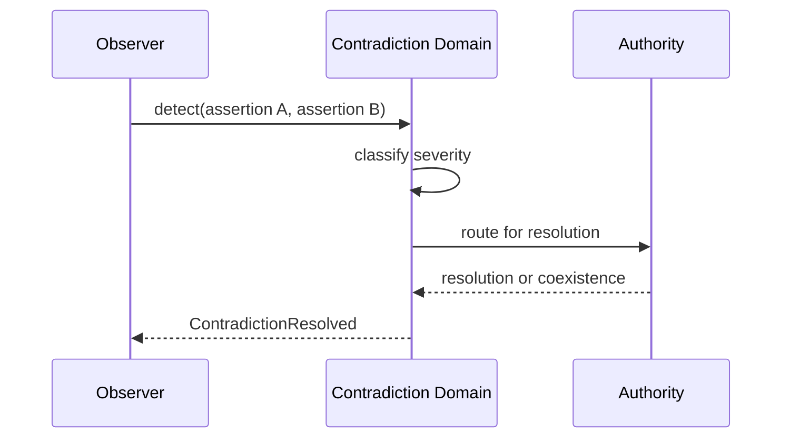

<a id="ucos-contr-000001-state-diagrams"></a>
##### State Diagrams

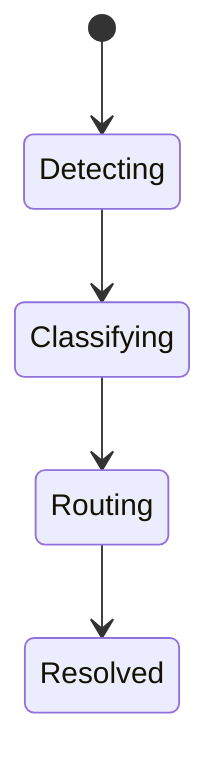

---

<a id="d-sim"></a>
### D-SIM · Simulation

| | |
|---|---|
| **Category** | C03 Reality and Reasoning |
| **Owns** | [Simulation](../UCOS-MASTER.md#t-simulation) |
| **Responsible for** | Future Modeling, Scenario Analysis, Prediction |
| **Not responsible for** | Reality Mutation, Policy Approval |
| **Contract** | [UCOS-SIM-000001 Simulation Architecture](#ucos-sim-000001) |
| **Artifacts** | [UCOS-SIM-000001](#ucos-sim-000001) |
| **Concepts** | 335 — `node _registry/compile.js --search <words> --kind concept --owner "Simulation"` |
| **Code** | — |
| **Managed in** | `_registry/domains.json` → `D-SIM` |

<a id="ucos-sim-000001"></a>
#### UCOS-SIM-000001 · Simulation Architecture

Owner [Simulation](#d-sim) · managed in `_registry/manifest.json` → `UCOS-SIM-000001`, content `_registry/content-core.json` → `SIM` · inherits the [standard contract](../UCOS-MASTER.md#standard-contract)

<a id="ucos-sim-000001-concepts"></a>
##### Concepts

Simulation is possible reality. Simulation ≠ Reality: it never mutates actual reality, never approves policy, and never spends money. Simulations are throwaway, reproducible, and clearly labeled.

<a id="ucos-sim-000001-ontology"></a>
##### Ontology

Simulation has a Model, input State, perturbations, and output Possibilities. Types: Pricing / Risk / Compliance / Expansion / Operational / Future Scenario / Economic — registry-driven.

<a id="ucos-sim-000001-taxonomy"></a>
##### Taxonomy

By horizon: Now / Near / Far. By fidelity: Order-of-magnitude / Approximate / High-fidelity. By purpose: Decision-support / Stress-test / Exploration.

<a id="ucos-sim-000001-data-model"></a>
##### Data Model

```yaml
Simulation:
  simulationId: <Identity>
  modelType: <registry id>
  inputState: <snapshot reference>
  perturbations: [<registry perturbation>]
  outputs: [Possibility]
  runs: <int>
  reproducible: <bool>
  temporal: {simulatedFrom, simulatedTo}
```

<a id="ucos-sim-000001-graph-model"></a>
##### Graph Model

(:Simulation)-[:MODELED_BY]->(:RegistryEntry); (:Simulation)-[:PERTURBS]->(:Context|:Policy); (:Simulation)-[:YIELDS]->(:Possibility); (:Simulation)-[:BASED_ON]->(:Knowledge|:Twin)

<a id="ucos-sim-000001-apis"></a>
##### APIs

- POST /simulation.v1.run
- GET  /simulation.v1/{id}
- POST /simulation.v1.compare
- GET  /simulation.v1/{id}/possibilities

<a id="ucos-sim-000001-events"></a>
##### Events

- SimulationStarted
- SimulationProgressed
- SimulationCompleted
- SimulationFailed
- PossibilityYielded

<a id="ucos-sim-000001-commands"></a>
##### Commands

- simulation.run
- simulation.cancel
- simulation.compare
- simulation.archive

<a id="ucos-sim-000001-queries"></a>
##### Queries

- simulation.byId
- simulation.possibilities
- simulation.byModel
- simulation.compare

<a id="ucos-sim-000001-state-machines"></a>
##### State Machines

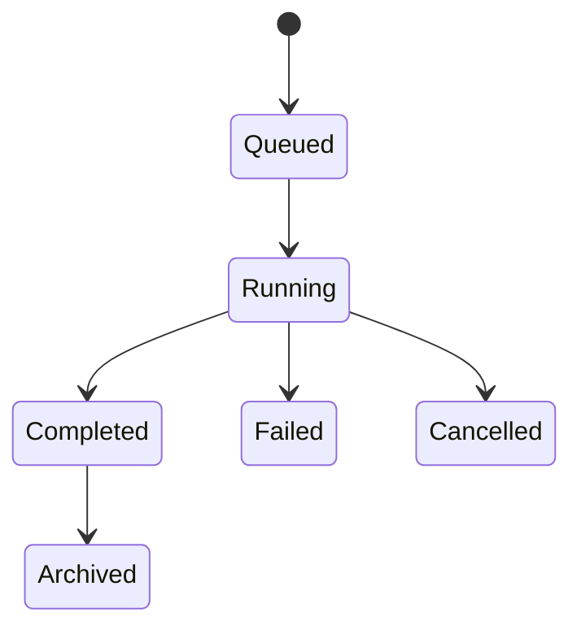

<a id="ucos-sim-000001-workflows"></a>
##### Workflows

- snapshot input state → select model → apply perturbations under budget → yield possibilities → label as simulated → archive

<a id="ucos-sim-000001-authorities"></a>
##### Authorities

- Simulation Authority (runs models); no authority to mutate reality — separation is constitutional.

<a id="ucos-sim-000001-permissions"></a>
##### Permissions

- simulation.run (simulation authority)
- simulation.read (context-scoped)

<a id="ucos-sim-000001-privacy-model"></a>
##### Privacy Model

Simulations over personal populations use synthetic or aggregated inputs; no individual-level personal simulation without consent.

<a id="ucos-sim-000001-audit-model"></a>
##### Audit Model

Every run records model version, inputs, perturbations, and resource cost. Outputs are watermarked as simulated in every projection.

<a id="ucos-sim-000001-digital-twin-model"></a>
##### Digital Twin Model

Twins provide the initial state for simulations; simulations never write back to twins — one-directional by law.

<a id="ucos-sim-000001-agent-model"></a>
##### Agent Model

Simulation Agent pre-runs scenarios for autonomous planning, governed by Agent Safety budgets.

<a id="ucos-sim-000001-runtime-model"></a>
##### Runtime Model

Runs in an isolated sandbox with compute/time budget enforcement; outputs are content-addressed and immutable.

<a id="ucos-sim-000001-scaling-model"></a>
##### Scaling Model

Embarrassingly parallel across perturbation grids; results cache by (model, input-hash, perturbation-hash).

<a id="ucos-sim-000001-multi-tenant-model"></a>
##### Multi-Tenant Model

Simulations never mix tenant states; cross-tenant scenarios require published relationship.

<a id="ucos-sim-000001-geo-distribution-model"></a>
##### Geo-Distribution Model

Heavy compute runs in the tenant's authorized regions; regulated data never leaves jurisdiction for simulation.

<a id="ucos-sim-000001-failure-model"></a>
##### Failure Model

Model divergence, budget exhaustion, non-convergence, input state staleness.

<a id="ucos-sim-000001-recovery-model"></a>
##### Recovery Model

Simulations are disposable; recovery is re-run. Archived results are content-addressed and self-verifying.

<a id="ucos-sim-000001-certification-model"></a>
##### Certification Model

Simulation must be reproducible, budget-bounded, reality-isolated, and clearly labeled in all outputs.

<a id="ucos-sim-000001-migration-model"></a>
##### Migration Model

New model types are registry additions; archived runs preserve their model version.

<a id="ucos-sim-000001-implementation-blueprint"></a>
##### Implementation Blueprint

Build order for SIM: (1) define registry entries — this domain owns by horizon: now / near / far as registry truth, not code; (2) implement the contract surface first (simulation.run, simulation.cancel, simulation.compare) and validate against SIM boundaries; (3) event-source all state so history is reconstructable; (4) wire the enforcement points — authority check, policy guard, evidence binding, trace — in-line, with no bypass path; (5) add tests per the Testing Architecture, citing evidence per gate; (6) obtain Verification and Certification before activation. Acceptance: the Zero Partial and Law 001 audits pass, every action answers the seven explainability questions, and this domain mutates no other domain internals.

<a id="ucos-sim-000001-sequence-diagrams"></a>
##### Sequence Diagrams

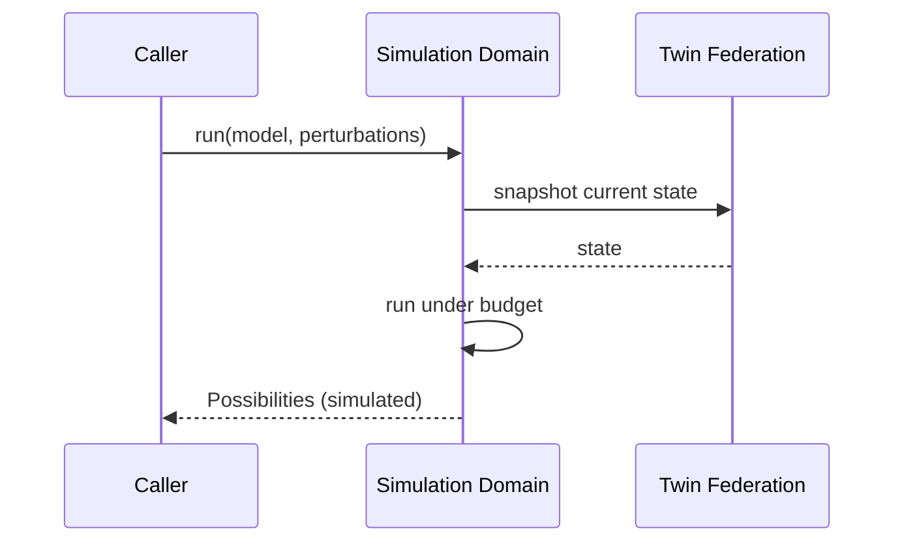

<a id="ucos-sim-000001-state-diagrams"></a>
##### State Diagrams

```mermaid
stateDiagram-v2
    [*] --> Snapshotting
    Snapshotting --> Modeling
    Modeling --> Yielding
    Yielding --> Archiving
```

---

<a id="d-cau"></a>
### D-CAU · Causality

| | |
|---|---|
| **Category** | C03 Reality and Reasoning |
| **Owns** | [Causality](../UCOS-MASTER.md#t-causality) |
| **Responsible for** | Cause/Effect Tracking, Impact Analysis, Consequence Modeling |
| **Not responsible for** | Relationship Storage, Decision |
| **Contract** | [UCOS-CAU-000001 Causality Architecture](#ucos-cau-000001) |
| **Artifacts** | [UCOS-CAU-000001](#ucos-cau-000001) |
| **Concepts** | 44 — `node _registry/compile.js --search <words> --kind concept --owner "Causality"` |
| **Code** | — |
| **Managed in** | `_registry/domains.json` → `D-CAU` |

<a id="ucos-cau-000001"></a>
#### UCOS-CAU-000001 · Causality Architecture

Owner [Causality](#d-cau) · managed in `_registry/manifest.json` → `UCOS-CAU-000001`, content `_registry/content-core.json` → `CAU` · inherits the [standard contract](../UCOS-MASTER.md#standard-contract)

<a id="ucos-cau-000001-concepts"></a>
##### Concepts

Causality is the reason one existence influences another. Causality ≠ Relationship: a link says 'connected'; causality says 'because'. Causal claims require intervention-grade evidence, not correlation.

<a id="ucos-cau-000001-ontology"></a>
##### Ontology

Causality has a Cause, an Effect, a Mechanism, and an Evidence grade. Claims are typed: Direct / Mediated / Contributory / Counterfactual.

<a id="ucos-cau-000001-taxonomy"></a>
##### Taxonomy

By strength: Proven (interventional) / Supported (observational + mechanism) / Hypothesized (correlational) / Refuted.

<a id="ucos-cau-000001-data-model"></a>
##### Data Model

```yaml
Causality:
  causalityId: <Identity>
  cause: <Identity|Event>
  effect: <Identity|Event>
  mechanism: <registry id>
  evidenceGrade: <Proven|Supported|Hypothesized|Refuted>
  evidence: [<Evidence>]
  confounders: [<Identity>]
  context: <Context>
  trust: <Trust>
```

<a id="ucos-cau-000001-graph-model"></a>
##### Graph Model

(:Cause)-[:CAUSES {mechanism, grade}]->(:Effect); (:Causality)-[:MEDIATED_BY]->(:Identity); (:Causality)-[:CONFOUNDED_BY]->(:Identity)

<a id="ucos-cau-000001-apis"></a>
##### APIs

- POST /causality.v1.assert
- GET  /causality.v1/{id}
- POST /causality.v1.explain
- GET  /causality.v1.impact/{id}

<a id="ucos-cau-000001-events"></a>
##### Events

- CausalityAsserted
- CausalityRefined
- CausalityRefuted
- ImpactAssessed

<a id="ucos-cau-000001-commands"></a>
##### Commands

- causality.assert
- causality.refine
- causality.refute
- causality.explain

<a id="ucos-cau-000001-queries"></a>
##### Queries

- causality.byId
- causality.effectsOf
- causality.causesOf
- causality.impact
- causality.byGrade

<a id="ucos-cau-000001-state-machines"></a>
##### State Machines

```mermaid
stateDiagram-v2
    [*] --> Hypothesized
    Hypothesized --> Supported: mechanism + obs evidence
    Supported --> Proven: interventional evidence
    Hypothesized --> Refuted
    Supported --> Refuted
    Proven --> Refined
```

<a id="ucos-cau-000001-workflows"></a>
##### Workflows

- observe correlation → propose mechanism → rule out confounders → upgrade on interventional evidence → publish grade

<a id="ucos-cau-000001-authorities"></a>
##### Authorities

- Causality Authority (asserts under evidence standards); interventional claims require elevated authority.

<a id="ucos-cau-000001-permissions"></a>
##### Permissions

- causality.assert (causality authority)
- causality.refute (peer authority)
- causality.read (context-scoped)

<a id="ucos-cau-000001-privacy-model"></a>
##### Privacy Model

Causal claims over persons require aggregated or consented evidence; individual-level causal claims are prohibited without consent.

<a id="ucos-cau-000001-audit-model"></a>
##### Audit Model

Every claim records evidence grade, confounders considered, and method. Correlational claims are never projected as causal.

<a id="ucos-cau-000001-digital-twin-model"></a>
##### Digital Twin Model

Causal models explain twin divergence and predict intervention outcomes on twins before reality is touched.

<a id="ucos-cau-000001-agent-model"></a>
##### Agent Model

Causality Agent continuously downgrades unsupported claims and flags spurious correlations for review.

<a id="ucos-cau-000001-runtime-model"></a>
##### Runtime Model

Graph traversal for impact analysis; confounder sets computed at assert time and rechecked on related Knowledge change.

<a id="ucos-cau-000001-scaling-model"></a>
##### Scaling Model

Causal graphs are partitioned by subject; impact queries are bounded by policy depth.

<a id="ucos-cau-000001-multi-tenant-model"></a>
##### Multi-Tenant Model

Causal claims never cross tenant boundaries without published relationship.

<a id="ucos-cau-000001-geo-distribution-model"></a>
##### Geo-Distribution Model

Evidence standards are jurisdiction-aware; a claim Proven under one regime may be Supported elsewhere — both recorded.

<a id="ucos-cau-000001-failure-model"></a>
##### Failure Model

Confounder omission, grade inflation, mechanism invalidation, cyclic causal claims.

<a id="ucos-cau-000001-recovery-model"></a>
##### Recovery Model

Claims are versioned; refutation supersedes rather than deletes, preserving the history of what was believed and why.

<a id="ucos-cau-000001-certification-model"></a>
##### Certification Model

Claim must pass mechanism validity, confounder enumeration, evidence-grade honesty, and acyclicity.

<a id="ucos-cau-000001-migration-model"></a>
##### Migration Model

New mechanisms are registry additions; existing claims re-grade on mechanism version change.

<a id="ucos-cau-000001-implementation-blueprint"></a>
##### Implementation Blueprint

Build order for CAU: (1) define registry entries — this domain owns by strength: proven (interventional) / supported (observational + mechanism) / hypothesized (correlational) / refuted as registry truth, not code; (2) implement the contract surface first (causality.assert, causality.refine, causality.refute) and validate against CAU boundaries; (3) event-source all state so history is reconstructable; (4) wire the enforcement points — authority check, policy guard, evidence binding, trace — in-line, with no bypass path; (5) add tests per the Testing Architecture, citing evidence per gate; (6) obtain Verification and Certification before activation. Acceptance: the Zero Partial and Law 001 audits pass, every action answers the seven explainability questions, and this domain mutates no other domain internals.

<a id="ucos-cau-000001-sequence-diagrams"></a>
##### Sequence Diagrams

```mermaid
sequenceDiagram
    participant A as Asserter
    participant CA as Causality Domain
    participant EV as Evidence
    A->>CA: assert(cause, effect, mechanism)
    CA->>EV: gather + grade evidence
    EV-->>CA: grade
    CA->>CA: enumerate confounders
    CA-->>A: CausalityAsserted
```

<a id="ucos-cau-000001-state-diagrams"></a>
##### State Diagrams

```mermaid
stateDiagram-v2
    [*] --> Correlating
    Correlating --> Mechanizing
    Mechanizing --> Confounding
    Confounding --> Grading
```

---

<a id="d-per"></a>
### D-PER · Perspective

| | |
|---|---|
| **Category** | C03 Reality and Reasoning |
| **Owns** | [Perspective](../UCOS-MASTER.md#t-perspective) |
| **Responsible for** | Observer Interpretation, Viewpoint Resolution |
| **Not responsible for** | Context, Policy |
| **Contract** | [UCOS-PER-000001 Perspective Architecture](#ucos-per-000001) |
| **Artifacts** | [UCOS-PER-000001](#ucos-per-000001) |
| **Concepts** | 94 — `node _registry/compile.js --search <words> --kind concept --owner "Perspective"` |
| **Code** | — |
| **Managed in** | `_registry/domains.json` → `D-PER` |

<a id="ucos-per-000001"></a>
#### UCOS-PER-000001 · Perspective Architecture

Owner [Perspective](#d-per) · managed in `_registry/manifest.json` → `UCOS-PER-000001`, content `_registry/content-ext.json` → `PER` · inherits the [standard contract](../UCOS-MASTER.md#standard-contract)

<a id="ucos-per-000001-concepts"></a>
##### Concepts

Perspective is observer-specific interpretation. Perspective ≠ Context: context is the applicability boundary; perspective is who is looking. The same object projects differently to customer, merchant, partner, supplier, regulator, auditor, agent, and AI.

<a id="ucos-per-000001-ontology"></a>
##### Ontology

Perspective has an Observer (Identity or Authority), a subject, and a projection policy. Perspectives never change the subject's truth — only its presentation.

<a id="ucos-per-000001-taxonomy"></a>
##### Taxonomy

By observer class: Human-role / Organizational / Regulatory / Automated-agent / AI. By fidelity: Full / Filtered / Redacted.

<a id="ucos-per-000001-data-model"></a>
##### Data Model

```yaml
Perspective:
  perspectiveId: <Identity>
  observer: <Identity|Authority>
  subject: <Identity>
  projectionPolicy: <Policy>
  redactionPolicy: <Policy>
  context: <Context>
  asOf: <Time>
```

<a id="ucos-per-000001-graph-model"></a>
##### Graph Model

(:Perspective)-[:OBSERVED_BY]->(:Identity); (:Perspective)-[:PROJECTS]->(:Identity); (:Perspective)-[:FILTERED_BY]->(:Policy); (:Perspective)-[:SCOPED_IN]->(:Context)

<a id="ucos-per-000001-apis"></a>
##### APIs

- POST /perspective.v1.project
- GET  /perspective.v1/{id}
- GET  /perspective.v1.byObserver/{observerId}

<a id="ucos-per-000001-events"></a>
##### Events

- PerspectiveProjected
- PerspectiveRedacted
- PerspectiveInvalidated

<a id="ucos-per-000001-commands"></a>
##### Commands

- perspective.project
- perspective.redact
- perspective.register
- perspective.invalidate

<a id="ucos-per-000001-queries"></a>
##### Queries

- perspective.byObserver
- perspective.bySubject
- perspective.diff

<a id="ucos-per-000001-state-machines"></a>
##### State Machines

```mermaid
stateDiagram-v2
    [*] --> Registered
    Registered --> Projected
    Projected --> Invalidated
    Invalidated --> [*]
```

<a id="ucos-per-000001-workflows"></a>
##### Workflows

- identify observer → resolve policy set → project subject → apply redaction → serve

<a id="ucos-per-000001-authorities"></a>
##### Authorities

- Observer's Authority governs what it may see; the subject's Authority governs what may be shown.

<a id="ucos-per-000001-permissions"></a>
##### Permissions

- perspective.project (observer with read grant)
- perspective.redact (subject authority)

<a id="ucos-per-000001-privacy-model"></a>
##### Privacy Model

Perspective is the primary privacy control surface: data minimization and redaction are projection-time, not afterthoughts.

<a id="ucos-per-000001-audit-model"></a>
##### Audit Model

Every projection records observer, subject, policies applied, and fields redacted — the basis of disclosure audit.

<a id="ucos-per-000001-digital-twin-model"></a>
##### Digital Twin Model

Perspective drives per-observer twin views — one underlying twin, many safe projections.

<a id="ucos-per-000001-agent-model"></a>
##### Agent Model

Perspective Agent verifies that no projection leaks beyond its policy — an ongoing compliance check.

<a id="ucos-per-000001-runtime-model"></a>
##### Runtime Model

Projection is computed per request from policy; results are short-TTL cached keyed by (observer, subject, policy-version).

<a id="ucos-per-000001-scaling-model"></a>
##### Scaling Model

Read-heavy; policy evaluation is the hot path and is compiled per policy version.

<a id="ucos-per-000001-multi-tenant-model"></a>
##### Multi-Tenant Model

Cross-tenant perspective is denied absent explicit published relationship and policy.

<a id="ucos-per-000001-geo-distribution-model"></a>
##### Geo-Distribution Model

Observer jurisdiction policy applies at projection time — a regulator's perspective in one region is not valid in another.

<a id="ucos-per-000001-failure-model"></a>
##### Failure Model

Policy conflict between observer grant and subject redaction, stale policy version, projection timeout.

<a id="ucos-per-000001-recovery-model"></a>
##### Recovery Model

Projections are recomputable; policy versioning guarantees deterministic re-projection.

<a id="ucos-per-000001-certification-model"></a>
##### Certification Model

Perspective must pass both observer-grant and subject-redaction policy with no unresolved conflict.

<a id="ucos-per-000001-migration-model"></a>
##### Migration Model

New observer classes are registry additions; projections re-derive on policy change.

<a id="ucos-per-000001-implementation-blueprint"></a>
##### Implementation Blueprint

Build order for PER: (1) define registry entries — this domain owns by observer class: human-role / organizational / regulatory / automated-agent / ai as registry truth, not code; (2) implement the contract surface first (perspective.project, perspective.redact, perspective.register) and validate against PER boundaries; (3) event-source all state so history is reconstructable; (4) wire the enforcement points — authority check, policy guard, evidence binding, trace — in-line, with no bypass path; (5) add tests per the Testing Architecture, citing evidence per gate; (6) obtain Verification and Certification before activation. Acceptance: the Zero Partial and Law 001 audits pass, every action answers the seven explainability questions, and this domain mutates no other domain internals.

<a id="ucos-per-000001-sequence-diagrams"></a>
##### Sequence Diagrams

```mermaid
sequenceDiagram
    participant O as Observer
    participant PE as Perspective Domain
    participant PL as Policy
    O->>PE: project(subject)
    PE->>PL: observer grant + subject redaction
    PL-->>PE: effective policy
    PE->>PE: project + redact
    PE-->>O: filtered view
```

<a id="ucos-per-000001-state-diagrams"></a>
##### State Diagrams

```mermaid
stateDiagram-v2
    [*] --> Identifying
    Identifying --> PolicyResolving
    PolicyResolving --> Projecting
    Projecting --> Serving
```

---

<a id="d-pos"></a>
### D-POS · Possibility

| | |
|---|---|
| **Category** | C03 Reality and Reasoning |
| **Owns** | [Possibility](../UCOS-MASTER.md#t-possibility) |
| **Responsible for** | Realizable Futures, Multi-Reality |
| **Not responsible for** | Reality Mutation, Decision |
| **Contract** | [UCOS-POSS-000001 Possibility Architecture](#ucos-poss-000001) |
| **Artifacts** | [UCOS-REA-000001](#ucos-rea-000001), [UCOS-POSS-000001](#ucos-poss-000001) |
| **Concepts** | 50 — `node _registry/compile.js --search <words> --kind concept --owner "Possibility"` |
| **Code** | — |
| **Managed in** | `_registry/domains.json` → `D-POS` |

<a id="ucos-rea-000001"></a>
#### UCOS-REA-000001 · Multi-Reality Architecture

Owner [Possibility](#d-pos) · managed in `_registry/manifest.json` → `UCOS-REA-000001`, content `_registry/content-ext.json` → `REA` · inherits the [standard contract](../UCOS-MASTER.md#standard-contract)

<a id="ucos-rea-000001-concepts"></a>
##### Concepts

The platform supports simultaneous, mutually disagreeing realities that all remain valid within their Context. Physical, Digital, Commercial, Financial, Operational, Legal, Regulatory, Customer, Partner, AI, Predicted, Future, Simulated — each a first-class reality.

<a id="ucos-rea-000001-ontology"></a>
##### Ontology

Reality is a Context-scoped projection of primitives. Two realities may contradict and both be valid; resolution is governed, never automatic except by policy.

<a id="ucos-rea-000001-taxonomy"></a>
##### Taxonomy

By actuality: Actual (physical) / Constructed (commercial, legal) / Projected (predicted, simulated) / Consensual (financial). By persistence: Persistent / Ephemeral.

<a id="ucos-rea-000001-data-model"></a>
##### Data Model

```yaml
Reality:
  realityId: <Identity>
  realityType: <registry id>
  context: <Context>
  subjects: [<Identity>]
  authority: <Authority>
  contradictionPolicy: <Policy>
  temporal: {asOf}
```

<a id="ucos-rea-000001-graph-model"></a>
##### Graph Model

(:Reality)-[:PROJECTS]->(:Existence); (:Reality)-[:CONTRADICTS]->(:Reality); (:Reality)-[:AUTHORED_BY]->(:Authority); (:Reality)-[:SCOPED_IN]->(:Context)

<a id="ucos-rea-000001-apis"></a>
##### APIs

- POST /reality.v1.project
- GET  /reality.v1/{id}
- GET  /reality.v1.bySubject/{subjectId}
- POST /reality.v1.contradict

<a id="ucos-rea-000001-events"></a>
##### Events

- RealityProjected
- RealityContradicted
- RealityReconciled
- RealityForked

<a id="ucos-rea-000001-commands"></a>
##### Commands

- reality.project
- reality.contradict
- reality.reconcile
- reality.fork

<a id="ucos-rea-000001-queries"></a>
##### Queries

- reality.bySubject
- reality.contradictions
- reality.byType
- reality.asOf

<a id="ucos-rea-000001-state-machines"></a>
##### State Machines

```mermaid
stateDiagram-v2
    [*] --> Projected
    Projected --> Contradicted
    Contradicted --> Reconciled
    Contradicted --> Coexisting: policy allows
    Reconciled --> [*]
```

<a id="ucos-rea-000001-workflows"></a>
##### Workflows

- project primitives into reality type → bind context → detect contradictions → apply contradiction policy → coexist or reconcile

<a id="ucos-rea-000001-authorities"></a>
##### Authorities

- Reality Authority (reconciliation); each reality's authority governs its own projection.

<a id="ucos-rea-000001-permissions"></a>
##### Permissions

- reality.project (reality authority)
- reality.reconcile (reality authority)
- reality.read (context-scoped)

<a id="ucos-rea-000001-privacy-model"></a>
##### Privacy Model

Realities containing personal data inherit the strictest applicable consent scope across all contributing contexts.

<a id="ucos-rea-000001-audit-model"></a>
##### Audit Model

Every contradiction records both realities, their authorities, and the policy that decided the outcome.

<a id="ucos-rea-000001-digital-twin-model"></a>
##### Digital Twin Model

Each reality type can host its own twin fleet — a subject may have distinct twins per reality.

<a id="ucos-rea-000001-agent-model"></a>
##### Agent Model

Reality Agent detects cross-reality drift and proposes reconciliation candidates under governance.

<a id="ucos-rea-000001-runtime-model"></a>
##### Runtime Model

Projection is computed per (subject, realityType, context) and cached; contradiction detection is a stream job.

<a id="ucos-rea-000001-scaling-model"></a>
##### Scaling Model

Projections are lazily computed and cached by hash; hot subjects are pre-projected.

<a id="ucos-rea-000001-multi-tenant-model"></a>
##### Multi-Tenant Model

Tenant realities are isolated; shared realities (e.g., legal) are read-only projections of authoritative domains.

<a id="ucos-rea-000001-geo-distribution-model"></a>
##### Geo-Distribution Model

Realities are jurisdiction-scoped; the same subject may have legally distinct realities per region — all valid.

<a id="ucos-rea-000001-failure-model"></a>
##### Failure Model

Contradiction deadlock, projection staleness, authority conflict, fork divergence.

<a id="ucos-rea-000001-recovery-model"></a>
##### Recovery Model

Projections are recomputable from primitives — reality is never backed up, it is re-derived.

<a id="ucos-rea-000001-certification-model"></a>
##### Certification Model

Reality must pass context binding, authority validity, and contradiction-policy compliance.

<a id="ucos-rea-000001-migration-model"></a>
##### Migration Model

New reality types are registry additions; existing projections re-derive on type change.

<a id="ucos-rea-000001-implementation-blueprint"></a>
##### Implementation Blueprint

Build order for REA: (1) define registry entries — this domain owns by actuality: actual (physical) / constructed (commercial, legal) / projected (predicted, simulated) / consensual (financial) as registry truth, not code; (2) implement the contract surface first (reality.project, reality.contradict, reality.reconcile) and validate against REA boundaries; (3) event-source all state so history is reconstructable; (4) wire the enforcement points — authority check, policy guard, evidence binding, trace — in-line, with no bypass path; (5) add tests per the Testing Architecture, citing evidence per gate; (6) obtain Verification and Certification before activation. Acceptance: the Zero Partial and Law 001 audits pass, every action answers the seven explainability questions, and this domain mutates no other domain internals.

<a id="ucos-rea-000001-sequence-diagrams"></a>
##### Sequence Diagrams

```mermaid
sequenceDiagram
    participant C as Caller
    participant RE as Reality Domain
    participant CT as Context
    C->>RE: project(subject, realityType)
    RE->>CT: resolve scope
    CT-->>RE: context
    RE->>RE: derive projection
    RE-->>C: RealityProjected
```

<a id="ucos-rea-000001-state-diagrams"></a>
##### State Diagrams

```mermaid
stateDiagram-v2
    [*] --> Scoping
    Scoping --> Deriving
    Deriving --> ContradictionCheck
    ContradictionCheck --> Published
```

<a id="ucos-poss-000001"></a>
#### UCOS-POSS-000001 · Possibility Architecture

Owner [Possibility](#d-pos) · managed in `_registry/manifest.json` → `UCOS-POSS-000001`, content `_registry/content-ext.json` → `POSS` · inherits the [standard contract](../UCOS-MASTER.md#standard-contract)

<a id="ucos-poss-000001-concepts"></a>
##### Concepts

Possibility is a realizable future state. Possibility ≠ Simulation (the method) and ≠ Reality (the present). Possibilities are the outputs of simulations and the inputs to planning.

<a id="ucos-poss-000001-ontology"></a>
##### Ontology

Possibility has an origin (Simulation or Reasoning), a subject, a plausibility, and preconditions. Possibilities never claim truth — they claim realizability under conditions.

<a id="ucos-poss-000001-taxonomy"></a>
##### Taxonomy

By horizon: Immediate / Near / Far. By plausibility: Likely / Possible / Unlikely / Speculative. By desirability: Desired / Neutral / Adverse.

<a id="ucos-poss-000001-data-model"></a>
##### Data Model

```yaml
Possibility:
  possibilityId: <Identity>
  subject: <Identity>
  origin: <Simulation|Reasoning>
  preconditions: [<registry expression>]
  plausibility: <0..1>
  desirability: <Desired|Neutral|Adverse>
  temporal: {earliestRealization}
  context: <Context>
```

<a id="ucos-poss-000001-graph-model"></a>
##### Graph Model

(:Possibility)-[:YIELDED_BY]->(:Simulation); (:Possibility)-[:PRECONDITION]->(:Knowledge|:State); (:Possibility)-[:CONCERNS]->(:Identity); (:Possibility)-[:PLANNED_IN]->(:Context)

<a id="ucos-poss-000001-apis"></a>
##### APIs

- POST /possibility.v1.register
- GET  /possibility.v1/{id}
- GET  /possibility.v1.bySubject/{subjectId}
- POST /possibility.v1.evaluate

<a id="ucos-poss-000001-events"></a>
##### Events

- PossibilityRegistered
- PossibilityEvaluated
- PossibilityRealized
- PossibilityDismissed

<a id="ucos-poss-000001-commands"></a>
##### Commands

- possibility.register
- possibility.evaluate
- possibility.realize
- possibility.dismiss

<a id="ucos-poss-000001-queries"></a>
##### Queries

- possibility.bySubject
- possibility.plausible
- possibility.adverse
- possibility.byHorizon

<a id="ucos-poss-000001-state-machines"></a>
##### State Machines

```mermaid
stateDiagram-v2
    [*] --> Registered
    Registered --> Evaluated
    Evaluated --> Realized: preconditions met + decision
    Evaluated --> Dismissed
    Realized --> [*]
```

<a id="ucos-poss-000001-workflows"></a>
##### Workflows

- register from simulation → evaluate plausibility against current state → decide → realize or dismiss with rationale

<a id="ucos-poss-000001-authorities"></a>
##### Authorities

- Planning Authority (evaluation); realization requires the acting domain's authority.

<a id="ucos-poss-000001-permissions"></a>
##### Permissions

- possibility.register (simulation/reasoning authority)
- possibility.evaluate (planning authority)
- possibility.read (context-scoped)

<a id="ucos-poss-000001-privacy-model"></a>
##### Privacy Model

Possibilities about individuals require aggregated or consented inputs; speculative personal futures are prohibited.

<a id="ucos-poss-000001-audit-model"></a>
##### Audit Model

Every possibility records origin, preconditions, and evaluation rationale. Realization links to the Decision that authorized it.

<a id="ucos-poss-000001-digital-twin-model"></a>
##### Digital Twin Model

Possibilities are the forward-looking twin state — what the twin could become, kept strictly separate from what it is.

<a id="ucos-poss-000001-agent-model"></a>
##### Agent Model

Possibility Agent ranks possibilities for planning agents and flags adverse ones for risk review.

<a id="ucos-poss-000001-runtime-model"></a>
##### Runtime Model

Evaluation is a precondition check against current state; registered lazily, cached by origin hash.

<a id="ucos-poss-000001-scaling-model"></a>
##### Scaling Model

Possibilities are numerous and low-cost; storage is time-bucketed with policy-driven pruning.

<a id="ucos-poss-000001-multi-tenant-model"></a>
##### Multi-Tenant Model

Possibilities never cross tenants; shared possibilities require published relationship.

<a id="ucos-poss-000001-geo-distribution-model"></a>
##### Geo-Distribution Model

Evaluation is jurisdiction-scoped — a possibility legal in one region may be adverse in another.

<a id="ucos-poss-000001-failure-model"></a>
##### Failure Model

Precondition staleness, plausibility inflation, unbounded possibility accumulation.

<a id="ucos-poss-000001-recovery-model"></a>
##### Recovery Model

Possibilities are disposable; dismissal is reversible while preconditions still hold.

<a id="ucos-poss-000001-certification-model"></a>
##### Certification Model

Possibility must declare origin, preconditions, and plausibility to inform any plan.

<a id="ucos-poss-000001-migration-model"></a>
##### Migration Model

New horizons and desirability classes are registry additions.

<a id="ucos-poss-000001-implementation-blueprint"></a>
##### Implementation Blueprint

Build order for POSS: (1) define registry entries — this domain owns by horizon: immediate / near / far as registry truth, not code; (2) implement the contract surface first (possibility.register, possibility.evaluate, possibility.realize) and validate against POSS boundaries; (3) event-source all state so history is reconstructable; (4) wire the enforcement points — authority check, policy guard, evidence binding, trace — in-line, with no bypass path; (5) add tests per the Testing Architecture, citing evidence per gate; (6) obtain Verification and Certification before activation. Acceptance: the Zero Partial and Law 001 audits pass, every action answers the seven explainability questions, and this domain mutates no other domain internals.

<a id="ucos-poss-000001-sequence-diagrams"></a>
##### Sequence Diagrams

```mermaid
sequenceDiagram
    participant SI as Simulation
    participant PO as Possibility Domain
    participant PL as Planner
    SI->>PO: register(future state)
    PO->>PO: evaluate preconditions
    PL->>PO: request candidates
    PO-->>PL: ranked possibilities
```

<a id="ucos-poss-000001-state-diagrams"></a>
##### State Diagrams

```mermaid
stateDiagram-v2
    [*] --> Registering
    Registering --> Evaluating
    Evaluating --> Ranking
    Ranking --> Deciding
```

---

<a id="d-evo"></a>
### D-EVO · Evolution

| | |
|---|---|
| **Category** | C03 Reality and Reasoning |
| **Owns** | [Evolution](../UCOS-MASTER.md#t-evolution), [Emergence](../UCOS-MASTER.md#t-emergence) |
| **Responsible for** | Governed Change, History Preservation, Emergence Detection |
| **Not responsible for** | Runtime Execution |
| **Contract** | [UCOS-EVO-000001 Evolution Architecture](#ucos-evo-000001) |
| **Artifacts** | [UCOS-EVO-000001](#ucos-evo-000001), [UCOS-EMG-000001](#ucos-emg-000001) |
| **Concepts** | 453 — `node _registry/compile.js --search <words> --kind concept --owner "Evolution"` |
| **Code** | `lib/governance.js` |
| **Managed in** | `_registry/domains.json` → `D-EVO` |

<a id="ucos-evo-000001"></a>
#### UCOS-EVO-000001 · Evolution Architecture

Owner [Evolution](#d-evo) · managed in `_registry/manifest.json` → `UCOS-EVO-000001`, content `_registry/content-core.json` → `EVO` · inherits the [standard contract](../UCOS-MASTER.md#standard-contract)

<a id="ucos-evo-000001-concepts"></a>
##### Concepts

Evolution is governed change over time that preserves history. Nothing evolves without governance; nothing that evolved is forgotten. Evolution covers Ontology, Schema, Policy, Capability, Workflow, API, Agent, and Knowledge evolution.

<a id="ucos-evo-000001-ontology"></a>
##### Ontology

Evolution has a Subject, a Change, a Rationale, an Authority, and a preserved History. Emergence is evolution's un-planned cousin: properties arising from interaction that were not present in the parts.

<a id="ucos-evo-000001-taxonomy"></a>
##### Taxonomy

By intent: Planned / Emergent. By impact: Additive / Breaking / Deprecated-path. By scope: Primitive-level (constitution only) / Registry-level / Projection-level.

<a id="ucos-evo-000001-data-model"></a>
##### Data Model

```yaml
Evolution:
  evolutionId: <Identity>
  subject: <Identity>
  changeType: <registry id>
  from: <prior version ref>
  to: <new version ref>
  rationale: <Knowledge>
  authority: <Authority>
  temporal: {effectiveAt}
  supersession: {priorVersions: [...], historyPreserved: true}
```

<a id="ucos-evo-000001-graph-model"></a>
##### Graph Model

(:Evolution)-[:EVOLVES]->(:Identity); (:Evolution)-[:SUPERSEDES_VERSION]->(:Evolution); (:Evolution)-[:DRIVES]->(:Emergence); (:Evolution)-[:APPROVED_BY]->(:Authority)

<a id="ucos-evo-000001-apis"></a>
##### APIs

- POST /evolution.v1.propose
- POST /evolution.v1.approve
- GET  /evolution.v1/{id}
- GET  /evolution.v1.history/{subjectId}

<a id="ucos-evo-000001-events"></a>
##### Events

- EvolutionProposed
- EvolutionApproved
- EvolutionActivated
- EvolutionRolledBack
- EmergenceDetected
- EmergenceRecorded

<a id="ucos-evo-000001-commands"></a>
##### Commands

- evolution.propose
- evolution.approve
- evolution.activate
- evolution.rollback
- emergence.record

<a id="ucos-evo-000001-queries"></a>
##### Queries

- evolution.history
- evolution.pending
- evolution.bySubject
- emergence.detected
- evolution.impact

<a id="ucos-evo-000001-state-machines"></a>
##### State Machines

```mermaid
stateDiagram-v2
    [*] --> Proposed
    Proposed --> Approved
    Approved --> Activated
    Activated --> RolledBack
    Activated --> [*]
    RolledBack --> [*]
```

<a id="ucos-evo-000001-workflows"></a>
##### Workflows

- propose with rationale → impact analysis → approve by authority → activate with prior version preserved → publish → monitor emergence

<a id="ucos-evo-000001-authorities"></a>
##### Authorities

- Evolution Authority (registry-level); Constitutional Assembly (primitive-level only)

<a id="ucos-evo-000001-permissions"></a>
##### Permissions

- evolution.propose (any authority)
- evolution.approve (subject's owning authority)
- evolution.rollback (approving authority)

<a id="ucos-evo-000001-privacy-model"></a>
##### Privacy Model

Evolution of privacy-relevant subjects triggers consent re-evaluation; changes cannot silently widen data use.

<a id="ucos-evo-000001-audit-model"></a>
##### Audit Model

Every change records rationale, authority, impact, and prior state. History is never rewritten — only superseded.

<a id="ucos-evo-000001-digital-twin-model"></a>
##### Digital Twin Model

Evolution drives twin model versioning; a twin's history is as valuable as its current state.

<a id="ucos-evo-000001-agent-model"></a>
##### Agent Model

Evolution Agent proposes changes from observed drift; Emergence Agent detects system-level properties for governance review.

<a id="ucos-evo-000001-runtime-model"></a>
##### Runtime Model

Version resolution prefers latest activated; historical queries time-travel via the version chain.

<a id="ucos-evo-000001-scaling-model"></a>
##### Scaling Model

Version chains are append-only and shard by subject; time-travel queries are bounded by retention policy.

<a id="ucos-evo-000001-multi-tenant-model"></a>
##### Multi-Tenant Model

Tenant-level evolution cannot alter shared ontology; shared changes go through the Evolution Authority.

<a id="ucos-evo-000001-geo-distribution-model"></a>
##### Geo-Distribution Model

Evolution activation is jurisdiction-aware; a change legal in one region rolls out per regional policy.

<a id="ucos-evo-000001-failure-model"></a>
##### Failure Model

Breaking change without deprecation, orphaned version chain, emergence runaway, rollback failure.

<a id="ucos-evo-000001-recovery-model"></a>
##### Recovery Model

Rollback is a first-class command that activates the prior version — never a data restore. History remains intact either way.

<a id="ucos-evo-000001-certification-model"></a>
##### Certification Model

Evolution must pass impact analysis, deprecation path (for breaking changes), authority jurisdiction, and history preservation.

<a id="ucos-evo-000001-migration-model"></a>
##### Migration Model

Migration IS evolution — there is no separate migration path. All changes flow through this domain.

<a id="ucos-evo-000001-implementation-blueprint"></a>
##### Implementation Blueprint

Build order for EVO: (1) define registry entries — this domain owns by intent: planned / emergent as registry truth, not code; (2) implement the contract surface first (evolution.propose, evolution.approve, evolution.activate) and validate against EVO boundaries; (3) event-source all state so history is reconstructable; (4) wire the enforcement points — authority check, policy guard, evidence binding, trace — in-line, with no bypass path; (5) add tests per the Testing Architecture, citing evidence per gate; (6) obtain Verification and Certification before activation. Acceptance: the Zero Partial and Law 001 audits pass, every action answers the seven explainability questions, and this domain mutates no other domain internals.

<a id="ucos-evo-000001-sequence-diagrams"></a>
##### Sequence Diagrams

```mermaid
sequenceDiagram
    participant P as Proposer
    participant EV as Evolution Domain
    participant AU as Authority
    P->>EV: propose(change, rationale)
    EV->>EV: impact analysis
    EV->>AU: approve
    AU-->>EV: approved
    EV->>EV: activate (history preserved)
    EV-->>P: EvolutionActivated
```

<a id="ucos-evo-000001-state-diagrams"></a>
##### State Diagrams

```mermaid
stateDiagram-v2
    [*] --> Impacting
    Impacting --> Approving
    Approving --> Activating
    Activating --> Monitoring
```

<a id="ucos-emg-000001"></a>
#### UCOS-EMG-000001 · Emergence Architecture

Owner [Evolution](#d-evo) · managed in `_registry/manifest.json` → `UCOS-EMG-000001`, content `_registry/content-ext.json` → `EMG` · inherits the [standard contract](../UCOS-MASTER.md#standard-contract)

<a id="ucos-emg-000001-concepts"></a>
##### Concepts

Emergence is a property of the whole that is absent from the parts. It is not designed; it is detected. The constitution does not suppress emergence — it governs it.

<a id="ucos-emg-000001-ontology"></a>
##### Ontology

Emergence has a System (a set of relationships), an EmergedProperty, a detection method, and a review state. Emergence is evidence that the system has exceeded the sum of its parts.

<a id="ucos-emg-000001-taxonomy"></a>
##### Taxonomy

By kind: Behavioral / Structural / Semantic / Economic / Social. By valence: Beneficial / Neutral / Adverse / Hazardous. By stability: Transient / Persistent.

<a id="ucos-emg-000001-data-model"></a>
##### Data Model

```yaml
Emergence:
  emergenceId: <Identity>
  system: [<Identity>]
  emergedProperty: <registry id>
  detectionMethod: <registry id>
  evidence: [<Evidence>]
  valence: <Beneficial|Neutral|Adverse|Hazardous>
  stability: <Transient|Persistent>
  reviewState: <Detected|UnderReview|Governing|Governed>
```

<a id="ucos-emg-000001-graph-model"></a>
##### Graph Model

(:Emergence)-[:ARISES_FROM]->(:Relationship); (:Emergence)-[:DETECTED_BY]->(:Observation|:Agent); (:Emergence)-[:GOVERNED_BY]->(:Policy)

<a id="ucos-emg-000001-apis"></a>
##### APIs

- POST /emergence.v1.report
- GET  /emergence.v1/{id}
- GET  /emergence.v1.open
- POST /emergence.v1.govern

<a id="ucos-emg-000001-events"></a>
##### Events

- EmergenceDetected
- EmergenceUnderReview
- EmergenceGoverned
- EmergenceEscalated

<a id="ucos-emg-000001-commands"></a>
##### Commands

- emergence.report
- emergence.review
- emergence.govern
- emergence.escalate

<a id="ucos-emg-000001-queries"></a>
##### Queries

- emergence.open
- emergence.byValence
- emergence.bySystem
- emergence.persistent

<a id="ucos-emg-000001-state-machines"></a>
##### State Machines

```mermaid
stateDiagram-v2
    [*] --> Detected
    Detected --> UnderReview
    UnderReview --> Governed
    UnderReview --> Escalated
    Escalated --> Governed
```

<a id="ucos-emg-000001-workflows"></a>
##### Workflows

- detect via observation/agent → classify valence → review → govern (adopt, counter, or monitor) → record

<a id="ucos-emg-000001-authorities"></a>
##### Authorities

- Governance Authority (adverse/hazardous); any authority may report.

<a id="ucos-emg-000001-permissions"></a>
##### Permissions

- emergence.report (any authority)
- emergence.govern (governance authority)
- emergence.read (context-scoped)

<a id="ucos-emg-000001-privacy-model"></a>
##### Privacy Model

Emergent properties over personal populations are aggregated; no individual inference without consent.

<a id="ucos-emg-000001-audit-model"></a>
##### Audit Model

Every emergent property records the system that produced it, the evidence, and the governance decision.

<a id="ucos-emg-000001-digital-twin-model"></a>
##### Digital Twin Model

Emergence is how twin fleets exhibit fleet-level behavior no single twin shows — monitored across the federation.

<a id="ucos-emg-000001-agent-model"></a>
##### Agent Model

Emergence Agent is the primary detector, watching relationship graphs for properties not present in any node.

<a id="ucos-emg-000001-runtime-model"></a>
##### Runtime Model

Detection is a batch/stream analytics job; review is governance-gated.

<a id="ucos-emg-000001-scaling-model"></a>
##### Scaling Model

Detection scales with relationship volume; results are time-windowed.

<a id="ucos-emg-000001-multi-tenant-model"></a>
##### Multi-Tenant Model

Emergence is detected within a tenant's system; cross-tenant emergence requires federation-level review.

<a id="ucos-emg-000001-geo-distribution-model"></a>
##### Geo-Distribution Model

Emergent behavior crossing jurisdictions triggers review in every affected region.

<a id="ucos-emg-000001-failure-model"></a>
##### Failure Model

Detection lag, false-positive flood, hazardous emergence under-governed.

<a id="ucos-emg-000001-recovery-model"></a>
##### Recovery Model

Emergence records are permanent evidence; adverse emergence is countered by policy, not deleted.

<a id="ucos-emg-000001-certification-model"></a>
##### Certification Model

System must demonstrate an emergence review path for any hazardous classification.

<a id="ucos-emg-000001-migration-model"></a>
##### Migration Model

New property kinds and valences are registry additions.

<a id="ucos-emg-000001-implementation-blueprint"></a>
##### Implementation Blueprint

Build order for EMG: (1) define registry entries — this domain owns by kind: behavioral / structural / semantic / economic / social as registry truth, not code; (2) implement the contract surface first (emergence.report, emergence.review, emergence.govern) and validate against EMG boundaries; (3) event-source all state so history is reconstructable; (4) wire the enforcement points — authority check, policy guard, evidence binding, trace — in-line, with no bypass path; (5) add tests per the Testing Architecture, citing evidence per gate; (6) obtain Verification and Certification before activation. Acceptance: the Zero Partial and Law 001 audits pass, every action answers the seven explainability questions, and this domain mutates no other domain internals.

<a id="ucos-emg-000001-sequence-diagrams"></a>
##### Sequence Diagrams

```mermaid
sequenceDiagram
    participant AG as Agent
    participant EM as Emergence Domain
    participant GV as Governance
    AG->>EM: report(emerged property)
    EM->>EM: classify valence
    EM->>GV: request governance
    GV-->>EM: policy response
    EM-->>AG: EmergenceGoverned
```

<a id="ucos-emg-000001-state-diagrams"></a>
##### State Diagrams

```mermaid
stateDiagram-v2
    [*] --> Detecting
    Detecting --> Classifying
    Classifying --> Reviewing
    Reviewing --> Governing
```

