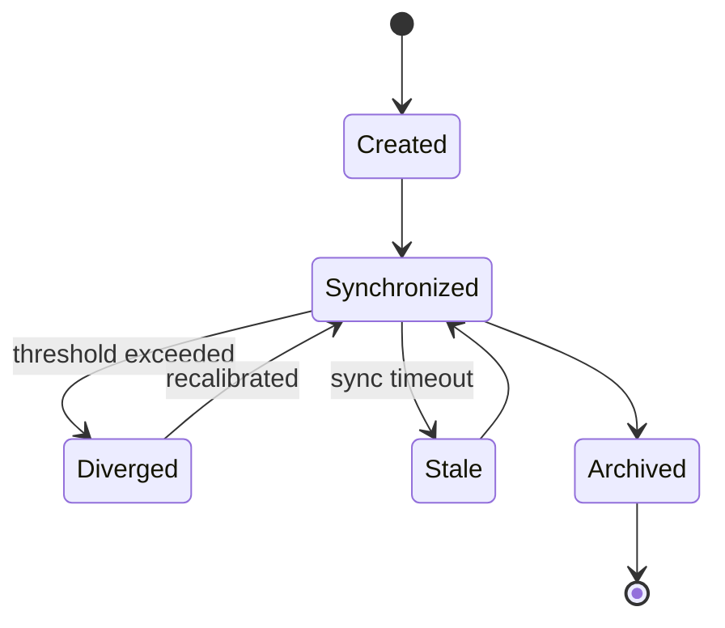
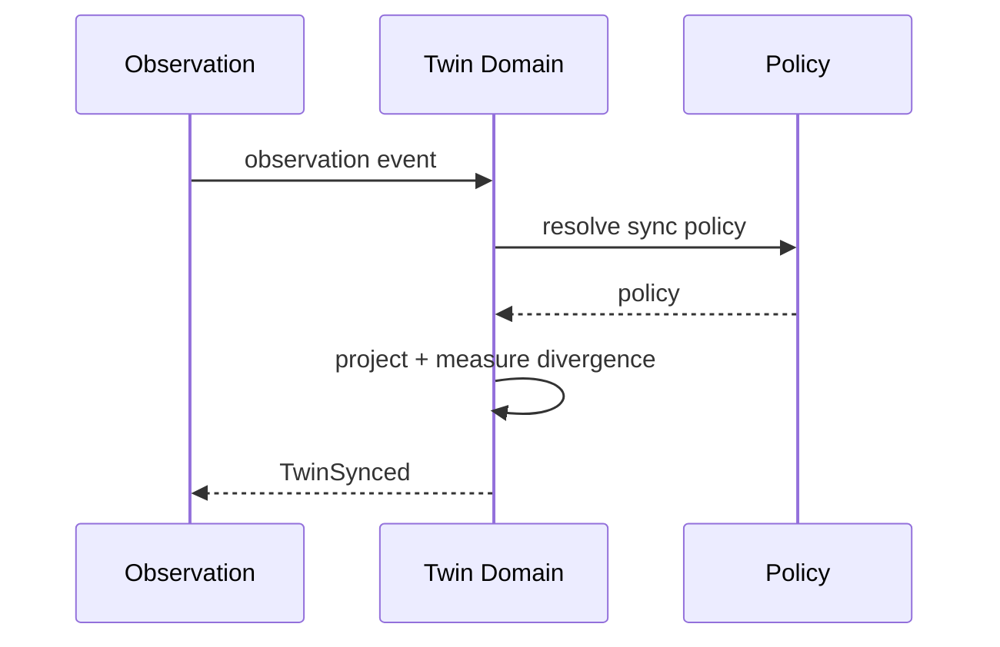
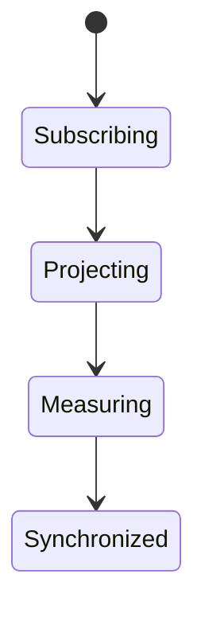
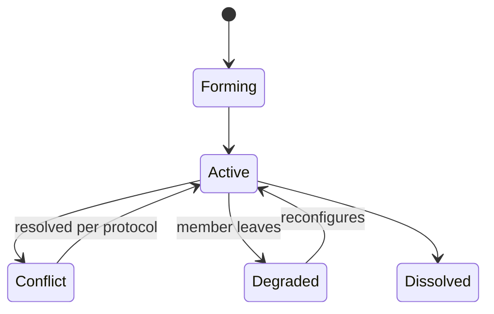
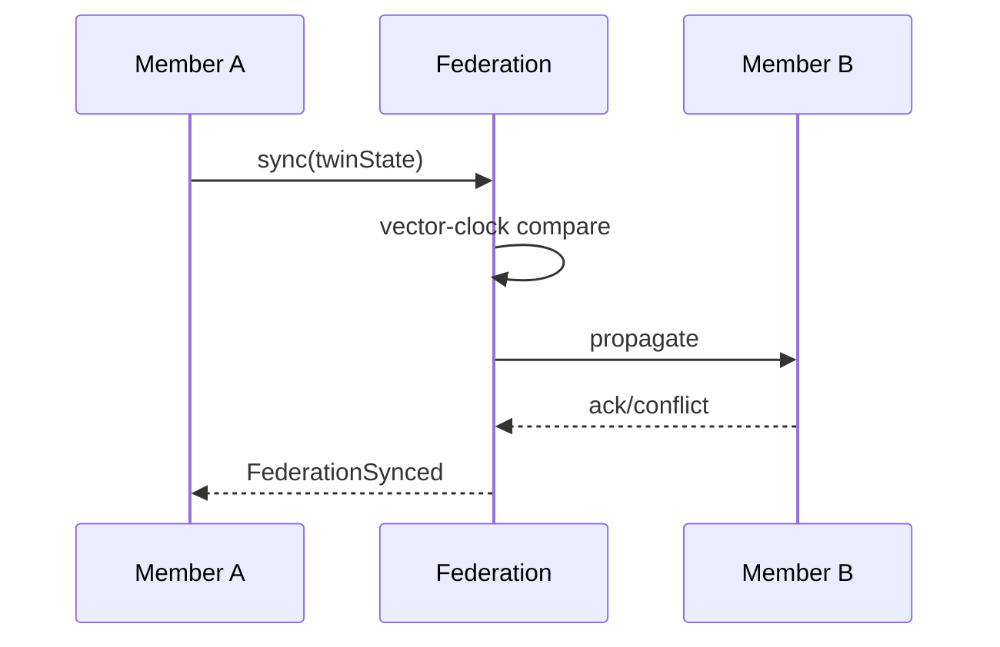
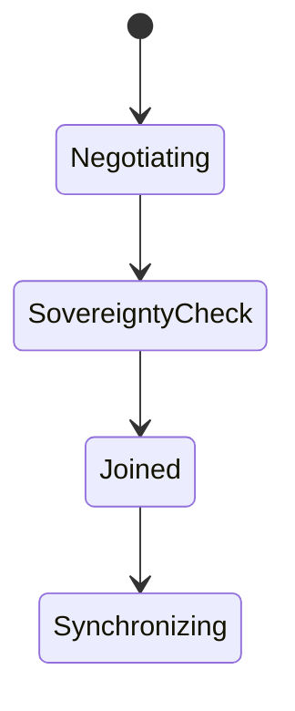
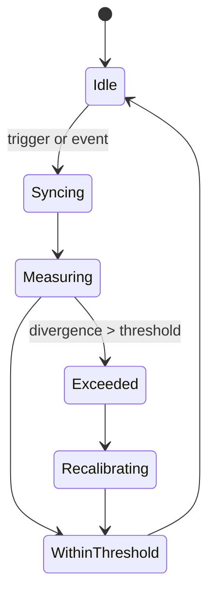
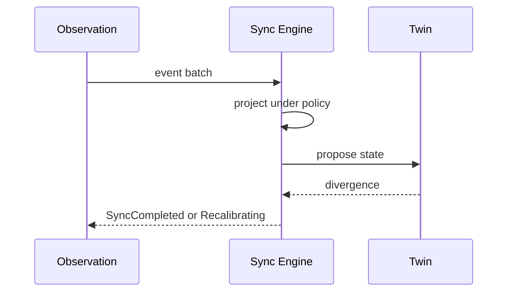
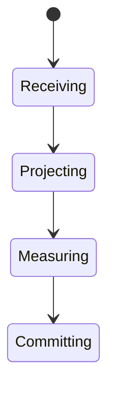

# Volume V03.2 · Reality and Reasoning (part 2 of 2)

**Part of** [the master document](../UCOS-MASTER.md) · **Category** C03 · **Projected from** `_registry/` — never edit this file: change the registry and run `npm run registry`.

**Parts:** [V03.1](V03.1-reality-and-reasoning.md) · **V03.2**

> How reality is observed, evidenced, explained, simulated and changed.

## Contents

- [D-DTW Twin](#d-dtw)
  - [UCOS-DTW-000001 Digital Twin Architecture](#ucos-dtw-000001)
  - [UCOS-DTW-000002 Twin Federation Architecture](#ucos-dtw-000002)
  - [UCOS-DTW-000003 Twin Synchronization Architecture](#ucos-dtw-000003)

---

<a id="d-dtw"></a>
### D-DTW · Twin

| | |
|---|---|
| **Category** | C03 Reality and Reasoning |
| **Owns** | [Digital Twin](../UCOS-MASTER.md#t-digital-twin) |
| **Responsible for** | Reality Representation, Synchronization, Twin Analytics |
| **Not responsible for** | Reality Governance, Policy Decisions |
| **Contract** | [UCOS-DTW-000001 Digital Twin Architecture](#ucos-dtw-000001) |
| **Artifacts** | [UCOS-DTW-000001](#ucos-dtw-000001), [UCOS-DTW-000002](#ucos-dtw-000002), [UCOS-DTW-000003](#ucos-dtw-000003) |
| **Managed in** | `_registry/domains.json` → `D-DTW` |

<a id="ucos-dtw-000001"></a>
#### UCOS-DTW-000001 · Digital Twin Architecture

Owner [Twin](#d-dtw) · managed in `_registry/manifest.json` → `UCOS-DTW-000001`, content `_registry/content-twin-agent.json` → `DTW` · inherits the [standard contract](../UCOS-MASTER.md#standard-contract)

<a id="ucos-dtw-000001-concepts"></a>
##### Concepts

A Digital Twin is a synchronized digital representation of reality. Twin ≠ Reality. Every object may hold multiple twins — operational, financial, commercial, security, compliance, knowledge, experience, lifecycle — each a distinct projection of the same underlying existence.

<a id="ucos-dtw-000001-ontology"></a>
##### Ontology

Twin has a subject Existence, a twinType (registry), a synchronization state, a fidelity level, and an observed-vs-projected divergence measure. Twins never govern reality — they represent it.

<a id="ucos-dtw-000001-taxonomy"></a>
##### Taxonomy

By aspect: Operational / Financial / Commercial / Security / Compliance / Knowledge / Experience / Lifecycle / Future aspect. By fidelity: High-fidelity / Approximate / Indicative. By sync: Real-time / Near-real-time / Batch / Event-driven.

<a id="ucos-dtw-000001-data-model"></a>
##### Data Model

```yaml
DigitalTwin:
  twinId: <Identity>
  subject: <Identity>
  twinType: <registry id>
  state: <projected state snapshot>
  syncState: <registry state>
  divergence: {measure, threshold, lastChecked}
  fidelity: <High|Approximate|Indicative>
  temporal: {asOf}
  context: <Context>
```

<a id="ucos-dtw-000001-graph-model"></a>
##### Graph Model

(:Twin)-[:TWIN_OF]->(:Identity); (:Twin)-[:SYNCED_FROM]->(:Observation); (:Twin)-[:DIVERGES_FROM]->(:Twin); (:Twin)-[:FED_INTO]->(:TwinFederation)

<a id="ucos-dtw-000001-apis"></a>
##### APIs

- POST /twin.v1.create
- GET  /twin.v1/{id}
- GET  /twin.v1.bySubject/{subjectId}
- POST /twin.v1.sync
- GET  /twin.v1.divergence/{id}

<a id="ucos-dtw-000001-events"></a>
##### Events

- TwinCreated
- TwinSynced
- TwinDiverged
- TwinRecalibrated
- TwinArchived

<a id="ucos-dtw-000001-commands"></a>
##### Commands

- twin.create
- twin.sync
- twin.recalibrate
- twin.archive
- twin.fork

<a id="ucos-dtw-000001-queries"></a>
##### Queries

- twin.bySubject
- twin.byType
- twin.divergent
- twin.timeline

<a id="ucos-dtw-000001-state-machines"></a>
##### State Machines



<a id="ucos-dtw-000001-workflows"></a>
##### Workflows

- create twin type → subscribe to observation feed → apply sync policy → measure divergence → recalibrate on threshold → archive on retirement

<a id="ucos-dtw-000001-authorities"></a>
##### Authorities

- Subject's Authority owns its twins; Twin Authority governs sync policy.

<a id="ucos-dtw-000001-permissions"></a>
##### Permissions

- twin.create (subject authority)
- twin.sync (system)
- twin.read (context-scoped + perspective-filtered)

<a id="ucos-dtw-000001-privacy-model"></a>
##### Privacy Model

Twins of persons are high-sensitivity; twin data minimization follows the Perspective redaction policy strictly.

<a id="ucos-dtw-000001-audit-model"></a>
##### Audit Model

Every sync records observation source, policy version, and divergence measure. Twin history is the audit of what reality was when.

<a id="ucos-dtw-000001-digital-twin-model"></a>
##### Digital Twin Model

Twins are the architecture's reality mirror — fleet behavior is monitored as Emergence across the federation.

<a id="ucos-dtw-000001-agent-model"></a>
##### Agent Model

Twin Agent monitors divergence and triggers recalibration or escalation when reality and representation drift.

<a id="ucos-dtw-000001-runtime-model"></a>
##### Runtime Model

Sync is an event-driven projection over the observation stream; state is a versioned snapshot, never mutable in place.

<a id="ucos-dtw-000001-scaling-model"></a>
##### Scaling Model

Twins are sharded by subject; sync load follows observation volume. Cold twins are tiered to cheaper storage.

<a id="ucos-dtw-000001-multi-tenant-model"></a>
##### Multi-Tenant Model

Twins are tenant-scoped; federated twins cross tenants only via published federation policy.

<a id="ucos-dtw-000001-geo-distribution-model"></a>
##### Geo-Distribution Model

Twin data follows the subject's residency; cross-region sync is read-only replica under sovereignty policy.

<a id="ucos-dtw-000001-failure-model"></a>
##### Failure Model

Observation feed loss, divergence storm, sync conflict across replicas, twin-type drift.

<a id="ucos-dtw-000001-recovery-model"></a>
##### Recovery Model

Twin state recomputes from observation history — a twin is never restored, it is re-derived.

<a id="ucos-dtw-000001-certification-model"></a>
##### Certification Model

Twin must declare fidelity, carry a divergence measure, and stay within threshold for certified use.

<a id="ucos-dtw-000001-migration-model"></a>
##### Migration Model

New twin types are registry additions; existing twins re-project on type version change.

<a id="ucos-dtw-000001-implementation-blueprint"></a>
##### Implementation Blueprint

Build order for DTW: (1) define registry entries — this domain owns by aspect: operational / financial / commercial / security / compliance / knowledge / experience / lifecycle / future aspect as registry truth, not code; (2) implement the contract surface first (twin.create, twin.sync, twin.recalibrate) and validate against DTW boundaries; (3) event-source all state so history is reconstructable; (4) wire the enforcement points — authority check, policy guard, evidence binding, trace — in-line, with no bypass path; (5) add tests per the Testing Architecture, citing evidence per gate; (6) obtain Verification and Certification before activation. Acceptance: the Zero Partial and Law 001 audits pass, every action answers the seven explainability questions, and this domain mutates no other domain internals.

<a id="ucos-dtw-000001-sequence-diagrams"></a>
##### Sequence Diagrams



<a id="ucos-dtw-000001-state-diagrams"></a>
##### State Diagrams



<a id="ucos-dtw-000002"></a>
#### UCOS-DTW-000002 · Twin Federation Architecture

Owner [Twin](#d-dtw) · managed in `_registry/manifest.json` → `UCOS-DTW-000002`, content `_registry/content-twin-agent.json` → `DTW2` · inherits the [standard contract](../UCOS-MASTER.md#standard-contract)

<a id="ucos-dtw-000002-concepts"></a>
##### Concepts

Twin Federation lets independently governed twins interoperate without merging ownership. A federation is a governed relationship among twin fleets, with a shared consistency model and a sovereignty-preserving protocol.

<a id="ucos-dtw-000002-ontology"></a>
##### Ontology

Federation has Member twins/fleets, a consistency model (eventual / strong-per-jurisdiction), a sovereignty policy, and a conflict protocol. Members retain authority; the federation coordinates.

<a id="ucos-dtw-000002-taxonomy"></a>
##### Taxonomy

By topology: Hub / Mesh / Hierarchical / Hybrid. By consistency: Strong / Eventual / Causal. By openness: Closed / Open / Conditional.

<a id="ucos-dtw-000002-data-model"></a>
##### Data Model

```yaml
TwinFederation:
  federationId: <Identity>
  members: [<Relationship>]
  consistencyModel: <registry id>
  sovereigntyPolicy: <Policy>
  conflictProtocol: <registry id>
  governance: <Authority>
  temporal: {formedAt}
```

<a id="ucos-dtw-000002-graph-model"></a>
##### Graph Model

(:Federation)-[:MEMBER]->(:Twin); (:Federation)-[:GOVERNED_BY]->(:Authority); (:Twin)-[:FED_PEER]->(:Twin); (:Federation)-[:CONFLICTS_HANDLED_BY]->(:Policy)

<a id="ucos-dtw-000002-apis"></a>
##### APIs

- POST /federation.v1.form
- POST /federation.v1.join
- GET  /federation.v1/{id}
- POST /federation.v1.sync
- POST /federation.v1.conflict

<a id="ucos-dtw-000002-events"></a>
##### Events

- FederationFormed
- FederationJoined
- FederationSynced
- FederationConflictDetected
- FederationMemberLeft

<a id="ucos-dtw-000002-commands"></a>
##### Commands

- federation.form
- federation.join
- federation.leave
- federation.sync
- federation.resolveConflict

<a id="ucos-dtw-000002-queries"></a>
##### Queries

- federation.byId
- federation.members
- federation.conflicts
- federation.consistency

<a id="ucos-dtw-000002-state-machines"></a>
##### State Machines



<a id="ucos-dtw-000002-workflows"></a>
##### Workflows

- form under governance → members join via relationship → sync under consistency model → conflicts handled by protocol → dissolve cleanly

<a id="ucos-dtw-000002-authorities"></a>
##### Authorities

- Federation Authority (coordination); each member retains its own twin authority — never ceded.

<a id="ucos-dtw-000002-permissions"></a>
##### Permissions

- federation.form (founding authorities)
- federation.join (member authority + sovereignty policy)
- federation.read (member-scoped)

<a id="ucos-dtw-000002-privacy-model"></a>
##### Privacy Model

Federation never pools personal data; cross-member personal data flows require consent covering every member jurisdiction.

<a id="ucos-dtw-000002-audit-model"></a>
##### Audit Model

Every cross-member sync and conflict records both sides' authority and the protocol decision.

<a id="ucos-dtw-000002-digital-twin-model"></a>
##### Digital Twin Model

Federation is how the system models reality at scale — no single twin holds the whole world; the federation holds it together.

<a id="ucos-dtw-000002-agent-model"></a>
##### Agent Model

Federation Agent monitors consistency health and member drift, proposing protocol tuning under governance.

<a id="ucos-dtw-000002-runtime-model"></a>
##### Runtime Model

Sync is a peer protocol with per-jurisdiction quorum; conflicts are detected by vector-clock divergence, not timestamps alone.

<a id="ucos-dtw-000002-scaling-model"></a>
##### Scaling Model

Federation scales horizontally by adding members; coordination cost is bounded by topology policy.

<a id="ucos-dtw-000002-multi-tenant-model"></a>
##### Multi-Tenant Model

Federation is the only legitimate cross-tenant twin mechanism — and only under published sovereignty policy.

<a id="ucos-dtw-000002-geo-distribution-model"></a>
##### Geo-Distribution Model

Sovereignty is the joining constraint: a member may only federate where its residency policy permits.

<a id="ucos-dtw-000002-failure-model"></a>
##### Failure Model

Split-brain across jurisdictions, sovereignty violation attempt, vector-clock corruption, member silent exit.

<a id="ucos-dtw-000002-recovery-model"></a>
##### Recovery Model

Conflicts resolve by protocol (last-writer-wins is prohibited for governed state); recovery is protocol-driven reconciliation.

<a id="ucos-dtw-000002-certification-model"></a>
##### Certification Model

Federation must publish consistency model, sovereignty policy, and conflict protocol, and prove their enforcement.

<a id="ucos-dtw-000002-migration-model"></a>
##### Migration Model

New consistency models and topologies are registry additions.

<a id="ucos-dtw-000002-implementation-blueprint"></a>
##### Implementation Blueprint

Build order for DTW2: (1) define registry entries — this domain owns by topology: hub / mesh / hierarchical / hybrid as registry truth, not code; (2) implement the contract surface first (federation.form, federation.join, federation.leave) and validate against DTW2 boundaries; (3) event-source all state so history is reconstructable; (4) wire the enforcement points — authority check, policy guard, evidence binding, trace — in-line, with no bypass path; (5) add tests per the Testing Architecture, citing evidence per gate; (6) obtain Verification and Certification before activation. Acceptance: the Zero Partial and Law 001 audits pass, every action answers the seven explainability questions, and this domain mutates no other domain internals.

<a id="ucos-dtw-000002-sequence-diagrams"></a>
##### Sequence Diagrams



<a id="ucos-dtw-000002-state-diagrams"></a>
##### State Diagrams



<a id="ucos-dtw-000003"></a>
#### UCOS-DTW-000003 · Twin Synchronization Architecture

Owner [Twin](#d-dtw) · managed in `_registry/manifest.json` → `UCOS-DTW-000003`, content `_registry/content-twin-agent.json` → `DTW3` · inherits the [standard contract](../UCOS-MASTER.md#standard-contract)

<a id="ucos-dtw-000003-concepts"></a>
##### Concepts

Twin Synchronization is the governed process that keeps a twin aligned with observed reality. It is policy-driven, measured, and never silent: every sync is an evidence-backed, auditable event.

<a id="ucos-dtw-000003-ontology"></a>
##### Ontology

Sync has a source Observation stream, a projection function, a divergence measure, and a threshold policy. Sync is continuous where the feed is live; bounded-lag where it is not.

<a id="ucos-dtw-000003-taxonomy"></a>
##### Taxonomy

By trigger: Event-driven / Scheduled / On-demand / Hybrid. By direction: Reality→Twin (primary) / Twin→Simulation (allowed) / Twin→Reality (prohibited). By lag: Real-time / Near-real-time / Batch.

<a id="ucos-dtw-000003-data-model"></a>
##### Data Model

```yaml
TwinSync:
  syncId: <Identity>
  twin: <DigitalTwin>
  source: <Observation stream>
  projectionFn: <registry expression>
  divergence: {measure, threshold}
  lag: <duration>
  policy: <Policy>
  temporal: {lastSyncAt}
```

<a id="ucos-dtw-000003-graph-model"></a>
##### Graph Model

(:Sync)-[:SYNCS]->(:Twin); (:Sync)-[:FROM]->(:Observation); (:Sync)-[:GOVERNED_BY]->(:Policy); (:Sync)-[:MEASURED_BY]->(:DivergenceMeasure)

<a id="ucos-dtw-000003-apis"></a>
##### APIs

- POST /sync.v1.trigger
- GET  /sync.v1.status/{twinId}
- GET  /sync.v1.lag/{twinId}
- POST /sync.v1.recalibrate

<a id="ucos-dtw-000003-events"></a>
##### Events

- SyncTriggered
- SyncCompleted
- SyncFailed
- DivergenceExceeded
- SyncRecalibrated

<a id="ucos-dtw-000003-commands"></a>
##### Commands

- sync.trigger
- sync.pause
- sync.resume
- sync.recalibrate
- sync.replay

<a id="ucos-dtw-000003-queries"></a>
##### Queries

- sync.status
- sync.lag
- sync.history
- sync.divergent

<a id="ucos-dtw-000003-state-machines"></a>
##### State Machines



<a id="ucos-dtw-000003-workflows"></a>
##### Workflows

- receive observation → resolve sync policy → project onto twin state → measure divergence → within threshold? commit : recalibrate

<a id="ucos-dtw-000003-authorities"></a>
##### Authorities

- Twin Authority (sync policy), Subject Authority (what may be projected).

<a id="ucos-dtw-000003-permissions"></a>
##### Permissions

- sync.trigger (system or authorized caller)
- sync.pause (twin authority)
- sync.read (twin owner)

<a id="ucos-dtw-000003-privacy-model"></a>
##### Privacy Model

Sync of personal twin data minimizes at projection time — the feed may be detailed, the twin need not be.

<a id="ucos-dtw-000003-audit-model"></a>
##### Audit Model

Every sync records observation window, policy version, divergence before/after, and decision rationale.

<a id="ucos-dtw-000003-digital-twin-model"></a>
##### Digital Twin Model

Sync is the heartbeat of the twin architecture — the mechanism by which digital representation tracks reality.

<a id="ucos-dtw-000003-agent-model"></a>
##### Agent Model

Sync Agent tunes thresholds from divergence history and flags chronically stale feeds for review.

<a id="ucos-dtw-000003-runtime-model"></a>
##### Runtime Model

Sync is a stream processor with exactly-once semantics over the observation feed; idempotent by projection hash.

<a id="ucos-dtw-000003-scaling-model"></a>
##### Scaling Model

Sync parallelizes by subject; backpressure degrades lag gracefully rather than dropping fidelity silently.

<a id="ucos-dtw-000003-multi-tenant-model"></a>
##### Multi-Tenant Model

Sync never crosses tenants; federated sync goes through the federation protocol, not direct access.

<a id="ucos-dtw-000003-geo-distribution-model"></a>
##### Geo-Distribution Model

Sync lag is measured per region; residency requires the sync to complete in-jurisdiction before propagation.

<a id="ucos-dtw-000003-failure-model"></a>
##### Failure Model

Feed interruption, projection error, threshold storm, clock skew across sources.

<a id="ucos-dtw-000003-recovery-model"></a>
##### Recovery Model

Sync is replayable from the observation log — lost twin state is re-derived, never restored stale.

<a id="ucos-dtw-000003-certification-model"></a>
##### Certification Model

Sync must be evidence-backed, policy-versioned, and divergence-measured to certify twin state.

<a id="ucos-dtw-000003-migration-model"></a>
##### Migration Model

New projection functions are registry additions; replay re-derives history under the new function.

<a id="ucos-dtw-000003-implementation-blueprint"></a>
##### Implementation Blueprint

Build order for DTW3: (1) define registry entries — this domain owns by trigger: event-driven / scheduled / on-demand / hybrid as registry truth, not code; (2) implement the contract surface first (sync.trigger, sync.pause, sync.resume) and validate against DTW3 boundaries; (3) event-source all state so history is reconstructable; (4) wire the enforcement points — authority check, policy guard, evidence binding, trace — in-line, with no bypass path; (5) add tests per the Testing Architecture, citing evidence per gate; (6) obtain Verification and Certification before activation. Acceptance: the Zero Partial and Law 001 audits pass, every action answers the seven explainability questions, and this domain mutates no other domain internals.

<a id="ucos-dtw-000003-sequence-diagrams"></a>
##### Sequence Diagrams



<a id="ucos-dtw-000003-state-diagrams"></a>
##### State Diagrams



