# Volume V04 · Universal Dimensions

**Part of** [the master document](../UCOS-MASTER.md) · **Category** C04 · **Projected from** `_registry/` — never edit this file: change the registry and run `npm run registry`.

> The coordinates any fact is placed in: where, when, how much, what value, in which expression, in what context.

## Contents

- [D-GEO Geo](#d-geo)
  - [UCOS-PLC-000001 Geo Architecture](#ucos-plc-000001)
- [D-TIM Time](#d-tim)
  - [UCOS-TIM-000001 Time Architecture](#ucos-tim-000001)
- [D-MEA Measure](#d-mea)
  - [UCOS-MEA-000001 Measure Architecture](#ucos-mea-000001)
- [D-VAL Value](#d-val)
  - [UCOS-VAL-000001 Value Architecture](#ucos-val-000001)
- [D-EXR Expression](#d-exr)
  - [UCOS-EXR-000001 Expression Architecture](#ucos-exr-000001)
- [D-CTX Context](#d-ctx)
  - [UCOS-CTX-000001 Context Architecture](#ucos-ctx-000001)

---

<a id="d-geo"></a>
### D-GEO · Geo

| | |
|---|---|
| **Category** | C04 Universal Dimensions |
| **Build status** | partial |
| **Owns** | [Place](../UCOS-MASTER.md#t-place) |
| **Responsible for** | Places At Every Scale, Place Kinds, Place Hierarchies, Coordinate Systems, Address Formats, Data Placement |
| **Not responsible for** | Deployment Regions, Time, Value |
| **Contract** | [UCOS-PLC-000001 Geo Architecture](#ucos-plc-000001) |
| **Artifacts** | [UCOS-PLC-000001](#ucos-plc-000001) |
| **Concepts** | 69 — `node _registry/compile.js --search <words> --kind concept --owner "Geo"` |
| **Code** | `lib/registry.js`, `lib/global.js`, `lib/kernel-shape.js`, `lib/places.js`, `lib/subdivisions.js`, `lib/seed/places.json`, `lib/seed/subdivisions.json`, `scripts/retire-country-columns.js` |
| **Managed in** | `_registry/domains.json` → `D-GEO` |

**Live routes (5)** — what the platform serves today for this domain:

- `GET /api/platform/global/countries`
- `GET /api/platform/global/country`
- `POST /api/platform/global/country`
- `PUT /api/platform/global/country`
- `POST /api/platform/global/tenant/country`

<a id="ucos-plc-000001"></a>
#### UCOS-PLC-000001 · Geo Architecture

Owner [Geo](#d-geo) · managed in `_registry/manifest.json` → `UCOS-PLC-000001`, content `_registry/content-platform.json` → `PLC` · inherits the [standard contract](../UCOS-MASTER.md#standard-contract)

<a id="ucos-plc-000001-concepts"></a>
##### Concepts

Geo Architecture holds every place at every scale, physical and not: from a single coordinate, shelf or room to a city, an ocean, a planet or a galaxy, and virtual realms. Places sit in many named hierarchies at once. Everything that depends on where (clock, value units, expressions, rules) relates to a place; nothing is stored on it.

<a id="ucos-plc-000001-ontology"></a>
##### Ontology

A Place has a Kind, Identifiers in any scheme, an optional Shape in a declared coordinate system, membership in any number of Hierarchies, and Relationships to other domains (uses a value unit, follows a clock, speaks expressions, is governed by rules).

<a id="ucos-plc-000001-taxonomy"></a>
##### Taxonomy

Kinds, by declaration: universe, galaxy, star system, star, planet, moon, ocean, sea, continent, country, region, city, district, site, building, floor, room, shelf, point, virtual realm, any kind added. Hierarchies: physical, political, postal, carrier zones, sales territories, any declared.

<a id="ucos-plc-000001-data-model"></a>
##### Data Model

```yaml
Place:
  placeId: <Identity>
  kind: <Kind>
  identifiers: [{scheme, code}]
  shape: {system, point | area | volume} | null
  hierarchies: [{hierarchy, parent}]
  addressFormat: <declared by kind> | null
  placement: <data-placement rule> | null
  temporal: {validFrom, validTo, recordedAt}
```

<a id="ucos-plc-000001-graph-model"></a>
##### Graph Model

(:Place)-[:WITHIN {hierarchy}]->(:Place); (:Place)-[:USES]->(:ValueUnit); (:Place)-[:FOLLOWS]->(:Clock); (:Place)-[:EXPRESSED_IN]->(:Expression); (:Place)-[:GOVERNED_BY]->(:Rule)

<a id="ucos-plc-000001-apis"></a>
##### APIs

*Designed interface: the contract the domain is built towards. The routes it serves today are on its card.*

- POST /plc.v1.place
- GET  /plc.v1/{id}
- POST /plc.v1.resolve-coordinate
- GET  /plc.v1/{id}/ancestors
- POST /plc.v1.import

<a id="ucos-plc-000001-events"></a>
##### Events

- PlaceDeclared
- PlaceMoved
- PlaceRetired
- HierarchyDeclared

<a id="ucos-plc-000001-commands"></a>
##### Commands

- place.declare
- place.move
- place.import
- hierarchy.declare

<a id="ucos-plc-000001-queries"></a>
##### Queries

- place.ancestors
- place.descendants
- place.containing
- place.near

<a id="ucos-plc-000001-state-machines"></a>
##### State Machines

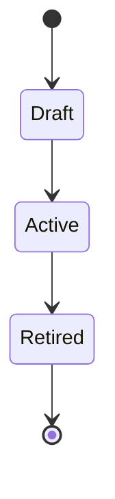

<a id="ucos-plc-000001-workflows"></a>
##### Workflows

- declare kind → declare or import places from a declared source → attach to hierarchies → relate to clock, value units, expressions and rules → publish through the change lifecycle

<a id="ucos-plc-000001-authorities"></a>
##### Authorities

- The platform owner governs shared hierarchies; a tenant governs its own zones and territories.

<a id="ucos-plc-000001-permissions"></a>
##### Permissions

- place.declare (scope owner)
- hierarchy.edit (hierarchy owner)
- place.read (any principal, filtered by view)

<a id="ucos-plc-000001-privacy-model"></a>
##### Privacy Model

The coordinates and addresses of people and private sites are sensitive by default and encrypted at field level; public places are not.

<a id="ucos-plc-000001-audit-model"></a>
##### Audit Model

Border moves, renames and re-parenting are versioned events, so any past geography can be reproduced.

<a id="ucos-plc-000001-digital-twin-model"></a>
##### Digital Twin Model

A place twin mirrors live signals tied to a place (occupancy, demand) without changing the place itself.

<a id="ucos-plc-000001-agent-model"></a>
##### Agent Model

An import agent loads deeper levels (cities, postcodes, streets) on demand from a declared source.

<a id="ucos-plc-000001-runtime-model"></a>
##### Runtime Model

Coordinate resolution uses a spatial cell index per coordinate system; ancestor lookups are constant-depth reads.

<a id="ucos-plc-000001-scaling-model"></a>
##### Scaling Model

The core ships to first-level regions; deeper levels load on demand because full depth is millions of rows.

<a id="ucos-plc-000001-multi-tenant-model"></a>
##### Multi-Tenant Model

Places are platform master data; a tenant selects through views and adds only its own zones.

<a id="ucos-plc-000001-geo-distribution-model"></a>
##### Geo-Distribution Model

This domain defines geography itself; data placement rules declared on places are enforced by Operations.

<a id="ucos-plc-000001-failure-model"></a>
##### Failure Model

A place with no kind, a cycle in a hierarchy, a coordinate in an undeclared system, overlapping zones a carrier did not intend.

<a id="ucos-plc-000001-recovery-model"></a>
##### Recovery Model

Versions are bi-temporal; a bad import is rolled back through the change lifecycle.

<a id="ucos-plc-000001-certification-model"></a>
##### Certification Model

Every place has a kind, every hierarchy is acyclic, and every coordinate resolves in its declared system.

<a id="ucos-plc-000001-migration-model"></a>
##### Migration Model

Today's country and subdivision tables and GOIP's spatial systems migrate into Earth's political hierarchy and the declared spatial systems.

<a id="ucos-plc-000001-implementation-blueprint"></a>
##### Implementation Blueprint

Build order for PLC: (1) place kinds and the hierarchy store; (2) identifiers and import from declared sources; (3) shapes and the spatial index; (4) relationships to Time, Value, Expression and Rule; (5) migration of the country tables; (6) tests for acyclic hierarchies and coordinate resolution. Every build step also inherits Kernel parts K1–K11 (kinds, nodes, hierarchies, identifiers, shape, attributes, versions, events, change lifecycle, views and scope, resolution).

<a id="ucos-plc-000001-sequence-diagrams"></a>
##### Sequence Diagrams

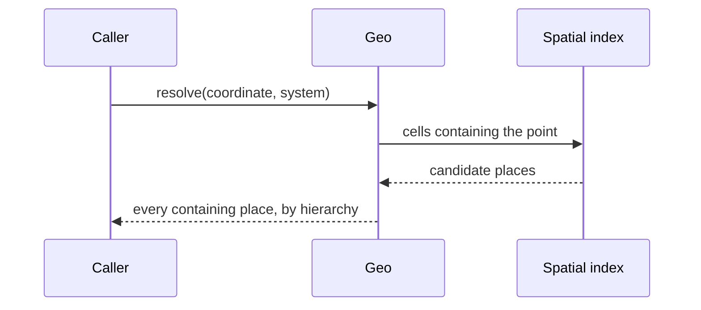

<a id="ucos-plc-000001-state-diagrams"></a>
##### State Diagrams

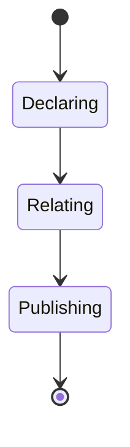

---

<a id="d-tim"></a>
### D-TIM · Time

| | |
|---|---|
| **Category** | C04 Universal Dimensions |
| **Build status** | partial |
| **Owns** | [Time](../UCOS-MASTER.md#t-time), [Calendar](../UCOS-MASTER.md#t-calendar) |
| **Responsible for** | Chronologies, Calendars, Clocks And Zones, Business Hours, Recurrence, Validity Windows, Signal Delay |
| **Not responsible for** | Event Recording, State |
| **Contract** | [UCOS-TIM-000001 Time Architecture](#ucos-tim-000001) |
| **Artifacts** | [UCOS-TIM-000001](#ucos-tim-000001) |
| **Concepts** | 112 — `node _registry/compile.js --search <words> --kind concept --owner "Time"` |
| **Code** | `lib/time.js`, `lib/seed/time.json` |
| **Managed in** | `_registry/domains.json` → `D-TIM` |

**Live routes:** none yet.

<a id="ucos-tim-000001"></a>
#### UCOS-TIM-000001 · Time Architecture

Owner [Time](#d-tim) · managed in `_registry/manifest.json` → `UCOS-TIM-000001`, content `_registry/content-platform.json` → `TIM` · inherits the [standard contract](../UCOS-MASTER.md#standard-contract)

<a id="ucos-tim-000001-concepts"></a>
##### Concepts

Time Architecture owns every way of measuring and scheduling time, for any body: chronologies, calendars, epochs, clocks and zones, business hours and holidays, periods, recurrences, availability, validity windows and the signal delay between bodies.

<a id="ucos-tim-000001-ontology"></a>
##### Ontology

A Chronology has a base unit and rotation; a Calendar names days and periods within it; a Clock gives local time for a place; a Period, Recurrence or Availability is expressed in a calendar and clock.

<a id="ucos-tim-000001-taxonomy"></a>
##### Taxonomy

Chronologies: solar, lunar, lunisolar, martian, declared. Calendars: Gregorian, Hijri, Hebrew, fiscal, academic, Darian, declared. Clocks: per zone or per body.

<a id="ucos-tim-000001-data-model"></a>
##### Data Model

```yaml
Calendar:
  calendarId: <Identity>
  chronology: <Chronology>
  epoch: <declared>
  dayLength: <Quantity in Measure>
  yearLength: <Quantity in Measure>
  periods: [<declared period kinds>]
```

<a id="ucos-tim-000001-graph-model"></a>
##### Graph Model

(:Calendar)-[:IN]->(:Chronology); (:Place)-[:FOLLOWS]->(:Clock); (:Availability)-[:EXPRESSED_IN]->(:Calendar); (:Body)-[:DELAY {seconds}]->(:Body)

<a id="ucos-tim-000001-apis"></a>
##### APIs

*Designed interface: the contract the domain is built towards. The routes it serves today are on its card.*

- POST /tim.v1.calendar
- POST /tim.v1.convert
- POST /tim.v1.next-occurrence
- GET  /tim.v1/clock/{place}
- GET  /tim.v1/delay/{from}/{to}

<a id="ucos-tim-000001-events"></a>
##### Events

- CalendarDeclared
- ClockChanged
- HolidaysPublished

<a id="ucos-tim-000001-commands"></a>
##### Commands

- calendar.declare
- clock.declare
- recurrence.declare
- holidays.declare

<a id="ucos-tim-000001-queries"></a>
##### Queries

- time.convert
- time.nextOccurrence
- time.businessHours
- time.delay

<a id="ucos-tim-000001-state-machines"></a>
##### State Machines


<a id="ucos-tim-000001-workflows"></a>
##### Workflows

- declare chronology → declare calendar → relate places to clocks → declare business hours and holidays → services schedule in the place's own clock

<a id="ucos-tim-000001-authorities"></a>
##### Authorities

- The platform owner governs chronologies and calendars; a tenant governs its business hours and holidays.

<a id="ucos-tim-000001-permissions"></a>
##### Permissions

- calendar.declare (platform)
- hours.edit (scope owner)
- time.read (any principal)

<a id="ucos-tim-000001-privacy-model"></a>
##### Privacy Model

Time carries no personal data; a person's schedule is owned by the domain that holds it.

<a id="ucos-tim-000001-audit-model"></a>
##### Audit Model

Zone and holiday changes are versioned, so a past deadline is re-computed in the rules then in force.

<a id="ucos-tim-000001-digital-twin-model"></a>
##### Digital Twin Model

A clock twin watches drift between declared and observed time sources.

<a id="ucos-tim-000001-agent-model"></a>
##### Agent Model

A calendar agent imports public holiday sets from declared sources for review.

<a id="ucos-tim-000001-runtime-model"></a>
##### Runtime Model

All timestamps are stored on one base timeline and converted on read; no engine assumes one calendar or one clock.

<a id="ucos-tim-000001-scaling-model"></a>
##### Scaling Model

Conversions are pure functions over declared rules and cache freely.

<a id="ucos-tim-000001-multi-tenant-model"></a>
##### Multi-Tenant Model

Calendars are platform master data; business hours are per tenant scope.

<a id="ucos-tim-000001-geo-distribution-model"></a>
##### Geo-Distribution Model

A place's clock and calendar come from its relationships, inherited down its hierarchies.

<a id="ucos-tim-000001-failure-model"></a>
##### Failure Model

An undeclared calendar, a zone rule change mid-period, a deadline computed in the wrong clock, assuming an instant network between bodies.

<a id="ucos-tim-000001-recovery-model"></a>
##### Recovery Model

Conversions recompute from versioned rules.

<a id="ucos-tim-000001-certification-model"></a>
##### Certification Model

Every scheduled deadline names its calendar and clock.

<a id="ucos-tim-000001-migration-model"></a>
##### Migration Model

GOIP's calendars, chronologies and temporal units, and today's UTC-only timestamps, move here.

<a id="ucos-tim-000001-implementation-blueprint"></a>
##### Implementation Blueprint

Build order for TIM: (1) chronologies and calendars as kinds; (2) clocks and the conversion function; (3) business hours, holidays and recurrence; (4) signal delay between bodies; (5) migrate GOIP's temporal registries; (6) tests across calendars and bodies. Every build step also inherits Kernel parts K1–K11 (kinds, nodes, hierarchies, identifiers, shape, attributes, versions, events, change lifecycle, views and scope, resolution).

<a id="ucos-tim-000001-sequence-diagrams"></a>
##### Sequence Diagrams

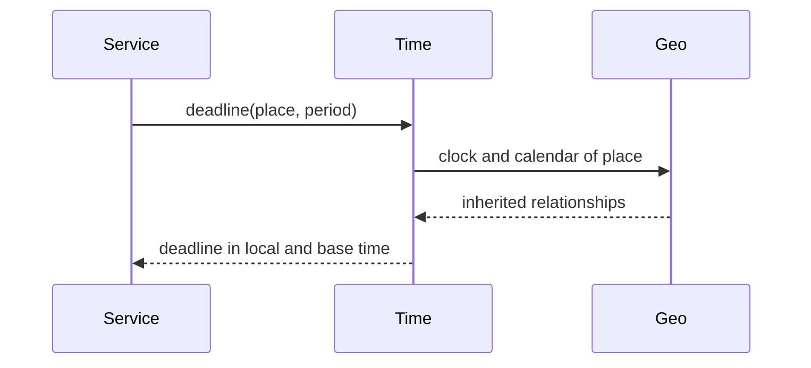

<a id="ucos-tim-000001-state-diagrams"></a>
##### State Diagrams

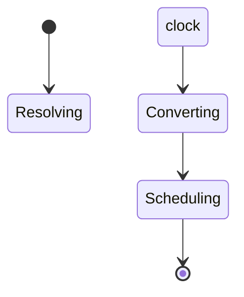

---

<a id="d-mea"></a>
### D-MEA · Measure

| | |
|---|---|
| **Category** | C04 Universal Dimensions |
| **Build status** | designed — declared and contracted; no code or live route yet |
| **Owns** | [Quantity](../UCOS-MASTER.md#t-quantity), [Unit](../UCOS-MASTER.md#t-unit) |
| **Responsible for** | Quantities, Units, Conversions |
| **Not responsible for** | Value Units, Time Calendars |
| **Contract** | [UCOS-MEA-000001 Measure Architecture](#ucos-mea-000001) |
| **Artifacts** | [UCOS-MEA-000001](#ucos-mea-000001) |
| **Concepts** | 189 — `node _registry/compile.js --search <words> --kind concept --owner "Measure"` |
| **Code** | — |
| **Managed in** | `_registry/domains.json` → `D-MEA` |

**Live routes:** none yet.

<a id="ucos-mea-000001"></a>
#### UCOS-MEA-000001 · Measure Architecture

Owner [Measure](#d-mea) · managed in `_registry/manifest.json` → `UCOS-MEA-000001`, content `_registry/content-platform.json` → `MEA` · inherits the [standard contract](../UCOS-MASTER.md#standard-contract)

<a id="ucos-mea-000001-concepts"></a>
##### Concepts

Measure Architecture owns every quantity and unit, from Planck scale to light-years, including time and data units, and the conversions between any systems.

<a id="ucos-mea-000001-ontology"></a>
##### Ontology

A Quantity has a dimension (length, mass, time, data, …), a magnitude and a Unit; a Unit belongs to a system and converts to the dimension's base unit by a declared factor or function.

<a id="ucos-mea-000001-taxonomy"></a>
##### Taxonomy

By dimension: length, area, volume, mass, time, temperature, data, energy, any declared. By system: metric, imperial, local, declared.

<a id="ucos-mea-000001-data-model"></a>
##### Data Model

```yaml
Unit:
  unitId: <Identity>
  dimension: <declared dimension>
  system: <declared system>
  toBase: {factor | function}
  symbol: <Expression>
```

<a id="ucos-mea-000001-graph-model"></a>
##### Graph Model

(:Quantity)-[:IN]->(:Unit); (:Unit)-[:CONVERTS_TO]->(:Unit); (:Unit)-[:MEASURES]->(:Dimension)

<a id="ucos-mea-000001-apis"></a>
##### APIs

*Designed interface: the contract the domain is built towards. The routes it serves today are on its card.*

- POST /mea.v1.unit
- POST /mea.v1.convert
- GET  /mea.v1/dimension/{id}/units

<a id="ucos-mea-000001-events"></a>
##### Events

- UnitDeclared
- ConversionDeclared

<a id="ucos-mea-000001-commands"></a>
##### Commands

- unit.declare
- conversion.declare

<a id="ucos-mea-000001-queries"></a>
##### Queries

- measure.convert
- measure.unitsOf

<a id="ucos-mea-000001-state-machines"></a>
##### State Machines


<a id="ucos-mea-000001-workflows"></a>
##### Workflows

- declare dimension → declare units and their base conversion → consumers convert on read

<a id="ucos-mea-000001-authorities"></a>
##### Authorities

- The platform owner governs units; a tenant may add local units within its scope.

<a id="ucos-mea-000001-permissions"></a>
##### Permissions

- unit.declare (scope owner)
- measure.read (any principal)

<a id="ucos-mea-000001-privacy-model"></a>
##### Privacy Model

Measures carry no personal data.

<a id="ucos-mea-000001-audit-model"></a>
##### Audit Model

Conversion factor changes are versioned so historical quantities re-read correctly.

<a id="ucos-mea-000001-digital-twin-model"></a>
##### Digital Twin Model

A measurement twin compares declared and observed values from devices.

<a id="ucos-mea-000001-agent-model"></a>
##### Agent Model

Agents convert units through this domain and never with their own factors.

<a id="ucos-mea-000001-runtime-model"></a>
##### Runtime Model

Conversion is a pure function over declared factors.

<a id="ucos-mea-000001-scaling-model"></a>
##### Scaling Model

Conversion tables are tiny and cache everywhere.

<a id="ucos-mea-000001-multi-tenant-model"></a>
##### Multi-Tenant Model

Units are master data; tenant-local units are scoped.

<a id="ucos-mea-000001-geo-distribution-model"></a>
##### Geo-Distribution Model

A place may prefer a unit system through a relationship; the quantity is stored once in base terms.

<a id="ucos-mea-000001-failure-model"></a>
##### Failure Model

Mixing dimensions, a missing conversion path, rounding below a unit's precision.

<a id="ucos-mea-000001-recovery-model"></a>
##### Recovery Model

Quantities are stored with their unit; recomputation is deterministic.

<a id="ucos-mea-000001-certification-model"></a>
##### Certification Model

Every conversion path resolves, and dimensions never mix.

<a id="ucos-mea-000001-migration-model"></a>
##### Migration Model

Today's units of measure and GOIP's temporal units move here.

<a id="ucos-mea-000001-implementation-blueprint"></a>
##### Implementation Blueprint

Build order for MEA: (1) dimensions and units as kinds; (2) conversion function; (3) migrate today's unit lists; (4) tests that refuse cross-dimension conversion. Every build step also inherits Kernel parts K1–K11 (kinds, nodes, hierarchies, identifiers, shape, attributes, versions, events, change lifecycle, views and scope, resolution).

<a id="ucos-mea-000001-sequence-diagrams"></a>
##### Sequence Diagrams

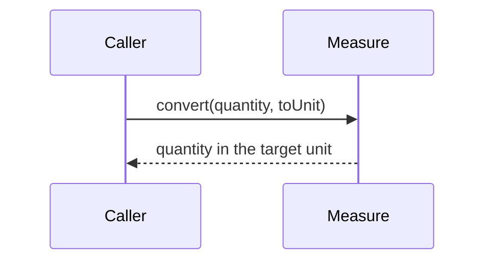

<a id="ucos-mea-000001-state-diagrams"></a>
##### State Diagrams

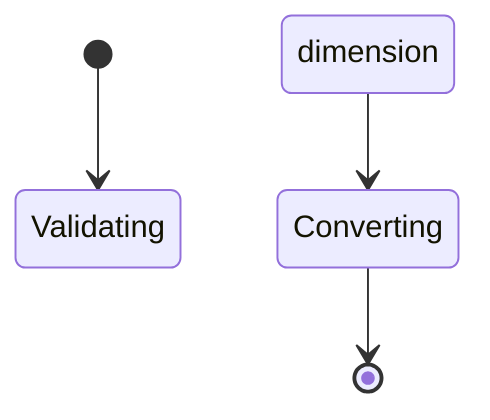

---

<a id="d-val"></a>
### D-VAL · Value

| | |
|---|---|
| **Category** | C04 Universal Dimensions |
| **Build status** | partial |
| **Owns** | [Value Unit](../UCOS-MASTER.md#t-value-unit) |
| **Responsible for** | Units Of Value, Minor Units, Rates Over Time, Settleability |
| **Not responsible for** | Pricing Rules, Offerings |
| **Contract** | [UCOS-VAL-000001 Value Architecture](#ucos-val-000001) |
| **Artifacts** | [UCOS-VAL-000001](#ucos-val-000001) |
| **Concepts** | 149 — `node _registry/compile.js --search <words> --kind concept --owner "Value"` |
| **Code** | `lib/registry.js`, `lib/global.js`, `lib/seed/value.json` |
| **Managed in** | `_registry/domains.json` → `D-VAL` |

**Live routes (10)** — what the platform serves today for this domain:

- `GET /api/fx`
- `GET /api/platform/fx`
- `POST /api/platform/fx/rates`
- `PUT /api/platform/fx/provider`
- `POST /api/platform/fx/sync`
- `GET /api/platform/global/currencies`
- `GET /api/platform/global/currency`
- `POST /api/platform/global/currency`
- `PUT /api/platform/global/currency`
- `POST /api/platform/global/tenant/currency`

<a id="ucos-val-000001"></a>
#### UCOS-VAL-000001 · Value Architecture

Owner [Value](#d-val) · managed in `_registry/manifest.json` → `UCOS-VAL-000001`, content `_registry/content-platform.json` → `VAL` · inherits the [standard contract](../UCOS-MASTER.md#standard-contract)

<a id="ucos-val-000001-concepts"></a>
##### Concepts

Value Architecture owns every unit in which value is held or exchanged — fiat, colonial, federation, points, carbon, energy, commodity — with its minor units, its rates over time from declared sources, and whether it can be settled.

<a id="ucos-val-000001-ontology"></a>
##### Ontology

A Value Unit has a class, minor units, a settleability flag, and Rates to other value units over time, each from a declared source.

<a id="ucos-val-000001-taxonomy"></a>
##### Taxonomy

By class: fiat, colonial, federation, loyalty, environmental, utility, commodity, any declared. By settleability: settleable / non-settleable.

<a id="ucos-val-000001-data-model"></a>
##### Data Model

```yaml
ValueUnit:
  valueUnitId: <Identity>
  class: <declared class>
  minorUnits: <integer>
  settleable: <boolean>
  identifiers: [{scheme, code}]
  rates: [{to, rate, source, validFrom}]
```

<a id="ucos-val-000001-graph-model"></a>
##### Graph Model

(:ValueUnit)-[:RATE {at, source}]->(:ValueUnit); (:Place)-[:USES]->(:ValueUnit); (:Offering)-[:PRICED_IN]->(:ValueUnit)

<a id="ucos-val-000001-apis"></a>
##### APIs

*Designed interface: the contract the domain is built towards. The routes it serves today are on its card.*

- POST /val.v1.unit
- POST /val.v1.rate
- POST /val.v1.convert
- GET  /val.v1/rates/{unit}

<a id="ucos-val-000001-events"></a>
##### Events

- ValueUnitDeclared
- RateRecorded
- RateSourceFailed

<a id="ucos-val-000001-commands"></a>
##### Commands

- valueUnit.declare
- rate.record
- rate.sync

<a id="ucos-val-000001-queries"></a>
##### Queries

- value.convert
- value.rateAt
- value.unitsOf

<a id="ucos-val-000001-state-machines"></a>
##### State Machines


<a id="ucos-val-000001-workflows"></a>
##### Workflows

- declare value unit → relate places to it → record or sync rates from declared sources → convert at the dated rate

<a id="ucos-val-000001-authorities"></a>
##### Authorities

- The platform owner governs value units and rate sources.

<a id="ucos-val-000001-permissions"></a>
##### Permissions

- valueUnit.declare (platform)
- rate.record (rate source or platform)
- value.read (any principal)

<a id="ucos-val-000001-privacy-model"></a>
##### Privacy Model

Value units carry no personal data.

<a id="ucos-val-000001-audit-model"></a>
##### Audit Model

Every rate carries its source and time, so any past conversion is reproducible.

<a id="ucos-val-000001-digital-twin-model"></a>
##### Digital Twin Model

A rate twin watches source freshness and divergence between sources.

<a id="ucos-val-000001-agent-model"></a>
##### Agent Model

A rate agent syncs from declared sources and flags anomalies for approval.

<a id="ucos-val-000001-runtime-model"></a>
##### Runtime Model

Conversion uses the rate valid at the transaction time, or a chosen time, and states the method.

<a id="ucos-val-000001-scaling-model"></a>
##### Scaling Model

Rates are append-only time series per pair.

<a id="ucos-val-000001-multi-tenant-model"></a>
##### Multi-Tenant Model

Value units are master data; a store selects the units it sells in.

<a id="ucos-val-000001-geo-distribution-model"></a>
##### Geo-Distribution Model

A place's units come from its relationships; nothing is stored on the place.

<a id="ucos-val-000001-failure-model"></a>
##### Failure Model

A missing rate defaulting to 1, rounding at the wrong minor units, a stale source.

<a id="ucos-val-000001-recovery-model"></a>
##### Recovery Model

Rates are immutable; conversions recompute from the dated series.

<a id="ucos-val-000001-certification-model"></a>
##### Certification Model

No conversion uses an undeclared rate; amounts round at their unit's minor units.

<a id="ucos-val-000001-migration-model"></a>
##### Migration Model

Today's currency and rate tables and GOIP's economic units move here.

<a id="ucos-val-000001-implementation-blueprint"></a>
##### Implementation Blueprint

Build order for VAL: (1) value-unit kinds and minor units; (2) dated rates with sources; (3) conversion with stated method; (4) migrate today's tables and GOIP units; (5) tests on minor units and dated rates. Every build step also inherits Kernel parts K1–K11 (kinds, nodes, hierarchies, identifiers, shape, attributes, versions, events, change lifecycle, views and scope, resolution).

<a id="ucos-val-000001-sequence-diagrams"></a>
##### Sequence Diagrams

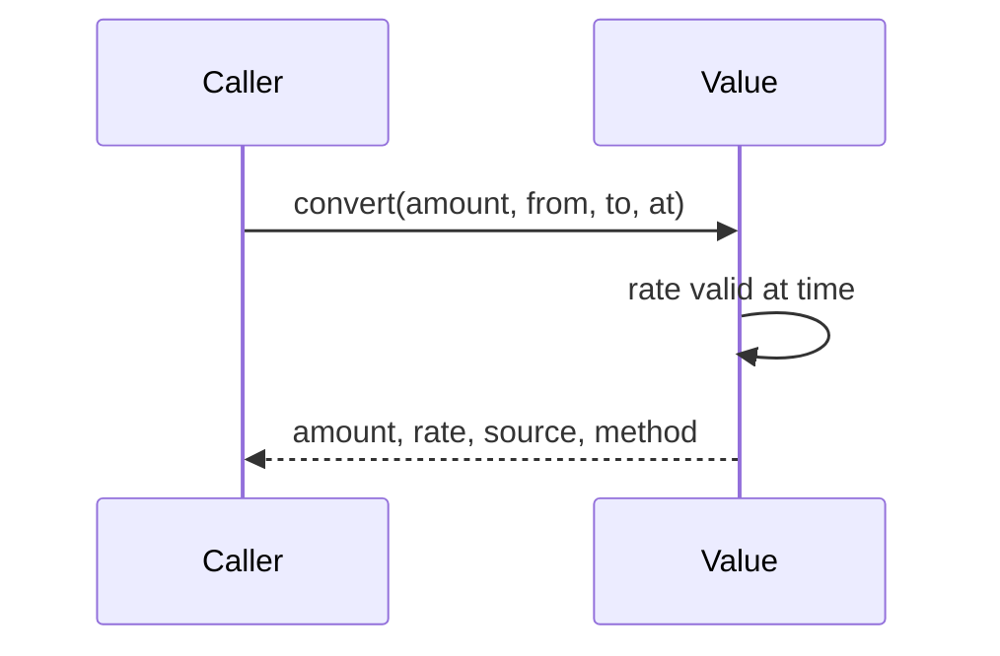

<a id="ucos-val-000001-state-diagrams"></a>
##### State Diagrams

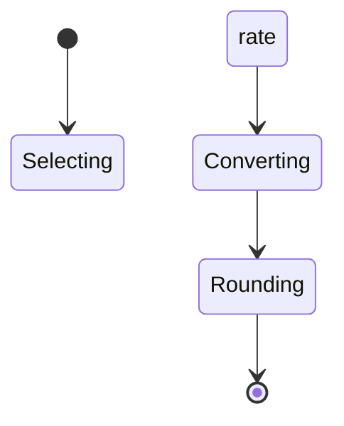

---

<a id="d-exr"></a>
### D-EXR · Expression

| | |
|---|---|
| **Category** | C04 Universal Dimensions |
| **Build status** | partial |
| **Owns** | [Expression](../UCOS-MASTER.md#t-expression), [Script](../UCOS-MASTER.md#t-script) |
| **Responsible for** | Languages, Scripts, Direction, Plural Rules, Interface Text, Multilingual Names, Translation |
| **Not responsible for** | Meaning, Place |
| **Contract** | [UCOS-EXR-000001 Expression Architecture](#ucos-exr-000001) |
| **Artifacts** | [UCOS-EXR-000001](#ucos-exr-000001) |
| **Concepts** | 41 — `node _registry/compile.js --search <words> --kind concept --owner "Expression"` |
| **Code** | `lib/expression.js`, `lib/seed/expression.json` |
| **Managed in** | `_registry/domains.json` → `D-EXR` |

**Live routes:** none yet.

<a id="ucos-exr-000001"></a>
#### UCOS-EXR-000001 · Expression Architecture

Owner [Expression](#d-exr) · managed in `_registry/manifest.json` → `UCOS-EXR-000001`, content `_registry/content-platform.json` → `EXR` · inherits the [standard contract](../UCOS-MASTER.md#standard-contract)

<a id="ucos-exr-000001-concepts"></a>
##### Concepts

Expression Architecture owns how meaning is expressed for people: languages, scripts and their direction, plural rules, message catalogues for every interface string, and the multilingual names of every node in every domain. Meaning stays with the Semantic domain; this domain owns its renderings.

<a id="ucos-exr-000001-ontology"></a>
##### Ontology

An Expression renders a Meaning in a language and Script; a Message Catalogue holds expressions for interface strings; a Name is an expression attached to a node.

<a id="ucos-exr-000001-taxonomy"></a>
##### Taxonomy

By direction: left-to-right / right-to-left / vertical. By origin: authored / translated by a person / translated by an agent. By scope: interface text / node names / content.

<a id="ucos-exr-000001-data-model"></a>
##### Data Model

```yaml
Expression:
  expressionId: <Identity>
  meaning: <Meaning identity>
  languageTag: <declared tag>
  script: <Script>
  text: <string>
  origin: <authored | translated>
  status: <draft | approved>
```

<a id="ucos-exr-000001-graph-model"></a>
##### Graph Model

(:Expression)-[:RENDERS]->(:Meaning); (:Expression)-[:IN]->(:Script); (:Node)-[:NAMED]->(:Expression); (:Place)-[:EXPRESSED_IN]->(:LanguageTag)

<a id="ucos-exr-000001-apis"></a>
##### APIs

*Designed interface: the contract the domain is built towards. The routes it serves today are on its card.*

- POST /exr.v1.expression
- GET  /exr.v1/catalogue/{tag}
- POST /exr.v1.translate
- GET  /exr.v1/names/{node}

<a id="ucos-exr-000001-events"></a>
##### Events

- ExpressionAdded
- ExpressionApproved
- CataloguePublished

<a id="ucos-exr-000001-commands"></a>
##### Commands

- expression.add
- expression.approve
- catalogue.publish
- translation.request

<a id="ucos-exr-000001-queries"></a>
##### Queries

- expression.forMeaning
- catalogue.missing
- names.of

<a id="ucos-exr-000001-state-machines"></a>
##### State Machines

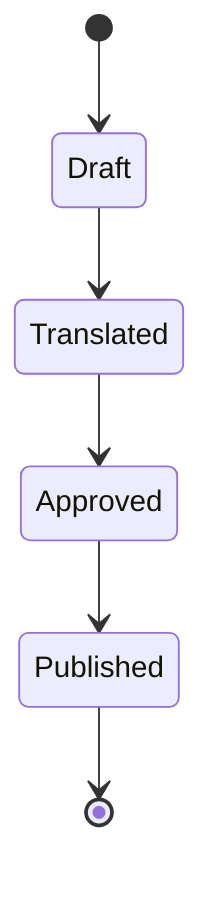

<a id="ucos-exr-000001-workflows"></a>
##### Workflows

- interface string declared → expression per tag requested → translated by person or agent → approved → catalogue published through the change lifecycle

<a id="ucos-exr-000001-authorities"></a>
##### Authorities

- The platform owner governs languages and scripts; a tenant governs its own catalogue overrides.

<a id="ucos-exr-000001-permissions"></a>
##### Permissions

- expression.add (translator role)
- expression.approve (reviewer role)
- catalogue.read (any principal)

<a id="ucos-exr-000001-privacy-model"></a>
##### Privacy Model

Expressions carry no personal data; content a person writes stays with the domain that owns it.

<a id="ucos-exr-000001-audit-model"></a>
##### Audit Model

Every approved expression records its translator and reviewer.

<a id="ucos-exr-000001-digital-twin-model"></a>
##### Digital Twin Model

A coverage twin tracks missing expressions per tag and screen.

<a id="ucos-exr-000001-agent-model"></a>
##### Agent Model

A translation agent drafts expressions; a person or an approval rule approves them.

<a id="ucos-exr-000001-runtime-model"></a>
##### Runtime Model

The resolver picks the expression for the viewer's tag, falling back along the declared tag chain; direction comes from the script.

<a id="ucos-exr-000001-scaling-model"></a>
##### Scaling Model

Catalogues are versioned bundles cached per tag.

<a id="ucos-exr-000001-multi-tenant-model"></a>
##### Multi-Tenant Model

Catalogues are master data with tenant overrides as overlays.

<a id="ucos-exr-000001-geo-distribution-model"></a>
##### Geo-Distribution Model

A place's expected tags come from its relationships; the viewer's choice wins.

<a id="ucos-exr-000001-failure-model"></a>
##### Failure Model

Missing expression, wrong plural form, right-to-left text rendered left-to-right.

<a id="ucos-exr-000001-recovery-model"></a>
##### Recovery Model

Catalogues roll back through the change lifecycle.

<a id="ucos-exr-000001-certification-model"></a>
##### Certification Model

Every interface string has an expression in every published tag, or a declared fallback.

<a id="ucos-exr-000001-migration-model"></a>
##### Migration Model

Today's product localisations and the English text in the consoles move here.

<a id="ucos-exr-000001-implementation-blueprint"></a>
##### Implementation Blueprint

Build order for EXR: (1) language tags and scripts with direction; (2) message catalogues; (3) node names; (4) translation workflow with approval; (5) migrate the console text; (6) coverage tests per tag. Every build step also inherits Kernel parts K1–K11 (kinds, nodes, hierarchies, identifiers, shape, attributes, versions, events, change lifecycle, views and scope, resolution).

<a id="ucos-exr-000001-sequence-diagrams"></a>
##### Sequence Diagrams

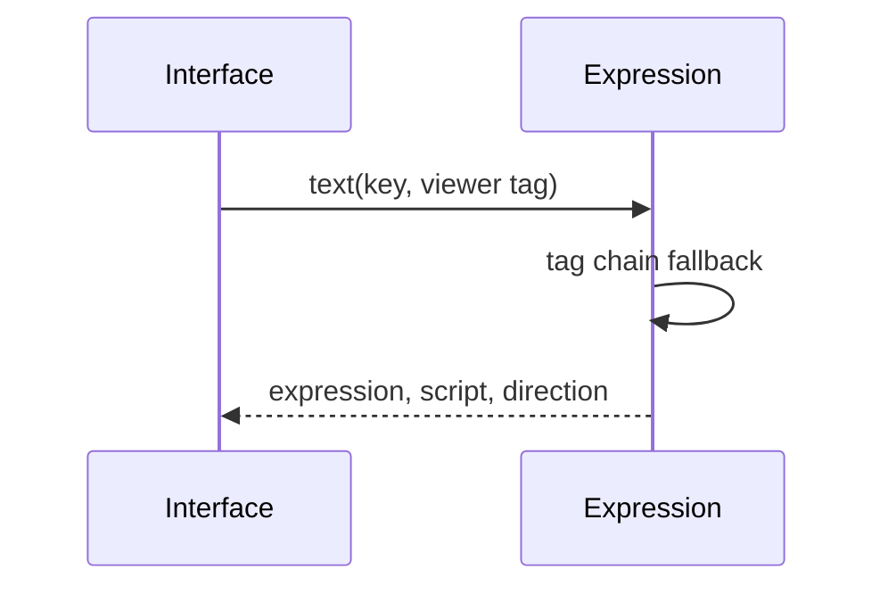

<a id="ucos-exr-000001-state-diagrams"></a>
##### State Diagrams

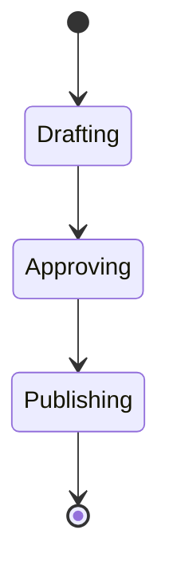

---

<a id="d-ctx"></a>
### D-CTX · Context

| | |
|---|---|
| **Category** | C04 Universal Dimensions |
| **Build status** | partial |
| **Owns** | [Context](../UCOS-MASTER.md#t-context) |
| **Responsible for** | Applicability, Scope, Boundary, Constraints |
| **Not responsible for** | Meaning, Trust, Identity |
| **Contract** | [UCOS-CTX-000001 Context Architecture](#ucos-ctx-000001) |
| **Artifacts** | [UCOS-CTX-000001](#ucos-ctx-000001) |
| **Concepts** | 123 — `node _registry/compile.js --search <words> --kind concept --owner "Context"` |
| **Code** | `lib/global.js`, `lib/kernel-context.js`, `lib/defaults.js`, `lib/settings.js`, `lib/seed/defaults.json`, `lib/seed/settings.json` |
| **Managed in** | `_registry/domains.json` → `D-CTX` |

**Live routes (3)** — what the platform serves today for this domain:

- `GET /api/admin/settings`
- `PUT /api/admin/settings`
- `POST /api/admin/settings/reset`

<a id="ucos-ctx-000001"></a>
#### UCOS-CTX-000001 · Context Architecture

Owner [Context](#d-ctx) · managed in `_registry/manifest.json` → `UCOS-CTX-000001`, content `_registry/content-core.json` → `CTX` · inherits the [standard contract](../UCOS-MASTER.md#standard-contract)

<a id="ucos-ctx-000001-concepts"></a>
##### Concepts

Context is the applicability boundary that changes how reality is projected. Context ≠ Perspective: a context is a scope; a perspective is an observer's interpretation. The same primitives project differently per context.

<a id="ucos-ctx-000001-ontology"></a>
##### Ontology

Context is hierarchical and compositional. Context types are registry-driven: Geographical, Organizational, Commercial, Customer, Contractual, Marketplace, Legal, Regulatory, Operational, Behavioral, Temporal, Digital, Physical, Future. A context constrains which Policies and Authorities are in force.

<a id="ucos-ctx-000001-taxonomy"></a>
##### Taxonomy

By breadth: Universal / Regional / Local / Instance. By nature: Structural (geo, org) / Temporal (time window) / Situational (session, intent).

<a id="ucos-ctx-000001-data-model"></a>
##### Data Model

```yaml
Context:
  contextId: <Identity>
  contextType: <registry id>
  hierarchy:
    parentId: <Context|null>
  constraints: [<constraint expressions>]
  policies: [<Policy>]
  authorities: [<Authority>]
  temporal: {effectiveFrom, effectiveTo}
  metadata: <Metadata>
```

<a id="ucos-ctx-000001-graph-model"></a>
##### Graph Model

(:Context)-[:CHILD_OF*]->(:Context); (:Context)-[:IN_FORCE]->(:Policy); (:Context)-[:JURISDICTION]->(:Authority); (:Identity)-[:PROJECTED_IN]->(:Context)

<a id="ucos-ctx-000001-apis"></a>
##### APIs

*Designed interface: the contract the domain is built towards. The routes it serves today are on its card.*

- POST /context.v1.create
- GET  /context.v1/{id}
- POST /context.v1.resolve
- GET  /context.v1/{id}/policies
- GET  /context.v1/{id}/ancestors

<a id="ucos-ctx-000001-events"></a>
##### Events

- ContextCreated
- ContextPolicyAttached
- ContextMerged
- ContextExpired
- ContextConflictDetected

<a id="ucos-ctx-000001-commands"></a>
##### Commands

- context.create
- context.attachPolicy
- context.delegate
- context.merge
- context.expire

<a id="ucos-ctx-000001-queries"></a>
##### Queries

- context.resolve
- context.effectivePolicies
- context.lineage
- context.overlaps
- context.byType

<a id="ucos-ctx-000001-state-machines"></a>
##### State Machines

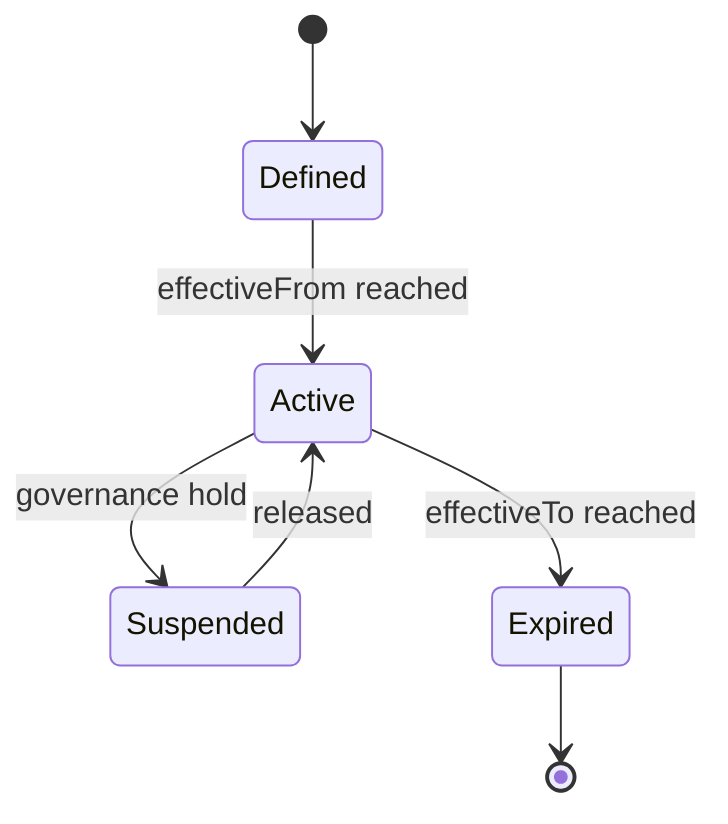

<a id="ucos-ctx-000001-workflows"></a>
##### Workflows

- define → attach policies → resolve hierarchy → detect overlap conflicts → activate → publish effective policy set

<a id="ucos-ctx-000001-authorities"></a>
##### Authorities

- Jurisdiction Authority (creates contexts in its scope)
- Platform Authority (universal context)

<a id="ucos-ctx-000001-permissions"></a>
##### Permissions

- context.create (jurisdiction authority)
- context.attachPolicy (context owner)
- context.resolve (any authenticated)

<a id="ucos-ctx-000001-privacy-model"></a>
##### Privacy Model

Context may implicitly narrow data access; privacy impact is asserted on creation and re-audited on policy attachment.

<a id="ucos-ctx-000001-audit-model"></a>
##### Audit Model

Context resolution is logged: which contexts applied, in what precedence, and which policy won on conflict. Precedence is deterministic, never incidental.

<a id="ucos-ctx-000001-digital-twin-model"></a>
##### Digital Twin Model

Context Twin mirrors real-world scope changes (e.g., a new regulatory regime activating) and projects the change through affected artifacts.

<a id="ucos-ctx-000001-agent-model"></a>
##### Agent Model

Context Agent detects overlapping contexts with contradictory policies and escalates per the Contradiction Architecture.

<a id="ucos-ctx-000001-runtime-model"></a>
##### Runtime Model

Resolution is a memoized hierarchy walk. Effective policy set = union of ancestor policies with deterministic conflict precedence (child > parent; specific > general).

<a id="ucos-ctx-000001-scaling-model"></a>
##### Scaling Model

Hierarchy is shallow and cache-friendly; resolution results cached per (Identity, Context) with invalidation on ContextPolicyAttached.

<a id="ucos-ctx-000001-multi-tenant-model"></a>
##### Multi-Tenant Model

A tenant's contexts are isolated. Cross-context projection requires explicit delegation.

<a id="ucos-ctx-000001-geo-distribution-model"></a>
##### Geo-Distribution Model

Geographical contexts are the primary sovereignty mechanism — data residency policy attaches here, not in application code.

<a id="ucos-ctx-000001-failure-model"></a>
##### Failure Model

Cycle in hierarchy, contradictory policies at same precedence, orphaned policy attachment, temporal overlap ambiguity.

<a id="ucos-ctx-000001-recovery-model"></a>
##### Recovery Model

Contexts are immutable versions; recovery = repoint to prior version. Policy attachments are event-sourced and reversible.

<a id="ucos-ctx-000001-certification-model"></a>
##### Certification Model

Context must pass acyclicity, jurisdiction ownership, policy compatibility, and deterministic precedence before activation.

<a id="ucos-ctx-000001-migration-model"></a>
##### Migration Model

New context types are registry additions. Existing contexts re-project on type definition change.

<a id="ucos-ctx-000001-implementation-blueprint"></a>
##### Implementation Blueprint

Build order for CTX: (1) define registry entries — this domain owns by breadth: universal / regional / local / instance as registry truth, not code; (2) implement the contract surface first (context.create, context.attachPolicy, context.delegate) and validate against CTX boundaries; (3) event-source all state so history is reconstructable; (4) wire the enforcement points — authority check, policy guard, evidence binding, trace — in-line, with no bypass path; (5) add tests per the Testing Architecture, citing evidence per gate; (6) obtain Verification and Certification before activation. Acceptance: the Zero Partial and Law 001 audits pass, every action answers the seven explainability questions, and this domain mutates no other domain internals.

<a id="ucos-ctx-000001-sequence-diagrams"></a>
##### Sequence Diagrams

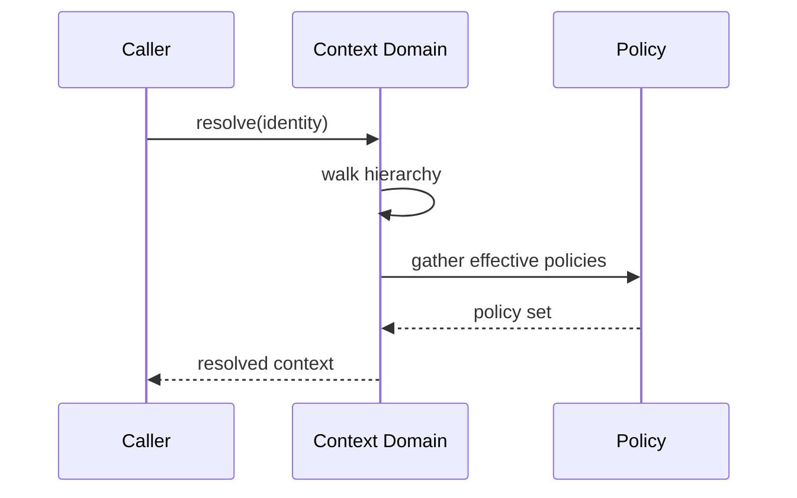

<a id="ucos-ctx-000001-state-diagrams"></a>
##### State Diagrams

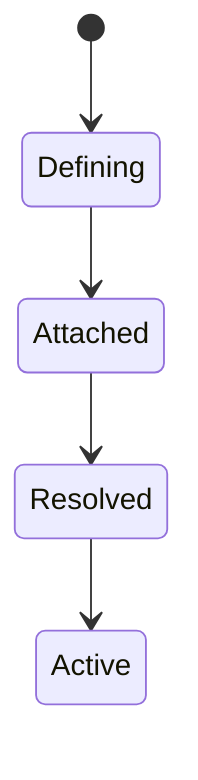

