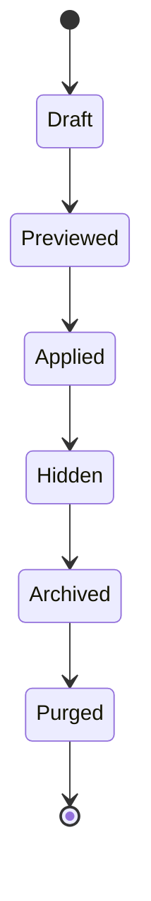
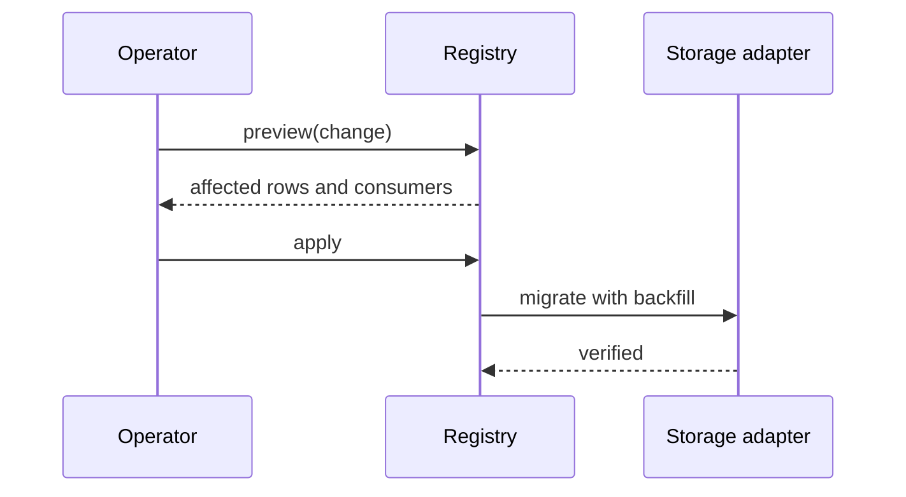
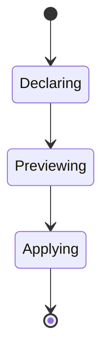
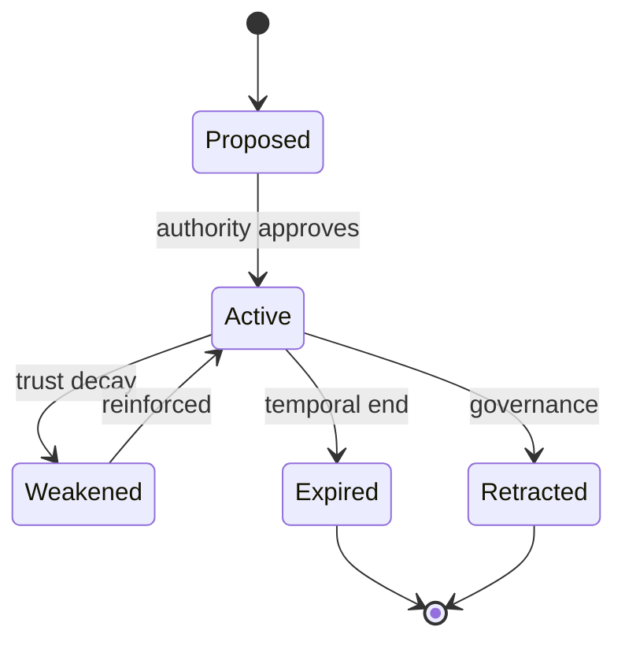
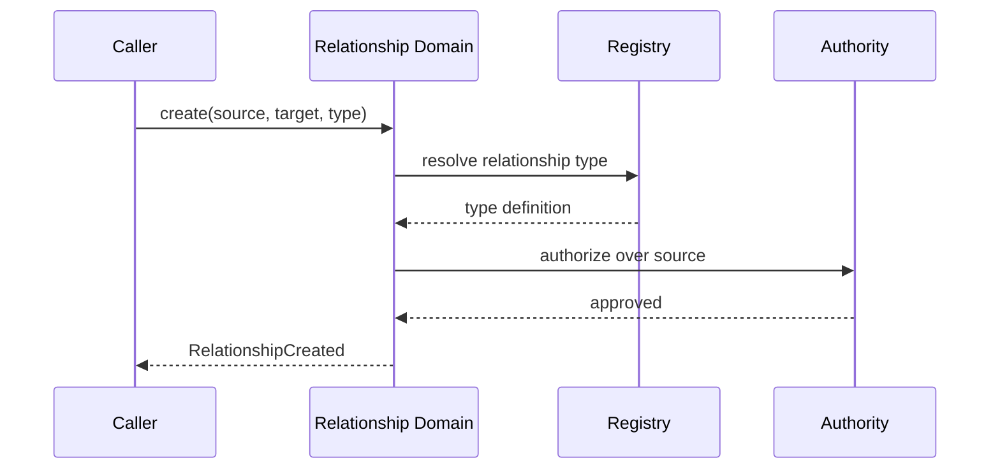
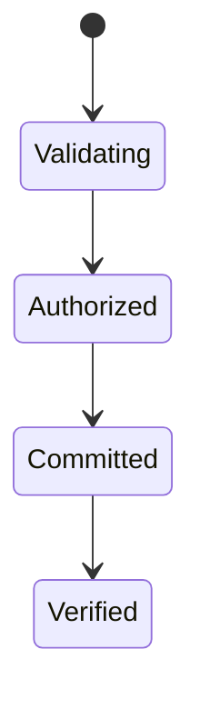

# Volume V05 · Structure

**Part of** [the master document](../UCOS-MASTER.md) · **Category** C05 · **Projected from** `_registry/` — never edit this file: change the registry and run `npm run registry`.

> How declarations are stored once and linked.

## Contents

- [D-REG Registry](#d-reg)
  - [UCOS-REG-000001 Registry Architecture](#ucos-reg-000001)
- [D-REL Relationship](#d-rel)
  - [UCOS-REL-000001 Relationship Architecture](#ucos-rel-000001)

---

<a id="d-reg"></a>
### D-REG · Registry

| | |
|---|---|
| **Category** | C05 Structure |
| **Owns** | [Registry](../UCOS-MASTER.md#t-registry), [RegistryEntry](../UCOS-MASTER.md#t-registryentry), [Metadata](../UCOS-MASTER.md#t-metadata), [Kind](../UCOS-MASTER.md#t-kind) |
| **Responsible for** | Declarations, Kinds And Attributes, Composite Kinds, Migrations, Storage Selection |
| **Not responsible for** | Constitutional Law, Relationship Integrity |
| **Contract** | [UCOS-REG-000001 Registry Architecture](#ucos-reg-000001) |
| **Artifacts** | [UCOS-REG-000001](#ucos-reg-000001) |
| **Concepts** | 327 — `node _registry/compile.js --search <words> --kind concept --owner "Registry"` |
| **Code** | `lib/entity.js`, `lib/meta.js`, `lib/parity-registries.js`, `lib/registry.js`, `lib/global.js`, `lib/canonical.js`, `lib/ucos.js`, `lib/ucos-registry.js`, `lib/ucos-foundations.js`, `lib/ucos-universes.js`, `lib/ucos-domain.js`, `lib/ucos-catalog.js`, `lib/ucos-completeness.js`, `lib/db.js`, `lib/dbpool.js`, `lib/sql.js`, `lib/pg.js`, `lib/pgbridge.js`, `lib/pgworker.js`, `lib/migrate.js`, `lib/seed/entity.json`, `lib/seed/meta.json`, `lib/seed/parity-registries.json`, `lib/seed/ucos.json`, `scripts/schema-dump.js` |
| **Managed in** | `_registry/domains.json` → `D-REG` |

<a id="ucos-reg-000001"></a>
#### UCOS-REG-000001 · Registry Architecture

Owner [Registry](#d-reg) · managed in `_registry/manifest.json` → `UCOS-REG-000001`, content `_registry/content-platform.json` → `REG` · inherits the [standard contract](../UCOS-MASTER.md#standard-contract)

<a id="ucos-reg-000001-concepts"></a>
##### Concepts

Registry Architecture owns the declarations themselves: kinds, attributes, types, validation, defaults, sensitivity, indexes and composite kinds, and where each domain is stored. Every change is a versioned migration with preview and rollback. This is the Registry primitive made operable.

<a id="ucos-reg-000001-ontology"></a>
##### Ontology

A Declaration defines a Kind with Attributes; a Composite Kind is a named set of dimensions, each a reference to a domain; a Storage Binding says which adapter holds a domain.

<a id="ucos-reg-000001-taxonomy"></a>
##### Taxonomy

By declaration: domain, kind, attribute, relation type, composite kind, view, index. By storage adapter: SQLite, PostgreSQL, document, graph, spatial, declared.

<a id="ucos-reg-000001-data-model"></a>
##### Data Model

```yaml
Declaration:
  declarationId: <Identity>
  domain: <Domain>
  kind: <Kind>
  attributes: [{name, type, required, default, sensitive, validation}]
  storage: <adapter binding>
  version: <integer>
```

<a id="ucos-reg-000001-graph-model"></a>
##### Graph Model

(:Kind)-[:IN]->(:Domain); (:Attribute)-[:OF]->(:Kind); (:CompositeKind)-[:DIMENSION]->(:Domain); (:Domain)-[:STORED_IN]->(:Adapter)

<a id="ucos-reg-000001-apis"></a>
##### APIs

- POST /reg.v1.declare
- POST /reg.v1.preview
- POST /reg.v1.apply
- POST /reg.v1.rollback
- GET  /reg.v1/{domain}

<a id="ucos-reg-000001-events"></a>
##### Events

- DeclarationAdded
- MigrationApplied
- MigrationRolledBack
- StorageMoved

<a id="ucos-reg-000001-commands"></a>
##### Commands

- declaration.add
- declaration.edit
- declaration.hide
- declaration.archive
- declaration.purge
- storage.move

<a id="ucos-reg-000001-queries"></a>
##### Queries

- registry.diff
- registry.consumers
- registry.history

<a id="ucos-reg-000001-state-machines"></a>
##### State Machines



<a id="ucos-reg-000001-workflows"></a>
##### Workflows

- declare → validate → preview (rows and consumers affected) → approve → apply live with background backfill → roll back if needed

<a id="ucos-reg-000001-authorities"></a>
##### Authorities

- The Constitutional Authority governs kernel declarations; scope owners govern their own extensions.

<a id="ucos-reg-000001-permissions"></a>
##### Permissions

- declaration.add (schema role at scope)
- declaration.purge (separate purge permission)
- registry.read (any principal)

<a id="ucos-reg-000001-privacy-model"></a>
##### Privacy Model

Sensitivity is declared here, per attribute, and enforced by Security as field-level encryption.

<a id="ucos-reg-000001-audit-model"></a>
##### Audit Model

Every declaration change is an audit record with its migration diff.

<a id="ucos-reg-000001-digital-twin-model"></a>
##### Digital Twin Model

A registry twin compares declared and stored structure to detect drift.

<a id="ucos-reg-000001-agent-model"></a>
##### Agent Model

Agents extend the registry only through preview and approval.

<a id="ucos-reg-000001-runtime-model"></a>
##### Runtime Model

Code may only use declarations the registry holds; storage is reached through the bound adapter.

<a id="ucos-reg-000001-scaling-model"></a>
##### Scaling Model

Declarations are small and cached; migrations backfill in the background.

<a id="ucos-reg-000001-multi-tenant-model"></a>
##### Multi-Tenant Model

Platform declarations are master data; a tenant extends only within its scope.

<a id="ucos-reg-000001-geo-distribution-model"></a>
##### Geo-Distribution Model

Storage bindings may differ per region to meet placement rules.

<a id="ucos-reg-000001-failure-model"></a>
##### Failure Model

An edit that orphans data, a purge of something still referenced, a storage move without verification.

<a id="ucos-reg-000001-recovery-model"></a>
##### Recovery Model

Every migration is reversible until purge; purge needs a separate permission.

<a id="ucos-reg-000001-certification-model"></a>
##### Certification Model

No code references an undeclared table or field.

<a id="ucos-reg-000001-migration-model"></a>
##### Migration Model

Today's five registry sets (entity, meta, parity, global, canonical) consolidate here.

<a id="ucos-reg-000001-implementation-blueprint"></a>
##### Implementation Blueprint

Build order for REG: (1) the declaration store; (2) preview and apply with rollback; (3) storage adapter interface (SQLite, then PostgreSQL); (4) consolidate today's registries; (5) gate test for undeclared tables and fields. Every build step also inherits Kernel parts K1–K11 (kinds, nodes, hierarchies, identifiers, shape, attributes, versions, events, change lifecycle, views and scope, resolution).

<a id="ucos-reg-000001-sequence-diagrams"></a>
##### Sequence Diagrams



<a id="ucos-reg-000001-state-diagrams"></a>
##### State Diagrams



---

<a id="d-rel"></a>
### D-REL · Relationship

| | |
|---|---|
| **Category** | C05 Structure |
| **Owns** | [Relationship](../UCOS-MASTER.md#t-relationship) |
| **Responsible for** | Relationship Definition, Relationship Resolution, Relationship Integrity |
| **Not responsible for** | Meaning, Trust, Authority |
| **Contract** | [UCOS-REL-000001 Relationship Architecture](#ucos-rel-000001) |
| **Artifacts** | [UCOS-REL-000001](#ucos-rel-000001) |
| **Concepts** | 298 — `node _registry/compile.js --search <words> --kind concept --owner "Relationship"` |
| **Code** | — |
| **Managed in** | `_registry/domains.json` → `D-REL` |

<a id="ucos-rel-000001"></a>
#### UCOS-REL-000001 · Relationship Architecture

Owner [Relationship](#d-rel) · managed in `_registry/manifest.json` → `UCOS-REL-000001`, content `_registry/content-core.json` → `REL` · inherits the [standard contract](../UCOS-MASTER.md#standard-contract)

<a id="ucos-rel-000001-concepts"></a>
##### Concepts

Relationship is a typed, contextualized, time-bounded connection between existences. Reality emerges through relationships, not through objects. Relationship ≠ Causality: a link is not a reason.

<a id="ucos-rel-000001-ontology"></a>
##### Ontology

Relationship has 1 source Identity, 1 target Identity, 1 RelationshipType (registry-driven), 0..n Context, temporal validity, and an Authority. Relationship types are open: Owns, Consumes, Produces, Requires, Provides, Contains, DependsOn, CompatibleWith, Replaces, Supersedes, Associates, Influences, Causes — plus unlimited future types from the registry.

<a id="ucos-rel-000001-taxonomy"></a>
##### Taxonomy

By direction: Directed / Undirected / Bidirectional. By strength: Structural / Behavioral / Ephemeral. By derivation: Declared / Inferred / Simulated.

<a id="ucos-rel-000001-data-model"></a>
##### Data Model

```yaml
Relationship:
  relationshipId: <Identity>
  relationshipType: <registry id>
  source: <Identity>
  target: <Identity>
  context: [<Context>]
  authority: <Authority>
  temporal: {validFrom, validTo}
  provenance: {declaredBy | inferredBy}
  trust: <Trust>
  metadata: <Metadata>
```

<a id="ucos-rel-000001-graph-model"></a>
##### Graph Model

This IS the graph. (:Identity)-[:RELATIONSHIP_TYPE {context, temporal, trust}]->(:Identity). Traversal is context-filtered at query time.

<a id="ucos-rel-000001-apis"></a>
##### APIs

- POST /relationship.v1.create
- POST /relationship.v1.query
- GET  /relationship.v1/{id}
- POST /relationship.v1/{id}/temporal
- GET  /relationship.v1.path

<a id="ucos-rel-000001-events"></a>
##### Events

- RelationshipCreated
- RelationshipRetracted
- RelationshipExpired
- RelationshipReinforced
- RelationshipInferred
- RelationshipIntegrityViolation

<a id="ucos-rel-000001-commands"></a>
##### Commands

- relationship.create
- relationship.retype
- relationship.expire
- relationship.reinforce
- relationship.retract

<a id="ucos-rel-000001-queries"></a>
##### Queries

- relationship.neighbors
- relationship.path
- relationship.byType
- relationship.byContext
- relationship.temporalAt
- relationship.density

<a id="ucos-rel-000001-state-machines"></a>
##### State Machines



<a id="ucos-rel-000001-workflows"></a>
##### Workflows

- validate endpoints exist → resolve type from registry → check authority → enforce context policy → commit → publish → integrity verify

<a id="ucos-rel-000001-authorities"></a>
##### Authorities

- Source-side Authority (declares)
- Platform Authority (retracts)
- Inference Authority (infers, lower trust by default)

<a id="ucos-rel-000001-permissions"></a>
##### Permissions

- relationship.create (endpoint owner or delegated)
- relationship.retract (platform authority)
- relationship.read (context-scoped)

<a id="ucos-rel-000001-privacy-model"></a>
##### Privacy Model

Relationships between persons are sensitive by default; traversal requires `relationship:read` scope plus a Context policy. Hidden-edge protection enforced.

<a id="ucos-rel-000001-audit-model"></a>
##### Audit Model

Every traversal of a sensitive edge is logged with the seven explainability fields. Inferred relationships are always marked as such, never presented as declared.

<a id="ucos-rel-000001-digital-twin-model"></a>
##### Digital Twin Model

Relationship Twin mirrors real-world connections (e.g., supplier links) and flags when observed reality diverges from declared relationships.

<a id="ucos-rel-000001-agent-model"></a>
##### Agent Model

Relationship Agent discovers latent edges via the Inference Domain and proposes them with reduced trust pending corroboration.

<a id="ucos-rel-000001-runtime-model"></a>
##### Runtime Model

Graph-native store. Context filtering at traversal time — no pre-materialized per-context graphs, which would duplicate truth.

<a id="ucos-rel-000001-scaling-model"></a>
##### Scaling Model

Shard by source Identity hash. Multi-hop traversal is bounded by policy hop-limit. Hot vertices are cached as projections, never as truth.

<a id="ucos-rel-000001-multi-tenant-model"></a>
##### Multi-Tenant Model

Cross-tenant edges require an explicit published RelationshipType + Policy. Default deny.

<a id="ucos-rel-000001-geo-distribution-model"></a>
##### Geo-Distribution Model

Edge locality follows Data Sovereignty: a vertex's authoritative edges live in its jurisdiction; replicas are read-only.

<a id="ucos-rel-000001-failure-model"></a>
##### Failure Model

Dangling endpoint, type registry drift, temporal inversion (validFrom > validTo), orphaned inferred edges after retraction.

<a id="ucos-rel-000001-recovery-model"></a>
##### Recovery Model

Edges are immutable + temporal; recovery is replay. Retraction is a tombstone, not a delete. Integrity job rebuilds dangling detection.

<a id="ucos-rel-000001-certification-model"></a>
##### Certification Model

Relationship must pass endpoint existence, type registry validity, authority jurisdiction, and temporal sanity.

<a id="ucos-rel-000001-migration-model"></a>
##### Migration Model

New relationship types are registry additions — zero schema migration. Retired types become non-creatable but remain queryable historically.

<a id="ucos-rel-000001-implementation-blueprint"></a>
##### Implementation Blueprint

Build order for REL: (1) define registry entries — this domain owns by direction: directed / undirected / bidirectional as registry truth, not code; (2) implement the contract surface first (relationship.create, relationship.retype, relationship.expire) and validate against REL boundaries; (3) event-source all state so history is reconstructable; (4) wire the enforcement points — authority check, policy guard, evidence binding, trace — in-line, with no bypass path; (5) add tests per the Testing Architecture, citing evidence per gate; (6) obtain Verification and Certification before activation. Acceptance: the Zero Partial and Law 001 audits pass, every action answers the seven explainability questions, and this domain mutates no other domain internals.

<a id="ucos-rel-000001-sequence-diagrams"></a>
##### Sequence Diagrams



<a id="ucos-rel-000001-state-diagrams"></a>
##### State Diagrams



