# Volume V06 · Decision and Control

**Part of** [the master document](../UCOS-MASTER.md) · **Category** C06 · **Projected from** `_registry/` — never edit this file: change the registry and run `npm run registry`.

> Who may decide, under which policy and rule, and what was decided.

## Contents

- [D-POL Policy](#d-pol)
  - [UCOS-POL-000001 Policy Architecture](#ucos-pol-000001)
- [D-RUL Rule](#d-rul)
  - [UCOS-RUL-000001 Rule Architecture](#ucos-rul-000001)
- [D-DEC Decision](#d-dec)
  - [UCOS-DEC-000001 Decision Architecture](#ucos-dec-000001)
- [D-AUT Authority](#d-aut)
  - [UCOS-AUT-000001 Authority Architecture](#ucos-aut-000001)

---

<a id="d-pol"></a>
### D-POL · Policy

| | |
|---|---|
| **Category** | C06 Decision and Control |
| **Build status** | partial |
| **Owns** | [Policy](../UCOS-MASTER.md#t-policy) |
| **Responsible for** | Behavior, Governance, Enforcement |
| **Not responsible for** | Knowledge, Meaning, Identity |
| **Contract** | [UCOS-POL-000001 Policy Architecture](#ucos-pol-000001) |
| **Artifacts** | [UCOS-POL-000001](#ucos-pol-000001) |
| **Concepts** | 342 — `node _registry/compile.js --search <words> --kind concept --owner "Policy"` |
| **Code** | `lib/policies.js` |
| **Managed in** | `_registry/domains.json` → `D-POL` |

**Live routes (6)** — what the platform serves today for this domain:

- `GET /api/ucii/policies`
- `POST /api/ucii/policies`
- `GET /api/platform/policies`
- `GET /api/platform/policies/:category`
- `PUT /api/platform/policies/:category`
- `DELETE /api/platform/policies/:category`

<a id="ucos-pol-000001"></a>
#### UCOS-POL-000001 · Policy Architecture

Owner [Policy](#d-pol) · managed in `_registry/manifest.json` → `UCOS-POL-000001`, content `_registry/content-core.json` → `POL` · inherits the [standard contract](../UCOS-MASTER.md#standard-contract)

<a id="ucos-pol-000001-concepts"></a>
##### Concepts

Policy is behavioral governance — the statement of what must, may, or must not happen. Policy ≠ Rule: policy is intent; the rule is its executable projection. All behavior derives from policy. Nothing executes that policy does not permit.

<a id="ucos-pol-000001-ontology"></a>
##### Ontology

Policy has Conditions, Actions, Priorities, Exceptions, and an Authority. Policy is resolved within a Context. Policy projects into Rules. Policy never executes directly — that is the Rule Domain's role.

<a id="ucos-pol-000001-taxonomy"></a>
##### Taxonomy

By force: Mandatory / Permissive / Prohibitive. By scope: Universal / Jurisdictional / Contextual / Instance. By origin: Constitutional / Regulatory / Organizational / Learned.

<a id="ucos-pol-000001-data-model"></a>
##### Data Model

```yaml
Policy:
  policyId: <Identity>
  intent: <Intent>
  conditions: [<registry expression>]
  actions: [<registry action>]
  priorities: [<int>]
  exceptions: [<Policy exception>]
  authority: <Authority>
  context: [<Context>]
  temporal: {effectiveFrom, effectiveTo}
  status: <Draft|Active|Retired>
```

<a id="ucos-pol-000001-graph-model"></a>
##### Graph Model

(:Policy)-[:PROJECTS_TO]->(:Rule); (:Policy)-[:ENFORCED_IN]->(:Context); (:Policy)-[:GRANTED_BY]->(:Authority); (:Policy)-[:EXCEPTIONS]->(:Policy)

<a id="ucos-pol-000001-apis"></a>
##### APIs

*Designed interface: the contract the domain is built towards. The routes it serves today are on its card.*

- POST /policy.v1.create
- POST /policy.v1.activate
- POST /policy.v1.evaluate
- GET  /policy.v1/{id}
- POST /policy.v1/{id}/retire

<a id="ucos-pol-000001-events"></a>
##### Events

- PolicyCreated
- PolicyActivated
- PolicyRetired
- PolicyEvaluated
- PolicyConflictDetected
- PolicyProjectionUpdated

<a id="ucos-pol-000001-commands"></a>
##### Commands

- policy.create
- policy.activate
- policy.retire
- policy.evaluate
- policy.exception.add
- policy.conflict.resolve

<a id="ucos-pol-000001-queries"></a>
##### Queries

- policy.byId
- policy.effectiveIn
- policy.applicableTo
- policy.conflicts
- policy.projectionStatus

<a id="ucos-pol-000001-state-machines"></a>
##### State Machines

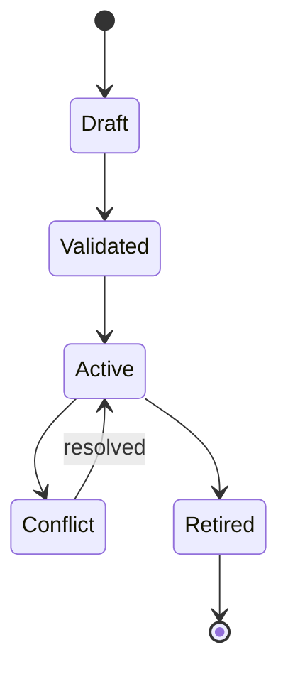

<a id="ucos-pol-000001-workflows"></a>
##### Workflows

- author intent → validate against constitution → detect conflicts → project to Rules → activate → publish → re-project on change

<a id="ucos-pol-000001-authorities"></a>
##### Authorities

- Constitutional Authority (supreme)
- Jurisdiction Authority (regional)
- Context Authority (scoped)

<a id="ucos-pol-000001-permissions"></a>
##### Permissions

- policy.create (authority in scope)
- policy.activate (same or higher authority)
- policy.evaluate (any authenticated, result scoped)

<a id="ucos-pol-000001-privacy-model"></a>
##### Privacy Model

Policies governing personal data must reference a lawful basis via the Consent Architecture; purpose limitation is a first-class condition.

<a id="ucos-pol-000001-audit-model"></a>
##### Audit Model

Every PolicyEvaluated records the input facts, matched conditions, chosen action, and precedence rationale. Denials carry appeal references.

<a id="ucos-pol-000001-digital-twin-model"></a>
##### Digital Twin Model

Policy Twin mirrors real-world regulatory text and flags when observed regulation drifts from enacted policy.

<a id="ucos-pol-000001-agent-model"></a>
##### Agent Model

Policy Agent detects conflicts between overlapping policies and proposes precedence resolutions under governance.

<a id="ucos-pol-000001-runtime-model"></a>
##### Runtime Model

Evaluation is a forward-chaining pass over the effective policy set for a Context; result is cached per (subject, context, fact-hash).

<a id="ucos-pol-000001-scaling-model"></a>
##### Scaling Model

Policy resolution is read-heavy and cacheable; invalidation is event-driven on PolicyActivated/PolicyRetired in the affected Context.

<a id="ucos-pol-000001-multi-tenant-model"></a>
##### Multi-Tenant Model

Tenant policies cannot override constitutional policy; precedence is Constitutional > Jurisdictional > Tenant > Contextual.

<a id="ucos-pol-000001-geo-distribution-model"></a>
##### Geo-Distribution Model

Jurisdictional policy is geo-scoped; where two jurisdictions conflict, Data Sovereignty policy decides the applicable set — both are recorded, neither is silently dropped.

<a id="ucos-pol-000001-failure-model"></a>
##### Failure Model

Conflict at equal precedence, unsatisfiable condition set, projection failure to Rules, policy storm (mass activation).

<a id="ucos-pol-000001-recovery-model"></a>
##### Recovery Model

Policies are versioned and event-sourced; retirement is reversible. Projection failures roll back to the last validated projection.

<a id="ucos-pol-000001-certification-model"></a>
##### Certification Model

Policy must pass constitutional conformance, conflict precedence determinism, and successful rule projection before activation.

<a id="ucos-pol-000001-migration-model"></a>
##### Migration Model

Policy language evolves by registry expression extension — never by changing the policy schema.

<a id="ucos-pol-000001-implementation-blueprint"></a>
##### Implementation Blueprint

Build order for POL: (1) define registry entries — this domain owns by force: mandatory / permissive / prohibitive as registry truth, not code; (2) implement the contract surface first (policy.create, policy.activate, policy.retire) and validate against POL boundaries; (3) event-source all state so history is reconstructable; (4) wire the enforcement points — authority check, policy guard, evidence binding, trace — in-line, with no bypass path; (5) add tests per the Testing Architecture, citing evidence per gate; (6) obtain Verification and Certification before activation. Acceptance: the Zero Partial and Law 001 audits pass, every action answers the seven explainability questions, and this domain mutates no other domain internals.

<a id="ucos-pol-000001-sequence-diagrams"></a>
##### Sequence Diagrams

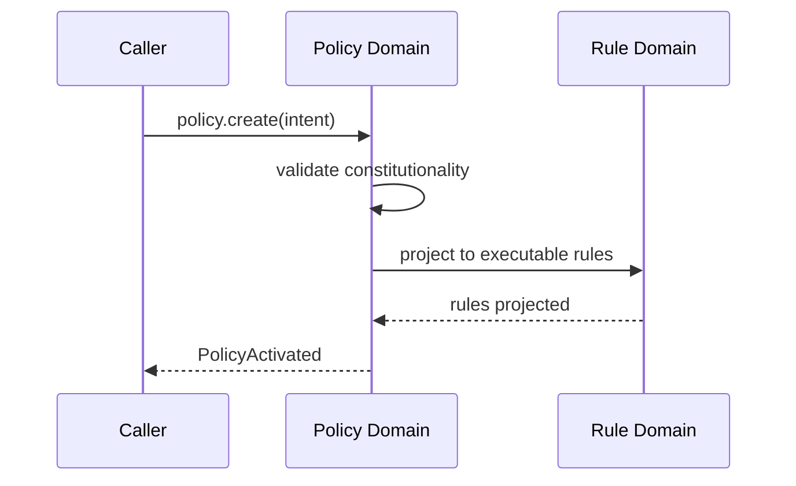

<a id="ucos-pol-000001-state-diagrams"></a>
##### State Diagrams

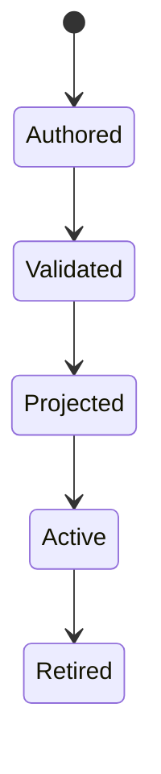

---

<a id="d-rul"></a>
### D-RUL · Rule

| | |
|---|---|
| **Category** | C06 Decision and Control |
| **Build status** | partial |
| **Owns** | [Rule](../UCOS-MASTER.md#t-rule) |
| **Responsible for** | Executable Constraint Definition, Rule Evaluation Readiness |
| **Not responsible for** | Policy Intent, Decision |
| **Contract** | [UCOS-RUL-000001 Rule Architecture](#ucos-rul-000001) |
| **Artifacts** | [UCOS-RUL-000001](#ucos-rul-000001) |
| **Concepts** | 35 — `node _registry/compile.js --search <words> --kind concept --owner "Rule"` |
| **Code** | `lib/registry.js`, `lib/rules.js`, `lib/gates.js`, `lib/tax.js`, `lib/seed/gates.json`, `lib/seed/rules.json`, `lib/seed/tax.json` |
| **Managed in** | `_registry/domains.json` → `D-RUL` |

**Live routes (14)** — what the platform serves today for this domain:

- `GET /api/admin/tax/report`
- `GET /api/admin/tax`
- `POST /api/admin/tax/quote`
- `GET /api/platform/rules`
- `POST /api/platform/rules`
- `POST /api/platform/rules/explain`
- `DELETE /api/platform/rules/:id`
- `GET /api/admin/rules`
- `GET /api/admin/rules/subjects`
- `GET /api/platform/rules/subjects`
- `POST /api/admin/rules`
- `POST /api/admin/rules/explain`
- `DELETE /api/admin/rules/:id`
- `POST /api/rules/check`

<a id="ucos-rul-000001"></a>
#### UCOS-RUL-000001 · Rule Architecture

Owner [Rule](#d-rul) · managed in `_registry/manifest.json` → `UCOS-RUL-000001`, content `_registry/content-core.json` → `RUL` · inherits the [standard contract](../UCOS-MASTER.md#standard-contract)

<a id="ucos-rul-000001-concepts"></a>
##### Concepts

Rule is the executable constraint derived from Policy. Rule ≠ Policy and Rule ≠ Decision. Rules are the machine-runnable projection of governance intent. A rule never contradicts its parent policy.

<a id="ucos-rul-000001-ontology"></a>
##### Ontology

Rule has exactly 1 parent Policy, an executable expression, an evaluation order, and an effect. Rules are composable but never self-referential.

<a id="ucos-rul-000001-taxonomy"></a>
##### Taxonomy

By effect: Permit / Deny / Require / Transform / Notify / Defer. By evaluation: Boolean / Threshold / Set-membership / Registry-lookup / Composite.

<a id="ucos-rul-000001-data-model"></a>
##### Data Model

```yaml
Rule:
  ruleId: <Identity>
  derivedFrom: <Policy>
  expression: <registry expression id>
  effect: <Permit|Deny|Require|Transform|Notify|Defer>
  priority: <int>
  evalOrder: <int>
  onConflict: <registry strategy>
  temporal: {effectiveFrom, effectiveTo}
```

<a id="ucos-rul-000001-graph-model"></a>
##### Graph Model

(:Rule)-[:DERIVED_FROM]->(:Policy); (:Rule)-[:EVALUATED_IN]->(:Evaluation); (:Rule)-[:CONFLICTS_WITH]->(:Rule)

<a id="ucos-rul-000001-apis"></a>
##### APIs

*Designed interface: the contract the domain is built towards. The routes it serves today are on its card.*

- POST /rule.v1.evaluate
- GET  /rule.v1/{id}
- GET  /rule.v1/byPolicy/{policyId}
- POST /rule.v1.validate

<a id="ucos-rul-000001-events"></a>
##### Events

- RuleEvaluated
- RuleProjectionUpdated
- RuleConflictDetected
- RuleDisabled
- RuleReconciled

<a id="ucos-rul-000001-commands"></a>
##### Commands

- rule.evaluate
- rule.validate
- rule.reorder
- rule.disable
- rule.reconcile

<a id="ucos-rul-000001-queries"></a>
##### Queries

- rule.byId
- rule.byPolicy
- rule.applicable
- rule.conflicts
- rule.coverage

<a id="ucos-rul-000001-state-machines"></a>
##### State Machines

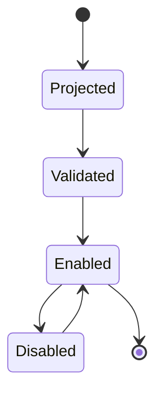

<a id="ucos-rul-000001-workflows"></a>
##### Workflows

- policy projects rule → static validation → conflict reconciliation → enable → evaluate at runtime

<a id="ucos-rul-000001-authorities"></a>
##### Authorities

- Inherits parent policy's authority; no independent authority.

<a id="ucos-rul-000001-permissions"></a>
##### Permissions

- rule.evaluate (runtime, scoped)
- rule.disable (parent policy authority)
- rule.reorder (parent policy authority)

<a id="ucos-rul-000001-privacy-model"></a>
##### Privacy Model

Rule expressions over personal data must carry the consent scope of their parent policy; evaluation logs minimize captured facts.

<a id="ucos-rul-000001-audit-model"></a>
##### Audit Model

Every RuleEvaluated records input facts, matched rule, effect, and evaluation time. Deterministic replay must reproduce identical outcomes.

<a id="ucos-rul-000001-digital-twin-model"></a>
##### Digital Twin Model

Rule Twin tracks real-world enforcement outcomes and flags divergence between rule effect and observed behavior.

<a id="ucos-rul-000001-agent-model"></a>
##### Agent Model

Rule Agent detects unreachable or redundant rules and proposes pruning under governance.

<a id="ucos-rul-000001-runtime-model"></a>
##### Runtime Model

Rules compile to a decision DAG per Context; evaluation is fact-driven with short-circuit on Deny for mandatory policies.

<a id="ucos-rul-000001-scaling-model"></a>
##### Scaling Model

DAG compilation cached per policy version; runtime evaluation is sub-millisecond. Hot paths are precompiled.

<a id="ucos-rul-000001-multi-tenant-model"></a>
##### Multi-Tenant Model

Rules are tenant-scoped through their parent policy; cross-tenant evaluation is constitutionally forbidden.

<a id="ucos-rul-000001-geo-distribution-model"></a>
##### Geo-Distribution Model

Rule evaluation is local per region; the compiled DAG is replicated, authoritative projection stays in jurisdiction.

<a id="ucos-rul-000001-failure-model"></a>
##### Failure Model

Non-deterministic expression, projection drift from policy, evaluation timeout, conflicting effects at equal priority.

<a id="ucos-rul-000001-recovery-model"></a>
##### Recovery Model

Rules are derived, so recovery is re-projection from the parent policy. No rule is ever hand-restored.

<a id="ucos-rul-000001-certification-model"></a>
##### Certification Model

Rule must pass determinism (same facts → same effect), policy conformance, and termination guarantees.

<a id="ucos-rul-000001-migration-model"></a>
##### Migration Model

Expression language evolves by registry; existing rules re-project on language version change.

<a id="ucos-rul-000001-implementation-blueprint"></a>
##### Implementation Blueprint

Build order for RUL: (1) define registry entries — this domain owns by effect: permit / deny / require / transform / notify / defer as registry truth, not code; (2) implement the contract surface first (rule.evaluate, rule.validate, rule.reorder) and validate against RUL boundaries; (3) event-source all state so history is reconstructable; (4) wire the enforcement points — authority check, policy guard, evidence binding, trace — in-line, with no bypass path; (5) add tests per the Testing Architecture, citing evidence per gate; (6) obtain Verification and Certification before activation. Acceptance: the Zero Partial and Law 001 audits pass, every action answers the seven explainability questions, and this domain mutates no other domain internals.

<a id="ucos-rul-000001-sequence-diagrams"></a>
##### Sequence Diagrams

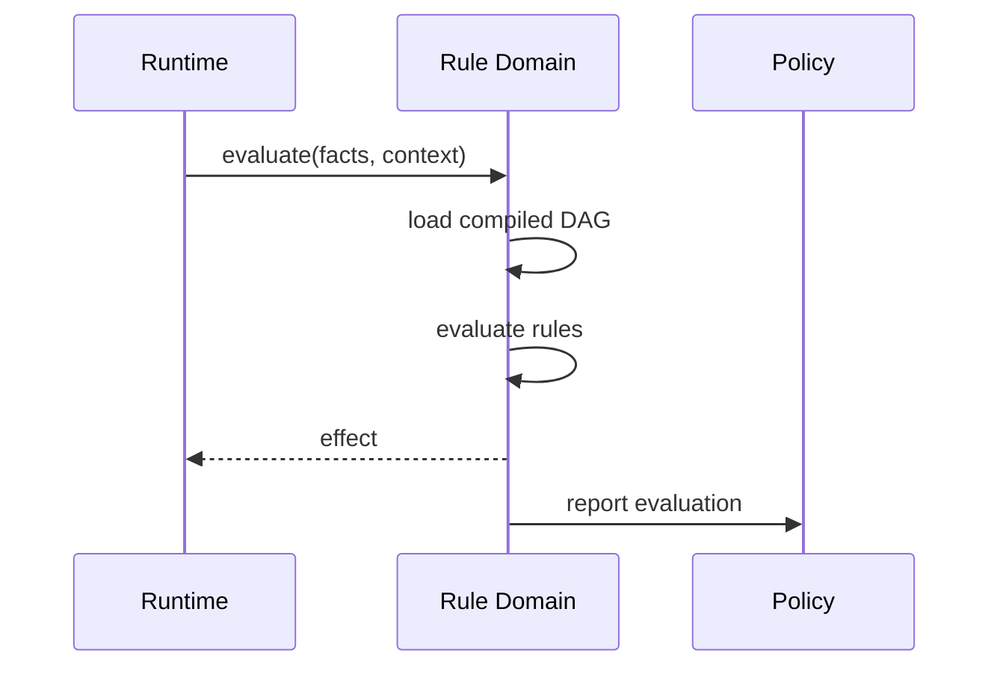

<a id="ucos-rul-000001-state-diagrams"></a>
##### State Diagrams

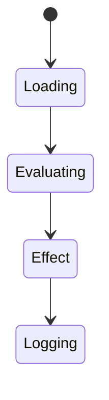

---

<a id="d-dec"></a>
### D-DEC · Decision

| | |
|---|---|
| **Category** | C06 Decision and Control |
| **Build status** | designed — declared and contracted; no code or live route yet |
| **Owns** | [Decision](../UCOS-MASTER.md#t-decision) |
| **Responsible for** | Decision Recording, Decision Lineage |
| **Not responsible for** | Rule Execution Semantics |
| **Contract** | [UCOS-DEC-000001 Decision Architecture](#ucos-dec-000001) |
| **Artifacts** | [UCOS-DEC-000001](#ucos-dec-000001) |
| **Concepts** | 212 — `node _registry/compile.js --search <words> --kind concept --owner "Decision"` |
| **Code** | — |
| **Managed in** | `_registry/domains.json` → `D-DEC` |

**Live routes:** none yet.

<a id="ucos-dec-000001"></a>
#### UCOS-DEC-000001 · Decision Architecture

Owner [Decision](#d-dec) · managed in `_registry/manifest.json` → `UCOS-DEC-000001`, content `_registry/content-platform.json` → `DEC` · inherits the [standard contract](../UCOS-MASTER.md#standard-contract)

<a id="ucos-dec-000001-concepts"></a>
##### Concepts

Decision Architecture records the outcome of evaluating rules against evidence, with its lineage, so every outcome the platform acts on can be traced to the rule versions, evidence and authority that produced it. A decision is recorded once and never edited; a reversal is a new decision that references the old one.

<a id="ucos-dec-000001-ontology"></a>
##### Ontology

A Decision has an Outcome, the Rules evaluated (with versions), the Evidence considered, the Context it applied in, the Authority under which it was taken, and a Lineage to earlier decisions it supersedes.

<a id="ucos-dec-000001-taxonomy"></a>
##### Taxonomy

By maker: Rule-evaluated / Person / Agent / Hybrid. By reversibility: Reversible / Irreversible. By scope: Platform / Tenant / Store / Single subject.

<a id="ucos-dec-000001-data-model"></a>
##### Data Model

```yaml
Decision:
  decisionId: <Identity>
  outcome: <registry outcome>
  rules: [<Rule identity + version>]
  evidence: [<Evidence>]
  context: <Context>
  authority: <Authority>
  supersedes: <Decision identity | null>
  temporal: {decidedAt, validFrom, validTo}
```

<a id="ucos-dec-000001-graph-model"></a>
##### Graph Model

(:Decision)-[:EVALUATED]->(:Rule); (:Decision)-[:CONSIDERED]->(:Evidence); (:Decision)-[:UNDER]->(:Authority); (:Decision)-[:SUPERSEDES]->(:Decision)

<a id="ucos-dec-000001-apis"></a>
##### APIs

*Designed interface: the contract the domain is built towards. The routes it serves today are on its card.*

- POST /dec.v1.record
- GET  /dec.v1/{id}
- GET  /dec.v1/{id}/lineage
- POST /dec.v1.supersede
- POST /dec.v1.query

<a id="ucos-dec-000001-events"></a>
##### Events

- DecisionRecorded
- DecisionSuperseded
- DecisionExplained

<a id="ucos-dec-000001-commands"></a>
##### Commands

- decision.record
- decision.supersede
- decision.explain

<a id="ucos-dec-000001-queries"></a>
##### Queries

- decision.lineage
- decision.bySubject
- decision.byRule

<a id="ucos-dec-000001-state-machines"></a>
##### State Machines

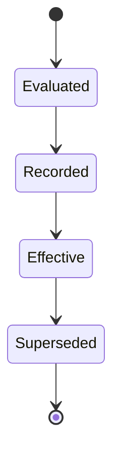

<a id="ucos-dec-000001-workflows"></a>
##### Workflows

- context resolved → rules selected → rules evaluated against evidence → outcome recorded with lineage → effects released to Runtime

<a id="ucos-dec-000001-authorities"></a>
##### Authorities

- Decision Authority records; the Authority domain decides who may take each class of decision.

<a id="ucos-dec-000001-permissions"></a>
##### Permissions

- decision.record (engine or authorised party)
- decision.supersede (authority over the original)
- decision.read (subject and auditors)

<a id="ucos-dec-000001-privacy-model"></a>
##### Privacy Model

A decision about a person is readable by that person; inputs that are sensitive attributes are referenced, never copied.

<a id="ucos-dec-000001-audit-model"></a>
##### Audit Model

Every decision is an audit record with its seven explainability answers.

<a id="ucos-dec-000001-digital-twin-model"></a>
##### Digital Twin Model

Decision twin tracks outcome distributions per rule to detect drift.

<a id="ucos-dec-000001-agent-model"></a>
##### Agent Model

Agents may propose decisions; money and irreversible classes need the approval their rule declares.

<a id="ucos-dec-000001-runtime-model"></a>
##### Runtime Model

Decisions are recorded synchronously before their effects run, so no effect exists without its decision.

<a id="ucos-dec-000001-scaling-model"></a>
##### Scaling Model

Decisions shard by subject; lineage queries walk a bounded supersession chain.

<a id="ucos-dec-000001-multi-tenant-model"></a>
##### Multi-Tenant Model

A tenant's decisions are isolated; platform decisions bound tenant decisions.

<a id="ucos-dec-000001-geo-distribution-model"></a>
##### Geo-Distribution Model

A decision carries the place it applied to, so a jurisdiction's decisions can be listed and audited.

<a id="ucos-dec-000001-failure-model"></a>
##### Failure Model

Missing evidence, rule version drift between evaluation and recording, effects run without a decision.

<a id="ucos-dec-000001-recovery-model"></a>
##### Recovery Model

Decisions are immutable; recovery replays effects from the decision log.

<a id="ucos-dec-000001-certification-model"></a>
##### Certification Model

Every effect must point to a recorded decision; an orphan effect fails certification.

<a id="ucos-dec-000001-migration-model"></a>
##### Migration Model

New decision classes are registry additions.

<a id="ucos-dec-000001-implementation-blueprint"></a>
##### Implementation Blueprint

Build order for DEC: (1) the decision record and its lineage; (2) record-before-effect in Runtime; (3) supersession instead of edits; (4) the explain query; (5) tests that fail on an effect without a decision. Every build step also inherits Kernel parts K1–K11 (kinds, nodes, hierarchies, identifiers, shape, attributes, versions, events, change lifecycle, views and scope, resolution).

<a id="ucos-dec-000001-sequence-diagrams"></a>
##### Sequence Diagrams

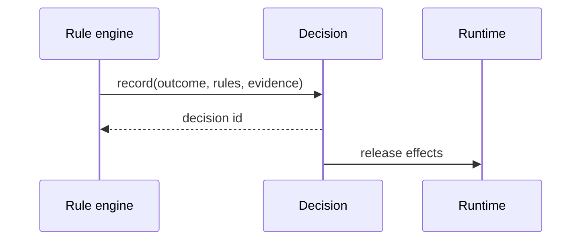

<a id="ucos-dec-000001-state-diagrams"></a>
##### State Diagrams

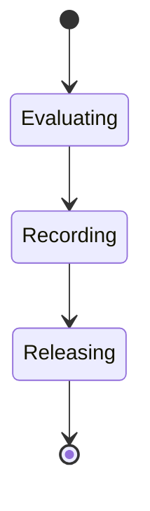

---

<a id="d-aut"></a>
### D-AUT · Authority

| | |
|---|---|
| **Category** | C06 Decision and Control |
| **Build status** | partial |
| **Owns** | [Authority](../UCOS-MASTER.md#t-authority), [Ownership](../UCOS-MASTER.md#t-ownership), [Permission](../UCOS-MASTER.md#t-permission) |
| **Responsible for** | Governance Rights, Jurisdictions, Delegations, Permissions |
| **Not responsible for** | Knowledge, Meaning, Relationships |
| **Contract** | [UCOS-AUT-000001 Authority Architecture](#ucos-aut-000001) |
| **Artifacts** | [UCOS-AUT-000001](#ucos-aut-000001) |
| **Concepts** | 331 — `node _registry/compile.js --search <words> --kind concept --owner "Authority"` |
| **Code** | `lib/authz.js`, `lib/rbac.js`, `lib/prbac.js`, `lib/seed/authz.json` |
| **Managed in** | `_registry/domains.json` → `D-AUT` |

**Live routes (9)** — what the platform serves today for this domain:

- `GET /api/admin/roles`
- `POST /api/admin/roles`
- `DELETE /api/admin/roles/:key`
- `POST /api/admin/roles/reset`
- `GET /api/platform/roles`
- `POST /api/platform/roles`
- `DELETE /api/platform/roles/:key`
- `POST /api/platform/roles/staff`
- `DELETE /api/platform/roles/staff/:key`

<a id="ucos-aut-000001"></a>
#### UCOS-AUT-000001 · Authority Architecture

Owner [Authority](#d-aut) · managed in `_registry/manifest.json` → `UCOS-AUT-000001`, content `_registry/content-core.json` → `AUT` · inherits the [standard contract](../UCOS-MASTER.md#standard-contract)

<a id="ucos-aut-000001-concepts"></a>
##### Concepts

Authority is the right to govern within a jurisdiction. Authority ≠ Ownership: authority is the right; ownership is the responsibility. Authority is delegable, revocable, and always bounded.

<a id="ucos-aut-000001-ontology"></a>
##### Ontology

Authority has a Jurisdiction, Rights, Responsibilities, and a delegating parent Authority. Types: Platform / Tenant / Country / Regulatory / Corporate / Future — all registry-driven.

<a id="ucos-aut-000001-taxonomy"></a>
##### Taxonomy

By scope: Universal / Jurisdictional / Organizational / Contextual. By source: Constitutional / Delegated / Assumed (weakest) / Attested.

<a id="ucos-aut-000001-data-model"></a>
##### Data Model

```yaml
Authority:
  authorityId: <Identity>
  type: <registry id>
  jurisdiction: <Context>
  rights: [<registry capability>]
  responsibilities: [<registry obligation>]
  delegatedFrom: <Authority|null>
  temporal: {grantedAt, revokedAt}
  status: <Active|Revoked|Expired>
```

<a id="ucos-aut-000001-graph-model"></a>
##### Graph Model

(:Authority)-[:DELEGATED_FROM*]->(:Authority); (:Authority)-[:JURISDICTION]->(:Context); (:Authority)-[:GRANTS]->(:Policy|:Permission); (:Authority)<-[:ASSERTED_BY]-(:Knowledge)

<a id="ucos-aut-000001-apis"></a>
##### APIs

*Designed interface: the contract the domain is built towards. The routes it serves today are on its card.*

- POST /authority.v1.grant
- POST /authority.v1.delegate
- POST /authority.v1.revoke
- GET  /authority.v1/{id}
- GET  /authority.v1.resolve

<a id="ucos-aut-000001-events"></a>
##### Events

- AuthorityGranted
- AuthorityDelegated
- AuthorityRevoked
- AuthorityChallenged
- AuthorityExpired
- AuthorityChainViolation

<a id="ucos-aut-000001-commands"></a>
##### Commands

- authority.grant
- authority.delegate
- authority.revoke
- authority.attest
- authority.challenge

<a id="ucos-aut-000001-queries"></a>
##### Queries

- authority.byId
- authority.resolve
- authority.chain
- authority.jurisdiction
- authority.conflicts

<a id="ucos-aut-000001-state-machines"></a>
##### State Machines

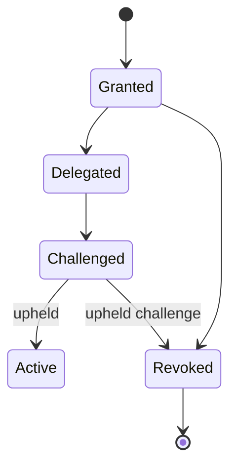

<a id="ucos-aut-000001-workflows"></a>
##### Workflows

- grant → scope to jurisdiction → delegate with reduced rights → challenge on suspicion → revoke with cascade to derived authorities

<a id="ucos-aut-000001-authorities"></a>
##### Authorities

- Constitutional Authority is self-sovereign; all others derive from it.

<a id="ucos-aut-000001-permissions"></a>
##### Permissions

- authority.grant (holder of the right being granted)
- authority.delegate (holder, with rights subset)
- authority.revoke (granter or higher)

<a id="ucos-aut-000001-privacy-model"></a>
##### Privacy Model

Authority chains over personal jurisdictions are auditable but access-restricted; revocation of consent cascades to derived grants.

<a id="ucos-aut-000001-audit-model"></a>
##### Audit Model

Every governed action records its full authority chain back to the Constitutional Authority. Untraceable chains are denied by default.

<a id="ucos-aut-000001-digital-twin-model"></a>
##### Digital Twin Model

Authority Twin mirrors real-world governance changes (e.g., regulatory body restructure) and cascades them through delegations.

<a id="ucos-aut-000001-agent-model"></a>
##### Agent Model

Authority Agent detects over-broad delegations and authority chain anomalies, challenging them under governance.

<a id="ucos-aut-000001-runtime-model"></a>
##### Runtime Model

Resolution walks the delegation chain with memoization; revocation invalidates the entire derived subtree.

<a id="ucos-aut-000001-scaling-model"></a>
##### Scaling Model

Chain depth is bounded by constitution. Resolution cached per (Authority, right); invalidation on AuthorityRevoked.

<a id="ucos-aut-000001-multi-tenant-model"></a>
##### Multi-Tenant Model

Tenant authority is bounded by constitutional authority — delegation cannot exceed the granter's rights (monotone decreasing).

<a id="ucos-aut-000001-geo-distribution-model"></a>
##### Geo-Distribution Model

Jurisdictional authority is geo-scoped; cross-jurisdiction action requires authority recognized in both — or is denied.

<a id="ucos-aut-000001-failure-model"></a>
##### Failure Model

Delegation cycle, rights inflation (child > parent), orphaned chain after revocation, jurisdiction gap.

<a id="ucos-aut-000001-recovery-model"></a>
##### Recovery Model

Chains are append-only; revocation is a terminal event. Recovery rebuilds the effective-authority projection from the chain.

<a id="ucos-aut-000001-certification-model"></a>
##### Certification Model

Authority must pass chain traceability, rights monotonicity, jurisdiction validity, and non-expiration.

<a id="ucos-aut-000001-migration-model"></a>
##### Migration Model

New authority types are registry additions; existing chains re-resolve on type change.

<a id="ucos-aut-000001-implementation-blueprint"></a>
##### Implementation Blueprint

Build order for AUT: (1) define registry entries — this domain owns by scope: universal / jurisdictional / organizational / contextual as registry truth, not code; (2) implement the contract surface first (authority.grant, authority.delegate, authority.revoke) and validate against AUT boundaries; (3) event-source all state so history is reconstructable; (4) wire the enforcement points — authority check, policy guard, evidence binding, trace — in-line, with no bypass path; (5) add tests per the Testing Architecture, citing evidence per gate; (6) obtain Verification and Certification before activation. Acceptance: the Zero Partial and Law 001 audits pass, every action answers the seven explainability questions, and this domain mutates no other domain internals.

<a id="ucos-aut-000001-sequence-diagrams"></a>
##### Sequence Diagrams

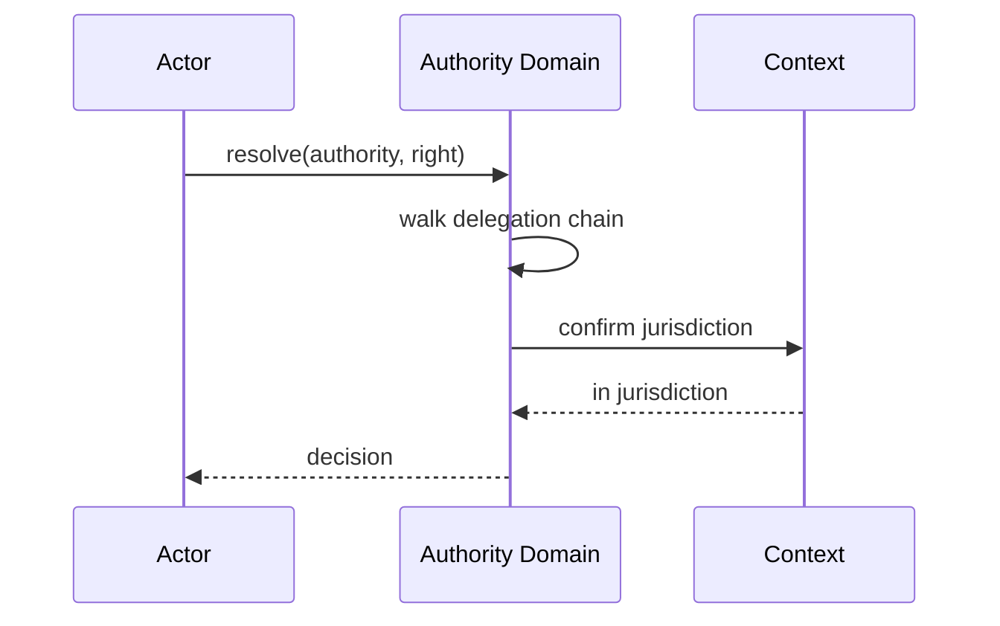

<a id="ucos-aut-000001-state-diagrams"></a>
##### State Diagrams

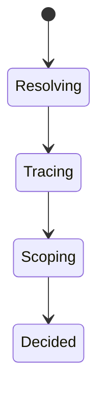

