# Volume V07 · Assurance

**Part of** [the master document](../UCOS-MASTER.md) · **Category** C07 · **Projected from** `_registry/` — never edit this file: change the registry and run `npm run registry`.

> Protection, computed trust, the immutable record, and obligations.

## Contents

- [D-SEC Security](#d-sec)
  - [UCOS-IAM-000001 Identity & Access Management](#ucos-iam-000001)
  - [UCOS-ZTA-000001 Zero Trust Architecture](#ucos-zta-000001)
  - [UCOS-CRY-000001 Cryptography Architecture](#ucos-cry-000001)
  - [UCOS-KMS-000001 Key Management Architecture](#ucos-kms-000001)
  - [UCOS-SEC-000001 Security Runtime Architecture](#ucos-sec-000001)
- [D-TRU Trust](#d-tru)
  - [UCOS-TRS-000001 Trust Architecture](#ucos-trs-000001)
- [D-AUD Audit](#d-aud)
  - [UCOS-AUD-000001 Audit Architecture](#ucos-aud-000001)
- [D-CMP Compliance](#d-cmp)
  - [UCOS-DSP-000001 Data Sovereignty Architecture](#ucos-dsp-000001)
  - [UCOS-CNS-000001 Consent Architecture](#ucos-cns-000001)
  - [UCOS-CMP-000001 Compliance Architecture](#ucos-cmp-000001)

---

<a id="d-sec"></a>
### D-SEC · Security

| | |
|---|---|
| **Category** | C07 Assurance |
| **Build status** | partial |
| **Owns** | [Credential](../UCOS-MASTER.md#t-credential), [Key](../UCOS-MASTER.md#t-key) |
| **Responsible for** | Authentication, Sign-in Methods, Keys And Encryption, Threat Protection, Security Incidents |
| **Not responsible for** | Trust Computation, Permissions, Audit Record |
| **Contract** | [UCOS-SEC-000001 Security Runtime Architecture](#ucos-sec-000001) |
| **Artifacts** | [UCOS-IAM-000001](#ucos-iam-000001), [UCOS-ZTA-000001](#ucos-zta-000001), [UCOS-CRY-000001](#ucos-cry-000001), [UCOS-KMS-000001](#ucos-kms-000001), [UCOS-SEC-000001](#ucos-sec-000001) |
| **Concepts** | 285 — `node _registry/compile.js --search <words> --kind concept --owner "Security"` |
| **Code** | `lib/security.js`, `lib/identity.js`, `lib/webauthn.js`, `lib/risk.js` |
| **Managed in** | `_registry/domains.json` → `D-SEC` |

**Live routes (45)** — what the platform serves today for this domain:

- `GET /api/session`
- `POST /api/auth/register`
- `POST /api/auth/login`
- `POST /api/auth/logout`
- `POST /api/auth/token-exchange`
- `POST /api/admin/risk/screen`
- `GET /api/admin/risk/blocklist`
- `POST /api/admin/risk/blocklist`
- `GET /api/admin/risk/queue`
- `PUT /api/admin/risk/:id/resolve`
- `GET /api/platform/identity-templates`
- `POST /api/platform/identity-templates`
- `DELETE /api/platform/identity-templates/:id`
- `GET /api/platform/identity-templates/:id`
- `PUT /api/platform/identity-templates/:id`
- `POST /api/platform/identity-templates/:id/apply`
- `GET /api/admin/sso`
- `PUT /api/admin/sso`
- `POST /api/auth/sso/start`
- `POST /api/auth/sso/callback`
- `GET /api/admin/identity-providers`
- `PUT /api/admin/identity-providers`
- `DELETE /api/admin/identity-providers/:id`
- `GET /api/admin/identity-provider-types`
- `POST /api/admin/identity-provider-types`
- `GET /api/admin/identity-settings`
- `PUT /api/admin/identity-settings`
- `POST /api/auth/password/forgot`
- `POST /api/auth/password/reset`
- `POST /api/auth/login-init`
- `POST /api/auth/login/otp`
- `POST /api/auth/login/magic`
- `POST /api/auth/login/biometric`
- `POST /api/auth/biometric/register`
- `POST /api/auth/login/callback`
- `GET /api/auth/methods`
- `GET /api/scim/Users`
- `POST /api/scim/Users`
- `POST /api/admin/scim/token`
- `POST /api/platform/login`
- `POST /api/platform/logout`
- `GET /api/platform/me`
- `GET /api/auth/me`
- `GET /api/platform/security`
- `POST /api/platform/keys/rotate`

<a id="ucos-iam-000001"></a>
#### UCOS-IAM-000001 · Identity & Access Management

Owner [Security](#d-sec) · managed in `_registry/manifest.json` → `UCOS-IAM-000001`, content `_registry/content-sec-ops-dep-qlt.json` → `IAM` · inherits the [standard contract](../UCOS-MASTER.md#standard-contract)

<a id="ucos-iam-000001-concepts"></a>
##### Concepts

Identity & Access Management authenticates every actor and authorizes every action. There is no unauthenticated path and no unaudited grant. Identity (who you are), Authentication (proof), Authorization (what you may do), and Delegation (on whose behalf) are four separate, governed concerns.

<a id="ucos-iam-000001-ontology"></a>
##### Ontology

IAM binds an Identity to Authentication evidence to an Authority scope to a Permission set. Permissions are granted, never assumed; every grant is reversible and traceable to its granter.

<a id="ucos-iam-000001-taxonomy"></a>
##### Taxonomy

By actor: Human / Agent / Service / System. By factor: Passwordless / MFA / Hardware-key / Certificate / Token / Biometric. By scope: Platform / Tenant / Context / Instance.

<a id="ucos-iam-000001-data-model"></a>
##### Data Model

```yaml
AccessGrant:
  grantId: <Identity>
  subject: <Identity>
  authority: <Authority>
  permissions: [<registry permission>]
  scope: <Context>
  temporal: {grantedAt, expiresAt}
  delegatedFrom: <Grant|null>
  conditions: [<registry expression>]
```

<a id="ucos-iam-000001-graph-model"></a>
##### Graph Model

(:Grant)-[:TO]->(:Identity); (:Grant)-[:WITHIN]->(:Context); (:Grant)-[:DELEGATED_FROM]->(:Grant); (:Grant)-[:REVOKED_BY]->(:Authority)

<a id="ucos-iam-000001-apis"></a>
##### APIs

*Designed interface: the contract the domain is built towards. The routes it serves today are on its card.*

- POST /iam.v1.authenticate
- POST /iam.v1.authorize
- POST /iam.v1.grant
- POST /iam.v1.revoke
- GET  /iam.v1.grants/{subjectId}

<a id="ucos-iam-000001-events"></a>
##### Events

- Authenticated
- Authorized
- Granted
- Revoked
- Delegated
- GrantExpired
- AuthFailure

<a id="ucos-iam-000001-commands"></a>
##### Commands

- iam.authenticate
- iam.authorize
- iam.grant
- iam.revoke
- iam.delegate

<a id="ucos-iam-000001-queries"></a>
##### Queries

- iam.grants
- iam.subject
- iam.permissions
- iam.effective
- iam.audit

<a id="ucos-iam-000001-state-machines"></a>
##### State Machines

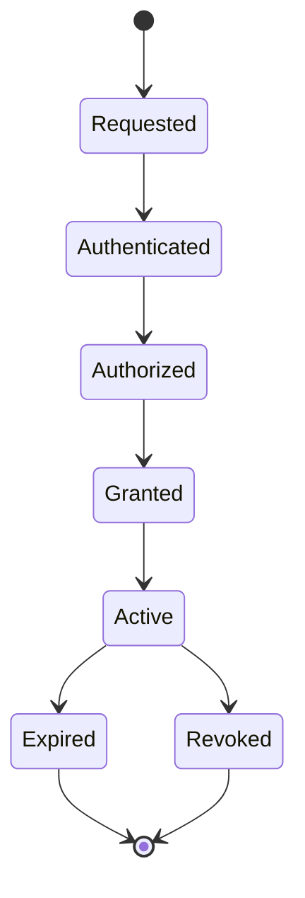

<a id="ucos-iam-000001-workflows"></a>
##### Workflows

- authenticate with registered factors → resolve authority scope → evaluate permissions under context → grant with expiry → revoke on demand or expiry

<a id="ucos-iam-000001-authorities"></a>
##### Authorities

- IAM Authority issues grants; granter's authority bounds the grant — rights are monotone-decreasing down the delegation chain.

<a id="ucos-iam-000001-permissions"></a>
##### Permissions

- iam.grant (holder of the right)
- iam.revoke (granter or higher)
- iam.read (subject or governance)

<a id="ucos-iam-000001-privacy-model"></a>
##### Privacy Model

Authentication evidence is never stored in plaintext; biometrics never leave the device enclave. Grants reference scopes, not personal contents.

<a id="ucos-iam-000001-audit-model"></a>
##### Audit Model

Every authentication and authorization is logged with factor strength, grant chain, and decision rationale.

<a id="ucos-iam-000001-digital-twin-model"></a>
##### Digital Twin Model

IAM twin monitors grant sprawl, stale grants, and authentication failure patterns as security signals.

<a id="ucos-iam-000001-agent-model"></a>
##### Agent Model

Security agent detects anomalous grant patterns and over-broad delegations, revoking or escalating under policy.

<a id="ucos-iam-000001-runtime-model"></a>
##### Runtime Model

Authorization is evaluated per request, cached per (subject, permission, policy-version) with event-driven invalidation on revoke.

<a id="ucos-iam-000001-scaling-model"></a>
##### Scaling Model

Auth is the hottest security path — token verification is stateless; grant resolution is cached and short-TTL.

<a id="ucos-iam-000001-multi-tenant-model"></a>
##### Multi-Tenant Model

Grants are tenant-scoped; cross-tenant grants require both tenants' authorities and are heavily audited.

<a id="ucos-iam-000001-geo-distribution-model"></a>
##### Geo-Distribution Model

Authentication evidence and grant logs reside in-jurisdiction; cross-region auth respects residency.

<a id="ucos-iam-000001-failure-model"></a>
##### Failure Model

Grant cycle, rights inflation, stale grant after revocation storm, factor unavailability.

<a id="ucos-iam-000001-recovery-model"></a>
##### Recovery Model

Grants are event-sourced; revocation cascades to all derived grants immediately.

<a id="ucos-iam-000001-certification-model"></a>
##### Certification Model

Every grant must be traceable to constitutional authority — untraceable grants are denied by default.

<a id="ucos-iam-000001-migration-model"></a>
##### Migration Model

New factors and permission types are registry additions.

<a id="ucos-iam-000001-implementation-blueprint"></a>
##### Implementation Blueprint

Build order for IAM: (1) define registry entries — this domain owns by actor: human / agent / service / system as registry truth, not code; (2) implement the contract surface first (iam.authenticate, iam.authorize, iam.grant) and validate against IAM boundaries; (3) event-source all state so history is reconstructable; (4) wire the enforcement points — authority check, policy guard, evidence binding, trace — in-line, with no bypass path; (5) add tests per the Testing Architecture, citing evidence per gate; (6) obtain Verification and Certification before activation. Acceptance: the Zero Partial and Law 001 audits pass, every action answers the seven explainability questions, and this domain mutates no other domain internals.

<a id="ucos-iam-000001-sequence-diagrams"></a>
##### Sequence Diagrams

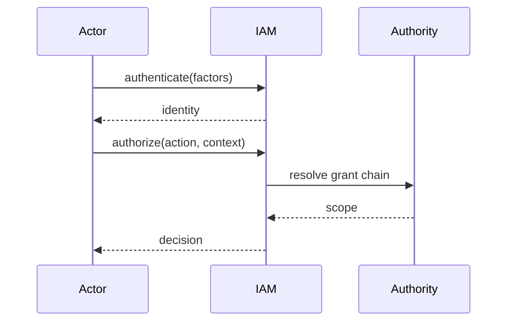

<a id="ucos-iam-000001-state-diagrams"></a>
##### State Diagrams

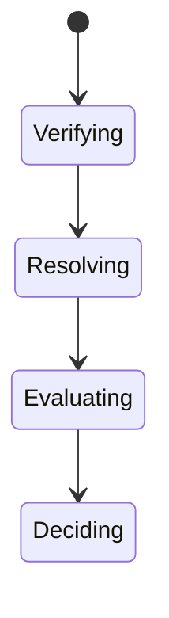

<a id="ucos-zta-000001"></a>
#### UCOS-ZTA-000001 · Zero Trust Architecture

Owner [Security](#d-sec) · managed in `_registry/manifest.json` → `UCOS-ZTA-000001`, content `_registry/content-sec-ops-dep-qlt.json` → `ZTA` · inherits the [standard contract](../UCOS-MASTER.md#standard-contract)

<a id="ucos-zta-000001-concepts"></a>
##### Concepts

Zero Trust Architecture assumes no implicit trust anywhere. Every request is authenticated, authorized, encrypted, and evidenced — regardless of network location. 'Inside the network' is not a concept the platform recognizes.

<a id="ucos-zta-000001-ontology"></a>
##### Ontology

Zero Trust is a property of every interaction: Identity verified, Context evaluated, Policy enforced, Least-privilege applied, Session bounded, and Everything logged. Trust is computed per request, never cached across sessions.

<a id="ucos-zta-000001-taxonomy"></a>
##### Taxonomy

By enforcement: Per-request / Per-session / Per-flow. By network: Mesh / Perimeter-less / Segmented. By evidence: Cryptographic / Behavioral / Attestation-based.

<a id="ucos-zta-000001-data-model"></a>
##### Data Model

```yaml
ZeroTrustDecision:
  decisionId: <Identity>
  subject: <Identity>
  resource: <registry resource>
  context: <Context>
  trustScore: <Trust>
  policyVersion: <version>
  decision: <Allow|Deny|StepUp|Challenge>
  evidence: [<Evidence>]
  temporal: {at}
```

<a id="ucos-zta-000001-graph-model"></a>
##### Graph Model

(:Decision)-[:FOR]->(:Identity); (:Decision)-[:ON]->(:Resource); (:Decision)-[:UNDER]->(:Policy); (:Decision)-[:SCORED_BY]->(:Trust)

<a id="ucos-zta-000001-apis"></a>
##### APIs

*Designed interface: the contract the domain is built towards. The routes it serves today are on its card.*

- POST /zt.v1.evaluate
- POST /zt.v1.stepup
- GET  /zt.v1/decision/{id}
- POST /zt.v1.attest

<a id="ucos-zta-000001-events"></a>
##### Events

- ZTEvaluated
- ZTDenied
- StepUpRequested
- AttestationVerified
- ZTQuarantine

<a id="ucos-zta-000001-commands"></a>
##### Commands

- zt.evaluate
- zt.stepUp
- zt.attest
- zt.quarantine

<a id="ucos-zta-000001-queries"></a>
##### Queries

- zt.decisions
- zt.denials
- zt.risky
- zt.attestations

<a id="ucos-zta-000001-state-machines"></a>
##### State Machines

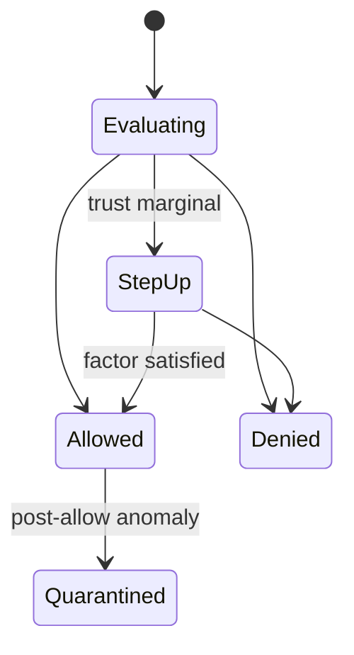

<a id="ucos-zta-000001-workflows"></a>
##### Workflows

- identify → score trust in context → evaluate least-privilege policy → allow / step-up / deny → continuously verify post-allow

<a id="ucos-zta-000001-authorities"></a>
##### Authorities

- Zero Trust Authority (policy); decisions are per-request and never delegated implicitly.

<a id="ucos-zta-000001-permissions"></a>
##### Permissions

- zt.evaluate (system, every request)
- zt.attest (platform authority)
- zt.quarantine (security authority)

<a id="ucos-zta-000001-privacy-model"></a>
##### Privacy Model

Behavioral evidence is minimized and consent-scoped; post-allow monitoring targets patterns, not contents.

<a id="ucos-zta-000001-audit-model"></a>
##### Audit Model

Every decision — allow and deny — is logged with trust inputs, policy version, and evidence. Denials are first-class audit artifacts.

<a id="ucos-zta-000001-digital-twin-model"></a>
##### Digital Twin Model

Zero Trust twin monitors decision latency, denial rates, and step-up friction as security UX signals.

<a id="ucos-zta-000001-agent-model"></a>
##### Agent Model

Zero Trust agent continuously re-evaluates active sessions and revokes on trust decay.

<a id="ucos-zta-000001-runtime-model"></a>
##### Runtime Model

Evaluation is in-line on every request; mTLS is mandatory service-to-service; no plaintext internal traffic exists.

<a id="ucos-zta-000001-scaling-model"></a>
##### Scaling Model

Evaluation is cached per (subject, resource, policy-version) with short TTL; trust decay invalidates.

<a id="ucos-zta-000001-multi-tenant-model"></a>
##### Multi-Tenant Model

Tenant isolation is enforced at every layer — network, compute, storage — never assumed from segmentation.

<a id="ucos-zta-000001-geo-distribution-model"></a>
##### Geo-Distribution Model

Attestation and decision logs reside in-jurisdiction; cross-region requests are re-evaluated, not trusted.

<a id="ucos-zta-000001-failure-model"></a>
##### Failure Model

Trust staleness, policy version skew, attestation failure, evaluation timeout (default deny).

<a id="ucos-zta-000001-recovery-model"></a>
##### Recovery Model

Quarantine is the safe state; recovery is governed re-attestation, never automatic.

<a id="ucos-zta-000001-certification-model"></a>
##### Certification Model

Platform must prove no implicit-trust path exists — every flow carries a decision record.

<a id="ucos-zta-000001-migration-model"></a>
##### Migration Model

New trust factors are registry additions.

<a id="ucos-zta-000001-implementation-blueprint"></a>
##### Implementation Blueprint

Build order for ZTA: (1) define registry entries — this domain owns by enforcement: per-request / per-session / per-flow as registry truth, not code; (2) implement the contract surface first (zt.evaluate, zt.stepUp, zt.attest) and validate against ZTA boundaries; (3) event-source all state so history is reconstructable; (4) wire the enforcement points — authority check, policy guard, evidence binding, trace — in-line, with no bypass path; (5) add tests per the Testing Architecture, citing evidence per gate; (6) obtain Verification and Certification before activation. Acceptance: the Zero Partial and Law 001 audits pass, every action answers the seven explainability questions, and this domain mutates no other domain internals.

<a id="ucos-zta-000001-sequence-diagrams"></a>
##### Sequence Diagrams

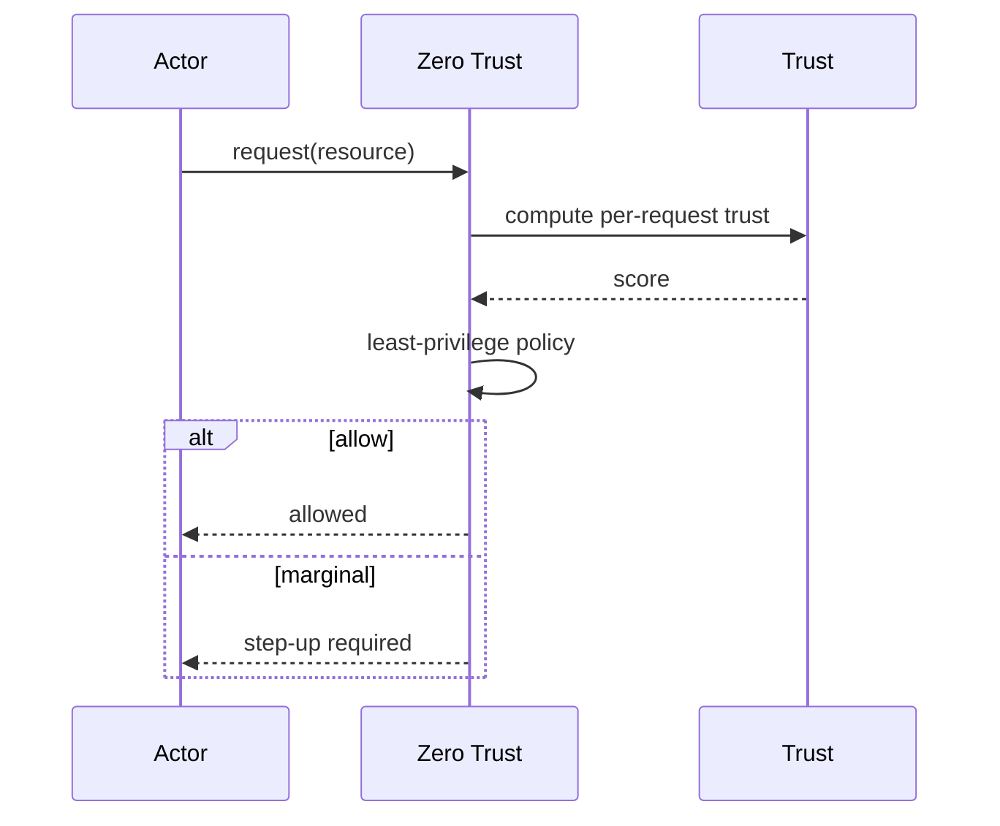

<a id="ucos-zta-000001-state-diagrams"></a>
##### State Diagrams

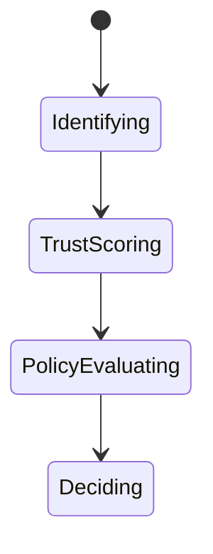

<a id="ucos-cry-000001"></a>
#### UCOS-CRY-000001 · Cryptography Architecture

Owner [Security](#d-sec) · managed in `_registry/manifest.json` → `UCOS-CRY-000001`, content `_registry/content-sec-ops-dep-qlt.json` → `CRY` · inherits the [standard contract](../UCOS-MASTER.md#standard-contract)

<a id="ucos-cry-000001-concepts"></a>
##### Concepts

Cryptography Architecture provides the mathematical foundations: confidentiality, integrity, authenticity, non-repudiation. Cryptographic agility is constitutional — algorithms are registry entries, not constants, so the platform re-keys and re-algorithms without redesign.

<a id="ucos-cry-000001-ontology"></a>
##### Ontology

Cryptography has Algorithm suites (registry), Key references (never raw keys), Operations (sign/verify/encrypt/decrypt/hash/kdf/mac), and Agility policy (rotation schedule, sunset triggers).

<a id="ucos-cry-000001-taxonomy"></a>
##### Taxonomy

By purpose: Signing / Encryption / Hashing / KDF / MAC / Key-agreement / Zero-knowledge. By agility: Fixed-schedule / Event-triggered / Quantum-ready. By scope: Platform / Tenant / Context.

<a id="ucos-cry-000001-data-model"></a>
##### Data Model

```yaml
CryptoOperation:
  opId: <Identity>
  operation: <registry id>
  algorithmSuite: <registry id, versioned>
  keyRef: <KMS reference, never raw>
  inputRef: <content-addressed>
  outputRef: <content-addressed>
  temporal: {at}
  evidence: <Evidence>
```

<a id="ucos-cry-000001-graph-model"></a>
##### Graph Model

(:Operation)-[:USES_SUITE]->(:AlgorithmSuite); (:Operation)-[:REFERENCES]->(:Key); (:Suite)-[:SUNSET_PER]->(:Policy); (:Operation)-[:EVIDENCED_BY]->(:Evidence)

<a id="ucos-cry-000001-apis"></a>
##### APIs

*Designed interface: the contract the domain is built towards. The routes it serves today are on its card.*

- POST /crypto.v1.sign
- POST /crypto.v1.verify
- POST /crypto.v1.encrypt
- POST /crypto.v1.decrypt
- POST /crypto.v1.hash
- GET  /crypto.v1.algorithms

<a id="ucos-cry-000001-events"></a>
##### Events

- CryptoOperation
- KeyRotated
- AlgorithmSunset
- VerificationFailed
- CryptoViolation

<a id="ucos-cry-000001-commands"></a>
##### Commands

- crypto.sign
- crypto.verify
- crypto.encrypt
- crypto.decrypt
- crypto.hash
- crypto.rotate

<a id="ucos-cry-000001-queries"></a>
##### Queries

- crypto.algorithms
- crypto.suites
- crypto.operations
- crypto.sunsets

<a id="ucos-cry-000001-state-machines"></a>
##### State Machines

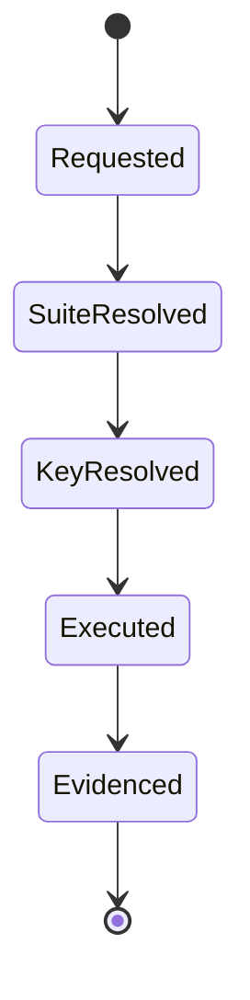

<a id="ucos-cry-000001-workflows"></a>
##### Workflows

- resolve suite from registry → resolve key reference → execute → record evidence → never expose raw key material

<a id="ucos-cry-000001-authorities"></a>
##### Authorities

- Cryptography Authority (suite governance); keys are held by KMS and referenced, never handled.

<a id="ucos-cry-000001-permissions"></a>
##### Permissions

- crypto.sign (key-authorized principal)
- crypto.verify (any authenticated)
- crypto.rotate (key authority)

<a id="ucos-cry-000001-privacy-model"></a>
##### Privacy Model

Encryption is the baseline for personal data at rest and in transit; plaintext personal data must never exist outside an enclave.

<a id="ucos-cry-000001-audit-model"></a>
##### Audit Model

Every operation records suite version, key reference, and result — without ever recording key material.

<a id="ucos-cry-000001-digital-twin-model"></a>
##### Digital Twin Model

Cryptography twin monitors algorithm usage distribution and sunset exposure across the fleet.

<a id="ucos-cry-000001-agent-model"></a>
##### Agent Model

Cryptography agent detects weak-suite usage and tracks sunset deadlines, driving rotation under governance.

<a id="ucos-cry-000001-runtime-model"></a>
##### Runtime Model

Operations are stateless and content-addressed; raw keys never enter process memory outside the KMS boundary.

<a id="ucos-cry-000001-scaling-model"></a>
##### Scaling Model

Signing/verification are the hot path — batched and hardware-accelerated where available.

<a id="ucos-cry-000001-multi-tenant-model"></a>
##### Multi-Tenant Model

Keys are tenant-isolated in KMS; cryptographic separation is a boundary, not an assumption.

<a id="ucos-cry-000001-geo-distribution-model"></a>
##### Geo-Distribution Model

Key residency follows data residency; cross-region crypto respects sovereignty (e.g., sovereign-key requirements).

<a id="ucos-cry-000001-failure-model"></a>
##### Failure Model

Suite deprecation, key compromise, verification failure storm, agility gap.

<a id="ucos-cry-000001-recovery-model"></a>
##### Recovery Model

Compromise triggers governed rotation + re-signing of affected content-addressed artifacts.

<a id="ucos-cry-000001-certification-model"></a>
##### Certification Model

Every suite in use must be registry-approved and not sunset; raw-key exposure is a critical certification failure.

<a id="ucos-cry-000001-migration-model"></a>
##### Migration Model

Agility is the point — new suites are registry additions, and rotation is a scheduled, not emergency, act.

<a id="ucos-cry-000001-implementation-blueprint"></a>
##### Implementation Blueprint

Build order for CRY: (1) define registry entries — this domain owns by purpose: signing / encryption / hashing / kdf / mac / key-agreement / zero-knowledge as registry truth, not code; (2) implement the contract surface first (crypto.sign, crypto.verify, crypto.encrypt) and validate against CRY boundaries; (3) event-source all state so history is reconstructable; (4) wire the enforcement points — authority check, policy guard, evidence binding, trace — in-line, with no bypass path; (5) add tests per the Testing Architecture, citing evidence per gate; (6) obtain Verification and Certification before activation. Acceptance: the Zero Partial and Law 001 audits pass, every action answers the seven explainability questions, and this domain mutates no other domain internals.

<a id="ucos-cry-000001-sequence-diagrams"></a>
##### Sequence Diagrams

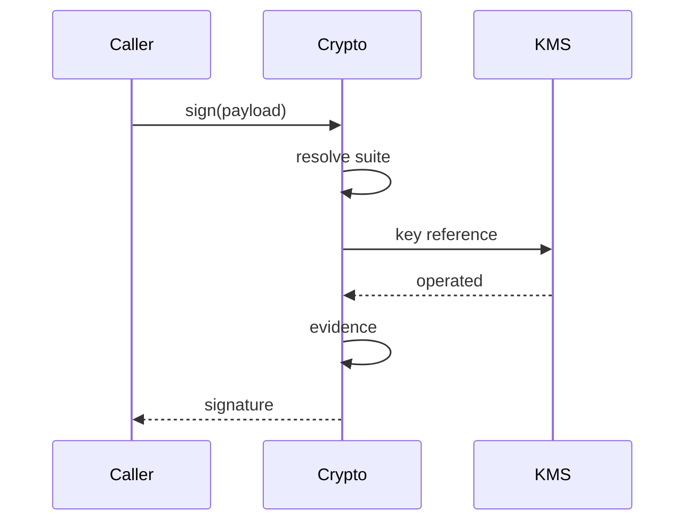

<a id="ucos-cry-000001-state-diagrams"></a>
##### State Diagrams

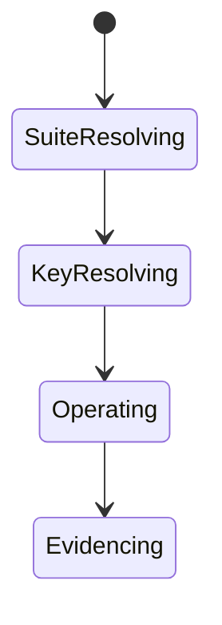

<a id="ucos-kms-000001"></a>
#### UCOS-KMS-000001 · Key Management Architecture

Owner [Security](#d-sec) · managed in `_registry/manifest.json` → `UCOS-KMS-000001`, content `_registry/content-sec-ops-dep-qlt.json` → `KMS` · inherits the [standard contract](../UCOS-MASTER.md#standard-contract)

<a id="ucos-kms-000001-concepts"></a>
##### Concepts

Key Management Architecture holds the platform's most sensitive primitive — the keys that make evidence trustworthy. Raw keys never leave KMS; everything else holds references. Key lifecycle is governed, audited, and recoverable only under quorum.

<a id="ucos-kms-000001-ontology"></a>
##### Ontology

Key has an Identity, an Algorithm suite, a Policy (usage, rotation, sunset), a State, and a Custody model. Keys are generated in KMS, referenced everywhere, rotated by policy, destroyed by quorum.

<a id="ucos-kms-000001-taxonomy"></a>
##### Taxonomy

By custody: Platform / Tenant / Sovereign / Customer-held / HSM-backed. By lifetime: Ephemeral / Short-lived / Long-lived / Eternal. By usage: Signing / Encryption / Wrapping / Derived.

<a id="ucos-kms-000001-data-model"></a>
##### Data Model

```yaml
Key:
  keyId: <Identity>
  algorithmSuite: <registry id>
  custody: <registry id>
  usagePolicy: <Policy>
  rotationPolicy: <Policy>
  state: <Active|Rotating|Suspended|Destroyed>
  temporal: {createdAt, rotatesAt, sunsetsAt}
  quorum: {destroyRequires: <n>}
```

<a id="ucos-kms-000001-graph-model"></a>
##### Graph Model

(:Key)-[:SUITE]->(:AlgorithmSuite); (:Key)-[:USED_PER]->(:Policy); (:Key)-[:ROTATES_ON]->(:Policy); (:Key)-[:REFERENCED_BY]->(:CryptoOperation)

<a id="ucos-kms-000001-apis"></a>
##### APIs

*Designed interface: the contract the domain is built towards. The routes it serves today are on its card.*

- POST /kms.v1.generate
- POST /kms.v1.rotate
- POST /kms.v1.destroy
- GET  /kms.v1/{id}
- POST /kms.v1.derive

<a id="ucos-kms-000001-events"></a>
##### Events

- KeyGenerated
- KeyRotated
- KeySuspended
- KeyDestroyed
- KeyDerived
- RotationOverdue

<a id="ucos-kms-000001-commands"></a>
##### Commands

- kms.generate
- kms.rotate
- kms.destroy
- kms.derive
- kms.suspend

<a id="ucos-kms-000001-queries"></a>
##### Queries

- kms.byId
- kms.byCustody
- kms.rotationDue
- kms.state

<a id="ucos-kms-000001-state-machines"></a>
##### State Machines

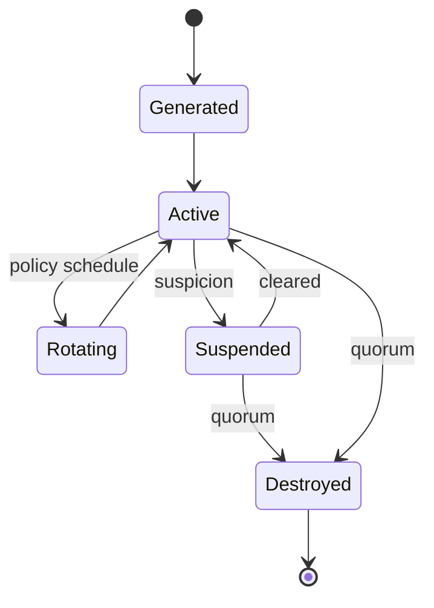

<a id="ucos-kms-000001-workflows"></a>
##### Workflows

- generate under policy → reference-only usage → rotate per schedule → suspend on suspicion → destroy only under quorum

<a id="ucos-kms-000001-authorities"></a>
##### Authorities

- Key Authority (lifecycle); destruction requires quorum — no single principal can destroy a key.

<a id="ucos-kms-000001-permissions"></a>
##### Permissions

- kms.generate (key authority)
- kms.rotate (key authority or policy)
- kms.destroy (quorum)
- kms.use (referenced via crypto ops only)

<a id="ucos-kms-000001-privacy-model"></a>
##### Privacy Model

Key material is the crown jewel — HSM-backed where available, never logged, never cached outside the boundary.

<a id="ucos-kms-000001-audit-model"></a>
##### Audit Model

Every key operation (including denied ones) is logged; the audit log itself is signed by a separate key.

<a id="ucos-kms-000001-digital-twin-model"></a>
##### Digital Twin Model

KMS twin monitors rotation overdue and key-usage anomalies as critical security signals.

<a id="ucos-kms-000001-agent-model"></a>
##### Agent Model

KMS agent tracks rotation deadlines and flags overdue keys as critical governance failures.

<a id="ucos-kms-000001-runtime-model"></a>
##### Runtime Model

All crypto happens inside KMS; callers receive results and references, never material.

<a id="ucos-kms-000001-scaling-model"></a>
##### Scaling Model

KMS is the trust bottleneck — horizontally scaled with HSM-backed quorum for critical operations.

<a id="ucos-kms-000001-multi-tenant-model"></a>
##### Multi-Tenant Model

Keys are tenant-isolated by custody; cross-tenant key use is impossible by construction.

<a id="ucos-kms-000001-geo-distribution-model"></a>
##### Geo-Distribution Model

Sovereign keys stay in-jurisdiction; export is prohibited where sovereignty policy forbids.

<a id="ucos-kms-000001-failure-model"></a>
##### Failure Model

Rotation overdue, quorum deadlock, HSM unavailability, key reference leak.

<a id="ucos-kms-000001-recovery-model"></a>
##### Recovery Model

Suspended keys can be cleared by quorum; destroyed keys are unrecoverable by design — that irreversibility is the guarantee.

<a id="ucos-kms-000001-certification-model"></a>
##### Certification Model

KMS must prove no raw-key egress path exists — formally audited boundary.

<a id="ucos-kms-000001-migration-model"></a>
##### Migration Model

New custody models are registry additions.

<a id="ucos-kms-000001-implementation-blueprint"></a>
##### Implementation Blueprint

Build order for KMS: (1) define registry entries — this domain owns by custody: platform / tenant / sovereign / customer-held / hsm-backed as registry truth, not code; (2) implement the contract surface first (kms.generate, kms.rotate, kms.destroy) and validate against KMS boundaries; (3) event-source all state so history is reconstructable; (4) wire the enforcement points — authority check, policy guard, evidence binding, trace — in-line, with no bypass path; (5) add tests per the Testing Architecture, citing evidence per gate; (6) obtain Verification and Certification before activation. Acceptance: the Zero Partial and Law 001 audits pass, every action answers the seven explainability questions, and this domain mutates no other domain internals.

<a id="ucos-kms-000001-sequence-diagrams"></a>
##### Sequence Diagrams

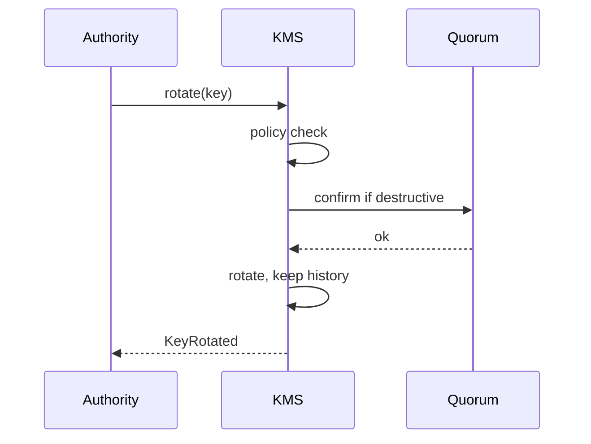

<a id="ucos-kms-000001-state-diagrams"></a>
##### State Diagrams

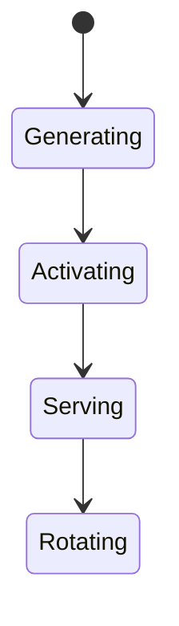

<a id="ucos-sec-000001"></a>
#### UCOS-SEC-000001 · Security Runtime Architecture

Owner [Security](#d-sec) · managed in `_registry/manifest.json` → `UCOS-SEC-000001`, content `_registry/content-sec-ops-dep-qlt.json` → `SEC` · inherits the [standard contract](../UCOS-MASTER.md#standard-contract)

<a id="ucos-sec-000001-concepts"></a>
##### Concepts

Security Runtime Architecture enforces security as an execution-time property, not a review-time aspiration. Every request passes authentication, authorization, policy, trust, and evidence guards — in-line, on the hot path, with no bypass.

<a id="ucos-sec-000001-ontology"></a>
##### Ontology

Security Runtime composes IAM, Zero Trust, Cryptography, KMS, and Policy into a single enforcement pipeline. It is the immune system: detection, prevention, response, and recovery operate continuously.

<a id="ucos-sec-000001-taxonomy"></a>
##### Taxonomy

By stage: Prevention / Detection / Response / Recovery. By threat: Intrusion / Fraud / Abuse / Data-leak / Supply-chain / Insider. By response: Block / Step-up / Quarantine / Incident.

<a id="ucos-sec-000001-data-model"></a>
##### Data Model

```yaml
SecurityEvent:
  securityEventId: <Identity>
  detectedBy: <registry detector id>
  severity: <registry level>
  subject: <Identity|null>
  context: <Context>
  evidence: [<Evidence>]
  response: <registry action>
  temporal: {detectedAt, respondedAt}
```

<a id="ucos-sec-000001-graph-model"></a>
##### Graph Model

(:SecurityEvent)-[:DETECTED_BY]->(:Detector); (:SecurityEvent)-[:RESPONDED_WITH]->(:Response); (:SecurityEvent)-[:ESCALATED_TO]->(:Authority); (:SecurityEvent)-[:EVIDENCED_BY]->(:Evidence)

<a id="ucos-sec-000001-apis"></a>
##### APIs

*Designed interface: the contract the domain is built towards. The routes it serves today are on its card.*

- POST /sec.v1.report
- GET  /sec.v1/events
- POST /sec.v1/{id}/respond
- POST /sec.v1.scan

<a id="ucos-sec-000001-events"></a>
##### Events

- SecurityDetected
- SecurityResponded
- SecurityQuarantined
- IncidentDeclared
- ThreatCleared

<a id="ucos-sec-000001-commands"></a>
##### Commands

- sec.report
- sec.respond
- sec.quarantine
- sec.scan
- sec.incident

<a id="ucos-sec-000001-queries"></a>
##### Queries

- sec.events
- sec.bySeverity
- sec.open
- sec.trends

<a id="ucos-sec-000001-state-machines"></a>
##### State Machines

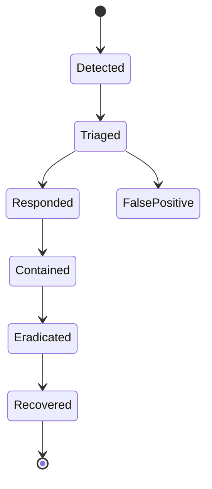

<a id="ucos-sec-000001-workflows"></a>
##### Workflows

- detect → triage severity → respond automatically within bounds → escalate beyond bounds → incident → recover with evidence

<a id="ucos-sec-000001-authorities"></a>
##### Authorities

- Security Authority (response within bounds); incidents escalate to governance authority.

<a id="ucos-sec-000001-permissions"></a>
##### Permissions

- sec.report (any observer, anonymous option)
- sec.respond (security authority)
- sec.incident (governance)

<a id="ucos-sec-000001-privacy-model"></a>
##### Privacy Model

Security monitoring over personal behavior is minimized and consent-scoped; detection targets patterns, never contents.

<a id="ucos-sec-000001-audit-model"></a>
##### Audit Model

Every detection and response is evidence-backed; false positives are recorded, not deleted — they tune detectors.

<a id="ucos-sec-000001-digital-twin-model"></a>
##### Digital Twin Model

Security twin monitors detection coverage and response latency as the immune system's health.

<a id="ucos-sec-000001-agent-model"></a>
##### Agent Model

Security agents are the primary detectors — operating continuously within strict response bounds.

<a id="ucos-sec-000001-runtime-model"></a>
##### Runtime Model

Guards are in-line and mandatory; response automation is bounded — escalation is always available to humans.

<a id="ucos-sec-000001-scaling-model"></a>
##### Scaling Model

Detection is a stream job; response is synchronous for blocking severity, queued otherwise.

<a id="ucos-sec-000001-multi-tenant-model"></a>
##### Multi-Tenant Model

Security events are tenant-scoped; platform-level incidents aggregate anonymized signals only.

<a id="ucos-sec-000001-geo-distribution-model"></a>
##### Geo-Distribution Model

Incident response routes to on-call in the affected jurisdiction — accountability is local.

<a id="ucos-sec-000001-failure-model"></a>
##### Failure Model

Detector blind spot, response latency, escalation queue overflow, quarantine exhaustion.

<a id="ucos-sec-000001-recovery-model"></a>
##### Recovery Model

Recovery is a governed phase with evidence preservation — incidents end with post-mortems, not silent clears.

<a id="ucos-sec-000001-certification-model"></a>
##### Certification Model

Every request path must carry an enforcement record — an unguarded path is a critical certification failure.

<a id="ucos-sec-000001-migration-model"></a>
##### Migration Model

New detectors are registry additions.

<a id="ucos-sec-000001-implementation-blueprint"></a>
##### Implementation Blueprint

Build order for SEC: (1) define registry entries — this domain owns by stage: prevention / detection / response / recovery as registry truth, not code; (2) implement the contract surface first (sec.report, sec.respond, sec.quarantine) and validate against SEC boundaries; (3) event-source all state so history is reconstructable; (4) wire the enforcement points — authority check, policy guard, evidence binding, trace — in-line, with no bypass path; (5) add tests per the Testing Architecture, citing evidence per gate; (6) obtain Verification and Certification before activation. Acceptance: the Zero Partial and Law 001 audits pass, every action answers the seven explainability questions, and this domain mutates no other domain internals.

<a id="ucos-sec-000001-sequence-diagrams"></a>
##### Sequence Diagrams

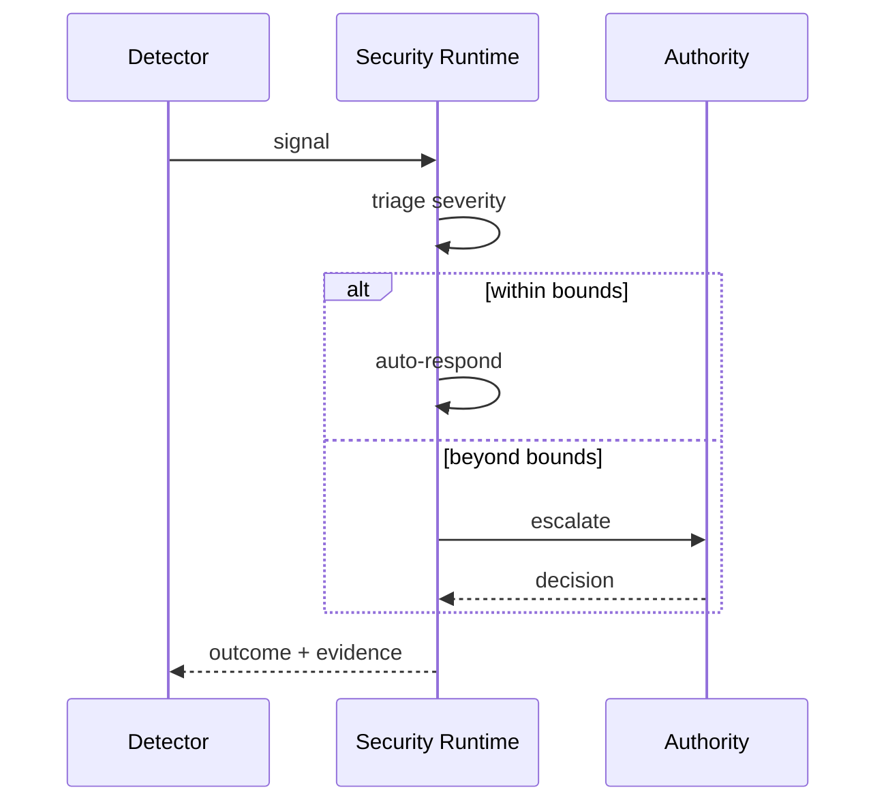

<a id="ucos-sec-000001-state-diagrams"></a>
##### State Diagrams

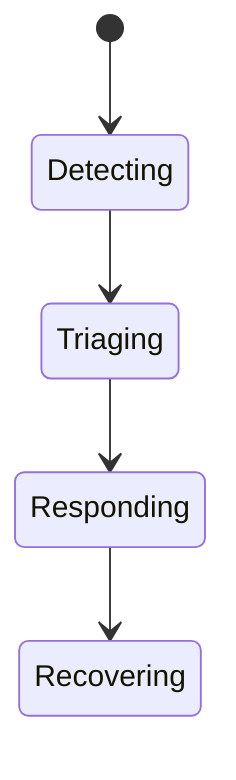

---

<a id="d-tru"></a>
### D-TRU · Trust

| | |
|---|---|
| **Category** | C07 Assurance |
| **Build status** | designed — declared and contracted; no code or live route yet |
| **Owns** | [Trust](../UCOS-MASTER.md#t-trust) |
| **Responsible for** | Trust Computation, Trust Scores, Trust Verification |
| **Not responsible for** | Evidence Generation, Policy, Identity |
| **Contract** | [UCOS-TRS-000001 Trust Architecture](#ucos-trs-000001) |
| **Artifacts** | [UCOS-TRS-000001](#ucos-trs-000001) |
| **Concepts** | 215 — `node _registry/compile.js --search <words> --kind concept --owner "Trust"` |
| **Code** | — |
| **Managed in** | `_registry/domains.json` → `D-TRU` |

**Live routes:** none yet.

<a id="ucos-trs-000001"></a>
#### UCOS-TRS-000001 · Trust Architecture

Owner [Trust](#d-tru) · managed in `_registry/manifest.json` → `UCOS-TRS-000001`, content `_registry/content-core.json` → `TRS` · inherits the [standard contract](../UCOS-MASTER.md#standard-contract)

<a id="ucos-trs-000001-concepts"></a>
##### Concepts

Trust is computed confidence in an assertion, derived from evidence. Trust ≠ Evidence and Trust ≠ Faith: it is a score, recomputable, always current, never asserted. Trust degrades without corroboration.

<a id="ucos-trs-000001-ontology"></a>
##### Ontology

Trust is a function over (Evidence, Authority, Consistency, Provenance, Confidence). Trust has a timestamp — stale trust decays. Trust is per-Context.

<a id="ucos-trs-000001-taxonomy"></a>
##### Taxonomy

By subject: Identity / Knowledge / Relationship / Authority / Agent. By method: Evidence-weighted / Authority-weighted / Consistency-weighted / Consensus / Decay-based.

<a id="ucos-trs-000001-data-model"></a>
##### Data Model

```yaml
Trust:
  trustId: <Identity>
  subject: <Identity>
  evidenceScore: <0..1>
  authorityScore: <0..1>
  consistencyScore: <0..1>
  provenanceScore: <0..1>
  confidenceScore: <0..1>
  composite: <0..1, registry formula>
  computedAt: <Time>
  context: <Context>
  decayPolicy: <Policy>
```

<a id="ucos-trs-000001-graph-model"></a>
##### Graph Model

(:Trust)-[:SCORES]->(:Identity|:Knowledge|:Relationship|:Authority); (:Trust)-[:DERIVED_FROM]->(:Evidence); (:Trust)-[:DECAYS_PER]->(:Policy)

<a id="ucos-trs-000001-apis"></a>
##### APIs

*Designed interface: the contract the domain is built towards. The routes it serves today are on its card.*

- GET  /trust.v1/{subjectId}
- POST /trust.v1/recompute
- GET  /trust.v1.history/{subjectId}
- GET  /trust.v1.compare

<a id="ucos-trs-000001-events"></a>
##### Events

- TrustComputed
- TrustDecayed
- TrustDisputed
- TrustThresholdCrossed
- TrustRecomputed

<a id="ucos-trs-000001-commands"></a>
##### Commands

- trust.recompute
- trust.decay
- trust.cite
- trust.dispute

<a id="ucos-trs-000001-queries"></a>
##### Queries

- trust.bySubject
- trust.history
- trust.distribution
- trust.belowThreshold
- trust.byContext

<a id="ucos-trs-000001-state-machines"></a>
##### State Machines

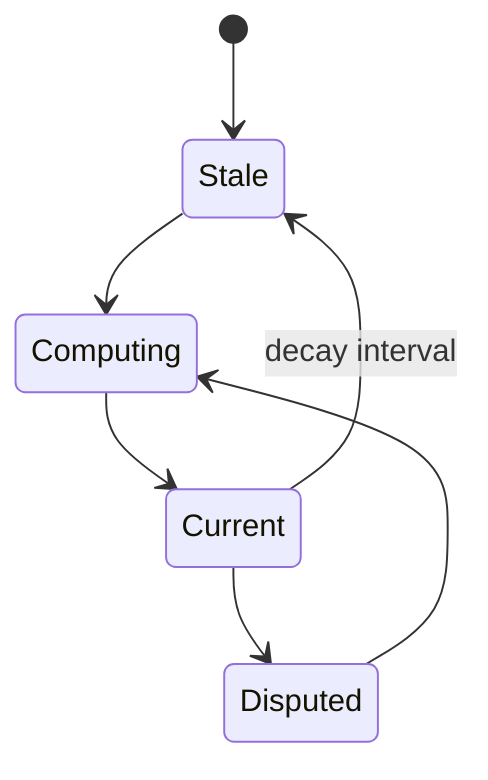

<a id="ucos-trs-000001-workflows"></a>
##### Workflows

- gather evidence → weight by authority → measure consistency → score provenance → apply confidence → composite → publish → schedule decay

<a id="ucos-trs-000001-authorities"></a>
##### Authorities

- Trust Domain computes; it does not assert. Authority Domain supplies the authority weight; Trust never overrides it.

<a id="ucos-trs-000001-permissions"></a>
##### Permissions

- trust.read (subject owner or scoped)
- trust.recompute (system)
- trust.dispute (peer authority)

<a id="ucos-trs-000001-privacy-model"></a>
##### Privacy Model

Trust over personal subjects is derived from minimized evidence; raw evidence is not exposed, only the score and its factor breakdown.

<a id="ucos-trs-000001-audit-model"></a>
##### Audit Model

Every score is reproducible: inputs, weights, formula version, and timestamp are recorded. A score that cannot be reproduced is void.

<a id="ucos-trs-000001-digital-twin-model"></a>
##### Digital Twin Model

Trust Twin tracks real-world reputation drift and flags divergence between computed trust and observed outcomes.

<a id="ucos-trs-000001-agent-model"></a>
##### Agent Model

Trust Agent continuously recomputes decaying scores and raises TrustThresholdCrossed for governance attention.

<a id="ucos-trs-000001-runtime-model"></a>
##### Runtime Model

Scores are read-optimized projections recomputed on evidence change or decay tick; never stored as primary truth.

<a id="ucos-trs-000001-scaling-model"></a>
##### Scaling Model

Recomputation is a stream job over evidence events; composite scores cached per (subject, context) with decay-aware TTL.

<a id="ucos-trs-000001-multi-tenant-model"></a>
##### Multi-Tenant Model

Trust is tenant-scoped; a subject's trust in one tenant says nothing about another unless a shared Context exists.

<a id="ucos-trs-000001-geo-distribution-model"></a>
##### Geo-Distribution Model

Trust factors are jurisdiction-weighted: an authority's weight is Context-dependent, so the same evidence yields different scores per jurisdiction — by design.

<a id="ucos-trs-000001-failure-model"></a>
##### Failure Model

Evidence starvation, formula drift across versions, authority score corruption, decay cascade.

<a id="ucos-trs-000001-recovery-model"></a>
##### Recovery Model

Scores are recomputable from evidence history; a corrupted score is regenerated, never restored from backup.

<a id="ucos-trs-000001-certification-model"></a>
##### Certification Model

Trust score must be reproducible, timestamped, formula-versioned, and within threshold for its subject's certifications.

<a id="ucos-trs-000001-migration-model"></a>
##### Migration Model

Formula evolves by registry version; recomputation triggers on version change with full history replay.

<a id="ucos-trs-000001-implementation-blueprint"></a>
##### Implementation Blueprint

Build order for TRS: (1) define registry entries — this domain owns by subject: identity / knowledge / relationship / authority / agent as registry truth, not code; (2) implement the contract surface first (trust.recompute, trust.decay, trust.cite) and validate against TRS boundaries; (3) event-source all state so history is reconstructable; (4) wire the enforcement points — authority check, policy guard, evidence binding, trace — in-line, with no bypass path; (5) add tests per the Testing Architecture, citing evidence per gate; (6) obtain Verification and Certification before activation. Acceptance: the Zero Partial and Law 001 audits pass, every action answers the seven explainability questions, and this domain mutates no other domain internals.

<a id="ucos-trs-000001-sequence-diagrams"></a>
##### Sequence Diagrams

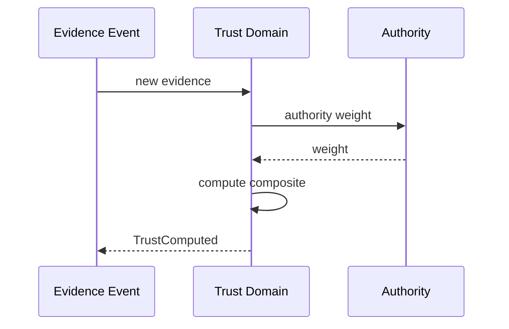

<a id="ucos-trs-000001-state-diagrams"></a>
##### State Diagrams

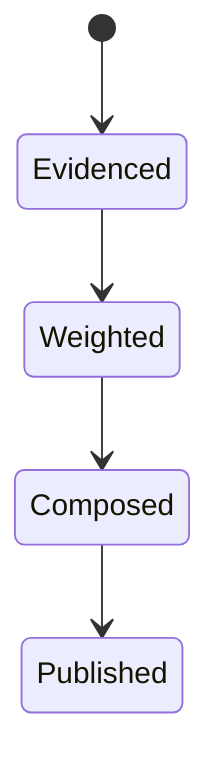

---

<a id="d-aud"></a>
### D-AUD · Audit

| | |
|---|---|
| **Category** | C07 Assurance |
| **Build status** | partial |
| **Owns** | [Audit Record](../UCOS-MASTER.md#t-audit-record) |
| **Responsible for** | Immutable Record, Investigation, Evidence Packs |
| **Not responsible for** | Evidence Validity, Obligations |
| **Contract** | [UCOS-AUD-000001 Audit Architecture](#ucos-aud-000001) |
| **Artifacts** | [UCOS-AUD-000001](#ucos-aud-000001) |
| **Concepts** | 40 — `node _registry/compile.js --search <words> --kind concept --owner "Audit"` |
| **Code** | `lib/ucos-trace.js`, `lib/security.js` |
| **Managed in** | `_registry/domains.json` → `D-AUD` |

**Live routes (4)** — what the platform serves today for this domain:

- `GET /api/admin/audit`
- `GET /api/platform/chain/verify`
- `GET /api/admin/chain/verify`
- `GET /api/platform/audit`

<a id="ucos-aud-000001"></a>
#### UCOS-AUD-000001 · Audit Architecture

Owner [Audit](#d-aud) · managed in `_registry/manifest.json` → `UCOS-AUD-000001`, content `_registry/content-sec-ops-dep-qlt.json` → `AUD` · inherits the [standard contract](../UCOS-MASTER.md#standard-contract)

<a id="ucos-aud-000001-concepts"></a>
##### Concepts

Audit Architecture proves what happened, when, why, and under whose authority — to any stakeholder including regulators and data subjects. The audit log is append-only, cryptographically chained, and replayable.

<a id="ucos-aud-000001-ontology"></a>
##### Ontology

Audit has Records (immutable facts), Chains (hash-linked), Queries (stakeholder-scoped), and Attestations (third-party verification). Audit is a product, not a byproduct.

<a id="ucos-aud-000001-taxonomy"></a>
##### Taxonomy

By audience: Regulator / Data-subject / Internal / External-certifier / Court. By content: Action / Decision / Access / Change / Consent / Sovereignty. By retention: Regulated-minimum / Contractual / Eternal.

<a id="ucos-aud-000001-data-model"></a>
##### Data Model

```yaml
AuditRecord:
  recordId: <Identity>
  actor: <Identity>
  action: <registry action>
  authority: <Authority>
  policyVersion: <version>
  evidence: [<Evidence>]
  explanation: <seven questions>
  prevHash: <hash>
  hash: <hash>
  temporal: {at}
  context: <Context>
```

<a id="ucos-aud-000001-graph-model"></a>
##### Graph Model

(:Record)-[:CHAINED_TO]->(:Record); (:Record)-[:BY_ACTOR]->(:Identity); (:Record)-[:UNDER_AUTHORITY]->(:Authority); (:Record)-[:ATTTESTED_BY]->(:Authority)

<a id="ucos-aud-000001-apis"></a>
##### APIs

*Designed interface: the contract the domain is built towards. The routes it serves today are on its card.*

- POST /aud.v1.record
- GET  /aud.v1/{id}
- POST /aud.v1.query
- POST /aud.v1.attest
- GET  /aud.v1.verify-chain

<a id="ucos-aud-000001-events"></a>
##### Events

- AuditRecorded
- ChainVerified
- AttestationIssued
- AuditQueryExecuted

<a id="ucos-aud-000001-commands"></a>
##### Commands

- aud.record
- aud.query
- aud.attest
- aud.verify

<a id="ucos-aud-000001-queries"></a>
##### Queries

- aud.byActor
- aud.bySubject
- aud.byAction
- aud.timeline
- aud.chain

<a id="ucos-aud-000001-state-machines"></a>
##### State Machines

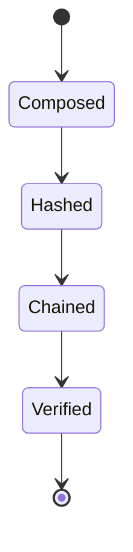

<a id="ucos-aud-000001-workflows"></a>
##### Workflows

- compose record with seven-question explanation → hash → chain to previous → verify → serve stakeholder queries

<a id="ucos-aud-000001-authorities"></a>
##### Authorities

- Audit Authority (record integrity); auditors query under their own scoped authority.

<a id="ucos-aud-000001-permissions"></a>
##### Permissions

- aud.record (system, all governed actions)
- aud.query (stakeholder-scoped)
- aud.attest (certifying authority)

<a id="ucos-aud-000001-privacy-model"></a>
##### Privacy Model

Subject access is a first-class query — data subjects see their own records in full, minimization applied elsewhere.

<a id="ucos-aud-000001-audit-model"></a>
##### Audit Model

The chain self-verifies — a broken hash is a critical integrity event with immediate alert.

<a id="ucos-aud-000001-digital-twin-model"></a>
##### Digital Twin Model

Audit twin monitors chain health and query latency as compliance signals.

<a id="ucos-aud-000001-agent-model"></a>
##### Agent Model

Audit agent detects chain anomalies and gaps in recorded coverage automatically.

<a id="ucos-aud-000001-runtime-model"></a>
##### Runtime Model

Records append in real time; hashing is in-line; verification is a background continuous job.

<a id="ucos-aud-000001-scaling-model"></a>
##### Scaling Model

Append-only logs shard by time bucket; queries fan out with stakeholder-scope enforcement.

<a id="ucos-aud-000001-multi-tenant-model"></a>
##### Multi-Tenant Model

Records are tenant-scoped; regulator queries are cross-tenant under jurisdiction authority.

<a id="ucos-aud-000001-geo-distribution-model"></a>
##### Geo-Distribution Model

Audit residency follows the action's jurisdiction; regulator access is jurisdiction-scoped.

<a id="ucos-aud-000001-failure-model"></a>
##### Failure Model

Chain break, record gap, query-scope leak, retention violation.

<a id="ucos-aud-000001-recovery-model"></a>
##### Recovery Model

A broken chain is unrecoverable by design — integrity is proven, not repaired. Gaps trigger incident.

<a id="ucos-aud-000001-certification-model"></a>
##### Certification Model

The chain must verify end-to-end from genesis — any break voids certification of the period.

<a id="ucos-aud-000001-migration-model"></a>
##### Migration Model

New record types are registry additions; the chain format is frozen.

<a id="ucos-aud-000001-implementation-blueprint"></a>
##### Implementation Blueprint

Build order for AUD: (1) define registry entries — this domain owns by audience: regulator / data-subject / internal / external-certifier / court as registry truth, not code; (2) implement the contract surface first (aud.record, aud.query, aud.attest) and validate against AUD boundaries; (3) event-source all state so history is reconstructable; (4) wire the enforcement points — authority check, policy guard, evidence binding, trace — in-line, with no bypass path; (5) add tests per the Testing Architecture, citing evidence per gate; (6) obtain Verification and Certification before activation. Acceptance: the Zero Partial and Law 001 audits pass, every action answers the seven explainability questions, and this domain mutates no other domain internals.

<a id="ucos-aud-000001-sequence-diagrams"></a>
##### Sequence Diagrams

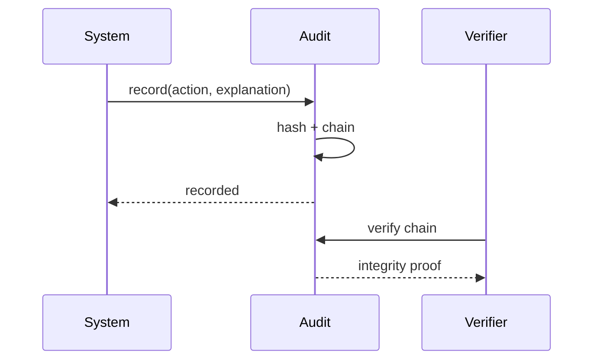

<a id="ucos-aud-000001-state-diagrams"></a>
##### State Diagrams

```mermaid
stateDiagram-v2
    [*] --> Composing
    Composing --> Chaining
    Chaining --> Serving
    Serving --> Verifying
```

---

<a id="d-cmp"></a>
### D-CMP · Compliance

| | |
|---|---|
| **Category** | C07 Assurance |
| **Build status** | partial |
| **Owns** | [Obligation](../UCOS-MASTER.md#t-obligation), [Consent](../UCOS-MASTER.md#t-consent) |
| **Responsible for** | Regulations, Controls, Consent, Data-Subject Requests, Retention, Residency Obligations, Processor Register |
| **Not responsible for** | Security Controls, Audit Record |
| **Contract** | [UCOS-CMP-000001 Compliance Architecture](#ucos-cmp-000001) |
| **Artifacts** | [UCOS-DSP-000001](#ucos-dsp-000001), [UCOS-CNS-000001](#ucos-cns-000001), [UCOS-CMP-000001](#ucos-cmp-000001) |
| **Concepts** | 211 — `node _registry/compile.js --search <words> --kind concept --owner "Compliance"` |
| **Code** | `lib/compliance.js`, `lib/seed/compliance.json` |
| **Managed in** | `_registry/domains.json` → `D-CMP` |

**Live routes (12)** — what the platform serves today for this domain:

- `GET /api/admin/retention`
- `PUT /api/admin/retention`
- `GET /api/admin/compliance/status`
- `GET /api/admin/compliance/catalog`
- `POST /api/admin/compliance/control`
- `GET /api/admin/compliance/evidence`
- `GET /api/consent`
- `POST /api/consent`
- `POST /api/privacy/request`
- `GET /api/admin/privacy/requests`
- `POST /api/admin/privacy/requests/:id`
- `GET /api/admin/privacy/requests/:id/events`

<a id="ucos-dsp-000001"></a>
#### UCOS-DSP-000001 · Data Sovereignty Architecture

Owner [Compliance](#d-cmp) · managed in `_registry/manifest.json` → `UCOS-DSP-000001`, content `_registry/content-sec-ops-dep-qlt.json` → `DSP` · inherits the [standard contract](../UCOS-MASTER.md#standard-contract)

<a id="ucos-dsp-000001-concepts"></a>
##### Concepts

Data Sovereignty Architecture ensures data is subject to the laws of the jurisdiction where it belongs. Residency is a property of the data, enforced at storage, processing, replication, and egress — not a policy document.

<a id="ucos-dsp-000001-ontology"></a>
##### Ontology

Sovereignty binds a data class to a Jurisdiction context with a Residency policy, a Transfer policy, and an Egress policy. Data without a jurisdiction may not be written at all.

<a id="ucos-dsp-000001-taxonomy"></a>
##### Taxonomy

By control: Residency / Localization / Transfer-restricted / Sovereign-key. By scope: National / Regional / Sectoral / Contractual. By enforcement: Storage / Compute / Replication / Egress.

<a id="ucos-dsp-000001-data-model"></a>
##### Data Model

```yaml
SovereigntyBinding:
  bindingId: <Identity>
  dataClass: <registry id>
  jurisdiction: <Context>
  residencyPolicy: <Policy>
  transferPolicy: <Policy>
  egressPolicy: <Policy>
  temporal: {effectiveFrom}
```

<a id="ucos-dsp-000001-graph-model"></a>
##### Graph Model

(:Binding)-[:BINDS]->(:DataClass); (:Binding)-[:WITHIN]->(:Context); (:Binding)-[:ENFORCED_AT]->(:Storage|:Compute|:Egress)

<a id="ucos-dsp-000001-apis"></a>
##### APIs

*Designed interface: the contract the domain is built towards. The routes it serves today are on its card.*

- POST /sovereignty.v1.bind
- GET  /sovereignty.v1/{id}
- POST /sovereignty.v1.transfer/check
- POST /sovereignty.v1.egress/check

<a id="ucos-dsp-000001-events"></a>
##### Events

- SovereigntyBound
- TransferRequested
- TransferDenied
- EgressBlocked
- SovereigntyViolation

<a id="ucos-dsp-000001-commands"></a>
##### Commands

- sovereignty.bind
- sovereignty.transfer
- sovereignty.egress
- sovereignty.audit

<a id="ucos-dsp-000001-queries"></a>
##### Queries

- sovereignty.byClass
- sovereignty.byJurisdiction
- sovereignty.violations
- sovereignty.transfers

<a id="ucos-dsp-000001-state-machines"></a>
##### State Machines

```mermaid
stateDiagram-v2
    [*] --> Bound
    Bound --> TransferRequested
    TransferRequested --> TransferAllowed: policy permits
    TransferRequested --> TransferDenied
    TransferAllowed --> Transferred
    Transferred --> [*]
```

<a id="ucos-dsp-000001-workflows"></a>
##### Workflows

- classify data → bind jurisdiction → check residency at write → check transfer at replication → block egress at boundary

<a id="ucos-dsp-000001-authorities"></a>
##### Authorities

- Jurisdiction Authority (binding); sovereignty overrides availability — a denied transfer is final, not retried.

<a id="ucos-dsp-000001-permissions"></a>
##### Permissions

- sovereignty.bind (jurisdiction authority)
- sovereignty.transfer (originating authority + policy)
- sovereignty.read (governance)

<a id="ucos-dsp-000001-privacy-model"></a>
##### Privacy Model

Sovereignty is privacy's enforcement arm — residency makes legal rights practically enforceable.

<a id="ucos-dsp-000001-audit-model"></a>
##### Audit Model

Every transfer attempt — allowed and denied — is logged with class, jurisdictions, and policy version.

<a id="ucos-dsp-000001-digital-twin-model"></a>
##### Digital Twin Model

Sovereignty twin monitors replica placement continuously — drift triggers correction or alert.

<a id="ucos-dsp-000001-agent-model"></a>
##### Agent Model

Sovereignty agent detects placement drift and flags unclassified data before it crosses a border.

<a id="ucos-dsp-000001-runtime-model"></a>
##### Runtime Model

Checks are in-line at write, replicate, and egress — sovereignty is a runtime gate, not a compliance report.

<a id="ucos-dsp-000001-scaling-model"></a>
##### Scaling Model

Binding lookup is cached per data class; egress inspection is at the boundary, not per-packet deep.

<a id="ucos-dsp-000001-multi-tenant-model"></a>
##### Multi-Tenant Model

Tenants bind their own jurisdictions; shared infra respects every tenant's binding simultaneously — the strictest wins.

<a id="ucos-dsp-000001-geo-distribution-model"></a>
##### Geo-Distribution Model

This IS the geo architecture — jurisdiction bindings are the mechanism for all cross-region behavior.

<a id="ucos-dsp-000001-failure-model"></a>
##### Failure Model

Unclassified data, binding conflict, replica drift, egress bypass attempt.

<a id="ucos-dsp-000001-recovery-model"></a>
##### Recovery Model

Placement violations trigger governed migration back into jurisdiction with full audit.

<a id="ucos-dsp-000001-certification-model"></a>
##### Certification Model

Every data class must carry a binding — unbound data is uncertifiable and cannot be written.

<a id="ucos-dsp-000001-migration-model"></a>
##### Migration Model

New jurisdictions are registry additions.

<a id="ucos-dsp-000001-implementation-blueprint"></a>
##### Implementation Blueprint

Build order for DSP: (1) define registry entries — this domain owns by control: residency / localization / transfer-restricted / sovereign-key as registry truth, not code; (2) implement the contract surface first (sovereignty.bind, sovereignty.transfer, sovereignty.egress) and validate against DSP boundaries; (3) event-source all state so history is reconstructable; (4) wire the enforcement points — authority check, policy guard, evidence binding, trace — in-line, with no bypass path; (5) add tests per the Testing Architecture, citing evidence per gate; (6) obtain Verification and Certification before activation. Acceptance: the Zero Partial and Law 001 audits pass, every action answers the seven explainability questions, and this domain mutates no other domain internals.

<a id="ucos-dsp-000001-sequence-diagrams"></a>
##### Sequence Diagrams

```mermaid
sequenceDiagram
    participant C as Caller
    participant SO as Sovereignty
    participant ST as Storage
    C->>SO: write(data, class)
    SO->>SO: resolve binding
    SO->>ST: route to jurisdiction
    ST-->>SO: stored in-region
    SO-->>C: ack
```

<a id="ucos-dsp-000001-state-diagrams"></a>
##### State Diagrams

```mermaid
stateDiagram-v2
    [*] --> Classifying
    Classifying --> Binding
    Binding --> ResidencyCheck
    ResidencyCheck --> Stored
```

<a id="ucos-cns-000001"></a>
#### UCOS-CNS-000001 · Consent Architecture

Owner [Compliance](#d-cmp) · managed in `_registry/manifest.json` → `UCOS-CNS-000001`, content `_registry/content-sec-ops-dep-qlt.json` → `CNS` · inherits the [standard contract](../UCOS-MASTER.md#standard-contract)

<a id="ucos-cns-000001-concepts"></a>
##### Concepts

Consent Architecture makes personal-data use a governed, revocable, auditable grant — not a clause. Consent is a first-class object with scope, purpose, duration, and a one-action revocation path.

<a id="ucos-cns-000001-ontology"></a>
##### Ontology

Consent has a Subject (person), a Scope (data classes), a Purpose, a Grantee, a Duration, and a State. Consent scopes chain: withdrawn consent invalidates everything downstream, immediately and automatically.

<a id="ucos-cns-000001-taxonomy"></a>
##### Taxonomy

By basis: Opt-in / Contract / Legal-obligation / Vital-interest / Legitimate-interest-governed. By scope: Broad / Purpose-specific / Narrow. By state: Given / Suspended / Withdrawn / Expired.

<a id="ucos-cns-000001-data-model"></a>
##### Data Model

```yaml
Consent:
  consentId: <Identity>
  subject: <Identity>
  scope: [<registry data class>]
  purpose: <registry id>
  grantee: <Identity>
  basis: <registry id>
  temporal: {givenAt, expiresAt}
  state: <Given|Suspended|Withdrawn|Expired>
  lineage: {derivedFrom: <Consent|null>}
```

<a id="ucos-cns-000001-graph-model"></a>
##### Graph Model

(:Consent)-[:GRANTED_BY]->(:Identity); (:Consent)-[:SCOPES]->(:DataClass); (:Consent)-[:FOR_PURPOSE]->(:Purpose); (:Consent)-[:DERIVED_FROM]->(:Consent)

<a id="ucos-cns-000001-apis"></a>
##### APIs

*Designed interface: the contract the domain is built towards. The routes it serves today are on its card.*

- POST /consent.v1.give
- POST /consent.v1.withdraw
- GET  /consent.v1/{id}
- GET  /consent.v1.bySubject/{subjectId}
- POST /consent.v1.check

<a id="ucos-cns-000001-events"></a>
##### Events

- ConsentGiven
- ConsentWithdrawn
- ConsentSuspended
- ConsentExpired
- ConsentPropagated

<a id="ucos-cns-000001-commands"></a>
##### Commands

- consent.give
- consent.withdraw
- consent.suspend
- consent.check
- consent.propagate

<a id="ucos-cns-000001-queries"></a>
##### Queries

- consent.bySubject
- consent.byGrantee
- consent.active
- consent.history
- consent.audit

<a id="ucos-cns-000001-state-machines"></a>
##### State Machines

```mermaid
stateDiagram-v2
    [*] --> Requested
    Requested --> Given: subject agrees
    Given --> Suspended
    Suspended --> Given
    Given --> Withdrawn
    Suspended --> Withdrawn
    Given --> Expired
    Withdrawn --> [*]
    Expired --> [*]
```

<a id="ucos-cns-000001-workflows"></a>
##### Workflows

- request with purpose + scope → subject grants → propagate to all consumers → withdrawal cascades immediately → verify before every use

<a id="ucos-cns-000001-authorities"></a>
##### Authorities

- Subject's own authority is supreme over their consent — no platform authority overrides withdrawal.

<a id="ucos-cns-000001-permissions"></a>
##### Permissions

- consent.give (subject)
- consent.withdraw (subject)
- consent.check (any consumer, per-use)
- consent.read (subject + governance)

<a id="ucos-cns-000001-privacy-model"></a>
##### Privacy Model

Consent IS the privacy control — purpose limitation is enforced at check time, not in policy prose.

<a id="ucos-cns-000001-audit-model"></a>
##### Audit Model

Every grant and withdrawal is logged with scope, purpose, and basis. Use-without-consent is a logged violation, not an error.

<a id="ucos-cns-000001-digital-twin-model"></a>
##### Digital Twin Model

Consent twin monitors expiry waves and withdrawal-propagation latency as privacy-health signals.

<a id="ucos-cns-000001-agent-model"></a>
##### Agent Model

Consent agent detects scope creep (use beyond granted purpose) and flags it for governance.

<a id="ucos-cns-000001-runtime-model"></a>
##### Runtime Model

Checks are in-line before personal-data use; withdrawal invalidates caches and projections downstream.

<a id="ucos-cns-000001-scaling-model"></a>
##### Scaling Model

Check is the hot path — cached per (subject, grantee, purpose) with event-driven invalidation on withdrawal.

<a id="ucos-cns-000001-multi-tenant-model"></a>
##### Multi-Tenant Model

Consent is subject-scoped, binding on all tenants holding the subject's data.

<a id="ucos-cns-000001-geo-distribution-model"></a>
##### Geo-Distribution Model

Consent follows the subject's jurisdiction — withdrawal propagates globally regardless of data location.

<a id="ucos-cns-000001-failure-model"></a>
##### Failure Model

Withdrawal propagation gap, scope ambiguity, expiry storm, missing basis.

<a id="ucos-cns-000001-recovery-model"></a>
##### Recovery Model

Withdrawal is immediate and complete — any delayed propagation is treated as a violation with remediation.

<a id="ucos-cns-000001-certification-model"></a>
##### Certification Model

Every personal-data use must cite a valid consent or legal basis — uncited use fails certification.

<a id="ucos-cns-000001-migration-model"></a>
##### Migration Model

New purposes and bases are registry additions.

<a id="ucos-cns-000001-implementation-blueprint"></a>
##### Implementation Blueprint

Build order for CNS: (1) define registry entries — this domain owns by basis: opt-in / contract / legal-obligation / vital-interest / legitimate-interest-governed as registry truth, not code; (2) implement the contract surface first (consent.give, consent.withdraw, consent.suspend) and validate against CNS boundaries; (3) event-source all state so history is reconstructable; (4) wire the enforcement points — authority check, policy guard, evidence binding, trace — in-line, with no bypass path; (5) add tests per the Testing Architecture, citing evidence per gate; (6) obtain Verification and Certification before activation. Acceptance: the Zero Partial and Law 001 audits pass, every action answers the seven explainability questions, and this domain mutates no other domain internals.

<a id="ucos-cns-000001-sequence-diagrams"></a>
##### Sequence Diagrams

```mermaid
sequenceDiagram
    participant S as Subject
    participant CN as Consent
    participant U as Data Consumer
    S->>CN: withdraw(consent)
    CN->>CN: mark withdrawn
    CN->>U: propagate invalidation
    U->>U: purge + invalidate caches
    U-->>CN: confirmed
```

<a id="ucos-cns-000001-state-diagrams"></a>
##### State Diagrams

```mermaid
stateDiagram-v2
    [*] --> Requesting
    Requesting --> Granting
    Granting --> Propagating
    Propagating --> Enforced
```

<a id="ucos-cmp-000001"></a>
#### UCOS-CMP-000001 · Compliance Architecture

Owner [Compliance](#d-cmp) · managed in `_registry/manifest.json` → `UCOS-CMP-000001`, content `_registry/content-platform.json` → `CMP` · inherits the [standard contract](../UCOS-MASTER.md#standard-contract)

<a id="ucos-cmp-000001-concepts"></a>
##### Concepts

Compliance Architecture owns every obligation the platform is under and the evidence it is met: regulations, obligations, controls, consent, data-subject requests, retention and legal holds, residency obligations and the processor register.

<a id="ucos-cmp-000001-ontology"></a>
##### Ontology

A Regulation lists Obligations; an Obligation maps to Controls; a Control maps to platform features, rules and gate tests; applicability is a Rule by place, industry, activity and size.

<a id="ucos-cmp-000001-taxonomy"></a>
##### Taxonomy

Regulations: privacy, payments, security, consumer, tax, accessibility, AI, any added. Privacy rights: access, correction, erasure, export, restriction, objection.

<a id="ucos-cmp-000001-data-model"></a>
##### Data Model

```yaml
Obligation:
  obligationId: <Identity>
  regulation: <Regulation>
  controls: [<Control>]
  applicability: <Rule>
  evidence: [<Evidence>]
  status: <met | at risk | unmet>
```

<a id="ucos-cmp-000001-graph-model"></a>
##### Graph Model

(:Regulation)-[:REQUIRES]->(:Obligation); (:Obligation)-[:SATISFIED_BY]->(:Control); (:Control)-[:PROVEN_BY]->(:Evidence); (:Party)-[:CONSENTED {purpose}]->(:Purpose)

<a id="ucos-cmp-000001-apis"></a>
##### APIs

*Designed interface: the contract the domain is built towards. The routes it serves today are on its card.*

- POST /cmp.v1.regulation
- POST /cmp.v1.consent
- POST /cmp.v1.subject-request
- GET  /cmp.v1/obligations
- GET  /cmp.v1/evidence-pack

<a id="ucos-cmp-000001-events"></a>
##### Events

- ConsentRecorded
- ConsentWithdrawn
- SubjectRequestOpened
- SubjectRequestFulfilled
- ControlFailed
- LegalHoldPlaced

<a id="ucos-cmp-000001-commands"></a>
##### Commands

- regulation.adopt
- consent.record
- consent.withdraw
- subjectRequest.open
- legalHold.place

<a id="ucos-cmp-000001-queries"></a>
##### Queries

- obligations.forScope
- consent.of
- retention.due
- processors.list

<a id="ucos-cmp-000001-state-machines"></a>
##### State Machines

```mermaid
stateDiagram-v2
    [*] --> Adopted
    Adopted --> Mapped
    Mapped --> Evidenced
    Evidenced --> Attested
    Attested --> [*]
```

<a id="ucos-cmp-000001-workflows"></a>
##### Workflows

- regulation adopted → obligations mapped to controls → evidence collected from Audit, configuration and gate tests → controls monitored → attestation

<a id="ucos-cmp-000001-authorities"></a>
##### Authorities

- The platform owner adopts regulations; a data protection role owns subject requests and holds.

<a id="ucos-cmp-000001-permissions"></a>
##### Permissions

- regulation.adopt (platform)
- subjectRequest.fulfil (privacy role)
- consent.read-own (the person)

<a id="ucos-cmp-000001-privacy-model"></a>
##### Privacy Model

This domain is the privacy programme: lawful basis, consent, rights, retention and residency.

<a id="ucos-cmp-000001-audit-model"></a>
##### Audit Model

Evidence packs are assembled from Audit records; every consent change is recorded.

<a id="ucos-cmp-000001-digital-twin-model"></a>
##### Digital Twin Model

A compliance twin shows control status per scope continuously.

<a id="ucos-cmp-000001-agent-model"></a>
##### Agent Model

A compliance agent drafts evidence packs and flags failing controls; it never closes a subject request alone.

<a id="ucos-cmp-000001-runtime-model"></a>
##### Runtime Model

Retention and legal holds are enforced by the change lifecycle; residency by Operations placement.

<a id="ucos-cmp-000001-scaling-model"></a>
##### Scaling Model

Controls are evaluated incrementally from events.

<a id="ucos-cmp-000001-multi-tenant-model"></a>
##### Multi-Tenant Model

Regulations apply by rule to each tenant's places and activities.

<a id="ucos-cmp-000001-geo-distribution-model"></a>
##### Geo-Distribution Model

Applicability and residency come from Geo through rules.

<a id="ucos-cmp-000001-failure-model"></a>
##### Failure Model

Processing without consent, a missed subject-request deadline, a purge under legal hold, data outside its residency.

<a id="ucos-cmp-000001-recovery-model"></a>
##### Recovery Model

Breach notification runs with Security's incident response.

<a id="ucos-cmp-000001-certification-model"></a>
##### Certification Model

Every obligation maps to at least one control with current evidence.

<a id="ucos-cmp-000001-migration-model"></a>
##### Migration Model

Today's compliance module, governance retention and the consent and data-sovereignty artifacts move here.

<a id="ucos-cmp-000001-implementation-blueprint"></a>
##### Implementation Blueprint

Build order for CMP: (1) regulation, obligation and control registries; (2) consent and subject-request workflows; (3) retention and legal hold through the change lifecycle; (4) evidence packs from Audit; (5) gate test that every obligation has a control. Every build step also inherits Kernel parts K1–K11 (kinds, nodes, hierarchies, identifiers, shape, attributes, versions, events, change lifecycle, views and scope, resolution).

<a id="ucos-cmp-000001-sequence-diagrams"></a>
##### Sequence Diagrams

```mermaid
sequenceDiagram
    participant P as Person
    participant C as Compliance
    participant W as Workflow
    P->>C: open subject request
    C->>W: start fulfilment workflow
    W-->>C: fulfilled with evidence
    C-->>P: response
```

<a id="ucos-cmp-000001-state-diagrams"></a>
##### State Diagrams

```mermaid
stateDiagram-v2
    [*] --> Mapping
    Mapping --> Evidencing
    Evidencing --> Attesting
    Attesting --> [*]
```

