# Volume V08 · Interaction

**Part of** [the master document](../UCOS-MASTER.md) · **Category** C08 · **Projected from** `_registry/` — never edit this file: change the registry and run `npm run registry`.

> How people see, are told, converse and find.

## Contents

- [D-EXP Experience](#d-exp)
  - [UCOS-EXP-000001 Experience Architecture](#ucos-exp-000001)
- [D-CMN Communication](#d-cmn)
  - [UCOS-CMN-000001 Communication Architecture](#ucos-cmn-000001)
- [D-NTF Notification](#d-ntf)
  - [UCOS-NTF-000001 Notification Architecture](#ucos-ntf-000001)
- [D-SRH Search](#d-srh)
  - [UCOS-SRC-000001 Search Architecture](#ucos-src-000001)

---

<a id="d-exp"></a>
### D-EXP · Experience

| | |
|---|---|
| **Category** | C08 Interaction |
| **Owns** | [Interface](../UCOS-MASTER.md#t-interface), [Device Type](../UCOS-MASTER.md#t-device-type) |
| **Responsible for** | Device Types, Design Tokens, Themes, Components, Screens, Navigation, Sites And Web Domains |
| **Not responsible for** | Message Delivery, Interface Text |
| **Contract** | [UCOS-EXP-000001 Experience Architecture](#ucos-exp-000001) |
| **Artifacts** | [UCOS-EXP-000001](#ucos-exp-000001) |
| **Code** | `lib/themes.js`, `lib/branding.js`, `lib/bundle.js`, `lib/sitemap.js`, `lib/seed/themes.json`, `public/js/admin.js`, `public/js/app.js`, `public/js/console.js`, `public/js/platform.js`, `public/js/data.js`, `public/js/editors.js`, `public/js/provisioning.js`, `public/js/rules-ui.js` |
| **Managed in** | `_registry/domains.json` → `D-EXP` |

<a id="ucos-exp-000001"></a>
#### UCOS-EXP-000001 · Experience Architecture

Owner [Experience](#d-exp) · managed in `_registry/manifest.json` → `UCOS-EXP-000001`, content `_registry/content-platform.json` → `EXP` · inherits the [standard contract](../UCOS-MASTER.md#standard-contract)

<a id="ucos-exp-000001-concepts"></a>
##### Concepts

Experience Architecture owns everything people see and touch, on every device: device types, design tokens, themes, components, screens, layouts, navigation, forms and lists, and sites with their web domains and SEO. All of it is configured, versioned and previewed per device.

<a id="ucos-exp-000001-ontology"></a>
##### Ontology

A Device Type declares its capabilities; a Theme is a set of Tokens; a Screen places registered Components in a Layout for device types; Forms and Lists render from Registry declarations.

<a id="ucos-exp-000001-taxonomy"></a>
##### Taxonomy

Device types: phone, tablet, desktop, TV, watch, wearable, kiosk, point of sale, in-car, voice, AR/VR, print, email, any declared. Token families: colour, type, spacing, radius, elevation, motion, iconography.

<a id="ucos-exp-000001-data-model"></a>
##### Data Model

```yaml
Screen:
  screenId: <Identity>
  deviceTypes: [<Device Type>]
  layout: <declared layout>
  components: [{component, props, binding}]
  theme: <Theme> | inherited
  scope: <K10 scope>
```

<a id="ucos-exp-000001-graph-model"></a>
##### Graph Model

(:Screen)-[:USES]->(:Component); (:Screen)-[:FOR]->(:DeviceType); (:Theme)-[:APPLIES_AT]->(:Scope); (:Site)-[:SERVES]->(:Screen)

<a id="ucos-exp-000001-apis"></a>
##### APIs

- POST /exp.v1.theme
- POST /exp.v1.screen
- POST /exp.v1.preview
- GET  /exp.v1/render/{screen}
- POST /exp.v1.site

<a id="ucos-exp-000001-events"></a>
##### Events

- ThemePublished
- ScreenPublished
- AccessibilityCheckFailed

<a id="ucos-exp-000001-commands"></a>
##### Commands

- theme.edit
- screen.edit
- component.register
- site.bind-domain

<a id="ucos-exp-000001-queries"></a>
##### Queries

- screen.resolve
- theme.resolve
- accessibility.report

<a id="ucos-exp-000001-state-machines"></a>
##### State Machines

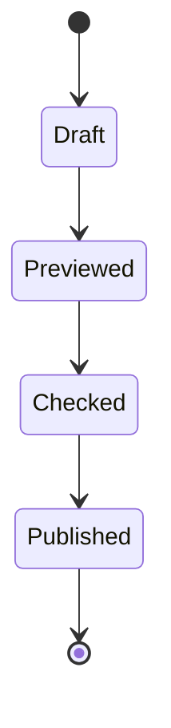

<a id="ucos-exp-000001-workflows"></a>
##### Workflows

- edit theme or screen → preview on every declared device → accessibility and performance checks → publish at a scope → roll back if needed

<a id="ucos-exp-000001-authorities"></a>
##### Authorities

- The platform owner governs components and device types; a tenant governs its themes, screens and sites.

<a id="ucos-exp-000001-permissions"></a>
##### Permissions

- theme.edit (design role at scope)
- component.register (platform)
- screen.read (any principal)

<a id="ucos-exp-000001-privacy-model"></a>
##### Privacy Model

Screens bind data through permissioned queries; nothing sensitive is rendered without the viewer's grant.

<a id="ucos-exp-000001-audit-model"></a>
##### Audit Model

Every publish records who changed what at which scope.

<a id="ucos-exp-000001-digital-twin-model"></a>
##### Digital Twin Model

An experience twin tracks render performance and errors per device type.

<a id="ucos-exp-000001-agent-model"></a>
##### Agent Model

A design agent proposes themes and layouts for preview; publishing follows approval rules.

<a id="ucos-exp-000001-runtime-model"></a>
##### Runtime Model

The resolver picks the nearest theme and layout for scope and device; direction comes from Expression.

<a id="ucos-exp-000001-scaling-model"></a>
##### Scaling Model

Rendered bundles are cached per scope, device and version.

<a id="ucos-exp-000001-multi-tenant-model"></a>
##### Multi-Tenant Model

Components are master data; themes and screens are tenant scope.

<a id="ucos-exp-000001-geo-distribution-model"></a>
##### Geo-Distribution Model

A theme or layout may apply to a place, for example a festival theme for one country.

<a id="ucos-exp-000001-failure-model"></a>
##### Failure Model

An injected script, an inaccessible theme, a layout broken on one device type.

<a id="ucos-exp-000001-recovery-model"></a>
##### Recovery Model

Publishes roll back in one step.

<a id="ucos-exp-000001-certification-model"></a>
##### Certification Model

Only registry components render; every published theme passes accessibility checks.

<a id="ucos-exp-000001-migration-model"></a>
##### Migration Model

Today's themes, branding, console bundles, sitemaps and hand-written screens move here.

<a id="ucos-exp-000001-implementation-blueprint"></a>
##### Implementation Blueprint

Build order for EXP: (1) device types and tokens; (2) component registry; (3) screens from configuration with preview; (4) accessibility and performance gates; (5) migrate themes, branding and console screens. Every build step also inherits Kernel parts K1–K11 (kinds, nodes, hierarchies, identifiers, shape, attributes, versions, events, change lifecycle, views and scope, resolution).

<a id="ucos-exp-000001-sequence-diagrams"></a>
##### Sequence Diagrams

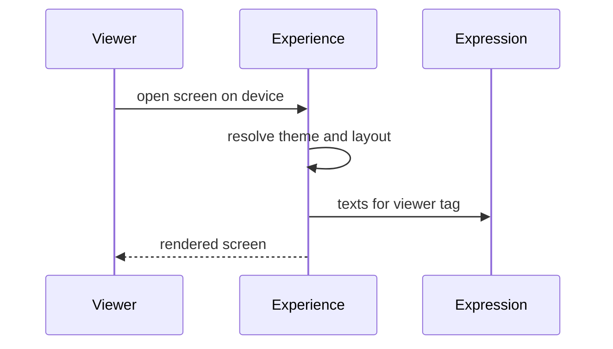

<a id="ucos-exp-000001-state-diagrams"></a>
##### State Diagrams

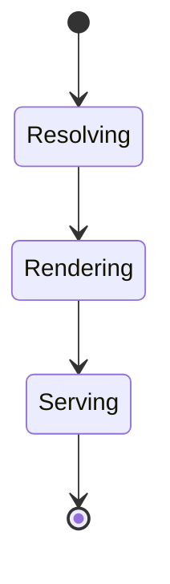

---

<a id="d-cmn"></a>
### D-CMN · Communication

| | |
|---|---|
| **Category** | C08 Interaction |
| **Owns** | [Message](../UCOS-MASTER.md#t-message), [Conversation](../UCOS-MASTER.md#t-conversation), [Communication Channel](../UCOS-MASTER.md#t-communication-channel) |
| **Responsible for** | Channels, Messages, Conversations, Templates, Sender Identities, Delivery |
| **Not responsible for** | Who Is Notified, System Event Transport |
| **Contract** | [UCOS-CMN-000001 Communication Architecture](#ucos-cmn-000001) |
| **Artifacts** | [UCOS-CMN-000001](#ucos-cmn-000001) |
| **Code** | `lib/mailer.js`, `lib/helpdesk.js` |
| **Managed in** | `_registry/domains.json` → `D-CMN` |

<a id="ucos-cmn-000001"></a>
#### UCOS-CMN-000001 · Communication Architecture

Owner [Communication](#d-cmn) · managed in `_registry/manifest.json` → `UCOS-CMN-000001`, content `_registry/content-platform.json` → `CMN` · inherits the [standard contract](../UCOS-MASTER.md#standard-contract)

<a id="ucos-cmn-000001-concepts"></a>
##### Concepts

Communication Architecture owns every exchange of messages with people: channels, messages one-way and two-way, conversations across channels, the shared inbox, templates, sender identities and delivery. Who is told what, and when, belongs to Notification.

<a id="ucos-cmn-000001-ontology"></a>
##### Ontology

A Message travels over a Communication Channel through a provider connector, from a Sender Identity; a Conversation threads messages between parties; a Template renders a message per purpose, channel and language tag.

<a id="ucos-cmn-000001-taxonomy"></a>
##### Taxonomy

Channels: email, SMS, RCS, WhatsApp and other chat apps, push, in-app, voice and IVR, video, social messaging, postal mail, any declared. Direction: outbound / inbound / two-way.

<a id="ucos-cmn-000001-data-model"></a>
##### Data Model

```yaml
Message:
  messageId: <Identity>
  conversation: <Conversation> | null
  channel: <Communication Channel>
  template: <Template> | null
  from: <Sender Identity>
  to: <Party>
  status: <queued | sent | delivered | read | failed | bounced>
```

<a id="ucos-cmn-000001-graph-model"></a>
##### Graph Model

(:Message)-[:IN]->(:Conversation); (:Message)-[:VIA]->(:Channel); (:Channel)-[:SERVED_BY]->(:Connector); (:Conversation)-[:BETWEEN]->(:Party)

<a id="ucos-cmn-000001-apis"></a>
##### APIs

- POST /cmn.v1.send
- POST /cmn.v1.inbound
- GET  /cmn.v1/conversation/{id}
- POST /cmn.v1.template
- GET  /cmn.v1/delivery/{id}

<a id="ucos-cmn-000001-events"></a>
##### Events

- MessageSent
- MessageDelivered
- MessageFailed
- MessageReceived
- ConversationAssigned

<a id="ucos-cmn-000001-commands"></a>
##### Commands

- message.send
- message.receive
- conversation.assign
- template.edit
- sender.verify

<a id="ucos-cmn-000001-queries"></a>
##### Queries

- inbox.list
- conversation.history
- delivery.report

<a id="ucos-cmn-000001-state-machines"></a>
##### State Machines

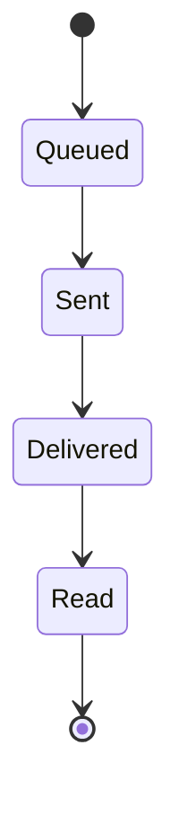

<a id="ucos-cmn-000001-workflows"></a>
##### Workflows

- render template in recipient's tag → choose channel and provider for place → send → track delivery → retry or fall back to the next channel

<a id="ucos-cmn-000001-authorities"></a>
##### Authorities

- The platform owner governs channels; a tenant governs its templates, senders and inbox.

<a id="ucos-cmn-000001-permissions"></a>
##### Permissions

- message.send (service or role)
- inbox.read (assigned agent or role)
- template.edit (scope owner)

<a id="ucos-cmn-000001-privacy-model"></a>
##### Privacy Model

Content and recipients are personal data; recording and retention follow Compliance, and consent is honoured per channel.

<a id="ucos-cmn-000001-audit-model"></a>
##### Audit Model

Every send and delivery outcome is recorded.

<a id="ucos-cmn-000001-digital-twin-model"></a>
##### Digital Twin Model

A deliverability twin tracks bounce and failure rates per channel and provider.

<a id="ucos-cmn-000001-agent-model"></a>
##### Agent Model

Agents handle conversations and hand off to a person by rule.

<a id="ucos-cmn-000001-runtime-model"></a>
##### Runtime Model

Sends are queued and retried with back-off; channel fallback follows the declared order.

<a id="ucos-cmn-000001-scaling-model"></a>
##### Scaling Model

Sends batch per provider within its rate limits.

<a id="ucos-cmn-000001-multi-tenant-model"></a>
##### Multi-Tenant Model

Each tenant has its own senders, templates and inbox.

<a id="ucos-cmn-000001-geo-distribution-model"></a>
##### Geo-Distribution Model

Channel and provider routing is per place.

<a id="ucos-cmn-000001-failure-model"></a>
##### Failure Model

Unverified sender, provider outage, opt-out ignored, wrong-language template.

<a id="ucos-cmn-000001-recovery-model"></a>
##### Recovery Model

Failed messages wait in a dead-letter queue and can be resent.

<a id="ucos-cmn-000001-certification-model"></a>
##### Certification Model

No message is sent without consent where the channel's law requires it.

<a id="ucos-cmn-000001-migration-model"></a>
##### Migration Model

Today's mailer, notification provider transports and helpdesk conversations move here.

<a id="ucos-cmn-000001-implementation-blueprint"></a>
##### Implementation Blueprint

Build order for CMN: (1) channels and sender identities; (2) templates per tag; (3) send with retry and fallback; (4) conversations and inbox; (5) migrate the mailer and helpdesk. Every build step also inherits Kernel parts K1–K11 (kinds, nodes, hierarchies, identifiers, shape, attributes, versions, events, change lifecycle, views and scope, resolution).

<a id="ucos-cmn-000001-sequence-diagrams"></a>
##### Sequence Diagrams

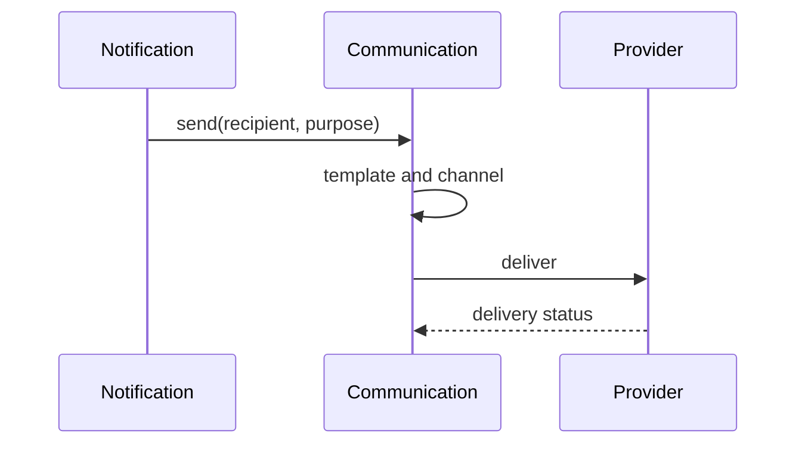

<a id="ucos-cmn-000001-state-diagrams"></a>
##### State Diagrams

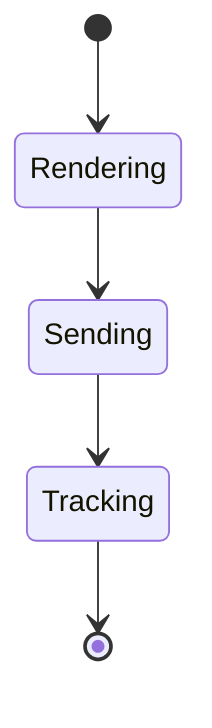

---

<a id="d-ntf"></a>
### D-NTF · Notification

| | |
|---|---|
| **Category** | C08 Interaction |
| **Owns** | [Notification](../UCOS-MASTER.md#t-notification) |
| **Responsible for** | Event Subscriptions, Recipient Preferences, Timing |
| **Not responsible for** | Channels, Templates, Delivery |
| **Contract** | [UCOS-NTF-000001 Notification Architecture](#ucos-ntf-000001) |
| **Artifacts** | [UCOS-NTF-000001](#ucos-ntf-000001) |
| **Code** | — |
| **Managed in** | `_registry/domains.json` → `D-NTF` |

<a id="ucos-ntf-000001"></a>
#### UCOS-NTF-000001 · Notification Architecture

Owner [Notification](#d-ntf) · managed in `_registry/manifest.json` → `UCOS-NTF-000001`, content `_registry/content-platform.json` → `NTF` · inherits the [standard contract](../UCOS-MASTER.md#standard-contract)

<a id="ucos-ntf-000001-concepts"></a>
##### Concepts

Notification Architecture decides who is told what, and when. It subscribes recipients to events, honours their preferences and consent, and times delivery. It owns no channel, template or delivery; it sends through Communication.

<a id="ucos-ntf-000001-ontology"></a>
##### Ontology

A Subscription links an Event to Recipients (a person, role, group, segment or a party resolved from the entity); Preferences choose channel and frequency per topic; Timing applies quiet hours, digests and rate limits.

<a id="ucos-ntf-000001-taxonomy"></a>
##### Taxonomy

By purpose: transactional / marketing / operational / security. By urgency: normal / urgent override.

<a id="ucos-ntf-000001-data-model"></a>
##### Data Model

```yaml
EventSubscription:
  subscriptionId: <Identity>
  event: <Event kind>
  recipients: <resolver expression>
  purpose: <transactional | marketing | operational | security>
  timing: {quietHours, digest, ratePerRecipient}
```

<a id="ucos-ntf-000001-graph-model"></a>
##### Graph Model

(:Subscription)-[:ON]->(:EventKind); (:Subscription)-[:TO]->(:RecipientRule); (:Party)-[:PREFERS {topic}]->(:Channel)

<a id="ucos-ntf-000001-apis"></a>
##### APIs

- POST /ntf.v1.subscription
- PUT  /ntf.v1/preferences/{party}
- GET  /ntf.v1/preferences/{party}

<a id="ucos-ntf-000001-events"></a>
##### Events

- NotificationDecided
- NotificationSuppressed
- DigestReleased

<a id="ucos-ntf-000001-commands"></a>
##### Commands

- subscription.declare
- preferences.set
- notification.mute

<a id="ucos-ntf-000001-queries"></a>
##### Queries

- subscriptions.forEvent
- preferences.of
- digest.pending

<a id="ucos-ntf-000001-state-machines"></a>
##### State Machines

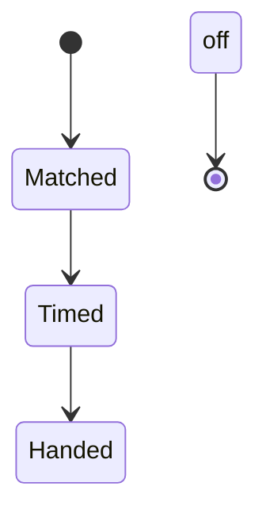

<a id="ucos-ntf-000001-workflows"></a>
##### Workflows

- event arrives → matching subscriptions → recipients resolved → preferences and consent applied → quiet hours and digest timing → handed to Communication

<a id="ucos-ntf-000001-authorities"></a>
##### Authorities

- A tenant governs its subscriptions; each person governs their own preferences.

<a id="ucos-ntf-000001-permissions"></a>
##### Permissions

- subscription.declare (scope owner)
- preferences.set (the person)

<a id="ucos-ntf-000001-privacy-model"></a>
##### Privacy Model

Preferences and consent are honoured before any send; marketing never rides on a transactional purpose.

<a id="ucos-ntf-000001-audit-model"></a>
##### Audit Model

Suppressions are recorded with their reason.

<a id="ucos-ntf-000001-digital-twin-model"></a>
##### Digital Twin Model

A notification twin tracks volume and suppression per event.

<a id="ucos-ntf-000001-agent-model"></a>
##### Agent Model

Agents may subscribe to events like any recipient.

<a id="ucos-ntf-000001-runtime-model"></a>
##### Runtime Model

Decisions run off the event log; timing uses the recipient's own clock from Time.

<a id="ucos-ntf-000001-scaling-model"></a>
##### Scaling Model

Fan-out is batched per event.

<a id="ucos-ntf-000001-multi-tenant-model"></a>
##### Multi-Tenant Model

Subscriptions are tenant scope.

<a id="ucos-ntf-000001-geo-distribution-model"></a>
##### Geo-Distribution Model

Quiet hours follow the recipient's place and clock.

<a id="ucos-ntf-000001-failure-model"></a>
##### Failure Model

Sending at night in the recipient's zone, marketing without consent, notification storms.

<a id="ucos-ntf-000001-recovery-model"></a>
##### Recovery Model

Decisions are idempotent per event and recipient.

<a id="ucos-ntf-000001-certification-model"></a>
##### Certification Model

Every send traces to a subscription and passes the consent check.

<a id="ucos-ntf-000001-migration-model"></a>
##### Migration Model

Today's notification triggers move here; their channels move to Communication.

<a id="ucos-ntf-000001-implementation-blueprint"></a>
##### Implementation Blueprint

Build order for NTF: (1) subscriptions over the event log; (2) recipient resolution; (3) preferences and consent; (4) timing; (5) migrate today's triggers. Every build step also inherits Kernel parts K1–K11 (kinds, nodes, hierarchies, identifiers, shape, attributes, versions, events, change lifecycle, views and scope, resolution).

<a id="ucos-ntf-000001-sequence-diagrams"></a>
##### Sequence Diagrams

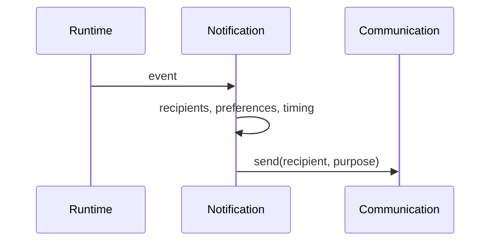

<a id="ucos-ntf-000001-state-diagrams"></a>
##### State Diagrams

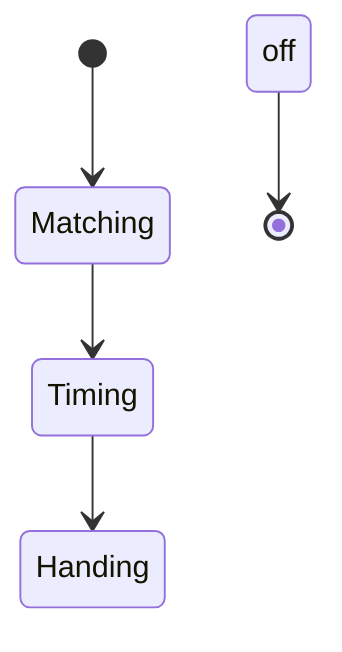

---

<a id="d-srh"></a>
### D-SRH · Search

| | |
|---|---|
| **Category** | C08 Interaction |
| **Owns** | [Search Index](../UCOS-MASTER.md#t-search-index) |
| **Responsible for** | Indexes, Ranking, Synonyms, Facets |
| **Not responsible for** | Persistence Indexes, Meaning |
| **Contract** | [UCOS-SRC-000001 Search Architecture](#ucos-src-000001) |
| **Artifacts** | [UCOS-SRC-000001](#ucos-src-000001) |
| **Code** | `lib/search.js` |
| **Managed in** | `_registry/domains.json` → `D-SRH` |

<a id="ucos-src-000001"></a>
#### UCOS-SRC-000001 · Search Architecture

Owner [Search](#d-srh) · managed in `_registry/manifest.json` → `UCOS-SRC-000001`, content `_registry/content-runtime-data.json` → `SRC` · inherits the [standard contract](../UCOS-MASTER.md#standard-contract)

<a id="ucos-src-000001-concepts"></a>
##### Concepts

Search Architecture is context-aware discovery over projections. Search is not a feature bolted on — it is a governed query path respecting semantics, context policy, privacy, and perspective.

<a id="ucos-src-000001-ontology"></a>
##### Ontology

Search has a Query (semantic + context), a Ranking policy, a Filter set (context/perspective/privacy), and a Result provenance. Ranking is policy-driven; relevance is never the only criterion.

<a id="ucos-src-000001-taxonomy"></a>
##### Taxonomy

By modality: Keyword / Semantic / Faceted / Hybrid / Voice / Visual / Future. By scope: Tenant / Marketplace / Federated. By personalization: Universal / Segment / Individual (consent-gated).

<a id="ucos-src-000001-data-model"></a>
##### Data Model

```yaml
SearchQuery:
  queryId: <Identity>
  semanticConcept: <SemanticModel|null>
  context: <Context>
  filters: [<Policy>]
  rankingPolicy: <Policy>
  perspective: <Perspective>
  temporal: {at}
  personalizationScope: <consent scope|null>
```

<a id="ucos-src-000001-graph-model"></a>
##### Graph Model

(:Search)-[:QUERIES]->(:Index); (:Search)-[:RANKED_BY]->(:Policy); (:Search)-[:FILTERED_BY]->(:Policy); (:Search)-[:PROJECTED_VIA]->(:Perspective)

<a id="ucos-src-000001-apis"></a>
##### APIs

- POST /search.v1.query
- POST /search.v1.suggest
- GET  /search.v1.facets
- POST /search.v1.semantic

<a id="ucos-src-000001-events"></a>
##### Events

- SearchExecuted
- SuggestionServed
- SemanticDisambiguated
- ZeroResultDetected

<a id="ucos-src-000001-commands"></a>
##### Commands

- search.query
- search.suggest
- search.facet
- search.semantic.resolve

<a id="ucos-src-000001-queries"></a>
##### Queries

- search.history
- search.popular
- search.zeroResults
- search.latency

<a id="ucos-src-000001-state-machines"></a>
##### State Machines

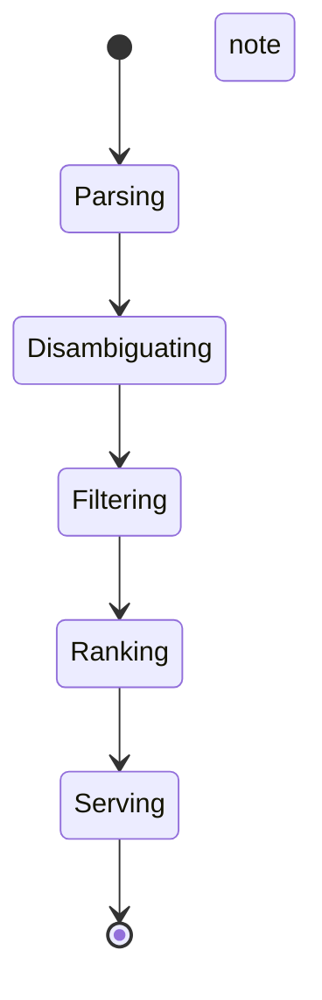

<a id="ucos-src-000001-workflows"></a>
##### Workflows

- parse query → semantic disambiguation → context + privacy filtering → policy ranking → perspective projection → serve

<a id="ucos-src-000001-authorities"></a>
##### Authorities

- Search Authority (infrastructure); ranking and filter policies carry their own authorities.

<a id="ucos-src-000001-permissions"></a>
##### Permissions

- search.query (authenticated, context-scoped)
- search.personalize (consent scope)
- search.read-own-history (subject)

<a id="ucos-src-000001-privacy-model"></a>
##### Privacy Model

Personalization requires consent; without it, search is context-scoped only. Query logs are minimized and retention-bounded.

<a id="ucos-src-000001-audit-model"></a>
##### Audit Model

Every search records context, filters applied, ranking policy version — required for marketplace fairness audit.

<a id="ucos-src-000001-digital-twin-model"></a>
##### Digital Twin Model

Search twin monitors zero-result rates and latency as catalog-health signals.

<a id="ucos-src-000001-agent-model"></a>
##### Agent Model

Search agent detects rising unmet queries and proposes catalog or semantic gaps to the owning domains.

<a id="ucos-src-000001-runtime-model"></a>
##### Runtime Model

Query planning fans out to indexes in parallel; results merge under ranking policy with consistent pagination.

<a id="ucos-src-000001-scaling-model"></a>
##### Scaling Model

Search scales with index partitioning; hot queries are cached with policy-version invalidation.

<a id="ucos-src-000001-multi-tenant-model"></a>
##### Multi-Tenant Model

Search is tenant-scoped; marketplace search aggregates only published projections under marketplace policy.

<a id="ucos-src-000001-geo-distribution-model"></a>
##### Geo-Distribution Model

Search respects geo-context — availability, language, and compliance projected per region.

<a id="ucos-src-000001-failure-model"></a>
##### Failure Model

Semantic ambiguity collapse, filter policy conflict, ranking bias, index staleness.

<a id="ucos-src-000001-recovery-model"></a>
##### Recovery Model

Search is stateless over truth — results recompute from indexes; caches are disposable.

<a id="ucos-src-000001-certification-model"></a>
##### Certification Model

Search must prove filters were applied before ranking — privacy before relevance, always.

<a id="ucos-src-000001-migration-model"></a>
##### Migration Model

New modalities are registry additions.

<a id="ucos-src-000001-implementation-blueprint"></a>
##### Implementation Blueprint

Build order for SRC: (1) define registry entries — this domain owns by modality: keyword / semantic / faceted / hybrid / voice / visual / future as registry truth, not code; (2) implement the contract surface first (search.query, search.suggest, search.facet) and validate against SRC boundaries; (3) event-source all state so history is reconstructable; (4) wire the enforcement points — authority check, policy guard, evidence binding, trace — in-line, with no bypass path; (5) add tests per the Testing Architecture, citing evidence per gate; (6) obtain Verification and Certification before activation. Acceptance: the Zero Partial and Law 001 audits pass, every action answers the seven explainability questions, and this domain mutates no other domain internals.

<a id="ucos-src-000001-sequence-diagrams"></a>
##### Sequence Diagrams

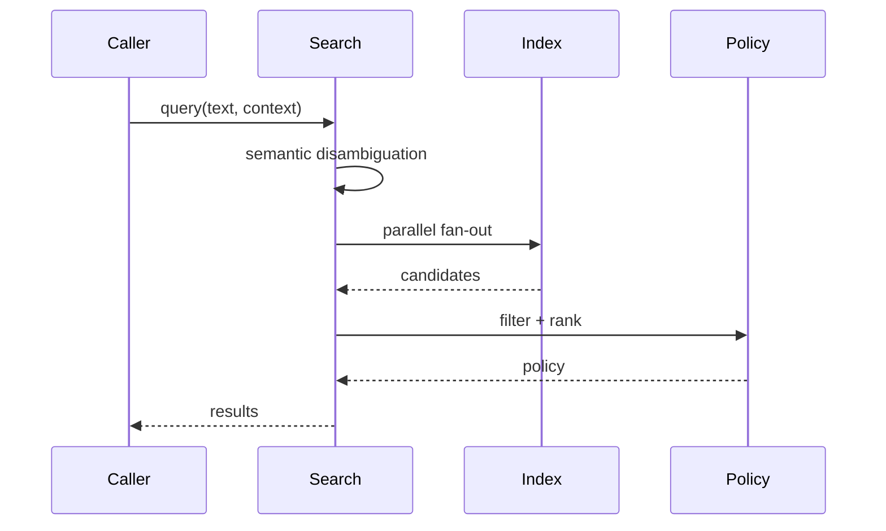

<a id="ucos-src-000001-state-diagrams"></a>
##### State Diagrams

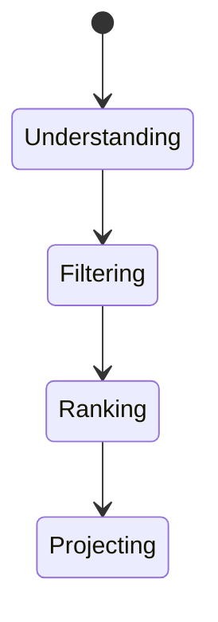

