# Volume V09.1 · Automation (part 1 of 2)

**Part of** [the master document](../UCOS-MASTER.md) · **Category** C09 · **Projected from** `_registry/` — never edit this file: change the registry and run `npm run registry`.

**Parts:** **V09.1** · [V09.2](V09.2-automation.md)

> How work runs: events, state, workflows, agents and connections.

## Contents

- [D-RUN Runtime](#d-run)
  - [UCOS-RUN-000001 Runtime Constitution](#ucos-run-000001)
  - [UCOS-RUN-000002 Execution Architecture](#ucos-run-000002)
  - [UCOS-RUN-000003 Orchestration Architecture](#ucos-run-000003)
  - [UCOS-RUN-000004 Workflow Architecture](#ucos-run-000004)
  - [UCOS-RUN-000005 State Machine Architecture](#ucos-run-000005)
  - [UCOS-EVT-000001 Event Architecture](#ucos-evt-000001)
  - [UCOS-MSG-000001 Messaging Architecture](#ucos-msg-000001)
- [D-AGT Agent](#d-agt)
  - [UCOS-AGT-000001 Agent Constitution](#ucos-agt-000001)
  - [UCOS-AGT-000002 Agent Runtime](#ucos-agt-000002)
  - [UCOS-AGT-000003 Agent Governance](#ucos-agt-000003)
  - [UCOS-AGT-000004 Agent Trust](#ucos-agt-000004)
  - [UCOS-AGT-000005 Agent Safety](#ucos-agt-000005)
  - [UCOS-AGT-000006 Agent Economics](#ucos-agt-000006)
  - [UCOS-AGT-000007 Agent Society](#ucos-agt-000007)

---

<a id="d-run"></a>
### D-RUN · Runtime

| | |
|---|---|
| **Category** | C09 Automation |
| **Build status** | partial |
| **Owns** | [State](../UCOS-MASTER.md#t-state), [Event](../UCOS-MASTER.md#t-event), [Process](../UCOS-MASTER.md#t-process), [Workflow](../UCOS-MASTER.md#t-workflow), [Projection](../UCOS-MASTER.md#t-projection) |
| **Responsible for** | Event Log, State Machines, Workflows, Orchestration, Execution, System Messaging |
| **Not responsible for** | Policy, Decision |
| **Contract** | [UCOS-RUN-000001 Runtime Constitution](#ucos-run-000001) |
| **Artifacts** | [UCOS-RUN-000001](#ucos-run-000001), [UCOS-RUN-000002](#ucos-run-000002), [UCOS-RUN-000003](#ucos-run-000003), [UCOS-RUN-000004](#ucos-run-000004), [UCOS-RUN-000005](#ucos-run-000005), [UCOS-EVT-000001](#ucos-evt-000001), [UCOS-MSG-000001](#ucos-msg-000001) |
| **Concepts** | 729 — `node _registry/compile.js --search <words> --kind concept --owner "Runtime"` |
| **Code** | `lib/kernel.js`, `lib/events.js`, `lib/states.js`, `lib/queue.js`, `lib/seed/states.json` |
| **Managed in** | `_registry/domains.json` → `D-RUN` |

**Live routes (3)** — what the platform serves today for this domain:

- `GET /api/ucii/workflows`
- `POST /api/ucii/workflows`
- `DELETE /api/ucii/workflows/:key`

<a id="ucos-run-000001"></a>
#### UCOS-RUN-000001 · Runtime Constitution

Owner [Runtime](#d-run) · managed in `_registry/manifest.json` → `UCOS-RUN-000001`, content `_registry/content-runtime-data.json` → `RUN` · inherits the [standard contract](../UCOS-MASTER.md#standard-contract)

<a id="ucos-run-000001-concepts"></a>
##### Concepts

The Runtime Constitution defines how derived reality executes. Constitution defines truth; Domains manage truth; Runtime derives reality; Agents execute reality; Applications consume reality. The runtime never owns truth — it computes projections of it.

<a id="ucos-run-000001-ontology"></a>
##### Ontology

Runtime is a pure function over registry state. Inputs: primitives + registry. Outputs: projections. Side effects: only governed, evidenced actions. The runtime is stateless with respect to truth.

<a id="ucos-run-000001-taxonomy"></a>
##### Taxonomy

By layer: Projection / Orchestration / Execution / Interaction. By mode: Interactive / Batch / Streaming / Event-driven. By ownership: Platform / Tenant / Edge.

<a id="ucos-run-000001-data-model"></a>
##### Data Model

```yaml
RuntimeSession:
  sessionId: <Identity>
  inputs: {primitives: [<ref>], registryVersion: <version>}
  projections: [<content-addressed ref>]
  actions: [<governed action ref>]
  temporal: {startedAt, endedAt}
  context: <Context>
  evidence: [<Evidence>]
```

<a id="ucos-run-000001-graph-model"></a>
##### Graph Model

(:Session)-[:INPUTS_FROM]->(:Registry); (:Session)-[:PROJECTS]->(:Projection); (:Session)-[:EMITS]->(:Event); (:Session)-[:GOVERNED_BY]->(:Policy)

<a id="ucos-run-000001-apis"></a>
##### APIs

*Designed interface: the contract the domain is built towards. The routes it serves today are on its card.*

- POST /runtime.v1.session
- GET  /runtime.v1/{id}
- POST /runtime.v1.project
- POST /runtime.v1.act

<a id="ucos-run-000001-events"></a>
##### Events

- SessionOpened
- ProjectionComputed
- ActionExecuted
- SessionClosed
- RuntimeViolation

<a id="ucos-run-000001-commands"></a>
##### Commands

- runtime.session.open
- runtime.project
- runtime.act
- runtime.session.close

<a id="ucos-run-000001-queries"></a>
##### Queries

- runtime.session
- runtime.projections
- runtime.actions
- runtime.health

<a id="ucos-run-000001-state-machines"></a>
##### State Machines

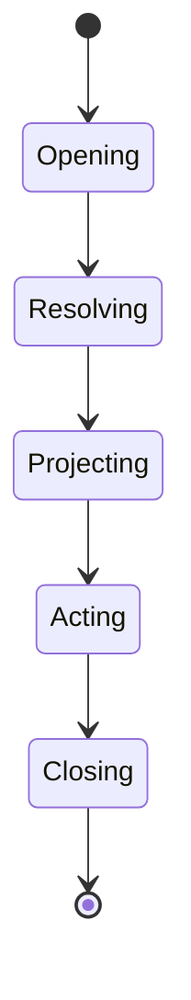

<a id="ucos-run-000001-workflows"></a>
##### Workflows

- open session with registry version → resolve context → compute projections → execute governed actions → close with full evidence

<a id="ucos-run-000001-authorities"></a>
##### Authorities

- Runtime Authority (execution); every action carries the acting domain's delegated authority.

<a id="ucos-run-000001-permissions"></a>
##### Permissions

- runtime.session (authenticated)
- runtime.act (action-class authority)
- runtime.read (session-scoped)

<a id="ucos-run-000001-privacy-model"></a>
##### Privacy Model

Sessions over personal data are consent-scoped and retention-bounded by policy.

<a id="ucos-run-000001-audit-model"></a>
##### Audit Model

Every session is a complete audit artifact — inputs, registry version, projections, actions, and evidence form an unbroken chain.

<a id="ucos-run-000001-digital-twin-model"></a>
##### Digital Twin Model

Runtime twin monitors projection latency and violation rates as platform health.

<a id="ucos-run-000001-agent-model"></a>
##### Agent Model

Agents execute within the runtime; their actions are governed at the same enforcement points as everything else.

<a id="ucos-run-000001-runtime-model"></a>
##### Runtime Model

The runtime is deliberately stateless about truth — all truth is re-derived from the registry per session, guaranteeing consistency.

<a id="ucos-run-000001-scaling-model"></a>
##### Scaling Model

Sessions are independent and horizontally scalable; registry version pinning makes projections reproducible at any scale.

<a id="ucos-run-000001-multi-tenant-model"></a>
##### Multi-Tenant Model

Sessions are tenant-isolated; cross-tenant projection requires published relationship and both authorities.

<a id="ucos-run-000001-geo-distribution-model"></a>
##### Geo-Distribution Model

Sessions run in-jurisdiction for regulated data; registry versions replicate for local resolution.

<a id="ucos-run-000001-failure-model"></a>
##### Failure Model

Registry version skew, projection timeout, evidence gap mid-session, policy version race.

<a id="ucos-run-000001-recovery-model"></a>
##### Recovery Model

Sessions are replayable from registry state — a failed session re-derives identically. In-flight actions are idempotent.

<a id="ucos-run-000001-certification-model"></a>
##### Certification Model

Runtime must prove every output is a deterministic function of registry state — no hidden state, no bypass paths.

<a id="ucos-run-000001-migration-model"></a>
##### Migration Model

Runtime evolves by registry version; old sessions remain reproducible at their pinned version.

<a id="ucos-run-000001-implementation-blueprint"></a>
##### Implementation Blueprint

Build order for RUN: (1) define registry entries — this domain owns by layer: projection / orchestration / execution / interaction as registry truth, not code; (2) implement the contract surface first (runtime.session.open, runtime.project, runtime.act) and validate against RUN boundaries; (3) event-source all state so history is reconstructable; (4) wire the enforcement points — authority check, policy guard, evidence binding, trace — in-line, with no bypass path; (5) add tests per the Testing Architecture, citing evidence per gate; (6) obtain Verification and Certification before activation. Acceptance: the Zero Partial and Law 001 audits pass, every action answers the seven explainability questions, and this domain mutates no other domain internals.

<a id="ucos-run-000001-sequence-diagrams"></a>
##### Sequence Diagrams

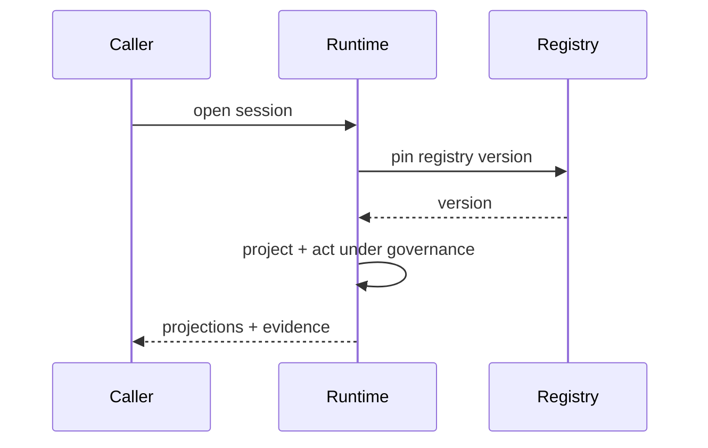

<a id="ucos-run-000001-state-diagrams"></a>
##### State Diagrams

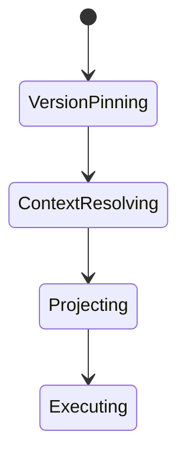

<a id="ucos-run-000002"></a>
#### UCOS-RUN-000002 · Execution Architecture

Owner [Runtime](#d-run) · managed in `_registry/manifest.json` → `UCOS-RUN-000002`, content `_registry/content-runtime-data.json` → `RUN2` · inherits the [standard contract](../UCOS-MASTER.md#standard-contract)

<a id="ucos-run-000002-concepts"></a>
##### Concepts

Execution Architecture defines how a single governed action runs. Every action passes authority check, policy guard, evidence binding, and trace recording — in that order, with no bypass.

<a id="ucos-run-000002-ontology"></a>
##### Ontology

Execution is a pipeline: Authorize → Guard → Execute → Evidence → Trace. Each stage is mandatory and independently verifiable. A skipped stage is a constitutional violation.

<a id="ucos-run-000002-taxonomy"></a>
##### Taxonomy

By synchronicity: Synchronous / Asynchronous / Deferred. By isolation: Shared / Isolated / Enclave. By idempotency: Idempotent / At-most-once / Compensatable.

<a id="ucos-run-000002-data-model"></a>
##### Data Model

```yaml
Execution:
  executionId: <Identity>
  actionClass: <registry id>
  authority: <Authority>
  policyVersion: <version>
  input: <content-addressed>
  output: <content-addressed>
  evidence: [<Evidence>]
  trace: <append-only ref>
  temporal: {at}
  idempotencyKey: <hash>
```

<a id="ucos-run-000002-graph-model"></a>
##### Graph Model

(:Execution)-[:AUTHORIZED_BY]->(:Authority); (:Execution)-[:GUARDED_BY]->(:Policy); (:Execution)-[:EVIDENCED_BY]->(:Evidence); (:Execution)-[:TRACED_IN]->(:AuditLog)

<a id="ucos-run-000002-apis"></a>
##### APIs

*Designed interface: the contract the domain is built towards. The routes it serves today are on its card.*

- POST /execution.v1.run
- GET  /execution.v1/{id}
- GET  /execution.v1.trace/{id}
- POST /execution.v1.compensate

<a id="ucos-run-000002-events"></a>
##### Events

- ExecutionRequested
- ExecutionAuthorized
- ExecutionGuarded
- ExecutionCompleted
- ExecutionFailed
- ExecutionCompensated

<a id="ucos-run-000002-commands"></a>
##### Commands

- execution.run
- execution.compensate
- execution.replay
- execution.audit

<a id="ucos-run-000002-queries"></a>
##### Queries

- execution.byId
- execution.trace
- execution.byActionClass
- execution.violations

<a id="ucos-run-000002-state-machines"></a>
##### State Machines

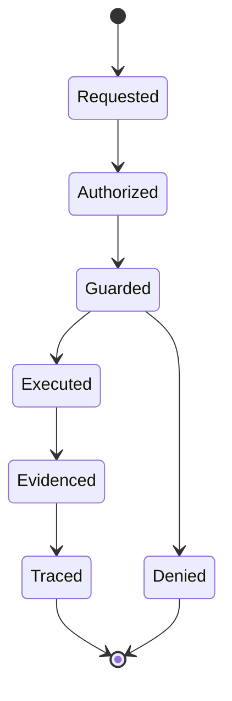

<a id="ucos-run-000002-workflows"></a>
##### Workflows

- authorize (authority chain) → guard (policy evaluation) → execute (isolated) → bind evidence → append trace

<a id="ucos-run-000002-authorities"></a>
##### Authorities

- The action class's owning authority; verified, never assumed.

<a id="ucos-run-000002-permissions"></a>
##### Permissions

- execution.run (holder of action-class authority)
- execution.compensate (governance)
- execution.read (auditor)

<a id="ucos-run-000002-privacy-model"></a>
##### Privacy Model

Traces minimize personal data; the enforcement facts are retained, subject contents are not.

<a id="ucos-run-000002-audit-model"></a>
##### Audit Model

The trace is the audit — every stage is a signed, timestamped, append-only entry. Replay reproduces identical outcome.

<a id="ucos-run-000002-digital-twin-model"></a>
##### Digital Twin Model

Execution twin monitors pipeline latency and denial rates as governance health.

<a id="ucos-run-000002-agent-model"></a>
##### Agent Model

Agent actions run through the identical pipeline — agents get no shortcut, by constitutional design.

<a id="ucos-run-000002-runtime-model"></a>
##### Runtime Model

The pipeline is in-process for latency, with each stage writing to an append-only log before the next begins.

<a id="ucos-run-000002-scaling-model"></a>
##### Scaling Model

Executions are independent; the append-only trace is the serialization point and is sharded by execution id.

<a id="ucos-run-000002-multi-tenant-model"></a>
##### Multi-Tenant Model

Executions are tenant-isolated; cross-tenant action classes require both authorities.

<a id="ucos-run-000002-geo-distribution-model"></a>
##### Geo-Distribution Model

Execution locality follows data residency; traces stay in-jurisdiction.

<a id="ucos-run-000002-failure-model"></a>
##### Failure Model

Stage skip (must be impossible), evidence failure post-execution, trace write failure, idempotency collision.

<a id="ucos-run-000002-recovery-model"></a>
##### Recovery Model

Failed executions compensate via recorded compensating actions — the pipeline is never left half-executed by design.

<a id="ucos-run-000002-certification-model"></a>
##### Certification Model

Pipeline completeness must be formally provable — a bypass path voids certification of the entire platform.

<a id="ucos-run-000002-migration-model"></a>
##### Migration Model

New action classes are registry additions; the pipeline schema is frozen.

<a id="ucos-run-000002-implementation-blueprint"></a>
##### Implementation Blueprint

Build order for RUN2: (1) define registry entries — this domain owns by synchronicity: synchronous / asynchronous / deferred as registry truth, not code; (2) implement the contract surface first (execution.run, execution.compensate, execution.replay) and validate against RUN2 boundaries; (3) event-source all state so history is reconstructable; (4) wire the enforcement points — authority check, policy guard, evidence binding, trace — in-line, with no bypass path; (5) add tests per the Testing Architecture, citing evidence per gate; (6) obtain Verification and Certification before activation. Acceptance: the Zero Partial and Law 001 audits pass, every action answers the seven explainability questions, and this domain mutates no other domain internals.

<a id="ucos-run-000002-sequence-diagrams"></a>
##### Sequence Diagrams

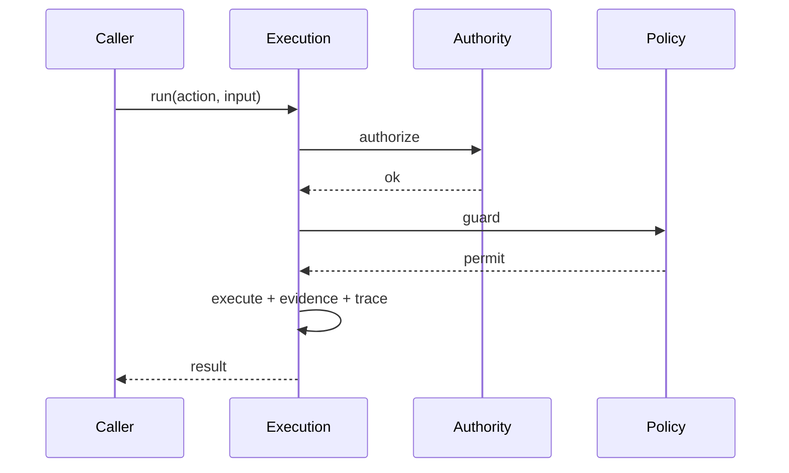

<a id="ucos-run-000002-state-diagrams"></a>
##### State Diagrams

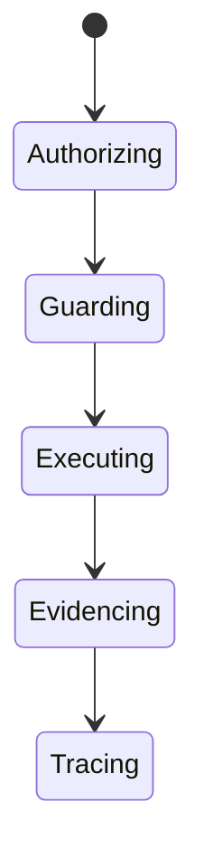

<a id="ucos-run-000003"></a>
#### UCOS-RUN-000003 · Orchestration Architecture

Owner [Runtime](#d-run) · managed in `_registry/manifest.json` → `UCOS-RUN-000003`, content `_registry/content-runtime-data.json` → `RUN3` · inherits the [standard contract](../UCOS-MASTER.md#standard-contract)

<a id="ucos-run-000003-concepts"></a>
##### Concepts

Orchestration coordinates multiple governed executions into coherent outcomes without introducing a coordination truth of its own. The orchestrator holds no state — it holds a plan, and the plan is itself a governed projection.

<a id="ucos-run-000003-ontology"></a>
##### Ontology

Orchestration has a Plan (workflow projection), Steps (executions), Dependencies (registry expressions), and Compensation logic. Sagas are first-class; distributed transactions across domains are prohibited (they'd create shared mutable truth).

<a id="ucos-run-000003-taxonomy"></a>
##### Taxonomy

By pattern: Saga / Pipeline / Fan-out-fan-in / Stateful-coordination / Event-choreography. By duration: Request-scale / Minutes / Hours / Days. By failure mode: Compensatable / Retryable / Escalating.

<a id="ucos-run-000003-data-model"></a>
##### Data Model

```yaml
Orchestration:
  orchestrationId: <Identity>
  plan: <workflow projection ref>
  steps: [{executionRef, dependsOn}]
  compensationPlan: [{step, compensatingAction}]
  state: <registry state>
  context: <Context>
  temporal: {startedAt}
```

<a id="ucos-run-000003-graph-model"></a>
##### Graph Model

(:Orchestration)-[:EXECUTES]->(:Execution); (:Orchestration)-[:PLAN_FROM]->(:Workflow); (:Orchestration)-[:COMPENSATES]->(:Execution); (:Orchestration)-[:SCOPED_IN]->(:Context)

<a id="ucos-run-000003-apis"></a>
##### APIs

*Designed interface: the contract the domain is built towards. The routes it serves today are on its card.*

- POST /orchestration.v1.start
- GET  /orchestration.v1/{id}
- POST /orchestration.v1/{id}/compensate
- GET  /orchestration.v1.status/{id}

<a id="ucos-run-000003-events"></a>
##### Events

- OrchestrationStarted
- StepCompleted
- StepFailed
- OrchestrationCompleted
- OrchestrationCompensating
- OrchestrationSuspended

<a id="ucos-run-000003-commands"></a>
##### Commands

- orchestration.start
- orchestration.compensate
- orchestration.suspend
- orchestration.resume

<a id="ucos-run-000003-queries"></a>
##### Queries

- orchestration.byId
- orchestration.status
- orchestration.active
- orchestration.timeline

<a id="ucos-run-000003-state-machines"></a>
##### State Machines

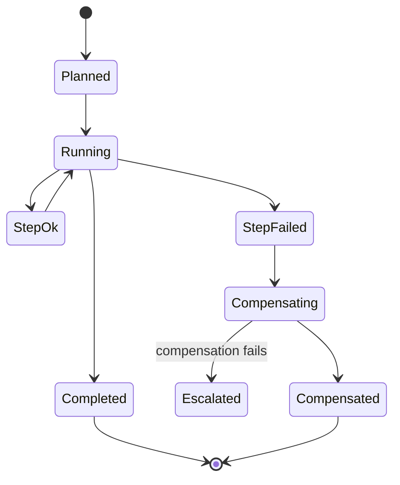

<a id="ucos-run-000003-workflows"></a>
##### Workflows

- materialize plan → execute steps per dependency → on failure: compensate in reverse → escalate if compensation fails

<a id="ucos-run-000003-authorities"></a>
##### Authorities

- Orchestration Authority (coordination); each step carries its own action-class authority.

<a id="ucos-run-000003-permissions"></a>
##### Permissions

- orchestration.start (plan owner)
- orchestration.compensate (governance)
- orchestration.read (participant)

<a id="ucos-run-000003-privacy-model"></a>
##### Privacy Model

Orchestration over personal data inherits the strictest consent scope among its steps.

<a id="ucos-run-000003-audit-model"></a>
##### Audit Model

Every step and compensation is traced; the orchestration is replayable end-to-end from the plan + step traces.

<a id="ucos-run-000003-digital-twin-model"></a>
##### Digital Twin Model

Orchestration twin tracks in-flight plans and predicts failure cascades before compensation is needed.

<a id="ucos-run-000003-agent-model"></a>
##### Agent Model

Planner agents materialize plans; orchestration executes them — planning and execution are separated by constitution.

<a id="ucos-run-000003-runtime-model"></a>
##### Runtime Model

Sagas with explicit compensation; no two-phase commit across domains — eventual consistency within a context window.

<a id="ucos-run-000003-scaling-model"></a>
##### Scaling Model

Orchestrations are independent; long-running plans checkpoint to the event store and resume.

<a id="ucos-run-000003-multi-tenant-model"></a>
##### Multi-Tenant Model

Orchestration never crosses tenants; marketplace flows are explicit multi-party plans with both authorities.

<a id="ucos-run-000003-geo-distribution-model"></a>
##### Geo-Distribution Model

Cross-region orchestration respects sovereignty — a step touching regulated data runs in-jurisdiction.

<a id="ucos-run-000003-failure-model"></a>
##### Failure Model

Step failure cascade, compensation failure, plan version drift, orphaned orchestration.

<a id="ucos-run-000003-recovery-model"></a>
##### Recovery Model

Compensation is the recovery mechanism; escalation routes to governance. Orphaned plans are reaped by policy.

<a id="ucos-run-000003-certification-model"></a>
##### Certification Model

Plan must be compensatable — non-compensatable distributed steps are uncertifiable.

<a id="ucos-run-000003-migration-model"></a>
##### Migration Model

New patterns are registry additions to the workflow registry.

<a id="ucos-run-000003-implementation-blueprint"></a>
##### Implementation Blueprint

Build order for RUN3: (1) define registry entries — this domain owns by pattern: saga / pipeline / fan-out-fan-in / stateful-coordination / event-choreography as registry truth, not code; (2) implement the contract surface first (orchestration.start, orchestration.compensate, orchestration.suspend) and validate against RUN3 boundaries; (3) event-source all state so history is reconstructable; (4) wire the enforcement points — authority check, policy guard, evidence binding, trace — in-line, with no bypass path; (5) add tests per the Testing Architecture, citing evidence per gate; (6) obtain Verification and Certification before activation. Acceptance: the Zero Partial and Law 001 audits pass, every action answers the seven explainability questions, and this domain mutates no other domain internals.

<a id="ucos-run-000003-sequence-diagrams"></a>
##### Sequence Diagrams

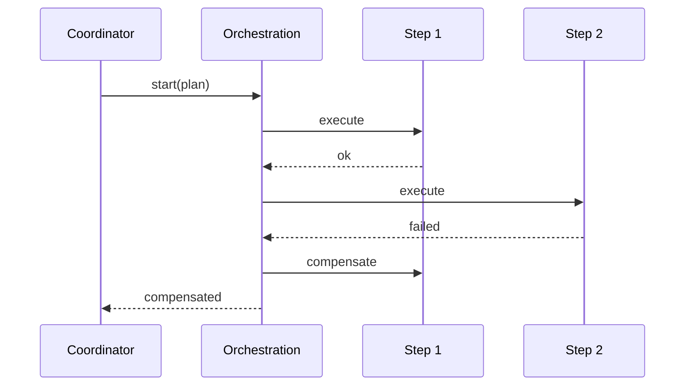

<a id="ucos-run-000003-state-diagrams"></a>
##### State Diagrams

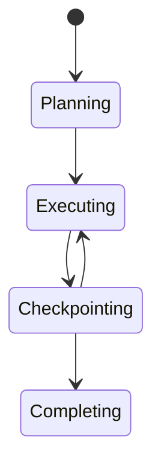

<a id="ucos-run-000004"></a>
#### UCOS-RUN-000004 · Workflow Architecture

Owner [Runtime](#d-run) · managed in `_registry/manifest.json` → `UCOS-RUN-000004`, content `_registry/content-runtime-data.json` → `RUN4` · inherits the [standard contract](../UCOS-MASTER.md#standard-contract)

<a id="ucos-run-000004-concepts"></a>
##### Concepts

Workflow Architecture defines process orchestration as a governed, registry-defined projection. Workflows are not code — they are declarations in the workflow registry, executed by the orchestration engine.

<a id="ucos-run-000004-ontology"></a>
##### Ontology

Workflow has Steps (action classes), Transitions (registry expressions), Guards (policies), and a state machine. Defining a workflow is a registry act, not a deployment act.

<a id="ucos-run-000004-taxonomy"></a>
##### Taxonomy

By structure: Sequential / Branching / Parallel / Loop / Event-driven / Hybrid. By mutability: Frozen-versioned / Governed-evolving. By scope: Universal / Domain / Tenant / Instance.

<a id="ucos-run-000004-data-model"></a>
##### Data Model

```yaml
Workflow:
  workflowId: <registry id>
  version: <int>
  steps: [{actionClass, guards: [Policy]}]
  transitions: [{from, to, condition}]
  stateMachine: <registry ref>
  compensationPlan: [{step, compensatingAction}]
  temporal: {effectiveFrom, effectiveTo}
```

<a id="ucos-run-000004-graph-model"></a>
##### Graph Model

(:Workflow)-[:HAS_STEP]->(:ActionClass); (:Workflow)-[:GUARDED_BY]->(:Policy); (:Workflow)-[:VERSION_OF]->(:Workflow); (:Workflow)-[:EXECUTED_AS]->(:Orchestration)

<a id="ucos-run-000004-apis"></a>
##### APIs

*Designed interface: the contract the domain is built towards. The routes it serves today are on its card.*

- POST /workflow.v1.define
- GET  /workflow.v1/{id}
- GET  /workflow.v1.versions/{id}
- POST /workflow.v1.validate

<a id="ucos-run-000004-events"></a>
##### Events

- WorkflowDefined
- WorkflowValidated
- WorkflowRetired
- WorkflowInstantiated

<a id="ucos-run-000004-commands"></a>
##### Commands

- workflow.define
- workflow.validate
- workflow.version.retire
- workflow.instantiate

<a id="ucos-run-000004-queries"></a>
##### Queries

- workflow.byId
- workflow.versions
- workflow.byStep
- workflow.active

<a id="ucos-run-000004-state-machines"></a>
##### State Machines

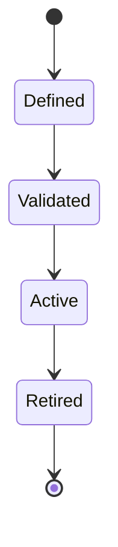

<a id="ucos-run-000004-workflows"></a>
##### Workflows

- define in registry → static validation (guards, compensatability, state machine sanity) → activate → instantiate per execution

<a id="ucos-run-000004-authorities"></a>
##### Authorities

- Workflow Authority (registry governance); step authorities are inherited from action classes.

<a id="ucos-run-000004-permissions"></a>
##### Permissions

- workflow.define (workflow authority)
- workflow.instantiate (plan owner)
- workflow.read (any authenticated)

<a id="ucos-run-000004-privacy-model"></a>
##### Privacy Model

Workflows over personal data carry consent scope as a first-class guard, not an afterthought.

<a id="ucos-run-000004-audit-model"></a>
##### Audit Model

Every instantiation records the workflow version — history is replayable because the version is immutable.

<a id="ucos-run-000004-digital-twin-model"></a>
##### Digital Twin Model

Workflow twin tracks execution distributions and bottleneck steps across instances.

<a id="ucos-run-000004-agent-model"></a>
##### Agent Model

Agents may define workflow proposals, but only the Workflow Authority activates them.

<a id="ucos-run-000004-runtime-model"></a>
##### Runtime Model

Workflow is data interpreted by the orchestration engine — the engine has zero workflow-specific code.

<a id="ucos-run-000004-scaling-model"></a>
##### Scaling Model

Definitions are few and globally cached; instances scale with orchestration.

<a id="ucos-run-000004-multi-tenant-model"></a>
##### Multi-Tenant Model

Universal workflows are shared; tenant workflows are registry entries scoped to the tenant.

<a id="ucos-run-000004-geo-distribution-model"></a>
##### Geo-Distribution Model

Workflow guards include jurisdiction policy — the same workflow may be legal in one region, blocked in another.

<a id="ucos-run-000004-failure-model"></a>
##### Failure Model

Invalid guard reference, uncompensatable step, transition deadlock, version retirement with live instances.

<a id="ucos-run-000004-recovery-model"></a>
##### Recovery Model

Versions are immutable; retirement prevents new instances, and live ones complete on their pinned version.

<a id="ucos-run-000004-certification-model"></a>
##### Certification Model

Workflow must pass static validation: guard completeness, state-machine reachability, and compensatability.

<a id="ucos-run-000004-migration-model"></a>
##### Migration Model

Workflow evolution is versioned registry evolution — there is no separate migration path.

<a id="ucos-run-000004-implementation-blueprint"></a>
##### Implementation Blueprint

Build order for RUN4: (1) define registry entries — this domain owns by structure: sequential / branching / parallel / loop / event-driven / hybrid as registry truth, not code; (2) implement the contract surface first (workflow.define, workflow.validate, workflow.version.retire) and validate against RUN4 boundaries; (3) event-source all state so history is reconstructable; (4) wire the enforcement points — authority check, policy guard, evidence binding, trace — in-line, with no bypass path; (5) add tests per the Testing Architecture, citing evidence per gate; (6) obtain Verification and Certification before activation. Acceptance: the Zero Partial and Law 001 audits pass, every action answers the seven explainability questions, and this domain mutates no other domain internals.

<a id="ucos-run-000004-sequence-diagrams"></a>
##### Sequence Diagrams

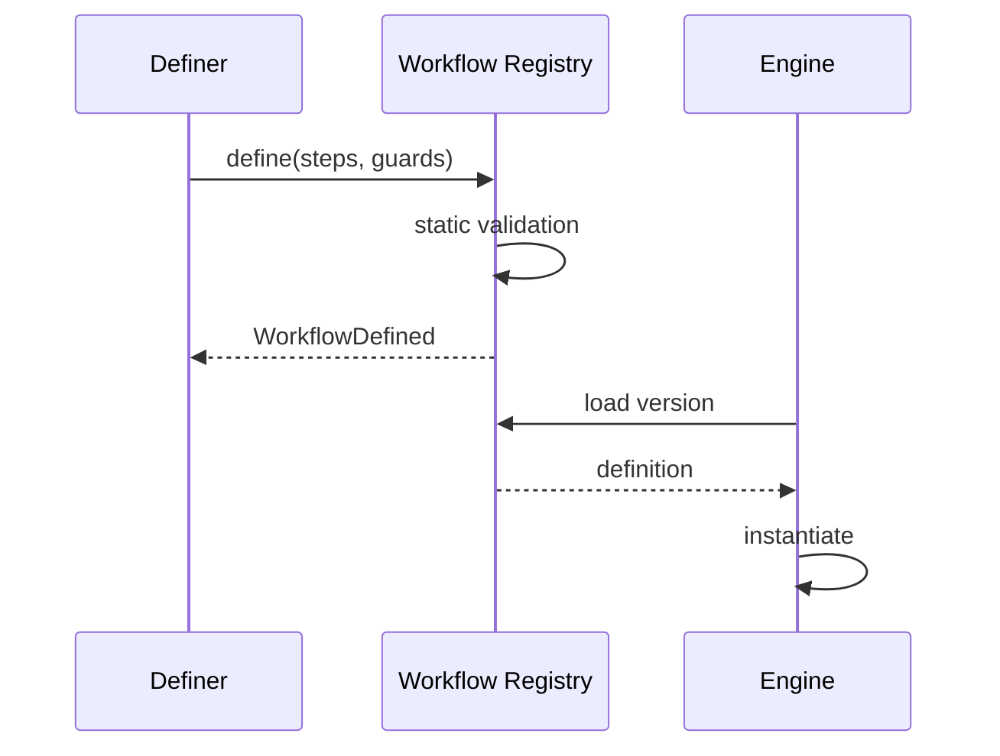

<a id="ucos-run-000004-state-diagrams"></a>
##### State Diagrams

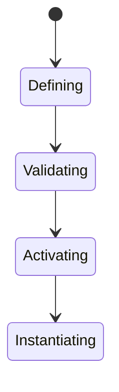

<a id="ucos-run-000005"></a>
#### UCOS-RUN-000005 · State Machine Architecture

Owner [Runtime](#d-run) · managed in `_registry/manifest.json` → `UCOS-RUN-000005`, content `_registry/content-runtime-data.json` → `RUN5` · inherits the [standard contract](../UCOS-MASTER.md#standard-contract)

<a id="ucos-run-000005-concepts"></a>
##### Concepts

State Machine Architecture makes lifecycle explicit and governed. Every stateful primitive and projection carries a registry-defined state machine; transitions are policy-guarded decisions, never silent mutations.

<a id="ucos-run-000005-ontology"></a>
##### Ontology

StateMachine has States (registry), Transitions (guarded), Events (triggers), and Invariants (must-hold per state). The current state is a projection of the transition history — never stored independently.

<a id="ucos-run-000005-taxonomy"></a>
##### Taxonomy

By determinism: Deterministic / Non-deterministic-governed. By persistence: Ephemeral / Persistent / Eternal. By complexity: Flat / Nested / Hierarchical / Orthogonal.

<a id="ucos-run-000005-data-model"></a>
##### Data Model

```yaml
StateMachine:
  machineId: <registry id>
  states: [<registry state>]
  initialState: <registry state>
  transitions: [{from, to, event, guard: [Policy], action}]
  invariants: [{state, mustHold}]
  version: <int>
```

<a id="ucos-run-000005-graph-model"></a>
##### Graph Model

(:StateMachine)-[:HAS_STATE]->(:State); (:StateMachine)-[:TRANSITION]->(:Transition); (:Transition)-[:GUARDED_BY]->(:Policy); (:StateMachine)-[:VERSION_OF]->(:StateMachine)

<a id="ucos-run-000005-apis"></a>
##### APIs

*Designed interface: the contract the domain is built towards. The routes it serves today are on its card.*

- POST /state-machine.v1.define
- GET  /state-machine.v1/{id}
- POST /state-machine.v1.evaluate
- GET  /state-machine.v1.state/{subjectId}

<a id="ucos-run-000005-events"></a>
##### Events

- TransitionEvaluated
- TransitionOccurred
- TransitionDenied
- InvariantViolated
- StateMachineDefined

<a id="ucos-run-000005-commands"></a>
##### Commands

- stateMachine.define
- stateMachine.transition
- stateMachine.rollback
- stateMachine.validate

<a id="ucos-run-000005-queries"></a>
##### Queries

- stateMachine.byId
- stateMachine.state
- stateMachine.history
- stateMachine.reachable

<a id="ucos-run-000005-state-machines"></a>
##### State Machines

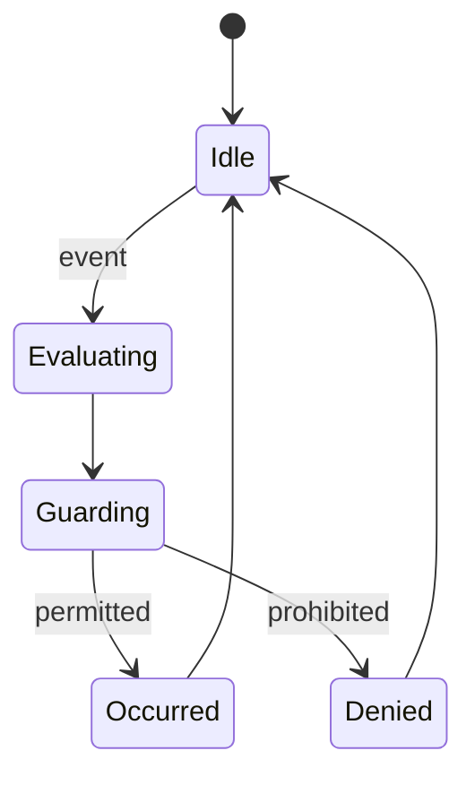

<a id="ucos-run-000005-workflows"></a>
##### Workflows

- event arrives → resolve machine version → evaluate guard → apply transition → verify invariant → append to history

<a id="ucos-run-000005-authorities"></a>
##### Authorities

- Machine Authority (definition); transitions carry the action class's authority.

<a id="ucos-run-000005-permissions"></a>
##### Permissions

- stateMachine.define (machine authority)
- stateMachine.transition (action authority)
- stateMachine.read (context-scoped)

<a id="ucos-run-000005-privacy-model"></a>
##### Privacy Model

States over personal subjects are sensitive; transition history minimizes subject data.

<a id="ucos-run-000005-audit-model"></a>
##### Audit Model

State is derived from transition history — the history IS the audit; a stored state contradicting history is a violation.

<a id="ucos-run-000005-digital-twin-model"></a>
##### Digital Twin Model

State twin monitors machines for stuck states and transition hotspots.

<a id="ucos-run-000005-agent-model"></a>
##### Agent Model

Agents may propose transitions; guards decide — agents never bypass the machine.

<a id="ucos-run-000005-runtime-model"></a>
##### Runtime Model

Evaluation is a function of (machine version, current state, event, guard result); idempotent by event key.

<a id="ucos-run-000005-scaling-model"></a>
##### Scaling Model

Machines are per-subject and independent; history is append-only and sharded by subject.

<a id="ucos-run-000005-multi-tenant-model"></a>
##### Multi-Tenant Model

Machine definitions are shared or tenant-scoped via the registry; instances never cross tenants.

<a id="ucos-run-000005-geo-distribution-model"></a>
##### Geo-Distribution Model

Guards include jurisdiction policy; a transition legal in one region may be denied in another.

<a id="ucos-run-000005-failure-model"></a>
##### Failure Model

Invariant violation post-transition, non-deterministic guard, history/state divergence, orphaned machine.

<a id="ucos-run-000005-recovery-model"></a>
##### Recovery Model

Rebuild state by replaying history; rollback is a compensating transition recorded like any other.

<a id="ucos-run-000005-certification-model"></a>
##### Certification Model

Machine must pass reachability analysis, guard determinism, and invariant coverage.

<a id="ucos-run-000005-migration-model"></a>
##### Migration Model

Machines version in the registry; instances finish on their pinned version.

<a id="ucos-run-000005-implementation-blueprint"></a>
##### Implementation Blueprint

Build order for RUN5: (1) define registry entries — this domain owns by determinism: deterministic / non-deterministic-governed as registry truth, not code; (2) implement the contract surface first (stateMachine.define, stateMachine.transition, stateMachine.rollback) and validate against RUN5 boundaries; (3) event-source all state so history is reconstructable; (4) wire the enforcement points — authority check, policy guard, evidence binding, trace — in-line, with no bypass path; (5) add tests per the Testing Architecture, citing evidence per gate; (6) obtain Verification and Certification before activation. Acceptance: the Zero Partial and Law 001 audits pass, every action answers the seven explainability questions, and this domain mutates no other domain internals.

<a id="ucos-run-000005-sequence-diagrams"></a>
##### Sequence Diagrams

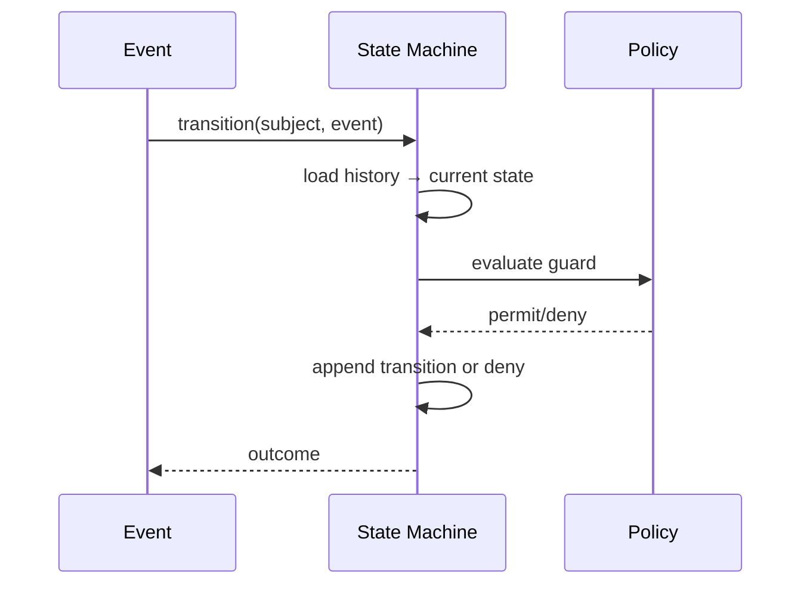

<a id="ucos-run-000005-state-diagrams"></a>
##### State Diagrams

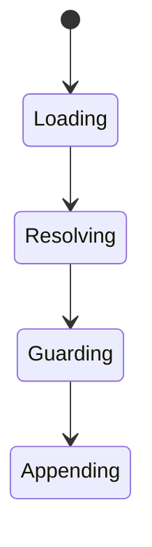

<a id="ucos-evt-000001"></a>
#### UCOS-EVT-000001 · Event Architecture

Owner [Runtime](#d-run) · managed in `_registry/manifest.json` → `UCOS-EVT-000001`, content `_registry/content-runtime-data.json` → `EVT` · inherits the [standard contract](../UCOS-MASTER.md#standard-contract)

<a id="ucos-evt-000001-concepts"></a>
##### Concepts

Event Architecture is the platform's nervous system — every state change is an immutable, evidenced, well-schema'd event. Events are how domains communicate without coupling; they are the only legitimate cross-domain broadcast.

<a id="ucos-evt-000001-ontology"></a>
##### Ontology

Event has a Type (registry), a Payload (schema-versioned), a Causation id, a Correlation id, an Authority, and Evidence. Events are facts that occurred — immutable once published.

<a id="ucos-evt-000001-taxonomy"></a>
##### Taxonomy

By scope: Domain / Cross-domain / Platform / External. By delivery: At-least-once / Exactly-once (projected) / Best-effort. By tempo: Real-time / Batched / Scheduled.

<a id="ucos-evt-000001-data-model"></a>
##### Data Model

```yaml
Event:
  eventId: <Identity>
  eventType: <registry id>
  schemaVersion: <version>
  payload: <schema-validated>
  causationId: <Event|null>
  correlationId: <Identity>
  authority: <Authority>
  evidence: <Evidence ref>
  temporal: {at}
  context: <Context>
```

<a id="ucos-evt-000001-graph-model"></a>
##### Graph Model

(:Event)-[:CAUSED_BY]->(:Event); (:Event)-[:PUBLISHED_BY]->(:Domain); (:Event)-[:SCHEMA_FROM]->(:RegistryEntry); (:Event)-[:EVIDENCED_BY]->(:Evidence)

<a id="ucos-evt-000001-apis"></a>
##### APIs

*Designed interface: the contract the domain is built towards. The routes it serves today are on its card.*

- POST /event.v1.publish
- GET  /event.v1/{id}
- POST /event.v1.subscribe
- GET  /event.v1.replay

<a id="ucos-evt-000001-events"></a>
##### Events

- EventPublished
- EventSchemaChanged
- EventReplayed
- SubscriptionCreated

<a id="ucos-evt-000001-commands"></a>
##### Commands

- event.publish
- event.subscribe
- event.replay
- event.compact

<a id="ucos-evt-000001-queries"></a>
##### Queries

- event.byId
- event.byType
- event.byCorrelation
- event.timeline

<a id="ucos-evt-000001-state-machines"></a>
##### State Machines

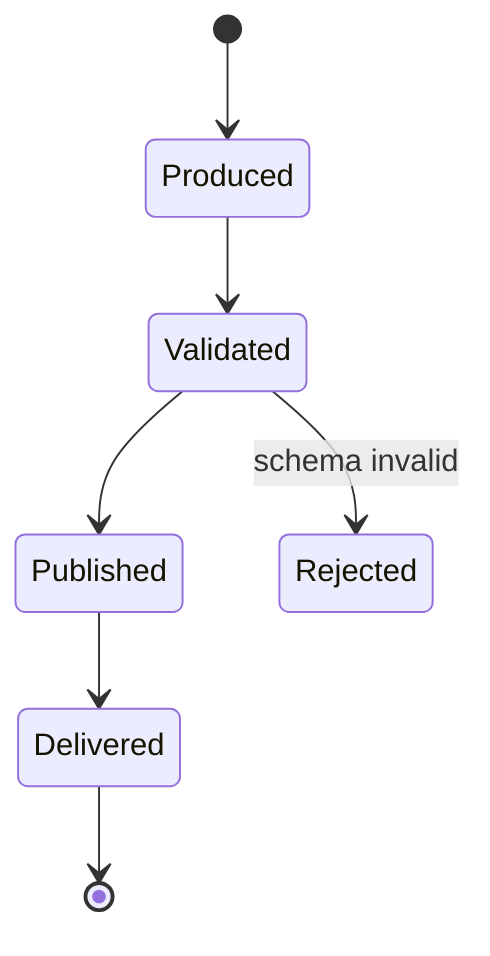

<a id="ucos-evt-000001-workflows"></a>
##### Workflows

- produce → validate against registry schema → attach evidence + authority → publish → deliver to subscribers → retain per policy

<a id="ucos-evt-000001-authorities"></a>
##### Authorities

- Publishing domain's authority; subscribers verify, never trust.

<a id="ucos-evt-000001-permissions"></a>
##### Permissions

- event.publish (domain, its own types only)
- event.subscribe (authenticated, topic-scoped)
- event.replay (governance)

<a id="ucos-evt-000001-privacy-model"></a>
##### Privacy Model

Event payloads minimize personal data; sensitive types carry consent scope and are redactable in projections, never in the log itself.

<a id="ucos-evt-000001-audit-model"></a>
##### Audit Model

The event log is the audit spine — causation chains reconstruct any state of the system at any time.

<a id="ucos-evt-000001-digital-twin-model"></a>
##### Digital Twin Model

Event twin monitors throughput, schema-rejection rates, and subscriber lag as platform health.

<a id="ucos-evt-000001-agent-model"></a>
##### Agent Model

Event agents detect anomalies in event flows (drops, surges, schema drift) and alert.

<a id="ucos-evt-000001-runtime-model"></a>
##### Runtime Model

At-least-once delivery with idempotent consumers; exactly-once is projected at the consumer via dedup keys.

<a id="ucos-evt-000001-scaling-model"></a>
##### Scaling Model

Partition by event type + correlation hash; replay is a first-class operation for recovery.

<a id="ucos-evt-000001-multi-tenant-model"></a>
##### Multi-Tenant Model

Events are tenant-namespaced; cross-tenant subscription requires published relationship and policy.

<a id="ucos-evt-000001-geo-distribution-model"></a>
##### Geo-Distribution Model

Event logs reside in the publishing domain's jurisdiction; cross-region replication respects residency.

<a id="ucos-evt-000001-failure-model"></a>
##### Failure Model

Schema rejection storm, subscriber lag, causation cycle, replay divergence.

<a id="ucos-evt-000001-recovery-model"></a>
##### Recovery Model

Replay rebuilds any projection; the log is the recovery source. Compaction preserves causation, never facts.

<a id="ucos-evt-000001-certification-model"></a>
##### Certification Model

Event must carry schema version, authority, and evidence to be published — unverifiable events are rejected.

<a id="ucos-evt-000001-migration-model"></a>
##### Migration Model

New types are registry additions; schema evolution is versioned with backward-compatible readers.

<a id="ucos-evt-000001-implementation-blueprint"></a>
##### Implementation Blueprint

Build order for EVT: (1) define registry entries — this domain owns by scope: domain / cross-domain / platform / external as registry truth, not code; (2) implement the contract surface first (event.publish, event.subscribe, event.replay) and validate against EVT boundaries; (3) event-source all state so history is reconstructable; (4) wire the enforcement points — authority check, policy guard, evidence binding, trace — in-line, with no bypass path; (5) add tests per the Testing Architecture, citing evidence per gate; (6) obtain Verification and Certification before activation. Acceptance: the Zero Partial and Law 001 audits pass, every action answers the seven explainability questions, and this domain mutates no other domain internals.

<a id="ucos-evt-000001-sequence-diagrams"></a>
##### Sequence Diagrams

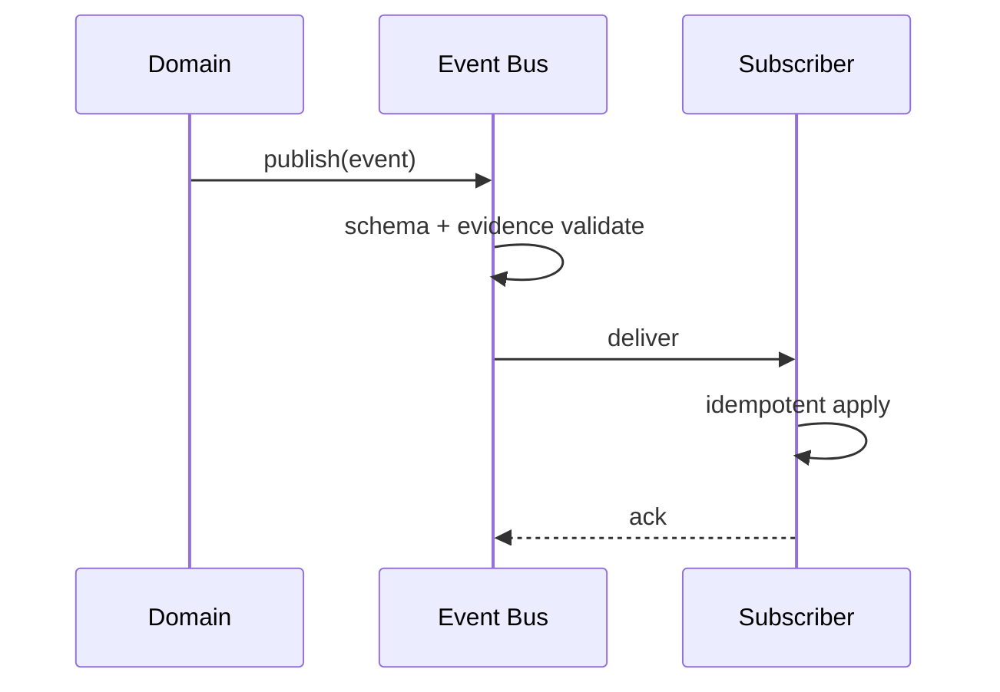

<a id="ucos-evt-000001-state-diagrams"></a>
##### State Diagrams

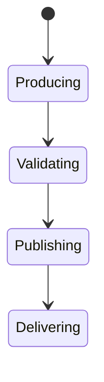

<a id="ucos-msg-000001"></a>
#### UCOS-MSG-000001 · Messaging Architecture

Owner [Runtime](#d-run) · managed in `_registry/manifest.json` → `UCOS-MSG-000001`, content `_registry/content-runtime-data.json` → `MSG` · inherits the [standard contract](../UCOS-MASTER.md#standard-contract)

<a id="ucos-msg-000001-concepts"></a>
##### Concepts

Messaging Architecture provides reliable, contract-governed communication between domains, services, and external systems. Messaging is the point-to-point complement to events — directed, contracted, and confirmed.

<a id="ucos-msg-000001-ontology"></a>
##### Ontology

Message has a Contract (registry), a Payload, a Delivery guarantee, and a Dead-letter path. Every queue is owned; every topic is governed; no anonymous producers or consumers exist.

<a id="ucos-msg-000001-taxonomy"></a>
##### Taxonomy

By pattern: Queue / Topic / Stream / Request-reply. By guarantee: At-most-once / At-least-once / Exactly-once-projected. By scope: Intra-domain / Cross-domain / External.

<a id="ucos-msg-000001-data-model"></a>
##### Data Model

```yaml
Message:
  messageId: <Identity>
  contractId: <registry contract>
  payload: <schema-validated>
  deliveryGuarantee: <registry id>
  authority: <Authority>
  temporal: {sentAt, deliveredAt}
  deadLetter: <DeadLetter ref|null>
```

<a id="ucos-msg-000001-graph-model"></a>
##### Graph Model

(:Message)-[:CONFORMS_TO]->(:Contract); (:Message)-[:SENT_BY]->(:Domain); (:Message)-[:DELIVERED_TO]->(:Domain); (:Message)-[:DEAD_LETTERED_TO]->(:DeadLetter)

<a id="ucos-msg-000001-apis"></a>
##### APIs

*Designed interface: the contract the domain is built towards. The routes it serves today are on its card.*

- POST /msg.v1.send
- POST /msg.v1.subscribe
- GET  /msg.v1/{id}
- POST /msg.v1.redeliver
- GET  /msg.v1.deadletter

<a id="ucos-msg-000001-events"></a>
##### Events

- MessageSent
- MessageDelivered
- MessageAcked
- MessageDeadLettered
- ContractViolation

<a id="ucos-msg-000001-commands"></a>
##### Commands

- msg.send
- msg.ack
- msg.nack
- msg.redeliver
- msg.deadletter

<a id="ucos-msg-000001-queries"></a>
##### Queries

- msg.byId
- msg.depth
- msg.lag
- msg.deadletters

<a id="ucos-msg-000001-state-machines"></a>
##### State Machines

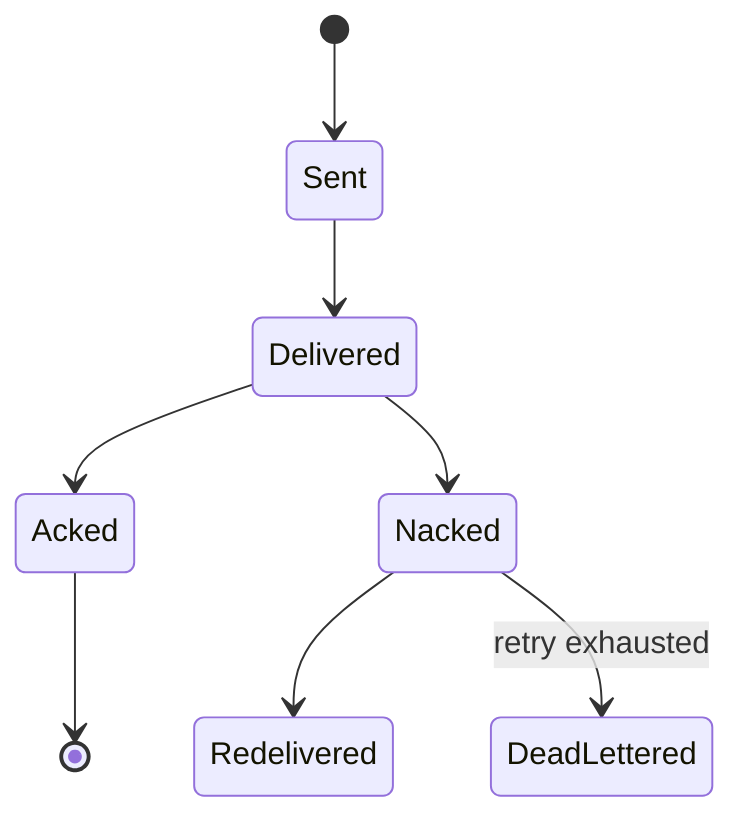

<a id="ucos-msg-000001-workflows"></a>
##### Workflows

- send under contract → validate schema → deliver → ack/nack → redeliver with backoff → dead-letter on exhaustion

<a id="ucos-msg-000001-authorities"></a>
##### Authorities

- Contract Authority (defines allowed interactions); producer and consumer domains each hold authority.

<a id="ucos-msg-000001-permissions"></a>
##### Permissions

- msg.send (contract-permitted producer)
- msg.subscribe (contract-permitted consumer)
- msg.read (participant)

<a id="ucos-msg-000001-privacy-model"></a>
##### Privacy Model

Personal-data messages are consent-scoped; dead-letters are purged per retention policy with evidence.

<a id="ucos-msg-000001-audit-model"></a>
##### Audit Model

Every message records contract version, authority, and delivery path — integration audit is complete.

<a id="ucos-msg-000001-digital-twin-model"></a>
##### Digital Twin Model

Messaging twin monitors depth, lag, and dead-letter rates across all contracts.

<a id="ucos-msg-000001-agent-model"></a>
##### Agent Model

Messaging agent detects contract drift and poison-message patterns, proposing contract fixes under governance.

<a id="ucos-msg-000001-runtime-model"></a>
##### Runtime Model

Consumers are idempotent by contract requirement; backoff is exponential with jitter; dead-letters alert.

<a id="ucos-msg-000001-scaling-model"></a>
##### Scaling Model

Partitions by contract; consumers scale per queue depth with policy bounds.

<a id="ucos-msg-000001-multi-tenant-model"></a>
##### Multi-Tenant Model

Queues are tenant-namespaced; cross-tenant messaging requires a published contract and both authorities.

<a id="ucos-msg-000001-geo-distribution-model"></a>
##### Geo-Distribution Model

Cross-region messaging respects residency; external egress is policy-governed and audited.

<a id="ucos-msg-000001-failure-model"></a>
##### Failure Model

Poison message, contract violation, consumer starvation, dead-letter overflow.

<a id="ucos-msg-000001-recovery-model"></a>
##### Recovery Model

Dead-letters are replayable after governed fix; acked messages are immutable facts.

<a id="ucos-msg-000001-certification-model"></a>
##### Certification Model

Contract must exist and both parties must be authorized — unsigned traffic is dropped at the edge.

<a id="ucos-msg-000001-migration-model"></a>
##### Migration Model

New contracts are registry additions; contract evolution is versioned with compatibility windows.

<a id="ucos-msg-000001-implementation-blueprint"></a>
##### Implementation Blueprint

Build order for MSG: (1) define registry entries — this domain owns by pattern: queue / topic / stream / request-reply as registry truth, not code; (2) implement the contract surface first (msg.send, msg.ack, msg.nack) and validate against MSG boundaries; (3) event-source all state so history is reconstructable; (4) wire the enforcement points — authority check, policy guard, evidence binding, trace — in-line, with no bypass path; (5) add tests per the Testing Architecture, citing evidence per gate; (6) obtain Verification and Certification before activation. Acceptance: the Zero Partial and Law 001 audits pass, every action answers the seven explainability questions, and this domain mutates no other domain internals.

<a id="ucos-msg-000001-sequence-diagrams"></a>
##### Sequence Diagrams

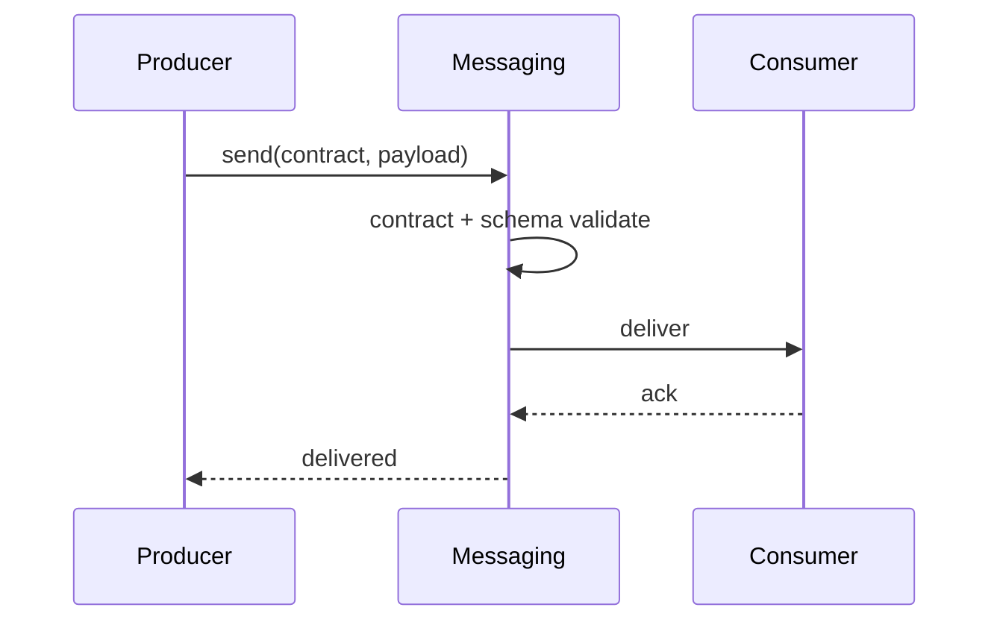

<a id="ucos-msg-000001-state-diagrams"></a>
##### State Diagrams

```mermaid
stateDiagram-v2
    [*] --> Contracting
    Contracting --> Validating
    Validating --> Delivering
    Delivering --> Settling
```

---

<a id="d-agt"></a>
### D-AGT · Agent

| | |
|---|---|
| **Category** | C09 Automation |
| **Build status** | partial |
| **Owns** | [Agent](../UCOS-MASTER.md#t-agent) |
| **Responsible for** | Autonomous Execution, Goal Fulfillment, Task Completion |
| **Must obey** | Constitution, Authority, Policy, Trust, Evidence |
| **Contract** | [UCOS-AGT-000001 Agent Constitution](#ucos-agt-000001) |
| **Artifacts** | [UCOS-AGT-000001](#ucos-agt-000001), [UCOS-AGT-000002](#ucos-agt-000002), [UCOS-AGT-000003](#ucos-agt-000003), [UCOS-AGT-000004](#ucos-agt-000004), [UCOS-AGT-000005](#ucos-agt-000005), [UCOS-AGT-000006](#ucos-agt-000006), [UCOS-AGT-000007](#ucos-agt-000007) |
| **Concepts** | 330 — `node _registry/compile.js --search <words> --kind concept --owner "Agent"` |
| **Code** | `lib/ai.js` |
| **Managed in** | `_registry/domains.json` → `D-AGT` |

**Live routes (10)** — what the platform serves today for this domain:

- `GET /api/admin/ai-gateways`
- `PUT /api/admin/ai-gateways`
- `POST /api/admin/ai-gateways/:id/test`
- `GET /api/ai`
- `POST /api/ai/run/:capability`
- `GET /api/ai/usage`
- `GET /api/ai/tasks`
- `POST /api/ai/tasks`
- `POST /api/ai/tasks/:id/run`
- `GET /api/platform/ai`

<a id="ucos-agt-000001"></a>
#### UCOS-AGT-000001 · Agent Constitution

Owner [Agent](#d-agt) · managed in `_registry/manifest.json` → `UCOS-AGT-000001`, content `_registry/content-twin-agent.json` → `AGT` · inherits the [standard contract](../UCOS-MASTER.md#standard-contract)

<a id="ucos-agt-000001-concepts"></a>
##### Concepts

An Agent is an autonomous actor operating under governance. Agent ≠ User, Agent ≠ Service, Agent ≠ Process. Agents are first-class citizens with identity, authority, trust, economics, and safety constraints — and they must always obey the Constitution, Authority, Policy, Trust, and Evidence.

<a id="ucos-agt-000001-ontology"></a>
##### Ontology

Agent has an Identity, a goal (Intent), capabilities (granted), a trust score, an economic account, and a safety envelope. Autonomy is bounded by policy; no agent acts outside its envelope.

<a id="ucos-agt-000001-taxonomy"></a>
##### Taxonomy

By role: Planner / Architect / Catalog / Pricing / Localization / Compliance / Tax / Trust / Fraud / Knowledge / Simulation / Security / Optimization / Governance / Certification / Evolution / Future role. By autonomy: Supervised / Semi-autonomous / Autonomous / Constituent-of-society.

<a id="ucos-agt-000001-data-model"></a>
##### Data Model

```yaml
Agent:
  agentId: <Identity>
  role: <registry id>
  goals: [<Intent>]
  capabilities: [<granted capability>]
  trust: <Trust>
  economics: <account reference>
  safetyEnvelope: <Policy set>
  authority: <Authority>
  status: <Active|Suspended|Decommissioned>
```

<a id="ucos-agt-000001-graph-model"></a>
##### Graph Model

(:Agent)-[:CAPABLE_OF]->(:Capability); (:Agent)-[:TRUSTED_AT]->(:Trust); (:Agent)-[:BOUNDED_BY]->(:Policy); (:Agent)-[:ACTS_WITHIN]->(:Authority); (:Agent)-[:MEMBER_OF]->(:AgentSociety)

<a id="ucos-agt-000001-apis"></a>
##### APIs

*Designed interface: the contract the domain is built towards. The routes it serves today are on its card.*

- POST /agent.v1.spawn
- GET  /agent.v1/{id}
- POST /agent.v1/{id}/act
- GET  /agent.v1/{id}/trust
- POST /agent.v1/{id}/suspend

<a id="ucos-agt-000001-events"></a>
##### Events

- AgentSpawned
- AgentActed
- AgentSuspended
- AgentDecommissioned
- AgentTrustChanged
- AgentEscalated

<a id="ucos-agt-000001-commands"></a>
##### Commands

- agent.spawn
- agent.act
- agent.suspend
- agent.decommission
- agent.delegate
- agent.report

<a id="ucos-agt-000001-queries"></a>
##### Queries

- agent.byId
- agent.byRole
- agent.trust
- agent.actions
- agent.society

<a id="ucos-agt-000001-state-machines"></a>
##### State Machines

```mermaid
stateDiagram-v2
    [*] --> Spawned
    Spawned --> Active: envelope verified
    Active --> Acting
    Acting --> Escalated: needs human
    Escalated --> Active: resolved
    Active --> Suspended: trust breach
    Suspended --> Decommissioned
    Active --> Decommissioned
    Decommissioned --> [*]
```

<a id="ucos-agt-000001-workflows"></a>
##### Workflows

- spawn under governance → verify safety envelope → act within authority → escalate on uncertainty → log with full explainability → suspend on breach

<a id="ucos-agt-000001-authorities"></a>
##### Authorities

- Governance Authority spawns; an agent's authority is a strict delegation, never exceeding its granter.

<a id="ucos-agt-000001-permissions"></a>
##### Permissions

- agent.spawn (governance authority)
- agent.act (agent's own delegated authority)
- agent.suspend (governance authority)

<a id="ucos-agt-000001-privacy-model"></a>
##### Privacy Model

Agents over personal data act only under consent scope; agent actions on individuals are auditable by the data subject.

<a id="ucos-agt-000001-audit-model"></a>
##### Audit Model

Every agent action answers all seven explainability questions — autonomous action without explanation is unconstitutional.

<a id="ucos-agt-000001-digital-twin-model"></a>
##### Digital Twin Model

Each agent has an operational twin monitoring its behavior against its envelope — drift triggers suspension.

<a id="ucos-agt-000001-agent-model"></a>
##### Agent Model

Agents are both governed actors and the governance workforce — the system polices itself through them.

<a id="ucos-agt-000001-runtime-model"></a>
##### Runtime Model

Actions are policy-guarded at execution time; the safety envelope is enforced, not advisory.

<a id="ucos-agt-000001-scaling-model"></a>
##### Scaling Model

Agents scale horizontally; per-agent rate limits and economic budgets bound resource use.

<a id="ucos-agt-000001-multi-tenant-model"></a>
##### Multi-Tenant Model

Agents are tenant-scoped; a cross-tenant agent requires both tenants' authority — rare and heavily audited.

<a id="ucos-agt-000001-geo-distribution-model"></a>
##### Geo-Distribution Model

Agent authority is jurisdiction-bound; an agent legal in one region may not act in another.

<a id="ucos-agt-000001-failure-model"></a>
##### Failure Model

Envelope violation, trust collapse, goal conflict, resource exhaustion, society polarization.

<a id="ucos-agt-000001-recovery-model"></a>
##### Recovery Model

Suspension is safe-by-default; a suspended agent's in-flight actions are compensated, not abandoned.

<a id="ucos-agt-000001-certification-model"></a>
##### Certification Model

Agent must pass envelope definition, authority traceability, trust threshold, and explainability verification before acting.

<a id="ucos-agt-000001-migration-model"></a>
##### Migration Model

New agent roles are registry additions; existing agents keep their envelope version.

<a id="ucos-agt-000001-implementation-blueprint"></a>
##### Implementation Blueprint

Build order for AGT: (1) define registry entries — this domain owns by role: planner / architect / catalog / pricing / localization / compliance / tax / trust / fraud / knowledge / simulation / security / optimization / governance / certification / evolution / future role as registry truth, not code; (2) implement the contract surface first (agent.spawn, agent.act, agent.suspend) and validate against AGT boundaries; (3) event-source all state so history is reconstructable; (4) wire the enforcement points — authority check, policy guard, evidence binding, trace — in-line, with no bypass path; (5) add tests per the Testing Architecture, citing evidence per gate; (6) obtain Verification and Certification before activation. Acceptance: the Zero Partial and Law 001 audits pass, every action answers the seven explainability questions, and this domain mutates no other domain internals.

<a id="ucos-agt-000001-sequence-diagrams"></a>
##### Sequence Diagrams

```mermaid
sequenceDiagram
    participant G as Governor
    participant AG as Agent Domain
    participant PL as Policy
    G->>AG: spawn(role, goals)
    AG->>PL: verify safety envelope
    PL-->>AG: envelope
    AG->>AG: act within authority
    AG-->>G: AgentActed + explanation
```

<a id="ucos-agt-000001-state-diagrams"></a>
##### State Diagrams

```mermaid
stateDiagram-v2
    [*] --> Spawning
    Spawning --> Enveloping
    Enveloping --> Active
    Active --> Acting
    Acting --> Explaining
```

<a id="ucos-agt-000002"></a>
#### UCOS-AGT-000002 · Agent Runtime

Owner [Agent](#d-agt) · managed in `_registry/manifest.json` → `UCOS-AGT-000002`, content `_registry/content-twin-agent.json` → `AGT2` · inherits the [standard contract](../UCOS-MASTER.md#standard-contract)

<a id="ucos-agt-000002-concepts"></a>
##### Concepts

Agent Runtime is the governed execution environment for autonomous actors. It enforces the safety envelope at instruction granularity — policy is a runtime guard, not a code review.

<a id="ucos-agt-000002-ontology"></a>
##### Ontology

Runtime hosts Agents, enforces envelopes, meters economics, and records full action traces. It is the boundary where intent becomes action — and where unconstitutional action is stopped.

<a id="ucos-agt-000002-taxonomy"></a>
##### Taxonomy

By isolation: Process / Container / VM / Enclave / Sandbox. By scheduling: Real-time / Best-effort / Batch. By tenancy: Dedicated / Shared.

<a id="ucos-agt-000002-data-model"></a>
##### Data Model

```yaml
AgentRuntime:
  runtimeId: <Identity>
  host: <Identity>
  isolation: <registry id>
  enforcementPoints: [pre-exec, post-exec, resource, network]
  metering: {economic account, rate limits}
  trace: <append-only log ref>
  policyVersion: <version>
```

<a id="ucos-agt-000002-graph-model"></a>
##### Graph Model

(:Runtime)-[:HOSTS]->(:Agent); (:Runtime)-[:ENFORCES]->(:Policy); (:Runtime)-[:METERS]->(:EconomicAccount); (:Runtime)-[:TRACES_TO]->(:AuditLog)

<a id="ucos-agt-000002-apis"></a>
##### APIs

*Designed interface: the contract the domain is built towards. The routes it serves today are on its card.*

- POST /runtime.v1.execute
- GET  /runtime.v1/trace/{agentId}
- POST /runtime.v1.halt
- GET  /runtime.v1.envelope/{agentId}

<a id="ucos-agt-000002-events"></a>
##### Events

- ExecutionRequested
- ExecutionGuarded
- ExecutionHalted
- EnvelopeViolated
- ResourceExhausted

<a id="ucos-agt-000002-commands"></a>
##### Commands

- runtime.execute
- runtime.halt
- runtime.quarantine
- runtime.trace
- runtime.enforce

<a id="ucos-agt-000002-queries"></a>
##### Queries

- runtime.trace
- runtime.envelope
- runtime.usage
- runtime.violations

<a id="ucos-agt-000002-state-machines"></a>
##### State Machines

```mermaid
stateDiagram-v2
    [*] --> Receiving
    Receiving --> Guarding: pre-exec policy
    Guarding --> Executing: permitted
    Guarding --> Denied: prohibited
    Executing --> Tracing
    Tracing --> Done
    Executing --> Halted: violation detected
    Halted --> Quarantined
```

<a id="ucos-agt-000002-workflows"></a>
##### Workflows

- receive action → pre-exec policy guard → execute in isolation → meter economics → post-exec trace → halt+quarantine on violation

<a id="ucos-agt-000002-authorities"></a>
##### Authorities

- Runtime Authority (enforcement); agents carry delegated authority verified at guard time.

<a id="ucos-agt-000002-permissions"></a>
##### Permissions

- runtime.execute (agent with valid envelope)
- runtime.halt (governance authority)
- runtime.trace (auditor)

<a id="ucos-agt-000002-privacy-model"></a>
##### Privacy Model

Traces of personal-data actions are minimized and consent-scoped; the fact of enforcement is auditable, contents are not.

<a id="ucos-agt-000002-audit-model"></a>
##### Audit Model

Every guarded execution records the policy evaluated, the decision, the economic charge, and the full action trace.

<a id="ucos-agt-000002-digital-twin-model"></a>
##### Digital Twin Model

The runtime twin monitors enforcement latency and violation rates as system-health signals.

<a id="ucos-agt-000002-agent-model"></a>
##### Agent Model

The runtime is what makes agents safe enough to be first-class citizens — enforcement is architectural, not procedural.

<a id="ucos-agt-000002-runtime-model"></a>
##### Runtime Model

Enforcement is in-line and mandatory; there is no code path from agent intent to effect that bypasses the guard.

<a id="ucos-agt-000002-scaling-model"></a>
##### Scaling Model

Runtimes scale horizontally; per-agent quotas prevent noisy-neighbor domination.

<a id="ucos-agt-000002-multi-tenant-model"></a>
##### Multi-Tenant Model

Runtimes are tenant-isolated at the isolation boundary — no shared execution context across tenants.

<a id="ucos-agt-000002-geo-distribution-model"></a>
##### Geo-Distribution Model

Execution jurisdiction follows the data's residency; cross-region execution requires sovereignty policy pass.

<a id="ucos-agt-000002-failure-model"></a>
##### Failure Model

Guard bypass (must be impossible by construction), quarantine overflow, trace loss, meter drift.

<a id="ucos-agt-000002-recovery-model"></a>
##### Recovery Model

Halted actions are compensatable via the event log; quarantined agents await governance review, never auto-resume.

<a id="ucos-agt-000002-certification-model"></a>
##### Certification Model

Runtime must prove no bypass path exists — formally verified guard placement is mandatory.

<a id="ucos-agt-000002-migration-model"></a>
##### Migration Model

New isolation types are registry additions; guard logic versioned and replayable.

<a id="ucos-agt-000002-implementation-blueprint"></a>
##### Implementation Blueprint

Build order for AGT2: (1) define registry entries — this domain owns by isolation: process / container / vm / enclave / sandbox as registry truth, not code; (2) implement the contract surface first (runtime.execute, runtime.halt, runtime.quarantine) and validate against AGT2 boundaries; (3) event-source all state so history is reconstructable; (4) wire the enforcement points — authority check, policy guard, evidence binding, trace — in-line, with no bypass path; (5) add tests per the Testing Architecture, citing evidence per gate; (6) obtain Verification and Certification before activation. Acceptance: the Zero Partial and Law 001 audits pass, every action answers the seven explainability questions, and this domain mutates no other domain internals.

<a id="ucos-agt-000002-sequence-diagrams"></a>
##### Sequence Diagrams

```mermaid
sequenceDiagram
    participant AG as Agent
    participant RT as Runtime
    participant PL as Policy
    AG->>RT: execute(action)
    RT->>PL: pre-exec guard
    PL-->>RT: permit/deny
    RT->>RT: execute in isolation + meter
    RT-->>AG: result + trace
```

<a id="ucos-agt-000002-state-diagrams"></a>
##### State Diagrams

```mermaid
stateDiagram-v2
    [*] --> Guarding
    Guarding --> Isolating
    Isolating --> Executing
    Executing --> Tracing
```

<a id="ucos-agt-000003"></a>
#### UCOS-AGT-000003 · Agent Governance

Owner [Agent](#d-agt) · managed in `_registry/manifest.json` → `UCOS-AGT-000003`, content `_registry/content-twin-agent.json` → `AGT3` · inherits the [standard contract](../UCOS-MASTER.md#standard-contract)

<a id="ucos-agt-000003-concepts"></a>
##### Concepts

Agent Governance ensures no autonomous actor is ungoverned. Every agent action is authorized, policy-checked, trust-scored, evidenced, explainable, and reversible-or-compensated. Governance is not oversight — it is an execution-time constraint.

<a id="ucos-agt-000003-ontology"></a>
##### Ontology

Governance binds each Agent to: an Authority chain, a Policy envelope, a Trust threshold, an Evidence requirement, and an Explainability contract. All five are checked at action time.

<a id="ucos-agt-000003-taxonomy"></a>
##### Taxonomy

By stage: Pre-action / In-action / Post-action / Continuous. By severity handling: Auto-permit / Auto-deny / Escalate / Quarantine. By scope: Single-agent / Multi-agent / Society-level.

<a id="ucos-agt-000003-data-model"></a>
##### Data Model

```yaml
AgentGovernance:
  governanceId: <Identity>
  agent: <Identity>
  authorityChain: [<Authority>]
  policyEnvelope: [<Policy>]
  trustThreshold: <0..1>
  evidenceRequirement: <registry id>
  explainabilityContract: <registry id>
  escalationPolicy: <Policy>
```

<a id="ucos-agt-000003-graph-model"></a>
##### Graph Model

(:Governance)-[:BINDS]->(:Agent); (:Governance)-[:REQUIRES]->(:Evidence); (:Governance)-[:ESCALATES_TO]->(:Authority); (:Governance)-[:GOVERNED_BY]->(:Policy)

<a id="ucos-agt-000003-apis"></a>
##### APIs

*Designed interface: the contract the domain is built towards. The routes it serves today are on its card.*

- POST /governance.v1.evaluate
- GET  /governance.v1/{agentId}
- POST /governance.v1.escalate
- GET  /governance.v1.violations

<a id="ucos-agt-000003-events"></a>
##### Events

- GovernanceEvaluated
- GovernanceEscalated
- GovernanceViolated
- GovernanceRemediated
- TrustThresholdBreached

<a id="ucos-agt-000003-commands"></a>
##### Commands

- governance.evaluate
- governance.escalate
- governance.sanction
- governance.remediate

<a id="ucos-agt-000003-queries"></a>
##### Queries

- governance.byAgent
- governance.violations
- governance.escalations
- governance.coverage

<a id="ucos-agt-000003-state-machines"></a>
##### State Machines

```mermaid
stateDiagram-v2
    [*] --> Evaluating
    Evaluating --> Permitted
    Evaluating --> Denied
    Evaluating --> Escalated
    Escalated --> Permitted: human approves
    Escalated --> Denied: human rejects
    Permitted --> Violated: post-action breach
    Violated --> Sanctioned
```

<a id="ucos-agt-000003-workflows"></a>
##### Workflows

- evaluate authority + policy + trust + evidence pre-action → permit/deny/escalate → monitor in-action → post-action audit → sanction on violation

<a id="ucos-agt-000003-authorities"></a>
##### Authorities

- Governance Authority over agents; humans are the escalation target of last resort.

<a id="ucos-agt-000003-permissions"></a>
##### Permissions

- governance.evaluate (runtime)
- governance.escalate (any agent or observer)
- governance.sanction (governance authority)

<a id="ucos-agt-000003-privacy-model"></a>
##### Privacy Model

Governance records of personal-data actions are consent-scoped; the governance fact is auditable, subject data minimized.

<a id="ucos-agt-000003-audit-model"></a>
##### Audit Model

The governance record IS the audit artifact — authority chain, policy version, trust score, evidence, and explanation for every action.

<a id="ucos-agt-000003-digital-twin-model"></a>
##### Digital Twin Model

Governance twin monitors violation rates and trust drift across the agent fleet as an early-warning system.

<a id="ucos-agt-000003-agent-model"></a>
##### Agent Model

Governance is what separates an agent from malware — identical capability, opposite constraint.

<a id="ucos-agt-000003-runtime-model"></a>
##### Runtime Model

Evaluation is in-line and cached per (agent, action-class, policy-version); escalation queues to humans with SLAs.

<a id="ucos-agt-000003-scaling-model"></a>
##### Scaling Model

Evaluation is sub-millisecond cached; escalations are human-paced and bounded by queue policy.

<a id="ucos-agt-000003-multi-tenant-model"></a>
##### Multi-Tenant Model

Governance is tenant-scoped; constitutional governance overrides tenant policy universally.

<a id="ucos-agt-000003-geo-distribution-model"></a>
##### Geo-Distribution Model

Escalation routes to on-call humans in the acting jurisdiction — accountability is local.

<a id="ucos-agt-000003-failure-model"></a>
##### Failure Model

Evaluation timeout (default deny), evidence starvation, escalation queue overflow, trust threshold storm.

<a id="ucos-agt-000003-recovery-model"></a>
##### Recovery Model

Sanctioned agents are compensatable via action traces; violations are never auto-forgiven — remediation is governed.

<a id="ucos-agt-000003-certification-model"></a>
##### Certification Model

Governance must prove 100% action coverage — an ungoverned agent path is a certification failure.

<a id="ucos-agt-000003-migration-model"></a>
##### Migration Model

New evaluation strategies are registry additions.

<a id="ucos-agt-000003-implementation-blueprint"></a>
##### Implementation Blueprint

Build order for AGT3: (1) define registry entries — this domain owns by stage: pre-action / in-action / post-action / continuous as registry truth, not code; (2) implement the contract surface first (governance.evaluate, governance.escalate, governance.sanction) and validate against AGT3 boundaries; (3) event-source all state so history is reconstructable; (4) wire the enforcement points — authority check, policy guard, evidence binding, trace — in-line, with no bypass path; (5) add tests per the Testing Architecture, citing evidence per gate; (6) obtain Verification and Certification before activation. Acceptance: the Zero Partial and Law 001 audits pass, every action answers the seven explainability questions, and this domain mutates no other domain internals.

<a id="ucos-agt-000003-sequence-diagrams"></a>
##### Sequence Diagrams

```mermaid
sequenceDiagram
    participant AG as Agent
    participant GV as Governance
    participant H as Human Escalation
    AG->>GV: request(action)
    GV->>GV: authority+policy+trust+evidence
    alt clear
        GV-->>AG: permitted
    else unclear
        GV->>H: escalate
        H-->>GV: decision
        GV-->>AG: decision
    end
```

<a id="ucos-agt-000003-state-diagrams"></a>
##### State Diagrams

```mermaid
stateDiagram-v2
    [*] --> AuthorityCheck
    AuthorityCheck --> PolicyCheck
    PolicyCheck --> TrustCheck
    TrustCheck --> EvidenceCheck
    EvidenceCheck --> Decision
```

<a id="ucos-agt-000004"></a>
#### UCOS-AGT-000004 · Agent Trust

Owner [Agent](#d-agt) · managed in `_registry/manifest.json` → `UCOS-AGT-000004`, content `_registry/content-twin-agent.json` → `AGT4` · inherits the [standard contract](../UCOS-MASTER.md#standard-contract)

<a id="ucos-agt-000004-concepts"></a>
##### Concepts

Agent Trust is the computed confidence that an agent will act within its envelope. It is earned through evidenced behavior, decayed by time and violation, and never assumed from role or title.

<a id="ucos-agt-000004-ontology"></a>
##### Ontology

Agent Trust aggregates action outcomes, violation history, governance evaluations, and peer attestations into a per-context score. Trust gates autonomy: low trust means escalation, not elimination.

<a id="ucos-agt-000004-taxonomy"></a>
##### Taxonomy

By input: Outcome-based / Violation-weighted / Peer-attested / Authority-attested. By decay: Time-decay / Event-decay / Violation-decay. By use: Autonomy gate / Escalation trigger / Budget cap.

<a id="ucos-agt-000004-data-model"></a>
##### Data Model

```yaml
AgentTrust:
  agentTrustId: <Identity>
  agent: <Identity>
  outcomeScore: <0..1>
  violationPenalty: <0..1>
  peerAttestation: <0..1>
  authorityAttestation: <0..1>
  composite: <0..1, registry formula>
  decayState: {lastEvent, halfLife}
  context: <Context>
```

<a id="ucos-agt-000004-graph-model"></a>
##### Graph Model

(:AgentTrust)-[:SCORES]->(:Agent); (:AgentTrust)-[:DERIVED_FROM]->(:GovernanceRecord); (:AgentTrust)-[:ATTESTED_BY]->(:Authority|:Agent); (:AgentTrust)-[:GATES]->(:Autonomy)

<a id="ucos-agt-000004-apis"></a>
##### APIs

*Designed interface: the contract the domain is built towards. The routes it serves today are on its card.*

- GET  /agent-trust.v1/{agentId}
- POST /agent-trust.v1.attest
- GET  /agent-trust.v1.history/{agentId}
- POST /agent-trust.v1.recompute

<a id="ucos-agt-000004-events"></a>
##### Events

- AgentTrustComputed
- AgentTrustDecayed
- AgentTrustBreached
- AgentTrustAttested
- AgentTrustReset

<a id="ucos-agt-000004-commands"></a>
##### Commands

- agentTrust.attest
- agentTrust.recompute
- agentTrust.dispute
- agentTrust.reset

<a id="ucos-agt-000004-queries"></a>
##### Queries

- agentTrust.byAgent
- agentTrust.low
- agentTrust.history
- agentTrust.byContext

<a id="ucos-agt-000004-state-machines"></a>
##### State Machines

```mermaid
stateDiagram-v2
    [*] --> Seeded
    Seeded --> Earning
    Earning --> Stable
    Stable --> Decaying: no events
    Stable --> Breached: violation
    Breached --> Rehabilitating: remediation
    Rehabilitating --> Earning
```

<a id="ucos-agt-000004-workflows"></a>
##### Workflows

- seed from spawn attestation → earn from evidenced outcomes → decay over time → breach on violation → rehabilitate through governed remediation

<a id="ucos-agt-000004-authorities"></a>
##### Authorities

- Trust Domain computes; Governance Authority attests; no agent attests its own trust.

<a id="ucos-agt-000004-permissions"></a>
##### Permissions

- agentTrust.attest (authority or peer agent)
- agentTrust.recompute (system)
- agentTrust.read (governance + agent owner)

<a id="ucos-agt-000004-privacy-model"></a>
##### Privacy Model

Trust records reference action classes, not personal data contents — minimization by construction.

<a id="ucos-agt-000004-audit-model"></a>
##### Audit Model

Every score change records the event, formula version, and attestations — fully reproducible.

<a id="ucos-agt-000004-digital-twin-model"></a>
##### Digital Twin Model

Agent trust twin tracks the fleet's trust distribution as a systemic health indicator.

<a id="ucos-agt-000004-agent-model"></a>
##### Agent Model

Trust is the currency of autonomy — an agent with no trust escalates everything, which is safe by design.

<a id="ucos-agt-000004-runtime-model"></a>
##### Runtime Model

Trust is a read-side projection recomputed on governance events; checks are cached per (agent, action-class).

<a id="ucos-agt-000004-scaling-model"></a>
##### Scaling Model

Recomputation is a stream job over governance records; scores cached with event invalidation.

<a id="ucos-agt-000004-multi-tenant-model"></a>
##### Multi-Tenant Model

Agent trust is tenant-scoped; cross-tenant attestation requires published relationship.

<a id="ucos-agt-000004-geo-distribution-model"></a>
##### Geo-Distribution Model

Trust thresholds are jurisdiction-tunable — stricter regimes demand higher autonomy gates.

<a id="ucos-agt-000004-failure-model"></a>
##### Failure Model

Attestation cartel, decay stall, formula drift, trust inflation without evidence.

<a id="ucos-agt-000004-recovery-model"></a>
##### Recovery Model

Trust recomputes from governance history — reset is a governed fresh start, not an amnesty.

<a id="ucos-agt-000004-certification-model"></a>
##### Certification Model

Agent trust must be evidence-backed, decay-aware, and threshold-enforced for any autonomy grant.

<a id="ucos-agt-000004-migration-model"></a>
##### Migration Model

Formula evolves by registry version; recomputation replays history under the new formula.

<a id="ucos-agt-000004-implementation-blueprint"></a>
##### Implementation Blueprint

Build order for AGT4: (1) define registry entries — this domain owns by input: outcome-based / violation-weighted / peer-attested / authority-attested as registry truth, not code; (2) implement the contract surface first (agentTrust.attest, agentTrust.recompute, agentTrust.dispute) and validate against AGT4 boundaries; (3) event-source all state so history is reconstructable; (4) wire the enforcement points — authority check, policy guard, evidence binding, trace — in-line, with no bypass path; (5) add tests per the Testing Architecture, citing evidence per gate; (6) obtain Verification and Certification before activation. Acceptance: the Zero Partial and Law 001 audits pass, every action answers the seven explainability questions, and this domain mutates no other domain internals.

<a id="ucos-agt-000004-sequence-diagrams"></a>
##### Sequence Diagrams

```mermaid
sequenceDiagram
    participant GV as Governance
    participant AT as Agent Trust
    participant AG as Agent
    GV->>AT: action outcome
    AT->>AT: recompute + decay
    AT-->>AG: autonomy level
```

<a id="ucos-agt-000004-state-diagrams"></a>
##### State Diagrams

```mermaid
stateDiagram-v2
    [*] --> Seeding
    Seeding --> Earning
    Earning --> Scoring
    Scoring --> Gating
```

<a id="ucos-agt-000005"></a>
#### UCOS-AGT-000005 · Agent Safety

Owner [Agent](#d-agt) · managed in `_registry/manifest.json` → `UCOS-AGT-000005`, content `_registry/content-twin-agent.json` → `AGT5` · inherits the [standard contract](../UCOS-MASTER.md#standard-contract)

<a id="ucos-agt-000005-concepts"></a>
##### Concepts

Agent Safety is the guarantee that autonomous action cannot cause unconstitutional harm. Safety is architectural — enforced at execution time by the runtime — not procedural or aspirational.

<a id="ucos-agt-000005-ontology"></a>
##### Ontology

Safety has an Envelope (policy bounds), Invariants (must-hold conditions), Fail-modes (safe defaults), and Recovery (compensation paths). The default fail-mode is always the safest available state.

<a id="ucos-agt-000005-taxonomy"></a>
##### Taxonomy

By hazard: Physical / Financial / Reputational / Privacy / Security / Constitutional. By control: Prevention / Detection / Response / Recovery. By severity: Minor / Major / Critical / Catastrophic.

<a id="ucos-agt-000005-data-model"></a>
##### Data Model

```yaml
AgentSafety:
  safetyId: <Identity>
  agent: <Identity>
  envelope: [<Policy>]
  invariants: [<registry expression>]
  failModes: [{condition, safeState}]
  hazardClasses: [<registry id>]
  recoveryPaths: [<compensation ref>]
  verificationLevel: <registry level>
```

<a id="ucos-agt-000005-graph-model"></a>
##### Graph Model

(:Safety)-[:PROTECTS]->(:Agent); (:Safety)-[:ENFORCED_BY]->(:Runtime); (:Safety)-[:FAILS_TO]->(:SafeState); (:Safety)-[:RECOVERS_VIA]->(:Compensation)

<a id="ucos-agt-000005-apis"></a>
##### APIs

*Designed interface: the contract the domain is built towards. The routes it serves today are on its card.*

- GET  /agent-safety.v1/{agentId}
- POST /agent-safety.v1.verify
- POST /agent-safety.v1.halt
- GET  /agent-safety.v1.incidents

<a id="ucos-agt-000005-events"></a>
##### Events

- SafetyVerified
- EnvelopeViolated
- SafetyHalt
- SafetyIncident
- SafetyRecovered
- InvariantBreach

<a id="ucos-agt-000005-commands"></a>
##### Commands

- agentSafety.verify
- agentSafety.halt
- agentSafety.quarantine
- agentSafety.recover
- agentSafety.incident

<a id="ucos-agt-000005-queries"></a>
##### Queries

- agentSafety.envelope
- agentSafety.incidents
- agentSafety.invariants
- agentSafety.byHazard

<a id="ucos-agt-000005-state-machines"></a>
##### State Machines

```mermaid
stateDiagram-v2
    [*] --> Verified
    Verified --> Operating
    Operating --> Warned: invariant strain
    Warned --> Operating: strain clears
    Warned --> Halted: invariant breach
    Operating --> Halted: envelope violation
    Halted --> Quarantined
    Quarantined --> Recovering: governed
    Recovering --> Verified
```

<a id="ucos-agt-000005-workflows"></a>
##### Workflows

- verify envelope + invariants pre-spawn → monitor invariants in-action → halt on breach → quarantine → governed recovery → re-verify

<a id="ucos-agt-000005-authorities"></a>
##### Authorities

- Safety Authority (enforcement); halts are automatic, not authorized — safety overrides authority.

<a id="ucos-agt-000005-permissions"></a>
##### Permissions

- agentSafety.halt (automatic + any authority)
- agentSafety.recover (governance authority only)
- agentSafety.read (auditor)

<a id="ucos-agt-000005-privacy-model"></a>
##### Privacy Model

Safety envelopes over personal data include privacy invariants — privacy violations are safety incidents.

<a id="ucos-agt-000005-audit-model"></a>
##### Audit Model

Every halt, quarantine, and recovery is a fully-evidenced incident record with root cause and remediation.

<a id="ucos-agt-000005-digital-twin-model"></a>
##### Digital Twin Model

Safety twin monitors near-miss rates across the fleet — strain before breach is the goal.

<a id="ucos-agt-000005-agent-model"></a>
##### Agent Model

Safety is why agents can be trusted at all — it is the counterweight to autonomy, applied uniformly.

<a id="ucos-agt-000005-runtime-model"></a>
##### Runtime Model

Invariant checks are in-line where cheap, sampled where costly — but envelope checks are always in-line.

<a id="ucos-agt-000005-scaling-model"></a>
##### Scaling Model

Safety monitoring scales with agent count; incident storage is append-only and time-bucketed.

<a id="ucos-agt-000005-multi-tenant-model"></a>
##### Multi-Tenant Model

Safety is constitutional — tenant policy cannot weaken a safety envelope, only strengthen it.

<a id="ucos-agt-000005-geo-distribution-model"></a>
##### Geo-Distribution Model

Hazard classes are jurisdiction-aware (e.g., physical-hazard agents meet local robotics regulation).

<a id="ucos-agt-000005-failure-model"></a>
##### Failure Model

Invariant missed, halt race, quarantine overflow, recovery loop without convergence.

<a id="ucos-agt-000005-recovery-model"></a>
##### Recovery Model

Recovery is governed and evidenced; an agent never auto-clears a Critical incident.

<a id="ucos-agt-000005-certification-model"></a>
##### Certification Model

Agent must pass formal envelope verification, invariant coverage, and fail-mode analysis before autonomy.

<a id="ucos-agt-000005-migration-model"></a>
##### Migration Model

New hazard classes are registry additions; existing agents re-verify on class activation.

<a id="ucos-agt-000005-implementation-blueprint"></a>
##### Implementation Blueprint

Build order for AGT5: (1) define registry entries — this domain owns by hazard: physical / financial / reputational / privacy / security / constitutional as registry truth, not code; (2) implement the contract surface first (agentSafety.verify, agentSafety.halt, agentSafety.quarantine) and validate against AGT5 boundaries; (3) event-source all state so history is reconstructable; (4) wire the enforcement points — authority check, policy guard, evidence binding, trace — in-line, with no bypass path; (5) add tests per the Testing Architecture, citing evidence per gate; (6) obtain Verification and Certification before activation. Acceptance: the Zero Partial and Law 001 audits pass, every action answers the seven explainability questions, and this domain mutates no other domain internals.

<a id="ucos-agt-000005-sequence-diagrams"></a>
##### Sequence Diagrams

```mermaid
sequenceDiagram
    participant RT as Runtime
    participant SF as Safety
    participant GV as Governance
    RT->>SF: invariant strain
    SF->>RT: warn + tighten
    RT->>SF: invariant breach
    SF->>RT: HALT
    SF->>GV: incident
    GV-->>SF: governed recovery
```

<a id="ucos-agt-000005-state-diagrams"></a>
##### State Diagrams

```mermaid
stateDiagram-v2
    [*] --> EnvelopeCheck
    EnvelopeCheck --> InvariantCheck
    InvariantCheck --> Operating
    Operating --> Monitoring
    Monitoring --> SafeState
```

<a id="ucos-agt-000006"></a>
#### UCOS-AGT-000006 · Agent Economics

Owner [Agent](#d-agt) · managed in `_registry/manifest.json` → `UCOS-AGT-000006`, content `_registry/content-twin-agent.json` → `AGT6` · inherits the [standard contract](../UCOS-MASTER.md#standard-contract)

<a id="ucos-agt-000006-concepts"></a>
##### Concepts

Agent Economics gives every autonomous actor a bounded budget and a priced action space. Agents are economically constrained — they cannot consume without accounting, and their incentives are aligned with constitutional value, not raw throughput.

<a id="ucos-agt-000006-ontology"></a>
##### Ontology

Agent Economics has an Account, priced actions, a budget policy, a value measure, and a sustainability weight. Spending is governed; value is measured; waste is penalized by policy.

<a id="ucos-agt-000006-taxonomy"></a>
##### Taxonomy

By budget: Fixed / Replenishing / Performance-based / Mission-based. By pricing: Flat / Marginal / Peak / Externalized-cost-inclusive. By measure: Financial / Computational / Carbon-weighted / Value-weighted.

<a id="ucos-agt-000006-data-model"></a>
##### Data Model

```yaml
AgentEconomics:
  economicsId: <Identity>
  agent: <Identity>
  account: <ledger ref>
  budgetPolicy: <Policy>
  pricedActions: [{actionClass, price}]
  valueMeasure: <registry expression>
  sustainabilityWeight: <registry factor>
  period: {resetAt}
```

<a id="ucos-agt-000006-graph-model"></a>
##### Graph Model

(:Economics)-[:FUNDS]->(:Agent); (:Economics)-[:SPENDS_ON]->(:ActionClass); (:Economics)-[:PRICED_BY]->(:Policy); (:Economics)-[:MEASURED_IN]->(:ValueMeasure)

<a id="ucos-agt-000006-apis"></a>
##### APIs

*Designed interface: the contract the domain is built towards. The routes it serves today are on its card.*

- GET  /agent-economics.v1/{agentId}
- POST /agent-economics.v1.charge
- GET  /agent-economics.v1.budget/{agentId}
- POST /agent-economics.v1.reprice

<a id="ucos-agt-000006-events"></a>
##### Events

- AgentCharged
- BudgetExhausted
- BudgetReplenished
- AgentRepriced
- ValueAssessed

<a id="ucos-agt-000006-commands"></a>
##### Commands

- agentEconomics.charge
- agentEconomics.budget.set
- agentEconomics.reprice
- agentEconomics.refund

<a id="ucos-agt-000006-queries"></a>
##### Queries

- agentEconomics.spend
- agentEconomics.budget
- agentEconomics.value
- agentEconomics.efficiency

<a id="ucos-agt-000006-state-machines"></a>
##### State Machines

```mermaid
stateDiagram-v2
    [*] --> Funded
    Funded --> Spending
    Spending --> Constrained: budget low
    Constrained --> Spending: replenished
    Spending --> Exhausted
    Exhausted --> Suspended: no budget
    Suspended --> Funded: governed top-up
```

<a id="ucos-agt-000006-workflows"></a>
##### Workflows

- allocate budget under policy → charge per priced action → measure value created → adjust price and budget → suspend on exhaustion

<a id="ucos-agt-000006-authorities"></a>
##### Authorities

- Economic Authority (pricing policy), Agent Owner (budget allocation).

<a id="ucos-agt-000006-permissions"></a>
##### Permissions

- agentEconomics.charge (runtime metering)
- agentEconomics.budget.set (agent owner)
- agentEconomics.read (owner + governance)

<a id="ucos-agt-000006-privacy-model"></a>
##### Privacy Model

Economic records are agent-scoped, not personal — charges reference action classes only.

<a id="ucos-agt-000006-audit-model"></a>
##### Audit Model

Every charge records action class, price version, budget state — agent spending is fully reconstructable.

<a id="ucos-agt-000006-digital-twin-model"></a>
##### Digital Twin Model

Economics twin tracks fleet spend efficiency and flags waste patterns for optimization agents.

<a id="ucos-agt-000006-agent-model"></a>
##### Agent Model

Economics makes agents frugal by construction — a budgetless agent is a liability the constitution forbids.

<a id="ucos-agt-000006-runtime-model"></a>
##### Runtime Model

Charging is synchronous with execution; budget check is a pre-exec guard (zero spend beyond budget).

<a id="ucos-agt-000006-scaling-model"></a>
##### Scaling Model

Metering is a high-throughput append ledger; aggregation is a stream job.

<a id="ucos-agt-000006-multi-tenant-model"></a>
##### Multi-Tenant Model

Agent economics are tenant-accounted; cross-tenant agent spending requires both owners' authority.

<a id="ucos-agt-000006-geo-distribution-model"></a>
##### Geo-Distribution Model

Pricing includes externalized costs per jurisdiction — carbon-weighted where regulated, always measured.

<a id="ucos-agt-000006-failure-model"></a>
##### Failure Model

Meter drift, budget race, negative balance, price version skew.

<a id="ucos-agt-000006-recovery-model"></a>
##### Recovery Model

The ledger is append-only; refunds are compensating entries, never deletes. Suspend-on-exhaustion is safe by default.

<a id="ucos-agt-000006-certification-model"></a>
##### Certification Model

Agent must have a bounded budget, priced actions, and a measured value function to operate autonomously.

<a id="ucos-agt-000006-migration-model"></a>
##### Migration Model

New pricing models and value measures are registry additions.

<a id="ucos-agt-000006-implementation-blueprint"></a>
##### Implementation Blueprint

Build order for AGT6: (1) define registry entries — this domain owns by budget: fixed / replenishing / performance-based / mission-based as registry truth, not code; (2) implement the contract surface first (agentEconomics.charge, agentEconomics.budget.set, agentEconomics.reprice) and validate against AGT6 boundaries; (3) event-source all state so history is reconstructable; (4) wire the enforcement points — authority check, policy guard, evidence binding, trace — in-line, with no bypass path; (5) add tests per the Testing Architecture, citing evidence per gate; (6) obtain Verification and Certification before activation. Acceptance: the Zero Partial and Law 001 audits pass, every action answers the seven explainability questions, and this domain mutates no other domain internals.

<a id="ucos-agt-000006-sequence-diagrams"></a>
##### Sequence Diagrams

```mermaid
sequenceDiagram
    participant AG as Agent
    participant EC as Economics
    participant LD as Ledger
    AG->>EC: action request
    EC->>EC: budget check
    EC->>LD: charge
    LD-->>EC: accepted
    EC-->>AG: permitted
```

<a id="ucos-agt-000006-state-diagrams"></a>
##### State Diagrams

```mermaid
stateDiagram-v2
    [*] --> Budgeting
    Budgeting --> Pricing
    Pricing --> Charging
    Charging --> Measuring
```

<a id="ucos-agt-000007"></a>
#### UCOS-AGT-000007 · Agent Society

Owner [Agent](#d-agt) · managed in `_registry/manifest.json` → `UCOS-AGT-000007`, content `_registry/content-twin-agent.json` → `AGT7` · inherits the [standard contract](../UCOS-MASTER.md#standard-contract)

<a id="ucos-agt-000007-concepts"></a>
##### Concepts

Agent Society is the governed ecosystem in which multiple agents cooperate, compete, negotiate, and collectively behave. Society is where emergence lives — and where emergent behavior is governed rather than suppressed.

<a id="ucos-agt-000007-ontology"></a>
##### Ontology

Society has Members (agents), Roles (registry), Interaction protocols, Norms (policies), and an Emergence monitor. Society-level behavior is monitored as Emergence and governed accordingly.

<a id="ucos-agt-000007-taxonomy"></a>
##### Taxonomy

By structure: Hierarchical / Flat / Market / Coalition / Hybrid. By interaction: Cooperative / Competitive / Negotiative / Delegative. By governance: Centrally-governed / Norm-governed / Constitution-first.

<a id="ucos-agt-000007-data-model"></a>
##### Data Model

```yaml
AgentSociety:
  societyId: <Identity>
  members: [<Relationship>]
  roles: [<registry role>]
  protocols: [<registry interaction id>]
  norms: [<Policy>]
  emergenceMonitor: <Emergence config>
  governance: <Authority>
  temporal: {formedAt}
```

<a id="ucos-agt-000007-graph-model"></a>
##### Graph Model

(:Society)-[:MEMBER]->(:Agent); (:Agent)-[:INTERACTS_WITH]->(:Agent); (:Society)-[:GOVERNED_BY]->(:Policy); (:Society)-[:MONITORED_BY]->(:Emergence)

<a id="ucos-agt-000007-apis"></a>
##### APIs

*Designed interface: the contract the domain is built towards. The routes it serves today are on its card.*

- POST /society.v1.form
- POST /society.v1.admit
- GET  /society.v1/{id}
- POST /society.v1.mediate
- GET  /society.v1.emergence/{id}

<a id="ucos-agt-000007-events"></a>
##### Events

- SocietyFormed
- MemberAdmitted
- MemberExpelled
- InteractionRecorded
- SocietyEmergence
- SocietyDissolved

<a id="ucos-agt-000007-commands"></a>
##### Commands

- society.form
- society.admit
- society.expel
- society.mediate
- society.dissolve

<a id="ucos-agt-000007-queries"></a>
##### Queries

- society.byId
- society.members
- society.interactions
- society.emergence
- society.norms

<a id="ucos-agt-000007-state-machines"></a>
##### State Machines

```mermaid
stateDiagram-v2
    [*] --> Forming
    Forming --> Active
    Active --> Conflict
    Conflict --> Mediated
    Active --> EmergentBehavior
    EmergentBehavior --> Governed
    Governed --> Active
    Active --> Dissolved
```

<a id="ucos-agt-000007-workflows"></a>
##### Workflows

- form under governance → admit members by role → interactions recorded per protocol → monitor emergence → govern emergent behavior → mediate conflicts

<a id="ucos-agt-000007-authorities"></a>
##### Authorities

- Society Governance Authority; constitutional norms override all society policy.

<a id="ucos-agt-000007-permissions"></a>
##### Permissions

- society.form (governance authority)
- society.admit (society authority)
- society.interact (member agent)

<a id="ucos-agt-000007-privacy-model"></a>
##### Privacy Model

Society interactions over personal data require consent covering all participating agents' scopes.

<a id="ucos-agt-000007-audit-model"></a>
##### Audit Model

Every interaction is recorded with protocol, norms applied, and outcome — multi-agent behavior is fully traceable.

<a id="ucos-agt-000007-digital-twin-model"></a>
##### Digital Twin Model

Society twin monitors interaction health, conflict rates, and emergence signals across the fleet.

<a id="ucos-agt-000007-agent-model"></a>
##### Agent Model

Society is where the system becomes more than its agents — and where that 'more' is kept safe.

<a id="ucos-agt-000007-runtime-model"></a>
##### Runtime Model

Interactions are protocol-mediated; off-protocol agent-to-agent contact is a policy violation by construction.

<a id="ucos-agt-000007-scaling-model"></a>
##### Scaling Model

Societies scale to fleet size; emergence monitoring is a stream job over interaction events.

<a id="ucos-agt-000007-multi-tenant-model"></a>
##### Multi-Tenant Model

Societies are tenant-scoped; cross-tenant societies require federation-level governance.

<a id="ucos-agt-000007-geo-distribution-model"></a>
##### Geo-Distribution Model

Norms are jurisdiction-aware; a society spanning regions carries the strictest applicable norm set.

<a id="ucos-agt-000007-failure-model"></a>
##### Failure Model

Norm conflict, emergence runaway, collusion, society polarization, protocol deadlock.

<a id="ucos-agt-000007-recovery-model"></a>
##### Recovery Model

Dissolution is clean and governed; agents return to their envelopes unchanged.

<a id="ucos-agt-000007-certification-model"></a>
##### Certification Model

Society must publish protocols, norms, and emergence governance to operate.

<a id="ucos-agt-000007-migration-model"></a>
##### Migration Model

New interaction protocols are registry additions.

<a id="ucos-agt-000007-implementation-blueprint"></a>
##### Implementation Blueprint

Build order for AGT7: (1) define registry entries — this domain owns by structure: hierarchical / flat / market / coalition / hybrid as registry truth, not code; (2) implement the contract surface first (society.form, society.admit, society.expel) and validate against AGT7 boundaries; (3) event-source all state so history is reconstructable; (4) wire the enforcement points — authority check, policy guard, evidence binding, trace — in-line, with no bypass path; (5) add tests per the Testing Architecture, citing evidence per gate; (6) obtain Verification and Certification before activation. Acceptance: the Zero Partial and Law 001 audits pass, every action answers the seven explainability questions, and this domain mutates no other domain internals.

<a id="ucos-agt-000007-sequence-diagrams"></a>
##### Sequence Diagrams

```mermaid
sequenceDiagram
    participant A1 as Agent A
    participant SO as Society
    participant A2 as Agent B
    A1->>SO: interaction request
    SO->>SO: protocol + norm check
    SO->>A2: mediate
    A2-->>SO: response
    SO-->>A1: outcome
    SO->>SO: emergence monitor
```

<a id="ucos-agt-000007-state-diagrams"></a>
##### State Diagrams

```mermaid
stateDiagram-v2
    [*] --> Forming
    Forming --> Admitting
    Admitting --> Interacting
    Interacting --> Monitoring
    Monitoring --> Governing
```

