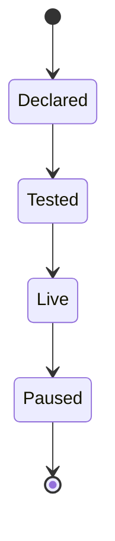
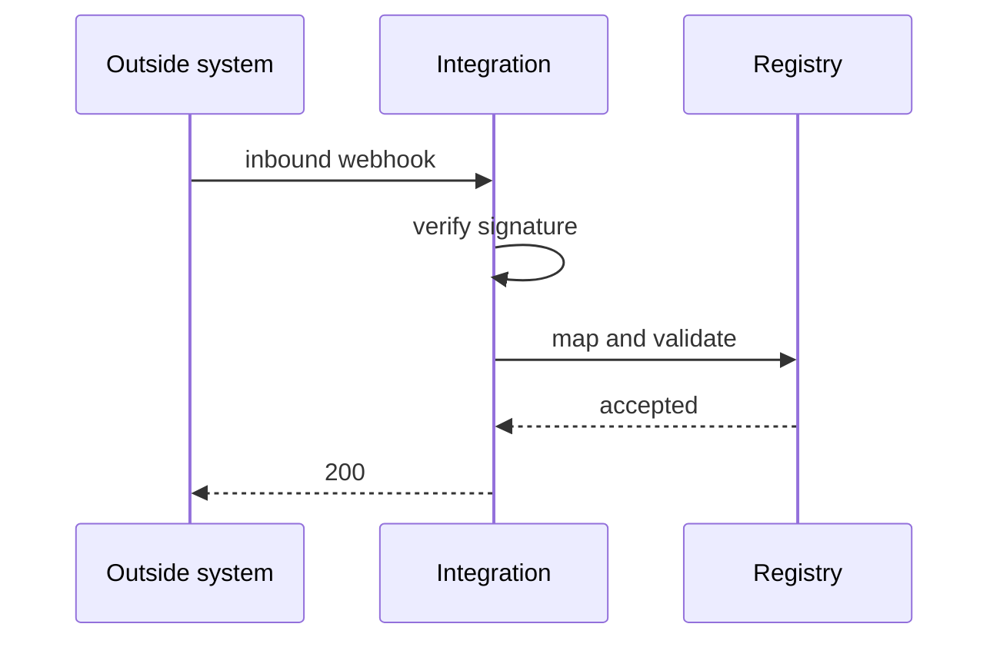
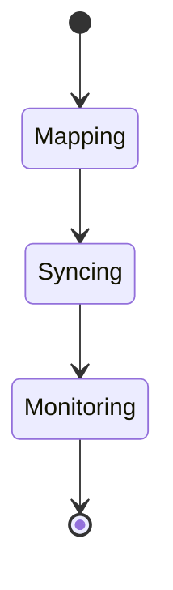

# Volume V09.2 · Automation (part 2 of 2)

**Part of** [the master document](../UCOS-MASTER.md) · **Category** C09 · **Projected from** `_registry/` — never edit this file: change the registry and run `npm run registry`.

**Parts:** [V09.1](V09.1-automation.md) · **V09.2**

> How work runs: events, state, workflows, agents and connections.

## Contents

- [D-INT Integration](#d-int)
  - [UCOS-INT-000001 Integration Architecture](#ucos-int-000001)

---

<a id="d-int"></a>
### D-INT · Integration

| | |
|---|---|
| **Category** | C09 Automation |
| **Build status** | partial |
| **Owns** | [API](../UCOS-MASTER.md#t-api), [Connector](../UCOS-MASTER.md#t-connector) |
| **Responsible for** | Generated API, Contracts And Versions, Connectors, Mapping, Sync, Webhooks |
| **Not responsible for** | Permissions, Communication Channels |
| **Contract** | [UCOS-INT-000001 Integration Architecture](#ucos-int-000001) |
| **Artifacts** | [UCOS-INT-000001](#ucos-int-000001) |
| **Concepts** | 169 — `node _registry/compile.js --search <words> --kind concept --owner "Integration"` |
| **Code** | `server.js`, `lib/registry.js`, `lib/global.js`, `lib/providers.js`, `lib/api.js`, `lib/spec.js`, `lib/connect.js`, `lib/idempotency.js`, `lib/seed/providers.json` |
| **Managed in** | `_registry/domains.json` → `D-INT` |

**Live routes (30)** — what the platform serves today for this domain:

- `GET /api/providers`
- `GET /api/platform/fanout`
- `GET /api/platform/global/providers`
- `GET /api/platform/global/provider`
- `POST /api/platform/global/provider`
- `PUT /api/platform/global/provider`
- `GET /api/platform/global/provider/availability`
- `POST /api/platform/global/provider/enable`
- `POST /api/platform/global/provider/disable`
- `GET /api/platform/global/tenant/providers`
- `POST /api/platform/global/tenant/provider`
- `DELETE /api/platform/global/tenant/provider`
- `GET /api/admin/gateways`
- `PUT /api/admin/gateways`
- `POST /api/admin/gateways/:id/test`
- `GET /api/admin/custom-providers`
- `POST /api/admin/custom-providers`
- `DELETE /api/admin/custom-providers/:id`
- `POST /api/admin/gateway/preview/:id`
- `POST /api/webhooks/inbound/:provider`
- `POST /api/admin/export/:kind`
- `GET /api/admin/webhooks`
- `POST /api/admin/webhooks`
- `PUT /api/admin/webhooks/:id`
- `DELETE /api/admin/webhooks/:id`
- `POST /api/admin/webhooks/:id/test`
- `POST /api/admin/webhooks/drain`
- `GET /api/platform/custom-providers`
- `POST /api/platform/custom-providers`
- `DELETE /api/platform/custom-providers/:id`

<a id="ucos-int-000001"></a>
#### UCOS-INT-000001 · Integration Architecture

Owner [Integration](#d-int) · managed in `_registry/manifest.json` → `UCOS-INT-000001`, content `_registry/content-platform.json` → `INT` · inherits the [standard contract](../UCOS-MASTER.md#standard-contract)

<a id="ucos-int-000001-concepts"></a>
##### Concepts

Integration Architecture owns the platform's API, generated from the registry and used by everyone including the console and agents, and every connection to an outside system: connectors as data, mapping, sync, webhooks and their monitoring.

<a id="ucos-int-000001-ontology"></a>
##### Ontology

An API Contract is generated per version from declarations; a Connector declares protocol, authentication, endpoints and a mapping onto kinds; a Sync moves data in, out or both on a schedule or trigger.

<a id="ucos-int-000001-taxonomy"></a>
##### Taxonomy

API styles: REST, GraphQL, bulk, event streams, query. Protocols: REST, GraphQL, SOAP, gRPC, webhooks, files (CSV, XML, JSON, EDI), queues, database replication, email in, declared.

<a id="ucos-int-000001-data-model"></a>
##### Data Model

```yaml
Connector:
  connectorId: <Identity>
  protocol: <declared protocol>
  auth: <declared scheme; secrets in Security>
  endpoints: [<endpoint>]
  mapping: [{external, kind, attribute, conversion}]
  direction: <in | out | both>
```

<a id="ucos-int-000001-graph-model"></a>
##### Graph Model

(:Contract)-[:GENERATED_FROM]->(:Declaration); (:Connector)-[:MAPS_TO]->(:Kind); (:Connector)-[:SERVES]->(:Channel)

<a id="ucos-int-000001-apis"></a>
##### APIs

*Designed interface: the contract the domain is built towards. The routes it serves today are on its card.*

- GET  /int.v1/contract/{version}
- POST /int.v1.connector
- POST /int.v1.sync
- POST /int.v1.webhook
- GET  /int.v1/health/{connector}

<a id="ucos-int-000001-events"></a>
##### Events

- ContractPublished
- SyncCompleted
- DeliveryFailed
- ConnectorUnhealthy

<a id="ucos-int-000001-commands"></a>
##### Commands

- connector.declare
- connector.test
- sync.run
- webhook.subscribe
- key.issue

<a id="ucos-int-000001-queries"></a>
##### Queries

- contract.diff
- sync.status
- deadLetters.list

<a id="ucos-int-000001-state-machines"></a>
##### State Machines



<a id="ucos-int-000001-workflows"></a>
##### Workflows

- declare connector → map onto kinds → test → go live → sync with checkpoints → dead-letter and resend on failure

<a id="ucos-int-000001-authorities"></a>
##### Authorities

- The platform owner governs the contract; a tenant governs its connectors and keys.

<a id="ucos-int-000001-permissions"></a>
##### Permissions

- connector.declare (integration role)
- key.issue (scope owner)
- contract.read (any principal)

<a id="ucos-int-000001-privacy-model"></a>
##### Privacy Model

Sensitive data leaves only to connectors approved for it in that region.

<a id="ucos-int-000001-audit-model"></a>
##### Audit Model

Every call is logged with secrets redacted.

<a id="ucos-int-000001-digital-twin-model"></a>
##### Digital Twin Model

An integration twin tracks throughput, latency and errors per connection.

<a id="ucos-int-000001-agent-model"></a>
##### Agent Model

Every API operation is an agent tool; agents never get a private path.

<a id="ucos-int-000001-runtime-model"></a>
##### Runtime Model

Idempotency keys, optimistic concurrency, retries with back-off and circuit breakers.

<a id="ucos-int-000001-scaling-model"></a>
##### Scaling Model

Syncs are incremental with checkpoints; webhooks are queued.

<a id="ucos-int-000001-multi-tenant-model"></a>
##### Multi-Tenant Model

Keys and connectors are tenant scope; the contract is shared.

<a id="ucos-int-000001-geo-distribution-model"></a>
##### Geo-Distribution Model

Outbound calls go only to declared hosts; data residency follows Compliance.

<a id="ucos-int-000001-failure-model"></a>
##### Failure Model

A breaking change without a new version, a silent sync gap, an unsigned inbound webhook.

<a id="ucos-int-000001-recovery-model"></a>
##### Recovery Model

Replay of a time window; dead letters resend from the console.

<a id="ucos-int-000001-certification-model"></a>
##### Certification Model

Every API change is compatible or a new version; every inbound webhook is signed.

<a id="ucos-int-000001-migration-model"></a>
##### Migration Model

Today's hand-written routes, the spec engine, the connect dispatcher and idempotency move here.

<a id="ucos-int-000001-implementation-blueprint"></a>
##### Implementation Blueprint

Build order for INT: (1) contract generation from the registry; (2) keys and OAuth clients; (3) connectors on today's spec engine; (4) sync, webhooks and dead letters; (5) replace hand-written routes per domain. Every build step also inherits Kernel parts K1–K11 (kinds, nodes, hierarchies, identifiers, shape, attributes, versions, events, change lifecycle, views and scope, resolution).

<a id="ucos-int-000001-sequence-diagrams"></a>
##### Sequence Diagrams



<a id="ucos-int-000001-state-diagrams"></a>
##### State Diagrams



