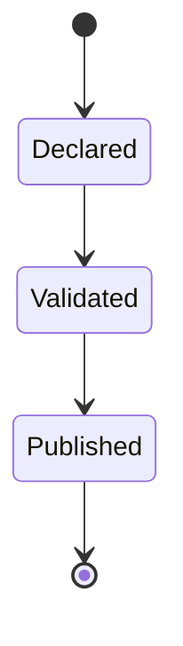
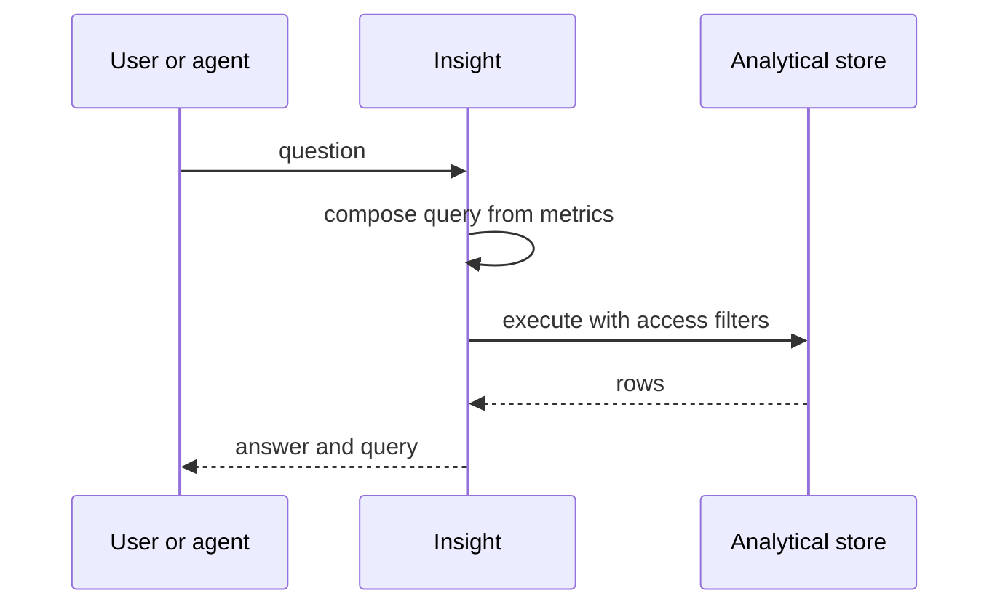
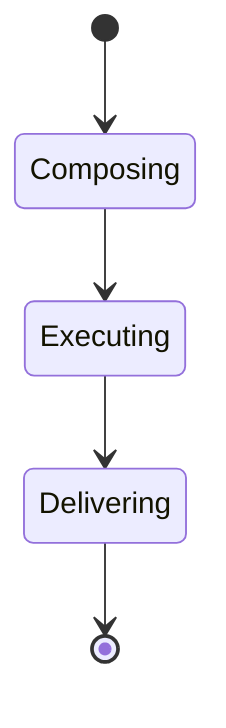

# Volume V10 · Intelligence

**Part of** [the master document](../UCOS-MASTER.md) · **Category** C10 · **Projected from** `_registry/` — never edit this file: change the registry and run `npm run registry`.

> Measurement of the platform and the business.

## Contents

- [D-INS Insight](#d-ins)
  - [UCOS-INS-000001 Insight Architecture](#ucos-ins-000001)

---

<a id="d-ins"></a>
### D-INS · Insight

| | |
|---|---|
| **Category** | C10 Intelligence |
| **Owns** | [Metric](../UCOS-MASTER.md#t-metric), [Report](../UCOS-MASTER.md#t-report) |
| **Responsible for** | Metrics, Reports, Dashboards, Alerts, Forecasts, Experiments |
| **Not responsible for** | Observation Capture, Simulation |
| **Contract** | [UCOS-INS-000001 Insight Architecture](#ucos-ins-000001) |
| **Artifacts** | [UCOS-INS-000001](#ucos-ins-000001) |
| **Code** | `lib/dashboards.js`, `lib/experiments.js`, `lib/planning.js` |
| **Managed in** | `_registry/domains.json` → `D-INS` |

<a id="ucos-ins-000001"></a>
#### UCOS-INS-000001 · Insight Architecture

Owner [Insight](#d-ins) · managed in `_registry/manifest.json` → `UCOS-INS-000001`, content `_registry/content-platform.json` → `INS` · inherits the [standard contract](../UCOS-MASTER.md#standard-contract)

<a id="ucos-ins-000001-concepts"></a>
##### Concepts

Insight Architecture owns every measurement of the platform and the business: a semantic layer of declared metrics and dimensions taken from the domains, reports, dashboards, alerts, forecasts and experiments, all from one definition per metric.

<a id="ucos-ins-000001-ontology"></a>
##### Ontology

A Metric declares a formula over kinds, a unit, an aggregation and an owner; Dimensions come from domains; a Report or Dashboard is a view over metrics and dimensions; an Alert watches a metric.

<a id="ucos-ins-000001-taxonomy"></a>
##### Taxonomy

Builders: report, pivot, dashboard, chart, map, funnel, cohort, retention, attribution, experiment. Intelligence: forecast, anomaly, segmentation, what-if.

<a id="ucos-ins-000001-data-model"></a>
##### Data Model

```yaml
Metric:
  metricId: <Identity>
  formula: <expression over kinds>
  unit: <Unit | Value Unit>
  aggregation: <sum | avg | count | declared>
  owner: <Party>
  preAggregations: [<declared>]
```

<a id="ucos-ins-000001-graph-model"></a>
##### Graph Model

(:Metric)-[:OVER]->(:Kind); (:Report)-[:SHOWS]->(:Metric); (:Report)-[:BY]->(:Dimension); (:Alert)-[:WATCHES]->(:Metric)

<a id="ucos-ins-000001-apis"></a>
##### APIs

- POST /ins.v1.metric
- POST /ins.v1.query
- POST /ins.v1.report
- POST /ins.v1.alert
- GET  /ins.v1/export/{report}

<a id="ucos-ins-000001-events"></a>
##### Events

- MetricDeclared
- AlertTriggered
- ReportScheduled
- ExperimentConcluded

<a id="ucos-ins-000001-commands"></a>
##### Commands

- metric.declare
- report.build
- alert.declare
- experiment.start

<a id="ucos-ins-000001-queries"></a>
##### Queries

- insight.query
- report.render
- forecast.of

<a id="ucos-ins-000001-state-machines"></a>
##### State Machines



<a id="ucos-ins-000001-workflows"></a>
##### Workflows

- declare metric → validate against the registry → build report or dashboard → schedule delivery through Notification → alert on threshold or anomaly

<a id="ucos-ins-000001-authorities"></a>
##### Authorities

- Each metric has an owner; the platform owner governs shared metrics.

<a id="ucos-ins-000001-permissions"></a>
##### Permissions

- metric.declare (analyst role)
- insight.query (row and column access from Security)
- report.share (owner)

<a id="ucos-ins-000001-privacy-model"></a>
##### Privacy Model

Sensitive values are masked or aggregated, and small groups are suppressed.

<a id="ucos-ins-000001-audit-model"></a>
##### Audit Model

Every view and export of a report is recorded.

<a id="ucos-ins-000001-digital-twin-model"></a>
##### Digital Twin Model

Insight is the platform's own twin of its business signals.

<a id="ucos-ins-000001-agent-model"></a>
##### Agent Model

Agents answer questions through the semantic layer and show the query they ran.

<a id="ucos-ins-000001-runtime-model"></a>
##### Runtime Model

Queries run on a separate analytical store fed from the event log, so reporting never slows transactions.

<a id="ucos-ins-000001-scaling-model"></a>
##### Scaling Model

Pre-aggregations are declared per metric.

<a id="ucos-ins-000001-multi-tenant-model"></a>
##### Multi-Tenant Model

Row access isolates tenants; platform reports aggregate across tenants by rule.

<a id="ucos-ins-000001-geo-distribution-model"></a>
##### Geo-Distribution Model

Maps use Geo shapes at any level; money converts through Value at dated rates.

<a id="ucos-ins-000001-failure-model"></a>
##### Failure Model

Two definitions of one metric, a report leaking a small group, a stale analytical store.

<a id="ucos-ins-000001-recovery-model"></a>
##### Recovery Model

The analytical store rebuilds from the event log.

<a id="ucos-ins-000001-certification-model"></a>
##### Certification Model

One definition per metric; every report respects row and column access.

<a id="ucos-ins-000001-migration-model"></a>
##### Migration Model

Today's dashboards, experiments, planning forecasts and GOIP intelligence move here.

<a id="ucos-ins-000001-implementation-blueprint"></a>
##### Implementation Blueprint

Build order for INS: (1) semantic layer; (2) analytical store fed from events; (3) report and dashboard builders; (4) alerts and scheduled delivery; (5) migrate dashboards and experiments. Every build step also inherits Kernel parts K1–K11 (kinds, nodes, hierarchies, identifiers, shape, attributes, versions, events, change lifecycle, views and scope, resolution).

<a id="ucos-ins-000001-sequence-diagrams"></a>
##### Sequence Diagrams



<a id="ucos-ins-000001-state-diagrams"></a>
##### State Diagrams



