# Volume V11.1 · Platform (part 1 of 2)

**Part of** [the master document](../UCOS-MASTER.md) · **Category** C11 · **Projected from** `_registry/` — never edit this file: change the registry and run `npm run registry`.

**Parts:** **V11.1** · [V11.2](V11.2-platform.md)

> Storing, running, verifying, holding content and offering the platform.

## Contents

- [D-PRS Persistence](#d-prs)
  - [UCOS-DB-000001 Storage Architecture](#ucos-db-000001)
  - [UCOS-GRF-000001 Graph Architecture](#ucos-grf-000001)
  - [UCOS-IDX-000001 Index Architecture](#ucos-idx-000001)
  - [UCOS-CCH-000001 Cache Architecture](#ucos-cch-000001)
- [D-OPS Operations](#d-ops)
  - [UCOS-SRE-000001 Reliability Architecture](#ucos-sre-000001)
  - [UCOS-MON-000001 Monitoring Architecture](#ucos-mon-000001)
  - [UCOS-OBSV-000001 Observability Architecture](#ucos-obsv-000001)
  - [UCOS-DR-000001 Disaster Recovery Architecture](#ucos-dr-000001)
  - [UCOS-BCP-000001 Business Continuity Architecture](#ucos-bcp-000001)
  - [UCOS-DEP-000001 Deployment Architecture](#ucos-dep-000001)
  - [UCOS-CLD-000001 Multi-Cloud Architecture](#ucos-cld-000001)
  - [UCOS-EDG-000001 Edge Architecture](#ucos-edg-000001)
  - [UCOS-GEO-000001 Geo-Distribution Architecture](#ucos-geo-000001)

---

<a id="d-prs"></a>
### D-PRS · Persistence

| | |
|---|---|
| **Category** | C11 Platform |
| **Owns** | [Storage](../UCOS-MASTER.md#t-storage), [Cache](../UCOS-MASTER.md#t-cache), [Index](../UCOS-MASTER.md#t-index) |
| **Responsible for** | Storage Adapters, Caching, Indexing, Graph Storage |
| **Not responsible for** | Declarations, Search Ranking |
| **Contract** | [UCOS-DB-000001 Storage Architecture](#ucos-db-000001) |
| **Artifacts** | [UCOS-DB-000001](#ucos-db-000001), [UCOS-GRF-000001](#ucos-grf-000001), [UCOS-IDX-000001](#ucos-idx-000001), [UCOS-CCH-000001](#ucos-cch-000001) |
| **Code** | — |
| **Managed in** | `_registry/domains.json` → `D-PRS` |

<a id="ucos-db-000001"></a>
#### UCOS-DB-000001 · Storage Architecture

Owner [Persistence](#d-prs) · managed in `_registry/manifest.json` → `UCOS-DB-000001`, content `_registry/content-runtime-data.json` → `DB` · inherits the [standard contract](../UCOS-MASTER.md#standard-contract)

<a id="ucos-db-000001-concepts"></a>
##### Concepts

Storage Architecture holds primitives and registry truth — nothing else. Commerce objects, products, offers, and projections are never stored; they are computed. The store is the memory of the constitution, not the memory of the business.

<a id="ucos-db-000001-ontology"></a>
##### Ontology

Storage is partitioned by domain ownership: each domain owns its tables/shards exclusively. Cross-domain access is via contract, never via shared table. Append-only for truth; projections are cached, not stored.

<a id="ucos-db-000001-taxonomy"></a>
##### Taxonomy

By truth: Authoritative (primitive/registry) / Derived (projection cache) / Ephemeral (session). By shape: Relational / Document / Graph / Blob / Time-series. By tier: Hot / Warm / Cold / Archive.

<a id="ucos-db-000001-data-model"></a>
##### Data Model

```yaml
StoragePartition:
  partitionId: <Identity>
  ownerDomain: <Domain>
  storeType: <registry id>
  tier: <Hot|Warm|Cold|Archive>
  residency: <Context jurisdiction>
  retentionPolicy: <Policy>
  encryptionState: <registry id>
```

<a id="ucos-db-000001-graph-model"></a>
##### Graph Model

(:Partition)-[:OWNED_BY]->(:Domain); (:Partition)-[:RESIDES_IN]->(:Context); (:Partition)-[:RETAINED_PER]->(:Policy); (:Partition)-[:REPLICATED_TO]->(:Partition)

<a id="ucos-db-000001-apis"></a>
##### APIs

- POST /storage.v1.partition
- GET  /storage.v1/partition/{id}
- POST /storage.v1.tier
- GET  /storage.v1.residency/{subjectId}

<a id="ucos-db-000001-events"></a>
##### Events

- PartitionCreated
- TierMoved
- Archived
- Purged
- ReplicaAdded
- ResidencyViolation

<a id="ucos-db-000001-commands"></a>
##### Commands

- storage.partition.create
- storage.tier.move
- storage.archive
- storage.purge
- storage.replicate

<a id="ucos-db-000001-queries"></a>
##### Queries

- storage.partition
- storage.residency
- storage.retention
- storage.footprint

<a id="ucos-db-000001-state-machines"></a>
##### State Machines

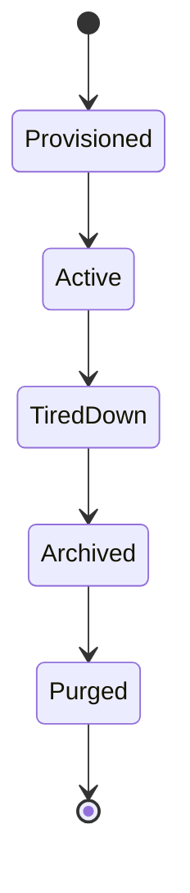

<a id="ucos-db-000001-workflows"></a>
##### Workflows

- provision under domain ownership → write primitives only → tier by access pattern → archive per retention → purge under governance

<a id="ucos-db-000001-authorities"></a>
##### Authorities

- Domain Authority owns its partitions; Storage Authority governs infrastructure policy.

<a id="ucos-db-000001-permissions"></a>
##### Permissions

- storage.write (domain, to its own partition only)
- storage.purge (governance authority)
- storage.read (domain-scoped)

<a id="ucos-db-000001-privacy-model"></a>
##### Privacy Model

Retention and purge are policy-driven per data class; erasure requests execute as governed purges with certificates.

<a id="ucos-db-000001-audit-model"></a>
##### Audit Model

Every tier move, archive, and purge is recorded; storage operations are as audited as business actions.

<a id="ucos-db-000001-digital-twin-model"></a>
##### Digital Twin Model

Storage twin monitors capacity, tier efficacy, and purge backlog as platform health.

<a id="ucos-db-000001-agent-model"></a>
##### Agent Model

Storage agent proposes tiering and retention adjustments from access patterns, under governance.

<a id="ucos-db-000001-runtime-model"></a>
##### Runtime Model

Writes are domain-scoped and schema-validated against the registry; reads route by domain contract.

<a id="ucos-db-000001-scaling-model"></a>
##### Scaling Model

Partitions scale independently per domain — no global bottleneck, no cross-domain coupling.

<a id="ucos-db-000001-multi-tenant-model"></a>
##### Multi-Tenant Model

Tenant data isolation at the partition level; shared infrastructure never implies shared data.

<a id="ucos-db-000001-geo-distribution-model"></a>
##### Geo-Distribution Model

Residency is a partition property — regulated data's partition physically resides in-jurisdiction.

<a id="ucos-db-000001-failure-model"></a>
##### Failure Model

Cross-domain write attempt (must be rejected), residency violation, retention policy conflict, tier thrash.

<a id="ucos-db-000001-recovery-model"></a>
##### Recovery Model

Authoritative truth is append-only and replicated; projection caches are disposable and re-derived.

<a id="ucos-db-000001-certification-model"></a>
##### Certification Model

Partition must pass ownership binding, residency compliance, encryption state, and retention policy.

<a id="ucos-db-000001-migration-model"></a>
##### Migration Model

Storage engines are pluggable via the registry; migrating engines never touches domain logic.

<a id="ucos-db-000001-implementation-blueprint"></a>
##### Implementation Blueprint

Build order for DB: (1) define registry entries — this domain owns by truth: authoritative (primitive/registry) / derived (projection cache) / ephemeral (session) as registry truth, not code; (2) implement the contract surface first (storage.partition.create, storage.tier.move, storage.archive) and validate against DB boundaries; (3) event-source all state so history is reconstructable; (4) wire the enforcement points — authority check, policy guard, evidence binding, trace — in-line, with no bypass path; (5) add tests per the Testing Architecture, citing evidence per gate; (6) obtain Verification and Certification before activation. Acceptance: the Zero Partial and Law 001 audits pass, every action answers the seven explainability questions, and this domain mutates no other domain internals.

<a id="ucos-db-000001-sequence-diagrams"></a>
##### Sequence Diagrams

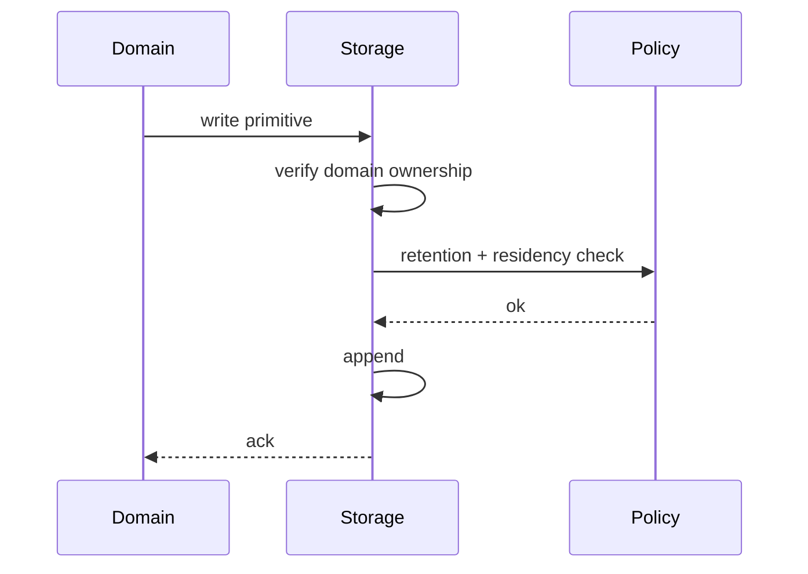

<a id="ucos-db-000001-state-diagrams"></a>
##### State Diagrams

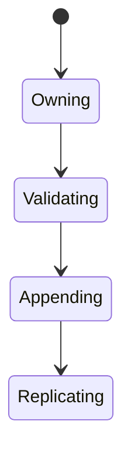

<a id="ucos-grf-000001"></a>
#### UCOS-GRF-000001 · Graph Architecture

Owner [Persistence](#d-prs) · managed in `_registry/manifest.json` → `UCOS-GRF-000001`, content `_registry/content-runtime-data.json` → `GRF` · inherits the [standard contract](../UCOS-MASTER.md#standard-contract)

<a id="ucos-grf-000001-concepts"></a>
##### Concepts

Graph Architecture is the native shape of the platform — reality emerges through relationships. The graph stores primitives and their relationships; everything queryable about reality is a traversal.

<a id="ucos-grf-000001-ontology"></a>
##### Ontology

Graph has Nodes (primitives/projections) and Edges (typed, contextualized, temporal). Traversal is context-filtered and trust-weighted. The graph is the substrate for Relationship, Causality, Discovery, and Emergence.

<a id="ucos-grf-000001-taxonomy"></a>
##### Taxonomy

By content: Primitive-graph / Projection-graph / Meta-graph. By traversal: Local / Multi-hop / Global-pattern. By store: Native-graph / Relational-emulated / Distributed.

<a id="ucos-grf-000001-data-model"></a>
##### Data Model

```yaml
GraphPartition:
  partitionId: <Identity>
  shardKey: <registry expression>
  nodes: <count>
  edges: <count>
  traversalPolicy: <Policy>
  residency: <Context>
  version: <int>
```

<a id="ucos-grf-000001-graph-model"></a>
##### Graph Model

(:Graph)-[:SHARDED_BY]->(:Expression); (:Graph)-[:TRAVERSED_PER]->(:Policy); (:Graph)-[:REPLICATED_TO]->(:Graph); (:Graph)-[:RESIDES_IN]->(:Context)

<a id="ucos-grf-000001-apis"></a>
##### APIs

- POST /graph.v1.traverse
- POST /graph.v1.neighbors
- GET  /graph.v1.path
- POST /graph.v1.pattern

<a id="ucos-grf-000001-events"></a>
##### Events

- TraversalExecuted
- HotspotDetected
- PartitionRebalanced
- GraphVersionChanged

<a id="ucos-grf-000001-commands"></a>
##### Commands

- graph.traverse
- graph.neighbors
- graph.path
- graph.pattern.match
- graph.rebalance

<a id="ucos-grf-000001-queries"></a>
##### Queries

- graph.byId
- graph.neighbors
- graph.path
- graph.pattern
- graph.density

<a id="ucos-grf-000001-state-machines"></a>
##### State Machines

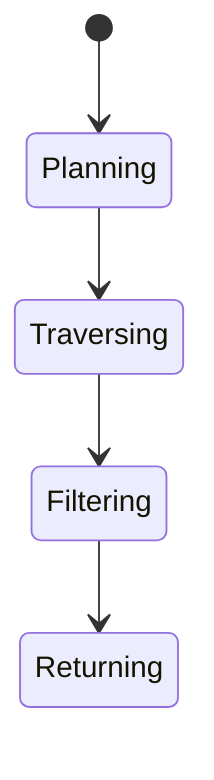

<a id="ucos-grf-000001-workflows"></a>
##### Workflows

- parse query → plan traversal under policy → execute with context filter → trust-weight results → return

<a id="ucos-grf-000001-authorities"></a>
##### Authorities

- Graph Authority (infrastructure); traversal policy enforces each domain's access contract.

<a id="ucos-grf-000001-permissions"></a>
##### Permissions

- graph.traverse (context-scoped, edge-policy-checked)
- graph.read (domain-scoped nodes)
- graph.admin (graph authority)

<a id="ucos-grf-000001-privacy-model"></a>
##### Privacy Model

Sensitive edges are filtered at traversal — never returned then hidden. Hidden-edge traversal attempts are logged.

<a id="ucos-grf-000001-audit-model"></a>
##### Audit Model

Every traversal records the query, context, policies applied, and edge count — the basis of data-access audit.

<a id="ucos-grf-000001-digital-twin-model"></a>
##### Digital Twin Model

Graph twin monitors degree distribution and hotspot formation as structural health.

<a id="ucos-grf-000001-agent-model"></a>
##### Agent Model

Discovery agents traverse for inference; every traversal is policy-checked like any other access.

<a id="ucos-grf-000001-runtime-model"></a>
##### Runtime Model

Traversal is bounded by policy hop-limit and trust floor; hot vertices are served from projections.

<a id="ucos-grf-000001-scaling-model"></a>
##### Scaling Model

Sharded by source-node hash; multi-hop traversals are bounded and parallel across shards.

<a id="ucos-grf-000001-multi-tenant-model"></a>
##### Multi-Tenant Model

Edges never cross tenants implicitly; cross-tenant edges are explicit published relationships.

<a id="ucos-grf-000001-geo-distribution-model"></a>
##### Geo-Distribution Model

Graph residency follows node sovereignty; replicas are read-only and policy-filtered.

<a id="ucos-grf-000001-failure-model"></a>
##### Failure Model

Hotspot overload, traversal timeout, edge-type drift, orphaned nodes.

<a id="ucos-grf-000001-recovery-model"></a>
##### Recovery Model

The graph is rebuilt from the Relationship Domain's append-only log — it is a projection, never primary truth.

<a id="ucos-grf-000001-certification-model"></a>
##### Certification Model

Traversal must prove policy enforcement on every edge touched — no bypass, no post-filter leak.

<a id="ucos-grf-000001-migration-model"></a>
##### Migration Model

New edge types are registry additions; the graph re-indexes without downtime.

<a id="ucos-grf-000001-implementation-blueprint"></a>
##### Implementation Blueprint

Build order for GRF: (1) define registry entries — this domain owns by content: primitive-graph / projection-graph / meta-graph as registry truth, not code; (2) implement the contract surface first (graph.traverse, graph.neighbors, graph.path) and validate against GRF boundaries; (3) event-source all state so history is reconstructable; (4) wire the enforcement points — authority check, policy guard, evidence binding, trace — in-line, with no bypass path; (5) add tests per the Testing Architecture, citing evidence per gate; (6) obtain Verification and Certification before activation. Acceptance: the Zero Partial and Law 001 audits pass, every action answers the seven explainability questions, and this domain mutates no other domain internals.

<a id="ucos-grf-000001-sequence-diagrams"></a>
##### Sequence Diagrams

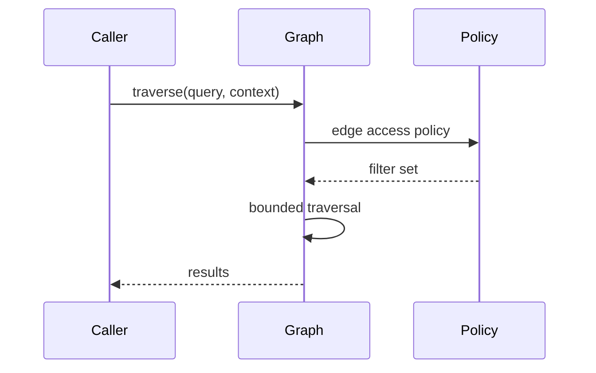

<a id="ucos-grf-000001-state-diagrams"></a>
##### State Diagrams

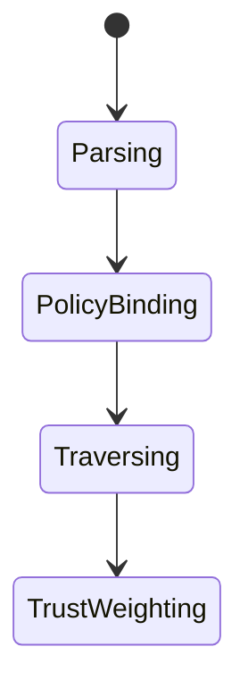

<a id="ucos-idx-000001"></a>
#### UCOS-IDX-000001 · Index Architecture

Owner [Persistence](#d-prs) · managed in `_registry/manifest.json` → `UCOS-IDX-000001`, content `_registry/content-runtime-data.json` → `IDX` · inherits the [standard contract](../UCOS-MASTER.md#standard-contract)

<a id="ucos-idx-000001-concepts"></a>
##### Concepts

Index Architecture makes the platform queryable at scale. Indexes are derived projections — rebuilt from truth, never authoritative — and their consistency with the source is continuously verified.

<a id="ucos-idx-000001-ontology"></a>
##### Ontology

Index has a Source (domain truth), a Projection function, a Consistency model, and a Rebuild policy. An index that diverges from truth is a defect, not an optimization.

<a id="ucos-idx-000001-taxonomy"></a>
##### Taxonomy

By structure: Inverted / B-tree / Hash / Graph / Vector / Hybrid. By consistency: Strong / Eventually / Snapshot. By trigger: Real-time / Batch / Scheduled.

<a id="ucos-idx-000001-data-model"></a>
##### Data Model

```yaml
Index:
  indexId: <Identity>
  source: <domain partition>
  projectionFn: <registry expression>
  consistencyModel: <registry id>
  rebuildPolicy: <Policy>
  state: <Fresh|Stale|Rebuilding|Degraded>
  version: <int>
```

<a id="ucos-idx-000001-graph-model"></a>
##### Graph Model

(:Index)-[:DERIVED_FROM]->(:Partition); (:Index)-[:REBUILT_PER]->(:Policy); (:Index)-[:CONSISTENT_WITH]->(:Partition); (:Index)-[:SERVES]->(:Query)

<a id="ucos-idx-000001-apis"></a>
##### APIs

- POST /index.v1.define
- GET  /index.v1/{id}
- POST /index.v1.rebuild
- GET  /index.v1.consistency/{id}

<a id="ucos-idx-000001-events"></a>
##### Events

- IndexChanged
- IndexRebuilt
- IndexInvalidated
- ConsistencyViolation
- IndexDegraded

<a id="ucos-idx-000001-commands"></a>
##### Commands

- index.define
- index.rebuild
- index.invalidate
- index.drop

<a id="ucos-idx-000001-queries"></a>
##### Queries

- index.byId
- index.consistency
- index.lag
- index.coverage

<a id="ucos-idx-000001-state-machines"></a>
##### State Machines

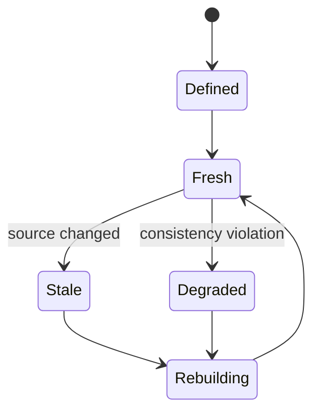

<a id="ucos-idx-000001-workflows"></a>
##### Workflows

- define projection → build → invalidate on source change → rebuild per policy → verify consistency

<a id="ucos-idx-000001-authorities"></a>
##### Authorities

- Index Authority (infrastructure); projection function must respect domain access contracts.

<a id="ucos-idx-000001-permissions"></a>
##### Permissions

- index.define (index authority)
- index.rebuild (system)
- index.read (query-scoped, still policy-checked)

<a id="ucos-idx-000001-privacy-model"></a>
##### Privacy Model

Indexes over personal data inherit consent scope at build time — no index of unseen data.

<a id="ucos-idx-000001-audit-model"></a>
##### Audit Model

Consistency verification is continuous; violations are events with source and index versions recorded.

<a id="ucos-idx-000001-digital-twin-model"></a>
##### Digital Twin Model

Index twin monitors lag and rebuild success rates across the fleet.

<a id="ucos-idx-000001-agent-model"></a>
##### Agent Model

Index agent detects query patterns and proposes new indexes, and flags unused ones for retirement.

<a id="ucos-idx-000001-runtime-model"></a>
##### Runtime Model

Invalidation is event-driven from the source domain; queries to stale indexes are served with a staleness marker, never silently.

<a id="ucos-idx-000001-scaling-model"></a>
##### Scaling Model

Indexes partition alongside their sources; rebuilds are incremental where the projection permits.

<a id="ucos-idx-000001-multi-tenant-model"></a>
##### Multi-Tenant Model

Indexes are tenant-scoped; a shared index over published data respects each source's policy.

<a id="ucos-idx-000001-geo-distribution-model"></a>
##### Geo-Distribution Model

Indexes replicate for read locality; the authoritative build stays in the source's jurisdiction.

<a id="ucos-idx-000001-failure-model"></a>
##### Failure Model

Consistency violation, rebuild failure, invalidation storm, projection drift after schema evolution.

<a id="ucos-idx-000001-recovery-model"></a>
##### Recovery Model

Indexes are disposable — a corrupt index is dropped and rebuilt from truth, never repaired in place.

<a id="ucos-idx-000001-certification-model"></a>
##### Certification Model

Index must carry a consistency guarantee level and prove verification runs on schedule.

<a id="ucos-idx-000001-migration-model"></a>
##### Migration Model

New index types are registry additions; schema evolution triggers governed rebuilds.

<a id="ucos-idx-000001-implementation-blueprint"></a>
##### Implementation Blueprint

Build order for IDX: (1) define registry entries — this domain owns by structure: inverted / b-tree / hash / graph / vector / hybrid as registry truth, not code; (2) implement the contract surface first (index.define, index.rebuild, index.invalidate) and validate against IDX boundaries; (3) event-source all state so history is reconstructable; (4) wire the enforcement points — authority check, policy guard, evidence binding, trace — in-line, with no bypass path; (5) add tests per the Testing Architecture, citing evidence per gate; (6) obtain Verification and Certification before activation. Acceptance: the Zero Partial and Law 001 audits pass, every action answers the seven explainability questions, and this domain mutates no other domain internals.

<a id="ucos-idx-000001-sequence-diagrams"></a>
##### Sequence Diagrams

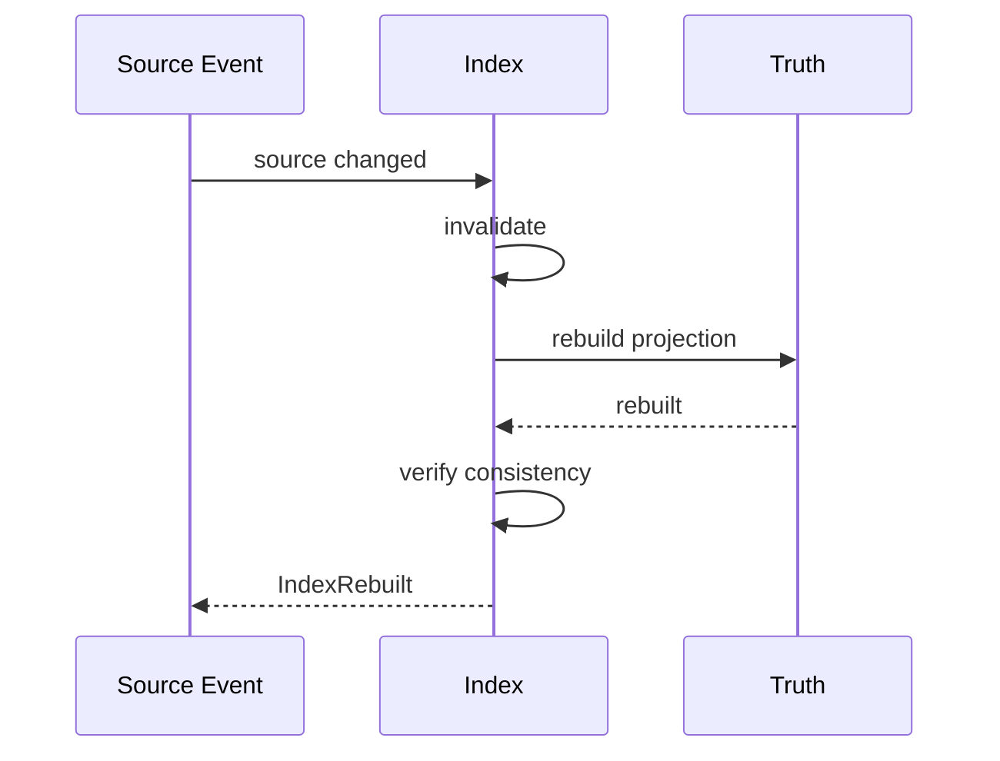

<a id="ucos-idx-000001-state-diagrams"></a>
##### State Diagrams

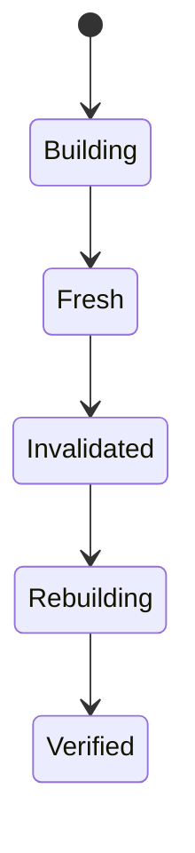

<a id="ucos-cch-000001"></a>
#### UCOS-CCH-000001 · Cache Architecture

Owner [Persistence](#d-prs) · managed in `_registry/manifest.json` → `UCOS-CCH-000001`, content `_registry/content-runtime-data.json` → `CCH` · inherits the [standard contract](../UCOS-MASTER.md#standard-contract)

<a id="ucos-cch-000001-concepts"></a>
##### Concepts

Cache Architecture makes projections fast. Everything cached is derived and disposable — a cache is never a source of truth, and its consistency with the registry is a first-class concern.

<a id="ucos-cch-000001-ontology"></a>
##### Ontology

Cache has a Key (content or semantic), a Source projection, an Invalidation policy, and a Consistency level. The invariant: a cache hit must be indistinguishable from recomputation under the pinned registry version.

<a id="ucos-cch-000001-taxonomy"></a>
##### Taxonomy

By key: Content-addressed / Semantic / Query. By level: Request / Node / Cluster / Edge. By invalidation: Event-driven / TTL / Version-pinned / Hybrid.

<a id="ucos-cch-000001-data-model"></a>
##### Data Model

```yaml
CacheEntry:
  cacheKey: <hash or semantic key>
  sourceProjection: <content-addressed>
  registryVersion: <version>
  invalidationPolicy: <Policy>
  consistency: <Strong|Eventually>
  temporal: {cachedAt, expiresAt}
  provenance: <computation ref>
```

<a id="ucos-cch-000001-graph-model"></a>
##### Graph Model

(:Cache)-[:DERIVED_FROM]->(:Projection); (:Cache)-[:INVALIDATED_BY]->(:Policy|:Event); (:Cache)-[:PINNED_TO]->(:RegistryVersion)

<a id="ucos-cch-000001-apis"></a>
##### APIs

- POST /cache.v1.get
- POST /cache.v1.put
- POST /cache.v1.invalidate
- GET  /cache.v1.consistency

<a id="ucos-cch-000001-events"></a>
##### Events

- CacheHit
- CacheMiss
- CacheInvalidated
- CacheWarming
- ConsistencyViolation

<a id="ucos-cch-000001-commands"></a>
##### Commands

- cache.put
- cache.invalidate
- cache.warm
- cache.flush

<a id="ucos-cch-000001-queries"></a>
##### Queries

- cache.hitRate
- cache.consistency
- cache.size
- cache.hotKeys

<a id="ucos-cch-000001-state-machines"></a>
##### State Machines

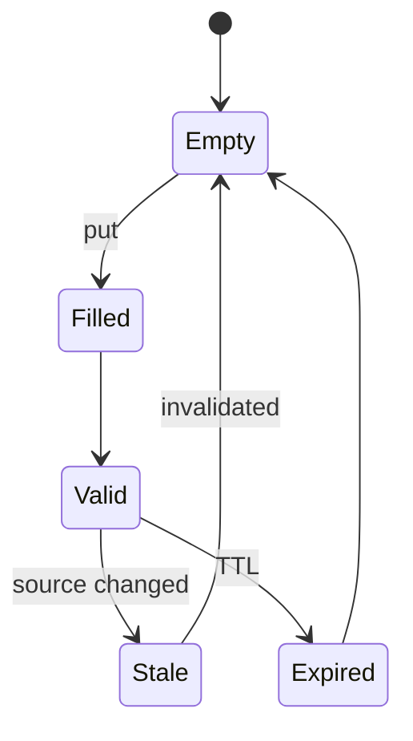

<a id="ucos-cch-000001-workflows"></a>
##### Workflows

- compute key → check cache → on miss compute from registry → store with pinned version → invalidate on source event or TTL

<a id="ucos-cch-000001-authorities"></a>
##### Authorities

- Cache Authority (infrastructure); invalidation policy is governed per projection type.

<a id="ucos-cch-000001-permissions"></a>
##### Permissions

- cache.write (system)
- cache.invalidate (source domain or policy)
- cache.flush (infrastructure authority)

<a id="ucos-cch-000001-privacy-model"></a>
##### Privacy Model

Personal-data caches are consent-scoped and subject to erasure invalidation — a purge propagates to all caches.

<a id="ucos-cch-000001-audit-model"></a>
##### Audit Model

Consistency sampling proves cache matches recomputation; violations are events, not silent corrections.

<a id="ucos-cch-000001-digital-twin-model"></a>
##### Digital Twin Model

Cache twin monitors hit rates, eviction storms, and consistency-sample failures.

<a id="ucos-cch-000001-agent-model"></a>
##### Agent Model

Cache agent warms predicted-hot keys and identifies low-value entries for eviction.

<a id="ucos-cch-000001-runtime-model"></a>
##### Runtime Model

Invalidation is event-driven from the source domains; edge caches are eventually consistent with staleness bounds.

<a id="ucos-cch-000001-scaling-model"></a>
##### Scaling Model

Multi-tier: request → node → cluster → edge; each tier bounded by its invalidation latency.

<a id="ucos-cch-000001-multi-tenant-model"></a>
##### Multi-Tenant Model

Cache keys are tenant-namespaced — cross-tenant key collision is impossible by construction.

<a id="ucos-cch-000001-geo-distribution-model"></a>
##### Geo-Distribution Model

Edge caches serve locality; regulated data's caches stay in-jurisdiction per residency policy.

<a id="ucos-cch-000001-failure-model"></a>
##### Failure Model

Stale-serve, invalidation loss, cache stampede, hot-key hotspot.

<a id="ucos-cch-000001-recovery-model"></a>
##### Recovery Model

Caches are disposable — flush and recompute is always a safe recovery; no truth is ever cached-only.

<a id="ucos-cch-000001-certification-model"></a>
##### Certification Model

Cache must declare consistency level and prove invalidation latency within policy bound.

<a id="ucos-cch-000001-migration-model"></a>
##### Migration Model

New invalidation strategies are registry additions.

<a id="ucos-cch-000001-implementation-blueprint"></a>
##### Implementation Blueprint

Build order for CCH: (1) define registry entries — this domain owns by key: content-addressed / semantic / query as registry truth, not code; (2) implement the contract surface first (cache.put, cache.invalidate, cache.warm) and validate against CCH boundaries; (3) event-source all state so history is reconstructable; (4) wire the enforcement points — authority check, policy guard, evidence binding, trace — in-line, with no bypass path; (5) add tests per the Testing Architecture, citing evidence per gate; (6) obtain Verification and Certification before activation. Acceptance: the Zero Partial and Law 001 audits pass, every action answers the seven explainability questions, and this domain mutates no other domain internals.

<a id="ucos-cch-000001-sequence-diagrams"></a>
##### Sequence Diagrams

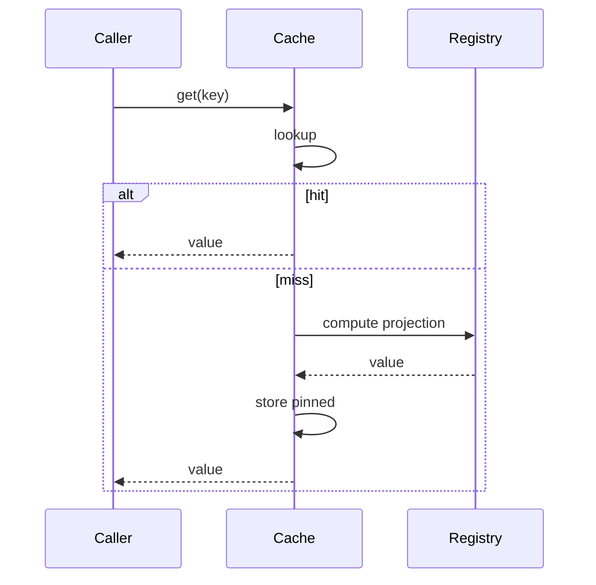

<a id="ucos-cch-000001-state-diagrams"></a>
##### State Diagrams

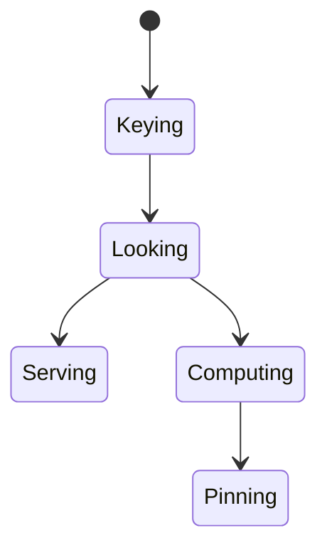

---

<a id="d-ops"></a>
### D-OPS · Operations

| | |
|---|---|
| **Category** | C11 Platform |
| **Owns** | [Environment](../UCOS-MASTER.md#t-environment), [Deployment](../UCOS-MASTER.md#t-deployment) |
| **Responsible for** | Environments, Deployments, Regions, Reliability, Monitoring, Backups And Recovery, Continuity |
| **Not responsible for** | Data Placement Law, Security Incidents |
| **Contract** | [UCOS-SRE-000001 Reliability Architecture](#ucos-sre-000001) |
| **Artifacts** | [UCOS-SRE-000001](#ucos-sre-000001), [UCOS-MON-000001](#ucos-mon-000001), [UCOS-OBSV-000001](#ucos-obsv-000001), [UCOS-DR-000001](#ucos-dr-000001), [UCOS-BCP-000001](#ucos-bcp-000001), [UCOS-DEP-000001](#ucos-dep-000001), [UCOS-CLD-000001](#ucos-cld-000001), [UCOS-EDG-000001](#ucos-edg-000001), [UCOS-GEO-000001](#ucos-geo-000001) |
| **Code** | `lib/ucos-monitor.js`, `lib/queue.js`, `lib/env.js`, `lib/config.js`, `lib/adapters.js`, `lib/enterprise.js`, `lib/logger.js`, `lib/metrics.js`, `scripts/backup.js`, `scripts/restore.js` |
| **Managed in** | `_registry/domains.json` → `D-OPS` |

<a id="ucos-sre-000001"></a>
#### UCOS-SRE-000001 · Reliability Architecture

Owner [Operations](#d-ops) · managed in `_registry/manifest.json` → `UCOS-SRE-000001`, content `_registry/content-sec-ops-dep-qlt.json` → `SRE` · inherits the [standard contract](../UCOS-MASTER.md#standard-contract)

<a id="ucos-sre-000001-concepts"></a>
##### Concepts

Reliability Architecture treats uptime as a governed property: every capability declares an SLO, every breach burns a budget, and every recovery is rehearsed. Reliability is designed, not hoped for.

<a id="ucos-sre-000001-ontology"></a>
##### Ontology

Reliability has SLOs (targets), Error budgets (governed spend), Dependencies (relationships), Failure domains (bounded blast radius), and Recovery objectives (RTO/RPO per class).

<a id="ucos-sre-000001-taxonomy"></a>
##### Taxonomy

By criticality: Tier-0 (constitutional) / Tier-1 (critical) / Tier-2 (standard) / Tier-3 (best-effort). By metric: Availability / Latency / Durability / Correctness / Throughput. By recovery: RTO-immediate / RTO-hours / RTO-days.

<a id="ucos-sre-000001-data-model"></a>
##### Data Model

```yaml
ReliabilityTarget:
  targetId: <Identity>
  capability: <registry capability>
  tier: <registry level>
  slo: {indicator, target, window}
  errorBudget: {remaining, resetsAt}
  dependencies: [<Relationship>]
  recovery: {rto, rpo}
  policy: <Policy>
```

<a id="ucos-sre-000001-graph-model"></a>
##### Graph Model

(:Target)-[:PROTECTS]->(:Capability); (:Target)-[:DEPENDS_ON]->(:Capability); (:Target)-[:BOUNDED_BY]->(:Policy); (:Target)-[:MEASURED_BY]->(:Indicator)

<a id="ucos-sre-000001-apis"></a>
##### APIs

- GET  /sre.v1/targets
- POST /sre.v1/target
- GET  /sre.v1/budgets
- POST /sre.v1/freeze

<a id="ucos-sre-000001-events"></a>
##### Events

- SLOBreached
- BudgetExhausted
- FreezeDeclared
- RehearsalCompleted
- DependencyFailed

<a id="ucos-sre-000001-commands"></a>
##### Commands

- sre.declare
- sre.freeze
- sre.unfreeze
- sre.rehearse
- sre.burn

<a id="ucos-sre-000001-queries"></a>
##### Queries

- sre.targets
- sre.budgets
- sre.dependencies
- sre.blastRadius
- sre.tiers

<a id="ucos-sre-000001-state-machines"></a>
##### State Machines

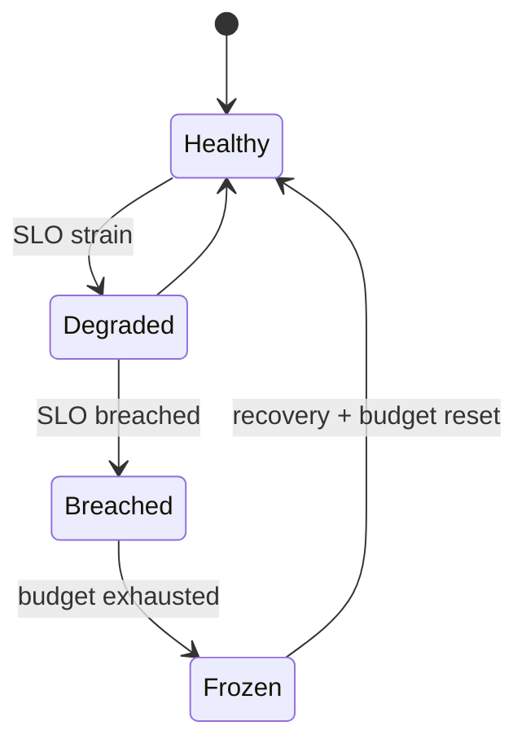

<a id="ucos-sre-000001-workflows"></a>
##### Workflows

- declare SLO → measure continuously → burn budget on errors → freeze on exhaustion → recover → rehearse

<a id="ucos-sre-000001-authorities"></a>
##### Authorities

- Reliability Authority (SLO governance); freeze halts non-critical change under policy.

<a id="ucos-sre-000001-permissions"></a>
##### Permissions

- sre.declare (reliability authority)
- sre.freeze (reliability authority)
- sre.read (any)

<a id="ucos-sre-000001-privacy-model"></a>
##### Privacy Model

Reliability metrics carry no personal data by construction — indicators are aggregate.

<a id="ucos-sre-000001-audit-model"></a>
##### Audit Model

Every breach and freeze is logged with cause analysis and remediation; rehearsals are recorded.

<a id="ucos-sre-000001-digital-twin-model"></a>
##### Digital Twin Model

Reliability twin simulates failure scenarios against live topology — chaos engineering under governance.

<a id="ucos-sre-000001-agent-model"></a>
##### Agent Model

Reliability agent detects budget burn early and proposes freezes before exhaustion.

<a id="ucos-sre-000001-runtime-model"></a>
##### Runtime Model

Probes are continuous; circuit breakers are automatic; fallbacks degrade gracefully, never silently.

<a id="ucos-sre-000001-scaling-model"></a>
##### Scaling Model

Failure domains are bounded per tier; blast radius is a queryable property, not a guess.

<a id="ucos-sre-000001-multi-tenant-model"></a>
##### Multi-Tenant Model

Tenant reliability is isolated — one tenant's storm cannot breach another's SLO.

<a id="ucos-sre-000001-geo-distribution-model"></a>
##### Geo-Distribution Model

Regional SLOs account for jurisdiction-failover constraints — sovereignty can limit recovery options, by design.

<a id="ucos-sre-000001-failure-model"></a>
##### Failure Model

Cascading dependency failure, budget miscalculation, frozen-state deadlock, rehearsal gap.

<a id="ucos-sre-000001-recovery-model"></a>
##### Recovery Model

Recovery is rehearsed per tier; RTO/RPO are measured, not asserted. Unrehearsed paths are assumed broken.

<a id="ucos-sre-000001-certification-model"></a>
##### Certification Model

Every capability must have a declared tier, SLO, and rehearsed recovery path.

<a id="ucos-sre-000001-migration-model"></a>
##### Migration Model

New tiers are registry additions.

<a id="ucos-sre-000001-implementation-blueprint"></a>
##### Implementation Blueprint

Build order for SRE: (1) define registry entries — this domain owns by criticality: tier-0 (constitutional) / tier-1 (critical) / tier-2 (standard) / tier-3 (best-effort) as registry truth, not code; (2) implement the contract surface first (sre.declare, sre.freeze, sre.unfreeze) and validate against SRE boundaries; (3) event-source all state so history is reconstructable; (4) wire the enforcement points — authority check, policy guard, evidence binding, trace — in-line, with no bypass path; (5) add tests per the Testing Architecture, citing evidence per gate; (6) obtain Verification and Certification before activation. Acceptance: the Zero Partial and Law 001 audits pass, every action answers the seven explainability questions, and this domain mutates no other domain internals.

<a id="ucos-sre-000001-sequence-diagrams"></a>
##### Sequence Diagrams

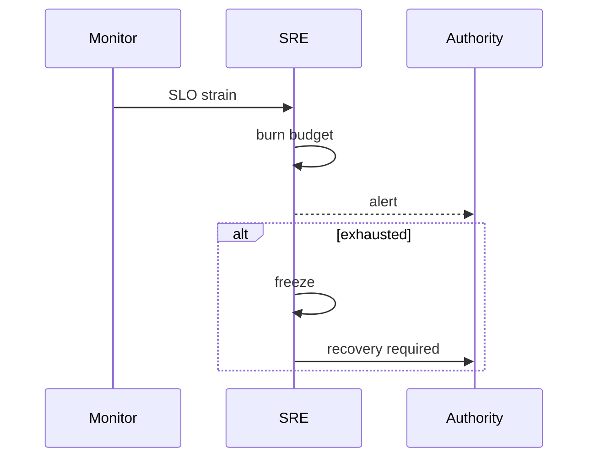

<a id="ucos-sre-000001-state-diagrams"></a>
##### State Diagrams

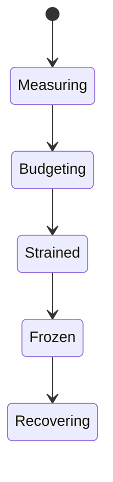

<a id="ucos-mon-000001"></a>
#### UCOS-MON-000001 · Monitoring Architecture

Owner [Operations](#d-ops) · managed in `_registry/manifest.json` → `UCOS-MON-000001`, content `_registry/content-sec-ops-dep-qlt.json` → `MON` · inherits the [standard contract](../UCOS-MASTER.md#standard-contract)

<a id="ucos-mon-000001-concepts"></a>
##### Concepts

Monitoring Architecture observes the platform continuously and in context. Metrics, logs, traces, and events are unified as Observations — feeding Knowledge, Trust, and Twins rather than sitting in siloed dashboards.

<a id="ucos-mon-000001-ontology"></a>
##### Ontology

Monitoring has Signals (metrics/logs/traces/events), Collection points, Aggregation policy, and Routing to the Observation Domain. Monitoring is not an end — it is the platform's senses.

<a id="ucos-mon-000001-taxonomy"></a>
##### Taxonomy

By signal: Metric / Log / Trace / Event / Profiling / Real-user. By collection: Agent / Exporter / SDK / Probe. By cadence: Continuous / Sampled / Periodic.

<a id="ucos-mon-000001-data-model"></a>
##### Data Model

```yaml
MonitoringSignal:
  signalId: <Identity>
  signalType: <registry id>
  source: <Identity>
  metric: <registry metric>
  value: <number|string>
  context: <Context>
  temporal: {at}
  retention: <Policy>
```

<a id="ucos-mon-000001-graph-model"></a>
##### Graph Model

(:Signal)-[:FROM]->(:Source); (:Signal)-[:FEEDS]->(:Observation); (:Signal)-[:RETAINED_PER]->(:Policy); (:Signal)-[:ALERTS]->(:Alert)

<a id="ucos-mon-000001-apis"></a>
##### APIs

- POST /mon.v1.ingest
- GET  /mon.v1/metrics
- POST /mon.v1.alert
- GET  /mon.v1/alerts

<a id="ucos-mon-000001-events"></a>
##### Events

- SignalIngested
- AlertRaised
- AlertAcknowledged
- AlertResolved
- AnomalyDetected

<a id="ucos-mon-000001-commands"></a>
##### Commands

- mon.ingest
- mon.alert
- mon.acknowledge
- mon.silence

<a id="ucos-mon-000001-queries"></a>
##### Queries

- mon.metrics
- mon.alerts
- mon.history
- mon.anomalies

<a id="ucos-mon-000001-state-machines"></a>
##### State Machines

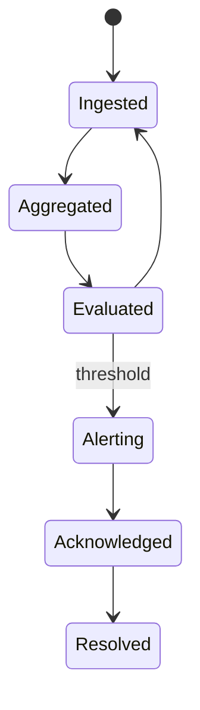

<a id="ucos-mon-000001-workflows"></a>
##### Workflows

- collect → validate schema → aggregate → evaluate thresholds → raise alerts → route to responders

<a id="ucos-mon-000001-authorities"></a>
##### Authorities

- Monitoring Authority (infrastructure); alert routing follows on-call authority in the acting jurisdiction.

<a id="ucos-mon-000001-permissions"></a>
##### Permissions

- mon.ingest (authorized collector)
- mon.alert (system)
- mon.read (context-scoped)

<a id="ucos-mon-000001-privacy-model"></a>
##### Privacy Model

Logs are the highest leak risk — personal data in logs is minimized by policy and scanned for violations.

<a id="ucos-mon-000001-audit-model"></a>
##### Audit Model

Monitoring is itself audited — alert response times and silence windows are recorded.

<a id="ucos-mon-000001-digital-twin-model"></a>
##### Digital Twin Model

Monitoring twin tracks signal coverage — a blind spot is a monitored condition, ironically and deliberately.

<a id="ucos-mon-000001-agent-model"></a>
##### Agent Model

Monitoring agent detects anomalies beyond static thresholds and auto-correlates alert storms.

<a id="ucos-mon-000001-runtime-model"></a>
##### Runtime Model

Ingest is high-throughput with backpressure; evaluation is stream-based with windowed aggregation.

<a id="ucos-mon-000001-scaling-model"></a>
##### Scaling Model

Signals partition by source; aggregation fans out by metric; retention is tiered per policy.

<a id="ucos-mon-000001-multi-tenant-model"></a>
##### Multi-Tenant Model

Signals are tenant-scoped; platform-level monitoring uses anonymized aggregates only.

<a id="ucos-mon-000001-geo-distribution-model"></a>
##### Geo-Distribution Model

Regional monitoring respects residency — signals stay in-jurisdiction, alerts route globally.

<a id="ucos-mon-000001-failure-model"></a>
##### Failure Model

Signal loss, alert fatigue, aggregation lag, false-negative blind spot.

<a id="ucos-mon-000001-recovery-model"></a>
##### Recovery Model

Signals replay from the Observation log; alert state rebuilds from evaluations.

<a id="ucos-mon-000001-certification-model"></a>
##### Certification Model

Critical capabilities must prove their signals reach monitoring — unmonitored critical paths fail certification.

<a id="ucos-mon-000001-migration-model"></a>
##### Migration Model

New signal types are registry additions.

<a id="ucos-mon-000001-implementation-blueprint"></a>
##### Implementation Blueprint

Build order for MON: (1) define registry entries — this domain owns by signal: metric / log / trace / event / profiling / real-user as registry truth, not code; (2) implement the contract surface first (mon.ingest, mon.alert, mon.acknowledge) and validate against MON boundaries; (3) event-source all state so history is reconstructable; (4) wire the enforcement points — authority check, policy guard, evidence binding, trace — in-line, with no bypass path; (5) add tests per the Testing Architecture, citing evidence per gate; (6) obtain Verification and Certification before activation. Acceptance: the Zero Partial and Law 001 audits pass, every action answers the seven explainability questions, and this domain mutates no other domain internals.

<a id="ucos-mon-000001-sequence-diagrams"></a>
##### Sequence Diagrams

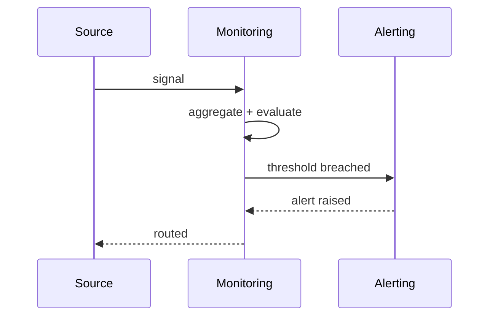

<a id="ucos-mon-000001-state-diagrams"></a>
##### State Diagrams

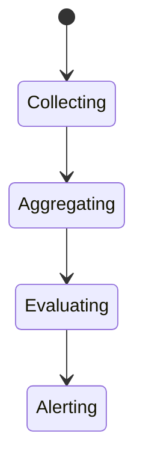

<a id="ucos-obsv-000001"></a>
#### UCOS-OBSV-000001 · Observability Architecture

Owner [Operations](#d-ops) · managed in `_registry/manifest.json` → `UCOS-OBSV-000001`, content `_registry/content-sec-ops-dep-qlt.json` → `OBSV` · inherits the [standard contract](../UCOS-MASTER.md#standard-contract)

<a id="ucos-obsv-000001-concepts"></a>
##### Concepts

Observability Architecture answers 'why is this happening?' — not just 'is it up?'. Traces, structured logs, metrics, evidence, and explanations are correlated across every domain so any behavior is reconstructable end-to-end.

<a id="ucos-obsv-000001-ontology"></a>
##### Ontology

Observability has Spans (units of work), Context propagation (trace identity), Correlation (causation + correlation ids), and Explanation (the seven questions). It is the introspection layer of a self-explaining system.

<a id="ucos-obsv-000001-taxonomy"></a>
##### Taxonomy

By output: Trace / Log / Metric / Evidence / Explanation. By depth: Request-level / Flow-level / System-level / Business-level. By audience: Engineer / Operator / Auditor / Regulator / Subject.

<a id="ucos-obsv-000001-data-model"></a>
##### Data Model

```yaml
TraceSpan:
  spanId: <Identity>
  traceId: <Identity>
  parentSpanId: <Identity|null>
  domain: <Domain>
  action: <registry action>
  authority: <Authority>
  policyVersion: <version>
  evidence: [<Evidence>]
  temporal: {startedAt, endedAt}
  context: <Context>
  explanation: <the seven questions>
```

<a id="ucos-obsv-000001-graph-model"></a>
##### Graph Model

(:Span)-[:CHILD_OF]->(:Span); (:Span)-[:IN_DOMAIN]->(:Domain); (:Span)-[:EVIDENCED_BY]->(:Evidence); (:Span)-[:EXPLAINS]->(:Action)

<a id="ucos-obsv-000001-apis"></a>
##### APIs

- POST /obs.v1.span
- GET  /obs.v1/trace/{traceId}
- GET  /obs.v1/explain/{traceId}
- POST /obs.v1.correlate

<a id="ucos-obsv-000001-events"></a>
##### Events

- SpanOpened
- SpanClosed
- TraceComplete
- ExplanationRequested
- CorrelationFound

<a id="ucos-obsv-000001-commands"></a>
##### Commands

- obs.span.open
- obs.span.close
- obs.explain
- obs.correlate

<a id="ucos-obsv-000001-queries"></a>
##### Queries

- obs.trace
- obs.explanation
- obs.criticalPaths
- obs.blindSpots

<a id="ucos-obsv-000001-state-machines"></a>
##### State Machines

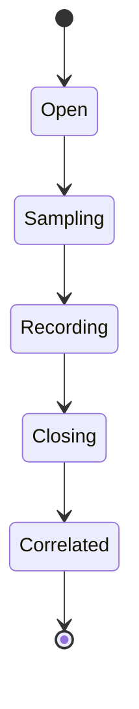

<a id="ucos-obsv-000001-workflows"></a>
##### Workflows

- open span with context → propagate trace identity → record evidence at each stage → close → correlate across domains → explain

<a id="ucos-obsv-000001-authorities"></a>
##### Authorities

- Observability Authority (infrastructure); explanations are governed artifacts, not informal notes.

<a id="ucos-obsv-000001-permissions"></a>
##### Permissions

- obs.span (any domain, its own)
- obs.read (context-scoped, auditor-elevated)
- obs.explain (any stakeholder)

<a id="ucos-obsv-000001-privacy-model"></a>
##### Privacy Model

Trace contents are minimized; personal data in spans is policy-prohibited and violation-scanned.

<a id="ucos-obsv-000001-audit-model"></a>
##### Audit Model

The trace IS the audit artifact — causation chains reconstruct any decision with authority and evidence.

<a id="ucos-obsv-000001-digital-twin-model"></a>
##### Digital Twin Model

Observability twin monitors trace completeness — an untraced critical path is a defect, flagged automatically.

<a id="ucos-obsv-000001-agent-model"></a>
##### Agent Model

Observability agent detects trace gaps and correlates anomalies across domains into explanations.

<a id="ucos-obsv-000001-runtime-model"></a>
##### Runtime Model

Context propagation is mandatory across every boundary; sampling is governed by policy with critical-path always-on.

<a id="ucos-obsv-000001-scaling-model"></a>
##### Scaling Model

Trace volume is high — sampling by policy, full retention for critical tiers, tiered storage otherwise.

<a id="ucos-obsv-000001-multi-tenant-model"></a>
##### Multi-Tenant Model

Traces are tenant-scoped; cross-tenant traces exist only in marketplace flows with both authorities.

<a id="ucos-obsv-000001-geo-distribution-model"></a>
##### Geo-Distribution Model

Trace residency follows the data's jurisdiction; cross-region correlation respects sovereignty.

<a id="ucos-obsv-000001-failure-model"></a>
##### Failure Model

Trace context loss, span drop, correlation gap, explanation void.

<a id="ucos-obsv-000001-recovery-model"></a>
##### Recovery Model

Traces are Observations — replayable; the Observation log is the source of reconstruction.

<a id="ucos-obsv-000001-certification-model"></a>
##### Certification Model

Every governed action must be traceable end-to-end — an untraceable action is unconstitutional.

<a id="ucos-obsv-000001-migration-model"></a>
##### Migration Model

New span types are registry additions.

<a id="ucos-obsv-000001-implementation-blueprint"></a>
##### Implementation Blueprint

Build order for OBSV: (1) define registry entries — this domain owns by output: trace / log / metric / evidence / explanation as registry truth, not code; (2) implement the contract surface first (obs.span.open, obs.span.close, obs.explain) and validate against OBSV boundaries; (3) event-source all state so history is reconstructable; (4) wire the enforcement points — authority check, policy guard, evidence binding, trace — in-line, with no bypass path; (5) add tests per the Testing Architecture, citing evidence per gate; (6) obtain Verification and Certification before activation. Acceptance: the Zero Partial and Law 001 audits pass, every action answers the seven explainability questions, and this domain mutates no other domain internals.

<a id="ucos-obsv-000001-sequence-diagrams"></a>
##### Sequence Diagrams

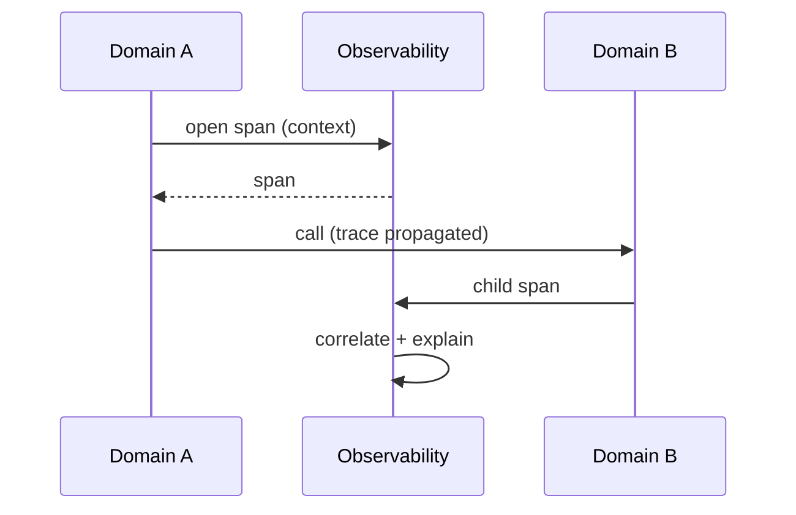

<a id="ucos-obsv-000001-state-diagrams"></a>
##### State Diagrams

```mermaid
stateDiagram-v2
    [*] --> Propagating
    Propagating --> Spanning
    Spanning --> Evidencing
    Evidencing --> Explaining
```

<a id="ucos-dr-000001"></a>
#### UCOS-DR-000001 · Disaster Recovery Architecture

Owner [Operations](#d-ops) · managed in `_registry/manifest.json` → `UCOS-DR-000001`, content `_registry/content-sec-ops-dep-qlt.json` → `DR` · inherits the [standard contract](../UCOS-MASTER.md#standard-contract)

<a id="ucos-dr-000001-concepts"></a>
##### Concepts

Disaster Recovery Architecture ensures the constitution survives the worst. Recovery is rehearsed, measured, and governed — RTO and RPO are promises backed by tested procedure, not entries in a spreadsheet.

<a id="ucos-dr-000001-ontology"></a>
##### Ontology

DR has Scenarios (registry), Impact analyses (per capability tier), Recovery objectives (RTO/RPO), Failover paths (governed), and Rehearsal records. Truth is the registry — recovering it is recovering everything.

<a id="ucos-dr-000001-taxonomy"></a>
##### Taxonomy

By scenario: Region-loss / Cloud-loss / Data-corruption / Key-compromise / Supply-chain / Pandemic-capacity. By tier: Tier-0 immediate / Tier-1 hours / Tier-2 days / Tier-3 best-effort. By mechanism: Failover / Restore / Re-derive / Rebuild.

<a id="ucos-dr-000001-data-model"></a>
##### Data Model

```yaml
DRPlan:
  planId: <Identity>
  scenario: <registry id>
  capability: <capability>
  tier: <registry level>
  objectives: {rto, rpo}
  failoverPath: [<governed step>]
  rehearsal: {lastAt, result, nextDue}
  policy: <Policy>
```

<a id="ucos-dr-000001-graph-model"></a>
##### Graph Model

(:Plan)-[:PROTECTS]->(:Capability); (:Plan)-[:RESPONDS_TO]->(:Scenario); (:Plan)-[:REHEARSED_IN]->(:Rehearsal); (:Plan)-[:GOVERNED_BY]->(:Policy)

<a id="ucos-dr-000001-apis"></a>
##### APIs

- GET  /dr.v1/plans
- POST /dr.v1/rehearse
- POST /dr.v1/failover
- GET  /dr.v1/rehearsals

<a id="ucos-dr-000001-events"></a>
##### Events

- RehearsalStarted
- RehearsalCompleted
- FailoverInitiated
- FailoverCompleted
- FailbackCompleted
- DRGapDetected

<a id="ucos-dr-000001-commands"></a>
##### Commands

- dr.rehearse
- dr.failover
- dr.failback
- dr.declare-incident

<a id="ucos-dr-000001-queries"></a>
##### Queries

- dr.plans
- dr.coverage
- dr.rehearsals
- dr.gaps

<a id="ucos-dr-000001-state-machines"></a>
##### State Machines

```mermaid
stateDiagram-v2
    [*] --> Ready
    Ready --> Rehearsing
    Rehearsing --> Ready: passed
    Rehearsing --> GapFound
    GapFound --> Ready: remediated
    Ready --> FailingOver: incident
    FailingOver --> DegradedOperation
    DegradedOperation --> FailingBack
    FailingBack --> Ready
```

<a id="ucos-dr-000001-workflows"></a>
##### Workflows

- declare plan per capability → rehearse on schedule → record results → on incident: failover under governance → failback when stable

<a id="ucos-dr-000001-authorities"></a>
##### Authorities

- DR Authority (failover decision); incident declaration escalates to governance authority.

<a id="ucos-dr-000001-permissions"></a>
##### Permissions

- dr.rehearse (dr authority)
- dr.failover (dr authority or automated under policy)
- dr.read (any)

<a id="ucos-dr-000001-privacy-model"></a>
##### Privacy Model

Recovery of personal data must recover consent state too — partial recovery that loses consent bindings is a violation.

<a id="ucos-dr-000001-audit-model"></a>
##### Audit Model

Every rehearsal and failover is a fully recorded incident with timeline, decisions, and evidence.

<a id="ucos-dr-000001-digital-twin-model"></a>
##### Digital Twin Model

DR twin simulates scenarios continuously against live topology — coverage gaps surface before disaster.

<a id="ucos-dr-000001-agent-model"></a>
##### Agent Model

DR agent detects unrehearsed plans and overdue rehearsals, blocking certification drift.

<a id="ucos-dr-000001-runtime-model"></a>
##### Runtime Model

Failover is governed: health-checked, staged, and reversible. Registry truth re-derives projections on the target.

<a id="ucos-dr-000001-scaling-model"></a>
##### Scaling Model

DR scales with the platform — each domain's recovery is its own plan, coordinated by DR policy.

<a id="ucos-dr-000001-multi-tenant-model"></a>
##### Multi-Tenant Model

Tenant recovery is isolated; platform recovery never depends on a single tenant's state.

<a id="ucos-dr-000001-geo-distribution-model"></a>
##### Geo-Distribution Model

Regional loss is the canonical scenario — sovereignty may constrain failover targets, and plans encode that constraint.

<a id="ucos-dr-000001-failure-model"></a>
##### Failure Model

Unrehearsed plan, failover target unavailable, split-brain, rehearsal-failure-ignored.

<a id="ucos-dr-000001-recovery-model"></a>
##### Recovery Model

Unrehearsed paths are assumed broken — a plan without a current rehearsal is a gap, not a plan.

<a id="ucos-dr-000001-certification-model"></a>
##### Certification Model

Every tier-0/1 capability must have a rehearsed plan within policy window.

<a id="ucos-dr-000001-migration-model"></a>
##### Migration Model

New scenarios are registry additions.

<a id="ucos-dr-000001-implementation-blueprint"></a>
##### Implementation Blueprint

Build order for DR: (1) define registry entries — this domain owns by scenario: region-loss / cloud-loss / data-corruption / key-compromise / supply-chain / pandemic-capacity as registry truth, not code; (2) implement the contract surface first (dr.rehearse, dr.failover, dr.failback) and validate against DR boundaries; (3) event-source all state so history is reconstructable; (4) wire the enforcement points — authority check, policy guard, evidence binding, trace — in-line, with no bypass path; (5) add tests per the Testing Architecture, citing evidence per gate; (6) obtain Verification and Certification before activation. Acceptance: the Zero Partial and Law 001 audits pass, every action answers the seven explainability questions, and this domain mutates no other domain internals.

<a id="ucos-dr-000001-sequence-diagrams"></a>
##### Sequence Diagrams

```mermaid
sequenceDiagram
    participant I as Incident Trigger
    participant DR as DR
    participant A as Authority
    I->>DR: scenario detected
    DR->>A: declare incident
    A-->>DR: failover approved
    DR->>DR: staged failover
    DR->>DR: verify + failback when stable
```

<a id="ucos-dr-000001-state-diagrams"></a>
##### State Diagrams

```mermaid
stateDiagram-v2
    [*] --> Detecting
    Detecting --> Declaring
    Declaring --> FailingOver
    FailingOver --> Stabilizing
    Stabilizing --> Recovering
```

<a id="ucos-bcp-000001"></a>
#### UCOS-BCP-000001 · Business Continuity Architecture

Owner [Operations](#d-ops) · managed in `_registry/manifest.json` → `UCOS-BCP-000001`, content `_registry/content-sec-ops-dep-qlt.json` → `BCP` · inherits the [standard contract](../UCOS-MASTER.md#standard-contract)

<a id="ucos-bcp-000001-concepts"></a>
##### Concepts

Business Continuity Architecture keeps the mission running when the platform can't be at full strength. Continuity is degraded operation under governance — explicit degraded modes, not silent feature-drops.

<a id="ucos-bcp-000001-ontology"></a>
##### Ontology

BCP has Continuity tiers (what must survive), Degraded modes (how it runs reduced), Governance-in-degradation (who decides), and Restoration paths (how it returns to full).

<a id="ucos-bcp-000001-taxonomy"></a>
##### Taxonomy

By degradation: Read-only / Regional-isolation / Reduced-fidelity / Queue-and-defer / Manual-fallback. By duration: Minutes / Hours / Days / Weeks. By scope: Single-capability / Regional / Platform-wide.

<a id="ucos-bcp-000001-data-model"></a>
##### Data Model

```yaml
ContinuityPlan:
  planId: <Identity>
  capability: <capability>
  degradedMode: <registry id>
  triggerConditions: [<registry expression>]
  governanceDelegation: <Authority>
  restorationPath: [<step>]
  temporal: {maxDuration}
  policy: <Policy>
```

<a id="ucos-bcp-000001-graph-model"></a>
##### Graph Model

(:Plan)-[:PROTECTS]->(:Capability); (:Plan)-[:DEGRADES_TO]->(:Mode); (:Plan)-[:DELEGATES_TO]->(:Authority); (:Plan)-[:RESTORES_VIA]->(:Step)

<a id="ucos-bcp-000001-apis"></a>
##### APIs

- GET  /bcp.v1/plans
- POST /bcp.v1/degrade
- POST  /bcp.v1/restore
- GET  /bcp.v1/modes

<a id="ucos-bcp-000001-events"></a>
##### Events

- DegradedModeEntered
- DegradedModeExited
- ContinuityRehearsed
- ContinuityBreach

<a id="ucos-bcp-000001-commands"></a>
##### Commands

- bcp.degrade
- bcp.restore
- bcp.rehearse
- bcp.declare

<a id="ucos-bcp-000001-queries"></a>
##### Queries

- bcp.plans
- bcp.modes
- bcp.active
- bcp.rehearsals

<a id="ucos-bcp-000001-state-machines"></a>
##### State Machines

```mermaid
stateDiagram-v2
    [*] --> Full
    Full --> Degraded: trigger
    Degraded --> Full: restored
    Degraded --> Critical: exceeds maxDuration
    Critical --> Manual: human governance
    Manual --> Full
```

<a id="ucos-bcp-000001-workflows"></a>
##### Workflows

- detect trigger → enter governed degraded mode → notify stakeholders → restore under plan → exit with evidence

<a id="ucos-bcp-000001-authorities"></a>
##### Authorities

- BCP Authority (degradation decision); critical degradations escalate to human governance.

<a id="ucos-bcp-000001-permissions"></a>
##### Permissions

- bcp.degrade (bcp authority)
- bcp.restore (bcp authority)
- bcp.read (any)

<a id="ucos-bcp-000001-privacy-model"></a>
##### Privacy Model

Degraded modes must not silently widen personal-data use — privacy holds even when convenience can't.

<a id="ucos-bcp-000001-audit-model"></a>
##### Audit Model

Every degradation and restoration is recorded with trigger, duration, decisions, and evidence.

<a id="ucos-bcp-000001-digital-twin-model"></a>
##### Digital Twin Model

Continuity twin monitors degradation duration against plan limits — overruns are breaches.

<a id="ucos-bcp-000001-agent-model"></a>
##### Agent Model

BCP agent detects approaching triggers and proposes early degradation to avoid hard failure.

<a id="ucos-bcp-000001-runtime-model"></a>
##### Runtime Model

Degraded modes are declared, not emergent — the system says 'I am degraded' to consumers honestly.

<a id="ucos-bcp-000001-scaling-model"></a>
##### Scaling Model

Continuity plans scale per capability; coordination is via BCP policy across domains.

<a id="ucos-bcp-000001-multi-tenant-model"></a>
##### Multi-Tenant Model

Tenant degradation is isolated; platform degradation notifies affected tenants under transparency policy.

<a id="ucos-bcp-000001-geo-distribution-model"></a>
##### Geo-Distribution Model

Regional isolation is a first-class degraded mode — sovereignty-compatible by construction.

<a id="ucos-bcp-000001-failure-model"></a>
##### Failure Model

Silent degradation, overrun without escalation, restoration data loss, mode conflict.

<a id="ucos-bcp-000001-recovery-model"></a>
##### Recovery Model

Restoration is verified — returning to full requires evidence of consistency, not just uptime.

<a id="ucos-bcp-000001-certification-model"></a>
##### Certification Model

Critical capabilities must have declared degraded modes with rehearsed entry and exit.

<a id="ucos-bcp-000001-migration-model"></a>
##### Migration Model

New modes are registry additions.

<a id="ucos-bcp-000001-implementation-blueprint"></a>
##### Implementation Blueprint

Build order for BCP: (1) define registry entries — this domain owns by degradation: read-only / regional-isolation / reduced-fidelity / queue-and-defer / manual-fallback as registry truth, not code; (2) implement the contract surface first (bcp.degrade, bcp.restore, bcp.rehearse) and validate against BCP boundaries; (3) event-source all state so history is reconstructable; (4) wire the enforcement points — authority check, policy guard, evidence binding, trace — in-line, with no bypass path; (5) add tests per the Testing Architecture, citing evidence per gate; (6) obtain Verification and Certification before activation. Acceptance: the Zero Partial and Law 001 audits pass, every action answers the seven explainability questions, and this domain mutates no other domain internals.

<a id="ucos-bcp-000001-sequence-diagrams"></a>
##### Sequence Diagrams

```mermaid
sequenceDiagram
    participant T as Trigger
    participant BC as BCP
    participant S as Stakeholders
    T->>BC: condition met
    BC->>BC: enter degraded mode
    BC->>S: notify honestly
    BC->>BC: restore under plan
    BC->>S: restored + evidence
```

<a id="ucos-bcp-000001-state-diagrams"></a>
##### State Diagrams

```mermaid
stateDiagram-v2
    [*] --> Monitoring
    Monitoring --> Triggered
    Triggered --> Degrading
    Degrading --> Restoring
    Restoring --> Full
```

<a id="ucos-dep-000001"></a>
#### UCOS-DEP-000001 · Deployment Architecture

Owner [Operations](#d-ops) · managed in `_registry/manifest.json` → `UCOS-DEP-000001`, content `_registry/content-sec-ops-dep-qlt.json` → `DEP` · inherits the [standard contract](../UCOS-MASTER.md#standard-contract)

<a id="ucos-dep-000001-concepts"></a>
##### Concepts

Deployment Architecture ships governed change. Every deployment is a versioned, policy-checked, reversible projection of the registry — the same machinery that evolves the platform is what deploys it.

<a id="ucos-dep-000001-ontology"></a>
##### Ontology

Deployment has an Artifact (content-addressed), a Target (registry-defined environment), a Policy (gate requirements), and a Rollback path. There is no out-of-band deployment path — every change is a governed event.

<a id="ucos-dep-000001-taxonomy"></a>
##### Taxonomy

By strategy: Canary / Blue-green / Rolling / Feature-flagged / Atomic. By target: Region / Cloud / Edge / On-prem / Sovereign. By risk: Standard / Gated / Frozen-window / Emergency.

<a id="ucos-dep-000001-data-model"></a>
##### Data Model

```yaml
Deployment:
  deploymentId: <Identity>
  artifact: <content-addressed ref>
  target: <registry environment>
  strategy: <registry id>
  policyVersion: <version>
  state: <registry state>
  rollbackTo: <Deployment|null>
  temporal: {at}
  evidence: [<Evidence>]
```

<a id="ucos-dep-000001-graph-model"></a>
##### Graph Model

(:Deployment)-[:OF]->(:Artifact); (:Deployment)-[:TO]->(:Environment); (:Deployment)-[:GATED_BY]->(:Policy); (:Deployment)-[:ROLLS_BACK_TO]->(:Deployment)

<a id="ucos-dep-000001-apis"></a>
##### APIs

- POST /dep.v1.deploy
- GET  /dep.v1/{id}
- POST /dep.v1.rollback
- GET  /dep.v1.status/{id}

<a id="ucos-dep-000001-events"></a>
##### Events

- DeploymentStarted
- DeploymentPromoted
- DeploymentCompleted
- DeploymentRolledBack
- DeploymentFrozen
- GateFailed

<a id="ucos-dep-000001-commands"></a>
##### Commands

- dep.deploy
- dep.promote
- dep.rollback
- dep.freeze

<a id="ucos-dep-000001-queries"></a>
##### Queries

- dep.history
- dep.active
- dep.byTarget
- dep.blocked

<a id="ucos-dep-000001-state-machines"></a>
##### State Machines

```mermaid
stateDiagram-v2
    [*] --> Validated
    Validated --> Gated
    Gated --> Deploying
    Deploying --> Canary
    Canary --> Promoted
    Canary --> RolledBack
    Promoted --> Completed
    Completed --> [*]
```

<a id="ucos-dep-000001-workflows"></a>
##### Workflows

- validate artifact → evaluate gates (tests, policy, certificates) → deploy canary → observe → promote or rollback

<a id="ucos-dep-000001-authorities"></a>
##### Authorities

- Deployment Authority (promote); rollback is available to on-call under policy.

<a id="ucos-dep-000001-permissions"></a>
##### Permissions

- dep.deploy (deployment authority)
- dep.rollback (on-call under policy)
- dep.read (any)

<a id="ucos-dep-000001-privacy-model"></a>
##### Privacy Model

Deployments touching personal-data paths require privacy-gate pass — no shipping around privacy.

<a id="ucos-dep-000001-audit-model"></a>
##### Audit Model

Every deployment and rollback is evidence-backed with gate results and artifact hashes.

<a id="ucos-dep-000001-digital-twin-model"></a>
##### Digital Twin Model

Deployment twin tracks failure rates per target and strategy, feeding reliability budgets.

<a id="ucos-dep-000001-agent-model"></a>
##### Agent Model

Deployment agent observes canary metrics and auto-promotes or rolls back within policy bounds.

<a id="ucos-dep-000001-runtime-model"></a>
##### Runtime Model

Artifacts are immutable and content-addressed; the runtime loads by hash — 'what's running' is always answerable.

<a id="ucos-dep-000001-scaling-model"></a>
##### Scaling Model

Deployments fan out per target region under sovereignty constraints.

<a id="ucos-dep-000001-multi-tenant-model"></a>
##### Multi-Tenant Model

Platform deployment is separate from tenant configuration; tenants evolve via registry, not deploys.

<a id="ucos-dep-000001-geo-distribution-model"></a>
##### Geo-Distribution Model

Regional deployments respect sovereignty — some targets only accept sovereign artifacts.

<a id="ucos-dep-000001-failure-model"></a>
##### Failure Model

Gate bypass, canary blindness, rollback failure, version skew across regions.

<a id="ucos-dep-000001-recovery-model"></a>
##### Recovery Model

Rollback is first-class and rehearsed; the artifact registry guarantees the previous version is retrievable.

<a id="ucos-dep-000001-certification-model"></a>
##### Certification Model

Every gate must pass — a bypassed gate fails certification for the artifact and the process.

<a id="ucos-dep-000001-migration-model"></a>
##### Migration Model

New strategies and targets are registry additions.

<a id="ucos-dep-000001-implementation-blueprint"></a>
##### Implementation Blueprint

Build order for DEP: (1) define registry entries — this domain owns by strategy: canary / blue-green / rolling / feature-flagged / atomic as registry truth, not code; (2) implement the contract surface first (dep.deploy, dep.promote, dep.rollback) and validate against DEP boundaries; (3) event-source all state so history is reconstructable; (4) wire the enforcement points — authority check, policy guard, evidence binding, trace — in-line, with no bypass path; (5) add tests per the Testing Architecture, citing evidence per gate; (6) obtain Verification and Certification before activation. Acceptance: the Zero Partial and Law 001 audits pass, every action answers the seven explainability questions, and this domain mutates no other domain internals.

<a id="ucos-dep-000001-sequence-diagrams"></a>
##### Sequence Diagrams

```mermaid
sequenceDiagram
    participant A as Artifact
    participant DE as Deployment
    participant G as Gates
    A->>DE: deploy request
    DE->>G: tests + policy + certificates
    G-->>DE: passed
    DE->>DE: canary
    DE->>DE: observe
    DE-->>A: promoted or rolled back
```

<a id="ucos-dep-000001-state-diagrams"></a>
##### State Diagrams

```mermaid
stateDiagram-v2
    [*] --> Validating
    Validating --> Gating
    Gating --> Canaries
    Canaries --> Observing
    Observing --> Promoting
```

<a id="ucos-cld-000001"></a>
#### UCOS-CLD-000001 · Multi-Cloud Architecture

Owner [Operations](#d-ops) · managed in `_registry/manifest.json` → `UCOS-CLD-000001`, content `_registry/content-sec-ops-dep-qlt.json` → `CLD` · inherits the [standard contract](../UCOS-MASTER.md#standard-contract)

<a id="ucos-cld-000001-concepts"></a>
##### Concepts

Multi-Cloud Architecture makes the platform cloud-agnostic by constitutional design. Clouds are registry-defined targets — capabilities are cloud-portable, sovereignty is per-target, and no vendor feature is ever a dependency.

<a id="ucos-cld-000001-ontology"></a>
##### Ontology

Cloud has a Provider (registry), a Capability mapping (platform capability → cloud service), a Sovereignty binding, and an Exit path. Every capability has at least one portable implementation and a documented exit.

<a id="ucos-cld-000001-taxonomy"></a>
##### Taxonomy

By portability: Portable / Adapter-wrapped / Vendor-specific (discouraged). By sovereignty: General / Sovereign-certified / Air-gapped. By usage: Primary / Failover / Burst / Niche.

<a id="ucos-cld-000001-data-model"></a>
##### Data Model

```yaml
CloudTarget:
  targetId: <Identity>
  provider: <registry id>
  capabilities: [{platformCapability, cloudService, portabilityClass}]
  sovereignty: <registry id>
  exitPath: <governed procedure>
  temporal: {onboardedAt}
```

<a id="ucos-cld-000001-graph-model"></a>
##### Graph Model

(:Target)-[:PROVIDES]->(:CloudService); (:CloudService)-[:IMPLEMENTS]->(:Capability); (:Target)-[:SOVEREIGN_UNDER]->(:Jurisdiction); (:Target)-[:EXIT_VIA]->(:Procedure)

<a id="ucos-cld-000001-apis"></a>
##### APIs

- GET  /cloud.v1/targets
- POST /cloud.v1/onboard
- GET  /cloud.v1/mapping/{capabilityId}
- POST /cloud.v1.exit-plan

<a id="ucos-cld-000001-events"></a>
##### Events

- CloudOnboarded
- CloudRetired
- CapabilityMapped
- ExitExecuted
- PortabilityViolation

<a id="ucos-cld-000001-commands"></a>
##### Commands

- cloud.onboard
- cloud.retire
- cloud.map
- cloud.exit

<a id="ucos-cld-000001-queries"></a>
##### Queries

- cloud.targets
- cloud.portability
- cloud.sovereign
- cloud.exitPaths

<a id="ucos-cld-000001-state-machines"></a>
##### State Machines

```mermaid
stateDiagram-v2
    [*] --> Candidate
    Candidate --> Onboarded: gates pass
    Onboarded --> Active
    Active --> Retiring
    Retiring --> Exited
    Exited --> [*]
```

<a id="ucos-cld-000001-workflows"></a>
##### Workflows

- onboard under gates → map capabilities to services → bind sovereignty → keep exit path tested → retire cleanly

<a id="ucos-cld-000001-authorities"></a>
##### Authorities

- Cloud Authority (onboarding); exit requires governance approval and a tested path.

<a id="ucos-cld-000001-permissions"></a>
##### Permissions

- cloud.onboard (cloud authority)
- cloud.map (capability owner)
- cloud.exit (governance)

<a id="ucos-cld-000001-privacy-model"></a>
##### Privacy Model

Each target carries its own privacy gates — personal data only goes where its bindings permit.

<a id="ucos-cld-000001-audit-model"></a>
##### Audit Model

Every capability mapping records portability class — vendor-specific dependencies are audited liabilities.

<a id="ucos-cld-000001-digital-twin-model"></a>
##### Digital Twin Model

Cloud twin monitors capability coverage and exit-path freshness across targets.

<a id="ucos-cld-000001-agent-model"></a>
##### Agent Model

Cloud agent detects vendor lock-in drift and proposes adapter migration before exit becomes painful.

<a id="ucos-cld-000001-runtime-model"></a>
##### Runtime Model

Capability resolution goes through the registry mapping — code never names a cloud service directly.

<a id="ucos-cld-000001-scaling-model"></a>
##### Scaling Model

Burst across clouds is a governed strategy, not an emergency act.

<a id="ucos-cld-000001-multi-tenant-model"></a>
##### Multi-Tenant Model

Tenants select targets under their sovereignty constraints; the platform enforces binding compatibility.

<a id="ucos-cld-000001-geo-distribution-model"></a>
##### Geo-Distribution Model

Sovereign clouds are first-class targets with their own certification path.

<a id="ucos-cld-000001-failure-model"></a>
##### Failure Model

Vendor-specific drift, unmapped capability, exit-path staleness, sovereignty conflict.

<a id="ucos-cld-000001-recovery-model"></a>
##### Recovery Model

Exit is a rehearsed procedure — a cloud loss is a failover to a mapped target, not a crisis.

<a id="ucos-cld-000001-certification-model"></a>
##### Certification Model

Every capability must declare portability class; vendor-specific use requires governance waiver.

<a id="ucos-cld-000001-migration-model"></a>
##### Migration Model

New providers are registry additions — onboarding never touches platform code.

<a id="ucos-cld-000001-implementation-blueprint"></a>
##### Implementation Blueprint

Build order for CLD: (1) define registry entries — this domain owns by portability: portable / adapter-wrapped / vendor-specific (discouraged) as registry truth, not code; (2) implement the contract surface first (cloud.onboard, cloud.retire, cloud.map) and validate against CLD boundaries; (3) event-source all state so history is reconstructable; (4) wire the enforcement points — authority check, policy guard, evidence binding, trace — in-line, with no bypass path; (5) add tests per the Testing Architecture, citing evidence per gate; (6) obtain Verification and Certification before activation. Acceptance: the Zero Partial and Law 001 audits pass, every action answers the seven explainability questions, and this domain mutates no other domain internals.

<a id="ucos-cld-000001-sequence-diagrams"></a>
##### Sequence Diagrams

```mermaid
sequenceDiagram
    participant GO as Governance
    participant CL as Cloud
    participant CP as Capability
    GO->>CL: onboard provider
    CL->>CP: map capabilities
    CP-->>CL: mapping
    CL->>CL: bind sovereignty + test exit
    CL-->>GO: Onboarded
```

<a id="ucos-cld-000001-state-diagrams"></a>
##### State Diagrams

```mermaid
stateDiagram-v2
    [*] --> Gating
    Gating --> Mapping
    Mapping --> SovereigntyBinding
    SovereigntyBinding --> Active
```

<a id="ucos-edg-000001"></a>
#### UCOS-EDG-000001 · Edge Architecture

Owner [Operations](#d-ops) · managed in `_registry/manifest.json` → `UCOS-EDG-000001`, content `_registry/content-sec-ops-dep-qlt.json` → `EDG` · inherits the [standard contract](../UCOS-MASTER.md#standard-contract)

<a id="ucos-edg-000001-concepts"></a>
##### Concepts

Edge Architecture runs governed computation where latency, sovereignty, or connectivity demand it. The edge is not a lesser platform — it is the same constitution, projected smaller, with bounded autonomy.

<a id="ucos-edg-000001-ontology"></a>
##### Ontology

Edge has a Node (registry), a Capability subset (declared), a Sync model (eventually consistent with hub), an Autonomy bound (what it may decide offline), and a Sovereignty binding (local jurisdiction).

<a id="ucos-edg-000001-taxonomy"></a>
##### Taxonomy

By form: Device / Appliance / Micro-datacenter / Regional-edge / On-prem. By connectivity: Always-on / Intermittent / Air-gapped. By autonomy: Full-offline / Bounded-offline / Online-only.

<a id="ucos-edg-000001-data-model"></a>
##### Data Model

```yaml
EdgeNode:
  nodeId: <Identity>
  form: <registry id>
  capabilities: [<registry capability>]
  syncModel: <registry id>
  autonomyBound: <Policy>
  sovereignty: <jurisdiction>
  temporal: {provisionedAt}
  state: <Provisioned|Syncing|Degraded|Quarantined>
```

<a id="ucos-edg-000001-graph-model"></a>
##### Graph Model

(:Node)-[:RUNS]->(:Capability); (:Node)-[:SYNCS_WITH]->(:Hub); (:Node)-[:BOUNDED_BY]->(:Policy); (:Node)-[:SOVEREIGN_UNDER]->(:Jurisdiction)

<a id="ucos-edg-000001-apis"></a>
##### APIs

- POST /edge.v1.provision
- GET  /edge.v1/{id}
- POST /edge.v1.sync
- POST /edge.v1.quarantine

<a id="ucos-edg-000001-events"></a>
##### Events

- EdgeProvisioned
- EdgeSynced
- EdgeDegraded
- EdgeQuarantined
- EdgeDecommissioned
- AutonomyExceeded

<a id="ucos-edg-000001-commands"></a>
##### Commands

- edge.provision
- edge.sync
- edge.quarantine
- edge.decommission

<a id="ucos-edg-000001-queries"></a>
##### Queries

- edge.nodes
- edge.capabilities
- edge.lag
- edge.degraded

<a id="ucos-edg-000001-state-machines"></a>
##### State Machines

```mermaid
stateDiagram-v2
    [*] --> Provisioned
    Provisioned --> Syncing
    Syncing --> InSync
    InSync --> Degraded: connectivity lost
    Degraded --> BoundedAutonomy: offline policy
    BoundedAutonomy --> Syncing: restored
    InSync --> Quarantined: violation
    Quarantined --> [*]
```

<a id="ucos-edg-000001-workflows"></a>
##### Workflows

- provision with capability subset → sync under model → operate with bounded autonomy when offline → reconcile on reconnect

<a id="ucos-edg-000001-authorities"></a>
##### Authorities

- Edge Authority (provisioning); local jurisdiction binds sovereignty.

<a id="ucos-edg-000001-permissions"></a>
##### Permissions

- edge.provision (edge authority)
- edge.sync (system)
- edge.quarantine (security authority)

<a id="ucos-edg-000001-privacy-model"></a>
##### Privacy Model

Edge personal data is minimized and locally sovereign — the edge holds only what its jurisdiction permits.

<a id="ucos-edg-000001-audit-model"></a>
##### Audit Model

Every offline decision is recorded locally and reconciled on sync — the edge is never an audit gap.

<a id="ucos-edg-000001-digital-twin-model"></a>
##### Digital Twin Model

Edge twin monitors sync lag and autonomy-bound breaches across the fleet.

<a id="ucos-edg-000001-agent-model"></a>
##### Agent Model

Edge agent detects autonomy-bound approaches and escalates before offline decisions exceed bounds.

<a id="ucos-edg-000001-runtime-model"></a>
##### Runtime Model

Offline operation is bounded by the policy envelope — the edge cannot exceed what its envelope permits, even disconnected.

<a id="ucos-edg-000001-scaling-model"></a>
##### Scaling Model

Edge nodes scale by the thousands; sync is sharded per node with backpressure.

<a id="ucos-edg-000001-multi-tenant-model"></a>
##### Multi-Tenant Model

Edge nodes serve tenants under their sovereignty bindings; a node's jurisdiction limits its tenants.

<a id="ucos-edg-000001-geo-distribution-model"></a>
##### Geo-Distribution Model

The edge IS the geo answer for sovereignty — data stays where the node physically sits.

<a id="ucos-edg-000001-failure-model"></a>
##### Failure Model

Split-brain on reconnect, sync conflict, autonomy exceedance, orphaned node.

<a id="ucos-edg-000001-recovery-model"></a>
##### Recovery Model

Reconciliation is governed: conflicts resolve by policy (never last-writer-wins for governed state); orphans are reaped or adopted.

<a id="ucos-edg-000001-certification-model"></a>
##### Certification Model

Every offline-capable edge must prove its autonomy bound is enforced — offline ≠ ungoverned.

<a id="ucos-edg-000001-migration-model"></a>
##### Migration Model

New edge forms are registry additions.

<a id="ucos-edg-000001-implementation-blueprint"></a>
##### Implementation Blueprint

Build order for EDG: (1) define registry entries — this domain owns by form: device / appliance / micro-datacenter / regional-edge / on-prem as registry truth, not code; (2) implement the contract surface first (edge.provision, edge.sync, edge.quarantine) and validate against EDG boundaries; (3) event-source all state so history is reconstructable; (4) wire the enforcement points — authority check, policy guard, evidence binding, trace — in-line, with no bypass path; (5) add tests per the Testing Architecture, citing evidence per gate; (6) obtain Verification and Certification before activation. Acceptance: the Zero Partial and Law 001 audits pass, every action answers the seven explainability questions, and this domain mutates no other domain internals.

<a id="ucos-edg-000001-sequence-diagrams"></a>
##### Sequence Diagrams

```mermaid
sequenceDiagram
    participant E as Edge
    participant H as Hub
    E->>H: sync
    H-->>E: delta
    E->>E: apply
    Note over E: connectivity lost
    E->>E: bounded autonomy
    E->>H: reconcile on restore
```

<a id="ucos-edg-000001-state-diagrams"></a>
##### State Diagrams

```mermaid
stateDiagram-v2
    [*] --> Provisioning
    Provisioning --> Syncing
    Syncing --> Serving
    Serving --> Reconciling
```

<a id="ucos-geo-000001"></a>
#### UCOS-GEO-000001 · Geo-Distribution Architecture

Owner [Operations](#d-ops) · managed in `_registry/manifest.json` → `UCOS-GEO-000001`, content `_registry/content-sec-ops-dep-qlt.json` → `GEO` · inherits the [standard contract](../UCOS-MASTER.md#standard-contract)

<a id="ucos-geo-000001-concepts"></a>
##### Concepts

Geo-Distribution Architecture places data and computation where law, latency, and resilience demand — by registry, not by accident. Distribution is a governed projection of sovereignty and performance requirements.

<a id="ucos-geo-000001-ontology"></a>
##### Ontology

Geo has Regions (registry), Placement policies (per data class), Replication topology (sovereignty-constrained), and Routing (context-aware). The same primitive may legitimately exist in many places under many jurisdictions.

<a id="ucos-geo-000001-taxonomy"></a>
##### Taxonomy

By driver: Latency / Sovereignty / Resilience / Cost. By topology: Primary-standby / Multi-master / Sovereign-isolated / Edge-augmented. By consistency: Strong-per-region / Eventual / Causal.

<a id="ucos-geo-000001-data-model"></a>
##### Data Model

```yaml
GeoPlacement:
  placementId: <Identity>
  dataClass: <registry id>
  primaryRegion: <registry region>
  replicaRegions: [<region with policy>]
  consistencyModel: <registry id>
  driver: <Latency|Sovereignty|Resilience|Cost>
  temporal: {effectiveFrom}
```

<a id="ucos-geo-000001-graph-model"></a>
##### Graph Model

(:Placement)-[:PLACES]->(:DataClass); (:Placement)-[:PRIMARY_IN]->(:Region); (:Placement)-[:REPLICATED_IN]->(:Region); (:Placement)-[:CONSTRAINED_BY]->(:Policy)

<a id="ucos-geo-000001-apis"></a>
##### APIs

- POST /geo.v1.place
- GET  /geo.v1/{id}
- POST /geo.v1.route
- GET  /geo.v1.placement/{dataClass}

<a id="ucos-geo-000001-events"></a>
##### Events

- PlacementDeclared
- GeoRebalanced
- TrafficRouted
- RelocationCompleted
- ResidencyDrift

<a id="ucos-geo-000001-commands"></a>
##### Commands

- geo.place
- geo.rebalance
- geo.route
- geo.relocate

<a id="ucos-geo-000001-queries"></a>
##### Queries

- geo.placements
- geo.regions
- geo.residency
- geo.topology

<a id="ucos-geo-000001-state-machines"></a>
##### State Machines

```mermaid
stateDiagram-v2
    [*] --> Declared
    Declared --> Placed
    Placed --> Replicating
    Replicating --> InService
    InService --> Rebalancing: policy trigger
    Rebalancing --> InService
```

<a id="ucos-geo-000001-workflows"></a>
##### Workflows

- classify data → declare placement under sovereignty → replicate per policy → route by context → rebalance on drift

<a id="ucos-geo-000001-authorities"></a>
##### Authorities

- Geo Authority (placement); jurisdiction authority constrains what may live where.

<a id="ucos-geo-000001-permissions"></a>
##### Permissions

- geo.place (geo authority + jurisdiction pass)
- geo.route (system)
- geo.read (governance)

<a id="ucos-geo-000001-privacy-model"></a>
##### Privacy Model

Placement is the physical guarantee behind privacy law — residency makes rights enforceable.

<a id="ucos-geo-000001-audit-model"></a>
##### Audit Model

Every placement and relocation logs class, regions, and policy — regulator-queryable.

<a id="ucos-geo-000001-digital-twin-model"></a>
##### Digital Twin Model

Geo twin monitors actual vs declared placement continuously — drift is an alert, not a surprise.

<a id="ucos-geo-000001-agent-model"></a>
##### Agent Model

Geo agent detects residency drift and proposes corrections before regulators do.

<a id="ucos-geo-000001-runtime-model"></a>
##### Runtime Model

Routing is context-aware: the request's jurisdiction participates in choosing the serving region.

<a id="ucos-geo-000001-scaling-model"></a>
##### Scaling Model

Regions scale independently; rebalancing is throttled to avoid thundering herds.

<a id="ucos-geo-000001-multi-tenant-model"></a>
##### Multi-Tenant Model

Tenant placements bind to their jurisdictions; shared regions respect every tenant's constraints.

<a id="ucos-geo-000001-geo-distribution-model"></a>
##### Geo-Distribution Model

This IS the geo architecture — distribution is governed, declared, and verifiable.

<a id="ucos-geo-000001-failure-model"></a>
##### Failure Model

Residency violation, replication lag, routing error, rebalance storm.

<a id="ucos-geo-000001-recovery-model"></a>
##### Recovery Model

Drift triggers governed migration back into compliance with full audit.

<a id="ucos-geo-000001-certification-model"></a>
##### Certification Model

Every data class must have a declared placement — undeclared data has no region and cannot be written.

<a id="ucos-geo-000001-migration-model"></a>
##### Migration Model

New regions are registry additions.

<a id="ucos-geo-000001-implementation-blueprint"></a>
##### Implementation Blueprint

Build order for GEO: (1) define registry entries — this domain owns by driver: latency / sovereignty / resilience / cost as registry truth, not code; (2) implement the contract surface first (geo.place, geo.rebalance, geo.route) and validate against GEO boundaries; (3) event-source all state so history is reconstructable; (4) wire the enforcement points — authority check, policy guard, evidence binding, trace — in-line, with no bypass path; (5) add tests per the Testing Architecture, citing evidence per gate; (6) obtain Verification and Certification before activation. Acceptance: the Zero Partial and Law 001 audits pass, every action answers the seven explainability questions, and this domain mutates no other domain internals.

<a id="ucos-geo-000001-sequence-diagrams"></a>
##### Sequence Diagrams

```mermaid
sequenceDiagram
    participant C as Caller
    participant GE as Geo
    participant R as Region
    C->>GE: request(context)
    GE->>GE: resolve jurisdiction
    GE->>R: route to compliant region
    R-->>GE: served
    GE-->>C: response
```

<a id="ucos-geo-000001-state-diagrams"></a>
##### State Diagrams

```mermaid
stateDiagram-v2
    [*] --> Classifying
    Classifying --> Declaring
    Declaring --> Placing
    Placing --> Routing
```

