# Volume V11.2 · Platform (part 2 of 2)

**Part of** [the master document](../UCOS-MASTER.md) · **Category** C11 · **Projected from** `_registry/` — never edit this file: change the registry and run `npm run registry`.

**Parts:** [V11.1](V11.1-platform.md) · **V11.2**

> Storing, running, verifying, holding content and offering the platform.

## Contents

- [D-QLT Quality](#d-qlt)
  - [UCOS-TST-000001 Testing Architecture](#ucos-tst-000001)
  - [UCOS-VER-000001 Verification Architecture](#ucos-ver-000001)
  - [UCOS-CER-000001 Certification Architecture](#ucos-cer-000001)
  - [UCOS-FML-000001 Formal Verification Architecture](#ucos-fml-000001)
- [D-CNT Content](#d-cnt)
  - [UCOS-MED-000001 Content Architecture](#ucos-med-000001)
- [D-OFG Offering](#d-ofg)
  - [UCOS-OFG-000001 Offering Architecture](#ucos-ofg-000001)

---

<a id="d-qlt"></a>
### D-QLT · Quality

| | |
|---|---|
| **Category** | C11 Platform |
| **Owns** | [Verification](../UCOS-MASTER.md#t-verification), [Test](../UCOS-MASTER.md#t-test) |
| **Responsible for** | Testing, Verification, Formal Verification, Certification Practice |
| **Not responsible for** | Certification Law, Evidence Validity |
| **Contract** | [UCOS-VER-000001 Verification Architecture](#ucos-ver-000001) |
| **Artifacts** | [UCOS-TST-000001](#ucos-tst-000001), [UCOS-VER-000001](#ucos-ver-000001), [UCOS-CER-000001](#ucos-cer-000001), [UCOS-FML-000001](#ucos-fml-000001) |
| **Concepts** | 442 — `node _registry/compile.js --search <words> --kind concept --owner "Quality"` |
| **Code** | `scripts/audit-hardcoding.js`, `scripts/audit-baseline.json`, `scripts/browser-check.js` |
| **Managed in** | `_registry/domains.json` → `D-QLT` |

<a id="ucos-tst-000001"></a>
#### UCOS-TST-000001 · Testing Architecture

Owner [Quality](#d-qlt) · managed in `_registry/manifest.json` → `UCOS-TST-000001`, content `_registry/content-sec-ops-dep-qlt.json` → `TST` · inherits the [standard contract](../UCOS-MASTER.md#standard-contract)

<a id="ucos-tst-000001-concepts"></a>
##### Concepts

Testing Architecture proves the constitution holds. Every artifact, contract, policy, and projection is testable — and tests are themselves governed artifacts, versioned with the thing they test.

<a id="ucos-tst-000001-ontology"></a>
##### Ontology

Test has a Subject (artifact under test), a Strategy (registry), a Coverage target, an Evidence output, and a Gate binding (which deployment gate it feeds). Untested code is uncertifiable code.

<a id="ucos-tst-000001-taxonomy"></a>
##### Taxonomy

By level: Unit / Contract / Integration / Domain-cross / System / Chaos / Regression. By target: Primitive conformance / Contract compliance / Policy enforcement / Performance / Security / Privacy. By evidence: Pass/fail / Coverage / Mutation / Formal.

<a id="ucos-tst-000001-data-model"></a>
##### Data Model

```yaml
Test:
  testId: <Identity>
  subject: <artifact ref>
  strategy: <registry id>
  coverage: {target, actual}
  evidence: <Evidence>
  gateBinding: <registry gate>
  temporal: {at}
  result: <Pass|Fail|Flaky|Quarantined>
```

<a id="ucos-tst-000001-graph-model"></a>
##### Graph Model

(:Test)-[:TESTS]->(:Artifact); (:Test)-[:FEEDS]->(:Gate); (:Test)-[:EVIDENCED_BY]->(:Evidence); (:Test)-[:STRATEGY]->(:RegistryEntry)

<a id="ucos-tst-000001-apis"></a>
##### APIs

- POST /tst.v1.run
- GET  /tst.v1/{id}
- POST /tst.v1.suite
- GET  /tst.v1.coverage/{subjectId}

<a id="ucos-tst-000001-events"></a>
##### Events

- TestRun
- TestPassed
- TestFailed
- TestQuarantined
- CoverageGap

<a id="ucos-tst-000001-commands"></a>
##### Commands

- tst.run
- tst.quarantine
- tst.promote
- tst.coverage

<a id="ucos-tst-000001-queries"></a>
##### Queries

- tst.results
- tst.coverage
- tst.flaky
- tst.gaps

<a id="ucos-tst-000001-state-machines"></a>
##### State Machines

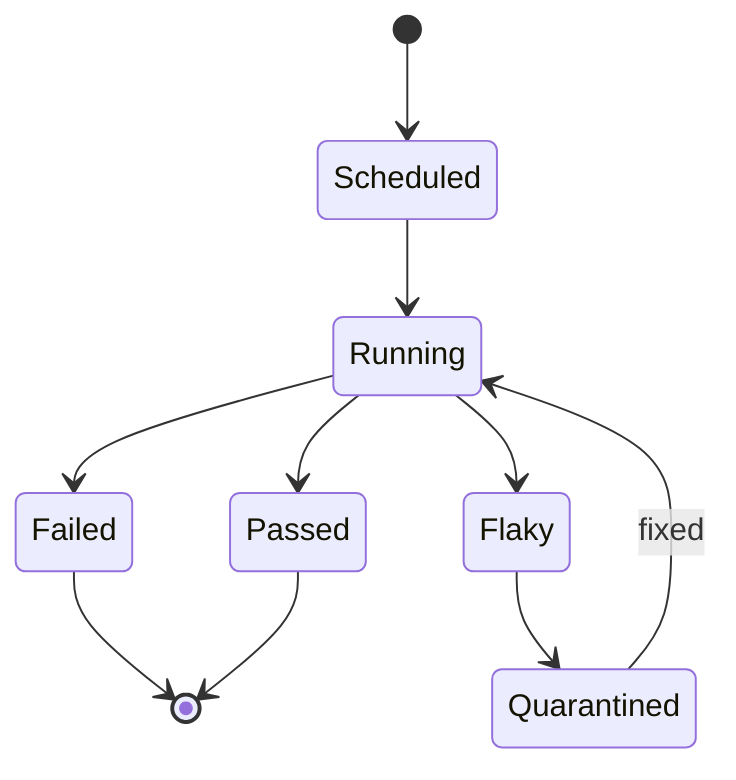

<a id="ucos-tst-000001-workflows"></a>
##### Workflows

- select subject → run strategy → capture evidence → evaluate coverage → feed gate → quarantine flakes

<a id="ucos-tst-000001-authorities"></a>
##### Authorities

- Quality Authority (test governance); flaky quarantine requires owner accountability.

<a id="ucos-tst-000001-permissions"></a>
##### Permissions

- tst.run (system or engineer)
- tst.quarantine (test owner)
- tst.read (any)

<a id="ucos-tst-000001-privacy-model"></a>
##### Privacy Model

Tests over personal data use synthetic fixtures — production personal data never enters test environments.

<a id="ucos-tst-000001-audit-model"></a>
##### Audit Model

Every gate pass cites the test evidence; a gate pass without evidence is a certification failure.

<a id="ucos-tst-000001-digital-twin-model"></a>
##### Digital Twin Model

Testing twin monitors coverage drift and flake rates as quality-health signals.

<a id="ucos-tst-000001-agent-model"></a>
##### Agent Model

Testing agent generates contract tests from registry schemas and detects coverage gaps automatically.

<a id="ucos-tst-000001-runtime-model"></a>
##### Runtime Model

Tests run in isolated fixtures; domain-cross tests use contract mocks, never live dependencies.

<a id="ucos-tst-000001-scaling-model"></a>
##### Scaling Model

Suite execution is parallel by subject; hot suites are sharded.

<a id="ucos-tst-000001-multi-tenant-model"></a>
##### Multi-Tenant Model

Tests are tenant-scoped; platform tests verify tenant isolation explicitly as a first-class suite.

<a id="ucos-tst-000001-geo-distribution-model"></a>
##### Geo-Distribution Model

Regional test suites verify sovereignty and placement behavior per jurisdiction.

<a id="ucos-tst-000001-failure-model"></a>
##### Failure Model

Flaky-masking, coverage theater, untested contract, gate bypass.

<a id="ucos-tst-000001-recovery-model"></a>
##### Recovery Model

Quarantined tests block promotion until fixed — flakes are debt, not noise to be ignored.

<a id="ucos-tst-000001-certification-model"></a>
##### Certification Model

Every gate must cite passing test evidence — no evidence, no pass, no exception.

<a id="ucos-tst-000001-migration-model"></a>
##### Migration Model

New strategies are registry additions.

<a id="ucos-tst-000001-implementation-blueprint"></a>
##### Implementation Blueprint

Build order for TST: (1) define registry entries — this domain owns by level: unit / contract / integration / domain-cross / system / chaos / regression as registry truth, not code; (2) implement the contract surface first (tst.run, tst.quarantine, tst.promote) and validate against TST boundaries; (3) event-source all state so history is reconstructable; (4) wire the enforcement points — authority check, policy guard, evidence binding, trace — in-line, with no bypass path; (5) add tests per the Testing Architecture, citing evidence per gate; (6) obtain Verification and Certification before activation. Acceptance: the Zero Partial and Law 001 audits pass, every action answers the seven explainability questions, and this domain mutates no other domain internals.

<a id="ucos-tst-000001-sequence-diagrams"></a>
##### Sequence Diagrams

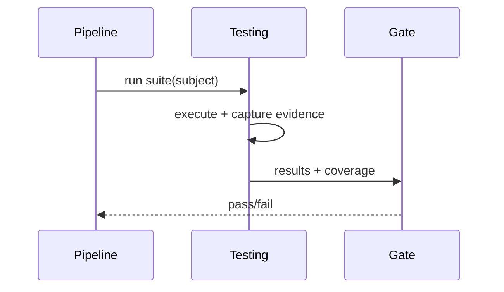

<a id="ucos-tst-000001-state-diagrams"></a>
##### State Diagrams

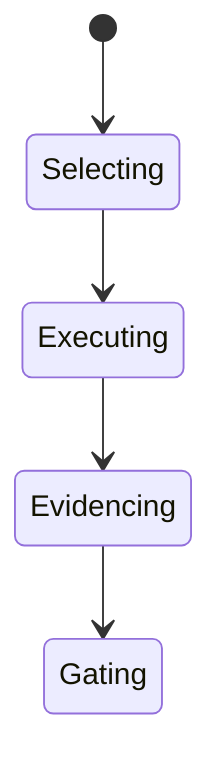

<a id="ucos-ver-000001"></a>
#### UCOS-VER-000001 · Verification Architecture

Owner [Quality](#d-qlt) · managed in `_registry/manifest.json` → `UCOS-VER-000001`, content `_registry/content-sec-ops-dep-qlt.json` → `VER` · inherits the [standard contract](../UCOS-MASTER.md#standard-contract)

<a id="ucos-ver-000001-concepts"></a>
##### Concepts

Verification Architecture confirms that what was built is what was declared — runtime matches registry, projections match primitives, behavior matches policy. Verification is continuous, not a milestone.

<a id="ucos-ver-000001-ontology"></a>
##### Ontology

Verification has a Claim (thing asserted), a Method (registry), Evidence (proof), and a Verdict. Claims cover identity, knowledge, relationships, context, policy, authority, trust, and reality integrity.

<a id="ucos-ver-000001-taxonomy"></a>
##### Taxonomy

By claim: Conformance / Integrity / Compliance / Performance / Privacy. By method: Static / Dynamic / Cryptographic / Formal / Empirical. By verdict: Verified / Refuted / Unverifiable.

<a id="ucos-ver-000001-data-model"></a>
##### Data Model

```yaml
Verification:
  verificationId: <Identity>
  claim: <registry claim id>
  subject: <artifact ref>
  method: <registry id>
  evidence: [<Evidence>]
  verdict: <Verified|Refuted|Unverifiable>
  temporal: {at, validUntil}
```

<a id="ucos-ver-000001-graph-model"></a>
##### Graph Model

(:Verification)-[:ASSERTS]->(:Claim); (:Verification)-[:METHOD]->(:RegistryEntry); (:Verification)-[:EVIDENCED_BY]->(:Evidence); (:Verification)-[:VALID_FOR]->(:Temporal)

<a id="ucos-ver-000001-apis"></a>
##### APIs

- POST /ver.v1.verify
- GET  /ver.v1/{id}
- POST /ver.v1.batch
- GET  /ver.v1.bySubject/{subjectId}

<a id="ucos-ver-000001-events"></a>
##### Events

- VerificationCompleted
- ClaimVerified
- ClaimRefuted
- VerificationStale
- VerificationDisputed

<a id="ucos-ver-000001-commands"></a>
##### Commands

- ver.verify
- ver.batch
- ver.dispute
- ver.refresh

<a id="ucos-ver-000001-queries"></a>
##### Queries

- ver.bySubject
- ver.refuted
- ver.stale
- ver.coverage

<a id="ucos-ver-000001-state-machines"></a>
##### State Machines

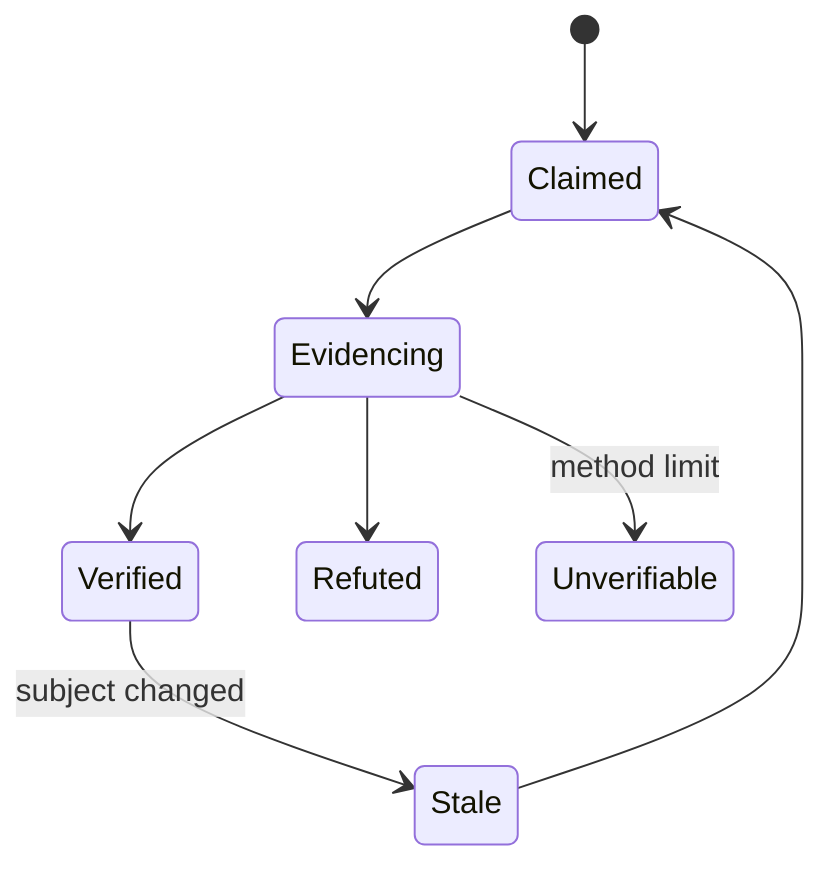

<a id="ucos-ver-000001-workflows"></a>
##### Workflows

- assert claim → gather evidence by method → verdict → bind to subject → invalidate on change

<a id="ucos-ver-000001-authorities"></a>
##### Authorities

- Quality Authority (methods); refutations route to the owning domain's governance.

<a id="ucos-ver-000001-permissions"></a>
##### Permissions

- ver.verify (system)
- ver.dispute (any authority)
- ver.read (any)

<a id="ucos-ver-000001-privacy-model"></a>
##### Privacy Model

Verification over personal-data handling verifies minimization and consent — privacy is a verifiable claim.

<a id="ucos-ver-000001-audit-model"></a>
##### Audit Model

Every verdict carries evidence and method version — reproducible by construction.

<a id="ucos-ver-000001-digital-twin-model"></a>
##### Digital Twin Model

Verification twin monitors stale-verdict rates as drift signals.

<a id="ucos-ver-000001-agent-model"></a>
##### Agent Model

Verification agent continuously re-verifies stale claims and escalates refutations.

<a id="ucos-ver-000001-runtime-model"></a>
##### Runtime Model

Verification runs in-line for critical claims and in background for the rest; staleness is tracked per subject version.

<a id="ucos-ver-000001-scaling-model"></a>
##### Scaling Model

Batch verification parallelizes by subject; in-line checks are cached per claim+version.

<a id="ucos-ver-000001-multi-tenant-model"></a>
##### Multi-Tenant Model

Tenant claims verify within their scope; platform claims verify isolation universally.

<a id="ucos-ver-000001-geo-distribution-model"></a>
##### Geo-Distribution Model

Regional claims verify sovereignty and placement per jurisdiction.

<a id="ucos-ver-000001-failure-model"></a>
##### Failure Model

Method exhaustion (Unverifiable), evidence staleness, refutation backlog.

<a id="ucos-ver-000001-recovery-model"></a>
##### Recovery Model

Refuted claims block the subject's certification until the owning domain remediates.

<a id="ucos-ver-000001-certification-model"></a>
##### Certification Model

Activation requires Verified, not Unverifiable — 'could not check' is not 'passed'.

<a id="ucos-ver-000001-migration-model"></a>
##### Migration Model

New methods are registry additions.

<a id="ucos-ver-000001-implementation-blueprint"></a>
##### Implementation Blueprint

Build order for VER: (1) define registry entries — this domain owns by claim: conformance / integrity / compliance / performance / privacy as registry truth, not code; (2) implement the contract surface first (ver.verify, ver.batch, ver.dispute) and validate against VER boundaries; (3) event-source all state so history is reconstructable; (4) wire the enforcement points — authority check, policy guard, evidence binding, trace — in-line, with no bypass path; (5) add tests per the Testing Architecture, citing evidence per gate; (6) obtain Verification and Certification before activation. Acceptance: the Zero Partial and Law 001 audits pass, every action answers the seven explainability questions, and this domain mutates no other domain internals.

<a id="ucos-ver-000001-sequence-diagrams"></a>
##### Sequence Diagrams

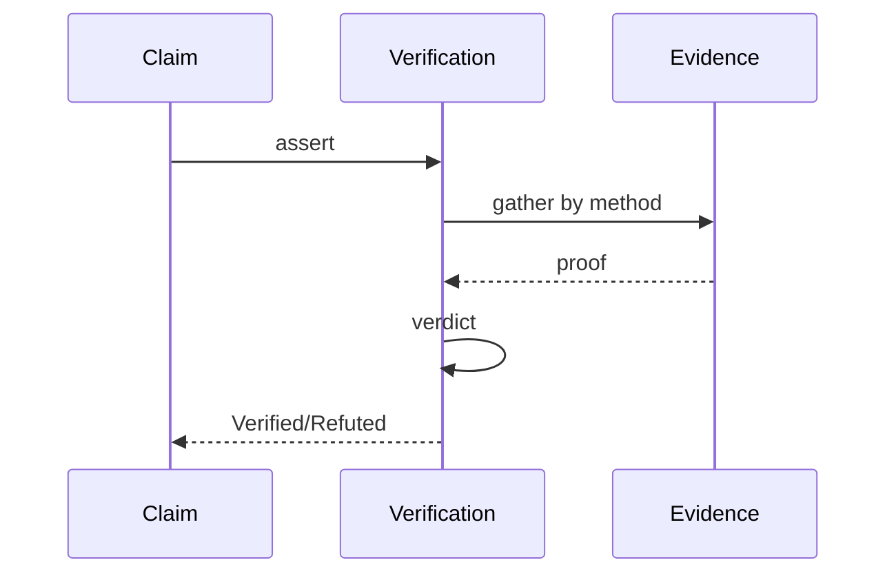

<a id="ucos-ver-000001-state-diagrams"></a>
##### State Diagrams

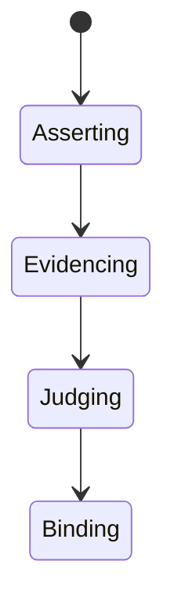

<a id="ucos-cer-000001"></a>
#### UCOS-CER-000001 · Certification Architecture

Owner [Quality](#d-qlt) · managed in `_registry/manifest.json` → `UCOS-CER-000001`, content `_registry/content-sec-ops-dep-qlt.json` → `CER` · inherits the [standard contract](../UCOS-MASTER.md#standard-contract)

<a id="ucos-cer-000001-concepts"></a>
##### Concepts

Certification Architecture turns verification into trust signals. A certificate is a signed, expiring, revocable statement that a subject met a standard — issued by authority, verifiable by anyone, revocable on breach.

<a id="ucos-cer-000001-ontology"></a>
##### Ontology

Certificate has a Subject, a Standard (registry), Evidence (verifications), an Issuer (authority), a Validity window, and a Revocation path. Certificates are the platform's trust currency with the outside world.

<a id="ucos-cer-000001-taxonomy"></a>
##### Taxonomy

By standard: Security / Privacy / Sovereignty / Reliability / Accessibility / Industry-specific. By issuer: Platform / Tenant / External-certifier / Regulator. By scope: Capability / Artifact / Tenant / Platform.

<a id="ucos-cer-000001-data-model"></a>
##### Data Model

```yaml
Certificate:
  certificateId: <Identity>
  subject: <artifact ref>
  standard: <registry id>
  evidence: [<Verification>]
  issuer: <Authority>
  temporal: {issuedAt, expiresAt}
  state: <Issued|Suspended|Revoked|Expired>
  revocationReason: <string|null>
```

<a id="ucos-cer-000001-graph-model"></a>
##### Graph Model

(:Certificate)-[:CERTIFIES]->(:Subject); (:Certificate)-[:TO_STANDARD]->(:Standard); (:Certificate)-[:ISSUED_BY]->(:Authority); (:Certificate)-[:SUPPORTED_BY]->(:Verification)

<a id="ucos-cer-000001-apis"></a>
##### APIs

- POST /cer.v1.issue
- GET  /cer.v1/{id}
- POST /cer.v1.revoke
- POST /cer.v1.verify
- GET  /cer.v1.bySubject/{subjectId}

<a id="ucos-cer-000001-events"></a>
##### Events

- CertificateIssued
- CertificateRevoked
- CertificateSuspended
- CertificateRenewed
- CertificateVerified

<a id="ucos-cer-000001-commands"></a>
##### Commands

- cer.issue
- cer.revoke
- cer.suspend
- cer.renew
- cer.verify

<a id="ucos-cer-000001-queries"></a>
##### Queries

- cer.bySubject
- cer.byStandard
- cer.revoked
- cer.expiring

<a id="ucos-cer-000001-state-machines"></a>
##### State Machines

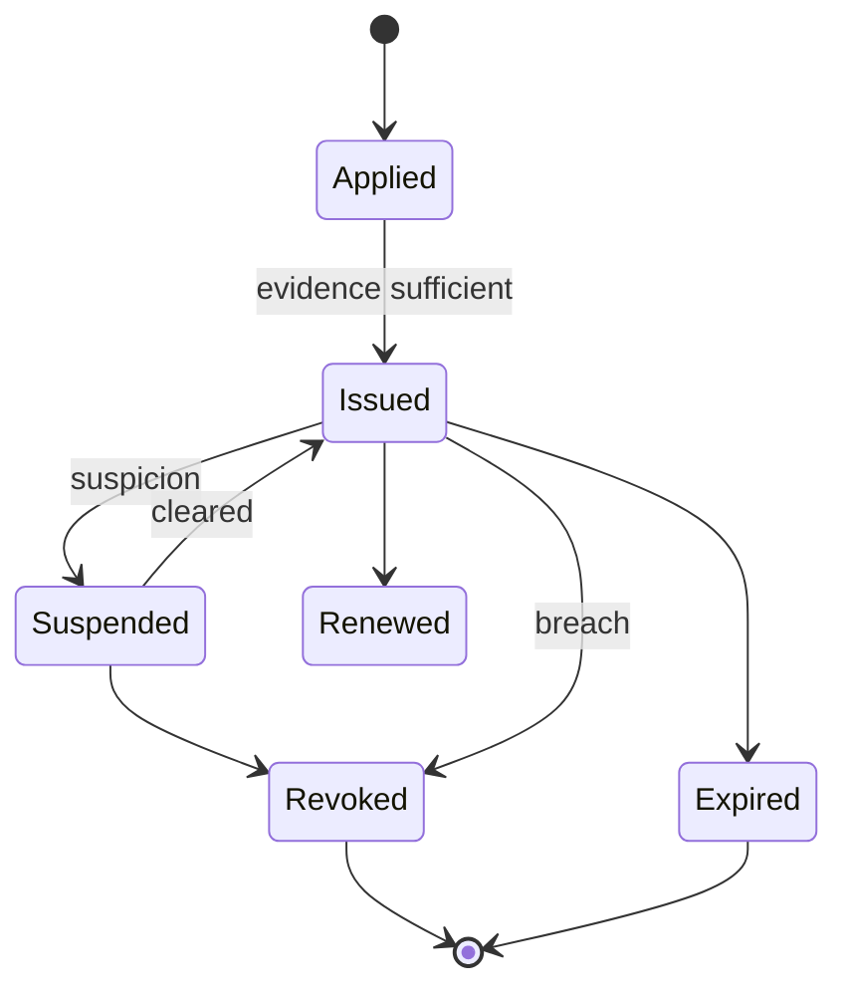

<a id="ucos-cer-000001-workflows"></a>
##### Workflows

- collect verification evidence → evaluate against standard → issue with validity → monitor → suspend/revoke on breach, renew on continuance

<a id="ucos-cer-000001-authorities"></a>
##### Authorities

- Certification Authority (issue); revocation requires evidence of breach and is logged publicly.

<a id="ucos-cer-000001-permissions"></a>
##### Permissions

- cer.issue (certification authority)
- cer.revoke (certification authority)
- cer.verify (any)
- cer.read (any)

<a id="ucos-cer-000001-privacy-model"></a>
##### Privacy Model

Privacy certificates require evidence of consent handling and minimization — verified, not self-attested.

<a id="ucos-cer-000001-audit-model"></a>
##### Audit Model

Issuance, suspension, revocation, and renewal are all public-record events with evidence.

<a id="ucos-cer-000001-digital-twin-model"></a>
##### Digital Twin Model

Certification twin monitors expiring and at-risk certificates fleet-wide.

<a id="ucos-cer-000001-agent-model"></a>
##### Agent Model

Certification agent flags evidence weakening before expiry, prompting renewal or planned revocation.

<a id="ucos-cer-000001-runtime-model"></a>
##### Runtime Model

Verification is a signature check — cheap and cacheable; revocation propagates via the event bus.

<a id="ucos-cer-000001-scaling-model"></a>
##### Scaling Model

Issuance is low-frequency; verification is the hot path and is edge-cached with short TTL.

<a id="ucos-cer-000001-multi-tenant-model"></a>
##### Multi-Tenant Model

Tenant certificates bind to their scope; platform certificates assert isolation to all tenants.

<a id="ucos-cer-000001-geo-distribution-model"></a>
##### Geo-Distribution Model

Regional certificates assert sovereignty compliance per jurisdiction.

<a id="ucos-cer-000001-failure-model"></a>
##### Failure Model

Revocation lag, evidence drift after issuance, over-issuance without verification.

<a id="ucos-cer-000001-recovery-model"></a>
##### Recovery Model

Revocation is the safety action — recovery is re-issuance after fresh evidence, never re-instatement of trust.

<a id="ucos-cer-000001-certification-model"></a>
##### Certification Model

A certificate without evidence backing is void — self-certification is prohibited.

<a id="ucos-cer-000001-migration-model"></a>
##### Migration Model

New standards are registry additions.

<a id="ucos-cer-000001-implementation-blueprint"></a>
##### Implementation Blueprint

Build order for CER: (1) define registry entries — this domain owns by standard: security / privacy / sovereignty / reliability / accessibility / industry-specific as registry truth, not code; (2) implement the contract surface first (cer.issue, cer.revoke, cer.suspend) and validate against CER boundaries; (3) event-source all state so history is reconstructable; (4) wire the enforcement points — authority check, policy guard, evidence binding, trace — in-line, with no bypass path; (5) add tests per the Testing Architecture, citing evidence per gate; (6) obtain Verification and Certification before activation. Acceptance: the Zero Partial and Law 001 audits pass, every action answers the seven explainability questions, and this domain mutates no other domain internals.

<a id="ucos-cer-000001-sequence-diagrams"></a>
##### Sequence Diagrams

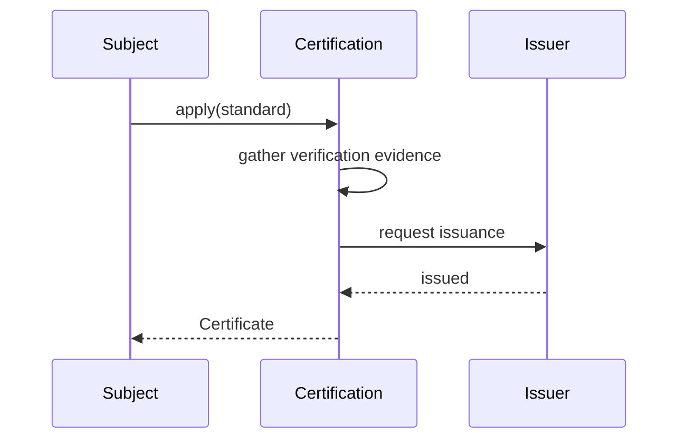

<a id="ucos-cer-000001-state-diagrams"></a>
##### State Diagrams

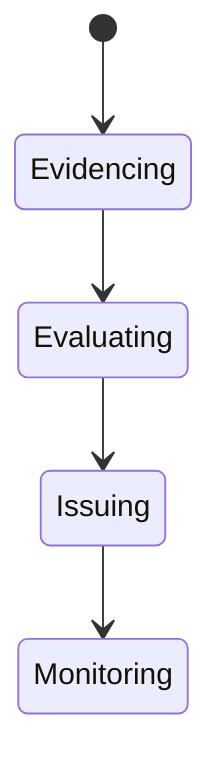

<a id="ucos-fml-000001"></a>
#### UCOS-FML-000001 · Formal Verification Architecture

Owner [Quality](#d-qlt) · managed in `_registry/manifest.json` → `UCOS-FML-000001`, content `_registry/content-sec-ops-dep-qlt.json` → `FML` · inherits the [standard contract](../UCOS-MASTER.md#standard-contract)

<a id="ucos-fml-000001-concepts"></a>
##### Concepts

Formal Verification Architecture proves critical properties mathematically — not by testing, but by construction. The constitution's most absolute claims (no bypass, no leak, no deadlock) are formal theorems where the cost is justified.

<a id="ucos-fml-000001-ontology"></a>
##### Ontology

Formal Verification has a Specification (property in a registry logic), a Model (system abstraction), a Prover (registry tool), and a Proof (machine-checkable artifact). Proofs are content-addressed and replayable.

<a id="ucos-fml-000001-taxonomy"></a>
##### Taxonomy

By technique: Model-checking / Theorem-proving / Static-analysis / Type-theory / Refinement. By property: Safety / Liveness / Security / Privacy / Termination / Determinism. By scope: Function / Module / Protocol / System.

<a id="ucos-fml-000001-data-model"></a>
##### Data Model

```yaml
FormalProof:
  proofId: <Identity>
  specification: <registry spec>
  subject: <artifact ref>
  technique: <registry id>
  prover: <registry tool + version>
  artifact: <content-addressed proof>
  verdict: <Proven|Disproven|Inconclusive>
  temporal: {at, validFor: <subject version>]
```

<a id="ucos-fml-000001-graph-model"></a>
##### Graph Model

(:Proof)-[:PROVES]->(:Specification); (:Proof)-[:ABOUT]->(:Artifact); (:Proof)-[:USING]->(:Prover); (:Specification)-[:PROPERTY]->(:Property)

<a id="ucos-fml-000001-apis"></a>
##### APIs

- POST /fml.v1.prove
- GET  /fml.v1/{id}
- POST /fml.v1.check
- GET  /fml.v1.bySubject/{subjectId}

<a id="ucos-fml-000001-events"></a>
##### Events

- ProofCompleted
- PropertyProven
- PropertyDisproven
- ProofStale
- ProofChecked

<a id="ucos-fml-000001-commands"></a>
##### Commands

- fml.prove
- fml.check
- fml.disprove
- fml.refresh

<a id="ucos-fml-000001-queries"></a>
##### Queries

- fml.proofs
- fml.proven
- fml.disproven
- fml.coverage

<a id="ucos-fml-000001-state-machines"></a>
##### State Machines

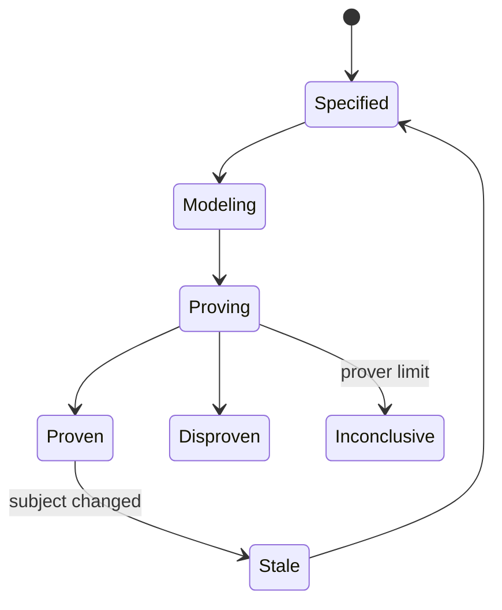

<a id="ucos-fml-000001-workflows"></a>
##### Workflows

- write specification in registry logic → build model → run prover → store machine-checkable proof → invalidate on subject change

<a id="ucos-fml-000001-authorities"></a>
##### Authorities

- Quality Authority (method); disproofs are critical governance events with mandatory remediation.

<a id="ucos-fml-000001-permissions"></a>
##### Permissions

- fml.prove (formal authority)
- fml.check (any)
- fml.read (any)

<a id="ucos-fml-000001-privacy-model"></a>
##### Privacy Model

Privacy properties (no-leak, minimization) are formally specified where personal data flows — privacy by proof, not promise.

<a id="ucos-fml-000001-audit-model"></a>
##### Audit Model

Proofs are replayable and content-addressed — anyone can re-check with the recorded prover version.

<a id="ucos-fml-000001-digital-twin-model"></a>
##### Digital Twin Model

Formal verification twin tracks proof coverage on critical paths and staleness after changes.

<a id="ucos-fml-000001-agent-model"></a>
##### Agent Model

Formal agent selects properties worth proving by risk and cost, and re-proves on change.

<a id="ucos-fml-000001-runtime-model"></a>
##### Runtime Model

Proof checking is cheap; proving is expensive — proofs run in CI and on-demand, never in the hot path.

<a id="ucos-fml-000001-scaling-model"></a>
##### Scaling Model

Proving is compute-heavy and batched; proof checking is cached per subject version.

<a id="ucos-fml-000001-multi-tenant-model"></a>
##### Multi-Tenant Model

Isolation properties are proven once for the platform, per topology change.

<a id="ucos-fml-000001-geo-distribution-model"></a>
##### Geo-Distribution Model

Sovereignty properties (residency enforcement) are formally specified per jurisdiction.

<a id="ucos-fml-000001-failure-model"></a>
##### Failure Model

Prover unsoundness, model drift, specification gap, inconclusive on critical property.

<a id="ucos-fml-000001-recovery-model"></a>
##### Recovery Model

A disproven critical property blocks the subject — remediation or rollback, no exceptions.

<a id="ucos-fml-000001-certification-model"></a>
##### Certification Model

Tier-0 properties (guard bypass, key egress, isolation) require formal proof — testing alone is insufficient.

<a id="ucos-fml-000001-migration-model"></a>
##### Migration Model

New techniques and provers are registry additions.

<a id="ucos-fml-000001-implementation-blueprint"></a>
##### Implementation Blueprint

Build order for FML: (1) define registry entries — this domain owns by technique: model-checking / theorem-proving / static-analysis / type-theory / refinement as registry truth, not code; (2) implement the contract surface first (fml.prove, fml.check, fml.disprove) and validate against FML boundaries; (3) event-source all state so history is reconstructable; (4) wire the enforcement points — authority check, policy guard, evidence binding, trace — in-line, with no bypass path; (5) add tests per the Testing Architecture, citing evidence per gate; (6) obtain Verification and Certification before activation. Acceptance: the Zero Partial and Law 001 audits pass, every action answers the seven explainability questions, and this domain mutates no other domain internals.

<a id="ucos-fml-000001-sequence-diagrams"></a>
##### Sequence Diagrams

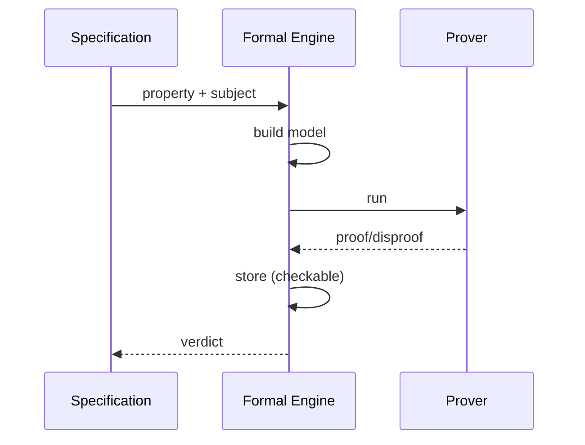

<a id="ucos-fml-000001-state-diagrams"></a>
##### State Diagrams

```mermaid
stateDiagram-v2
    [*] --> Specifying
    Specifying --> Modeling
    Modeling --> Proving
    Proving -> Checking
```

---

<a id="d-cnt"></a>
### D-CNT · Content

| | |
|---|---|
| **Category** | C11 Platform |
| **Owns** | [Media Asset](../UCOS-MASTER.md#t-media-asset) |
| **Responsible for** | Files And Media, Transforms, Scanning |
| **Not responsible for** | Interface, Message |
| **Contract** | [UCOS-MED-000001 Content Architecture](#ucos-med-000001) |
| **Artifacts** | [UCOS-MED-000001](#ucos-med-000001) |
| **Concepts** | 80 — `node _registry/compile.js --search <words> --kind concept --owner "Content"` |
| **Code** | `lib/ugc.js` |
| **Managed in** | `_registry/domains.json` → `D-CNT` |

<a id="ucos-med-000001"></a>
#### UCOS-MED-000001 · Content Architecture

Owner [Content](#d-cnt) · managed in `_registry/manifest.json` → `UCOS-MED-000001`, content `_registry/content-platform.json` → `MED` · inherits the [standard contract](../UCOS-MASTER.md#standard-contract)

<a id="ucos-med-000001-concepts"></a>
##### Concepts

Content Architecture owns files and media for any entity: images, video, audio, documents, 3D and AR assets, with storage adapters, a CDN, transforms and malware scanning.

<a id="ucos-med-000001-ontology"></a>
##### Ontology

A Media Asset is attached to a node, stored through an adapter, scanned, transformed into declared renditions and served through a CDN.

<a id="ucos-med-000001-taxonomy"></a>
##### Taxonomy

By type: image, video, audio, document, 3D, AR, declared. By sensitivity: public / private / sensitive.

<a id="ucos-med-000001-data-model"></a>
##### Data Model

```yaml
MediaAsset:
  assetId: <Identity>
  attachedTo: <node>
  type: <declared type>
  storage: <adapter binding>
  renditions: [<declared rendition>]
  sensitivity: <declared>
  scan: <clean | quarantined>
```

<a id="ucos-med-000001-graph-model"></a>
##### Graph Model

(:MediaAsset)-[:ATTACHED_TO]->(:Node); (:MediaAsset)-[:RENDITION]->(:MediaAsset)

<a id="ucos-med-000001-apis"></a>
##### APIs

- POST /med.v1.upload
- GET  /med.v1/{id}
- POST /med.v1.transform
- DELETE /med.v1/{id}

<a id="ucos-med-000001-events"></a>
##### Events

- AssetUploaded
- AssetScanned
- AssetQuarantined

<a id="ucos-med-000001-commands"></a>
##### Commands

- asset.upload
- asset.transform
- asset.quarantine

<a id="ucos-med-000001-queries"></a>
##### Queries

- assets.of
- asset.renditions

<a id="ucos-med-000001-state-machines"></a>
##### State Machines

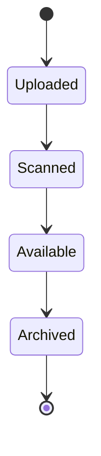

<a id="ucos-med-000001-workflows"></a>
##### Workflows

- upload → scan → transform into renditions → serve through CDN → archive per retention

<a id="ucos-med-000001-authorities"></a>
##### Authorities

- The owner of the attached node governs its assets.

<a id="ucos-med-000001-permissions"></a>
##### Permissions

- asset.upload (node editor)
- asset.read (per node access)

<a id="ucos-med-000001-privacy-model"></a>
##### Privacy Model

Sensitive assets are encrypted and served only to permitted viewers; retention follows Compliance.

<a id="ucos-med-000001-audit-model"></a>
##### Audit Model

Uploads, quarantines and deletions are recorded.

<a id="ucos-med-000001-digital-twin-model"></a>
##### Digital Twin Model

A content twin tracks storage use and CDN performance.

<a id="ucos-med-000001-agent-model"></a>
##### Agent Model

Agents may generate assets; generated assets are labelled.

<a id="ucos-med-000001-runtime-model"></a>
##### Runtime Model

Uploads stream to the bound storage adapter; renditions are generated in the background.

<a id="ucos-med-000001-scaling-model"></a>
##### Scaling Model

CDN caching per rendition.

<a id="ucos-med-000001-multi-tenant-model"></a>
##### Multi-Tenant Model

Assets are tenant scope.

<a id="ucos-med-000001-geo-distribution-model"></a>
##### Geo-Distribution Model

Storage placement follows the node's residency rules.

<a id="ucos-med-000001-failure-model"></a>
##### Failure Model

Malware, an oversize upload, a broken rendition.

<a id="ucos-med-000001-recovery-model"></a>
##### Recovery Model

Renditions regenerate from the original.

<a id="ucos-med-000001-certification-model"></a>
##### Certification Model

No asset is served before it is scanned.

<a id="ucos-med-000001-migration-model"></a>
##### Migration Model

Today's product media and review uploads move here.

<a id="ucos-med-000001-implementation-blueprint"></a>
##### Implementation Blueprint

Build order for MED: (1) asset store behind adapters; (2) scanning; (3) renditions and CDN; (4) migrate today's media. Every build step also inherits Kernel parts K1–K11 (kinds, nodes, hierarchies, identifiers, shape, attributes, versions, events, change lifecycle, views and scope, resolution).

<a id="ucos-med-000001-sequence-diagrams"></a>
##### Sequence Diagrams

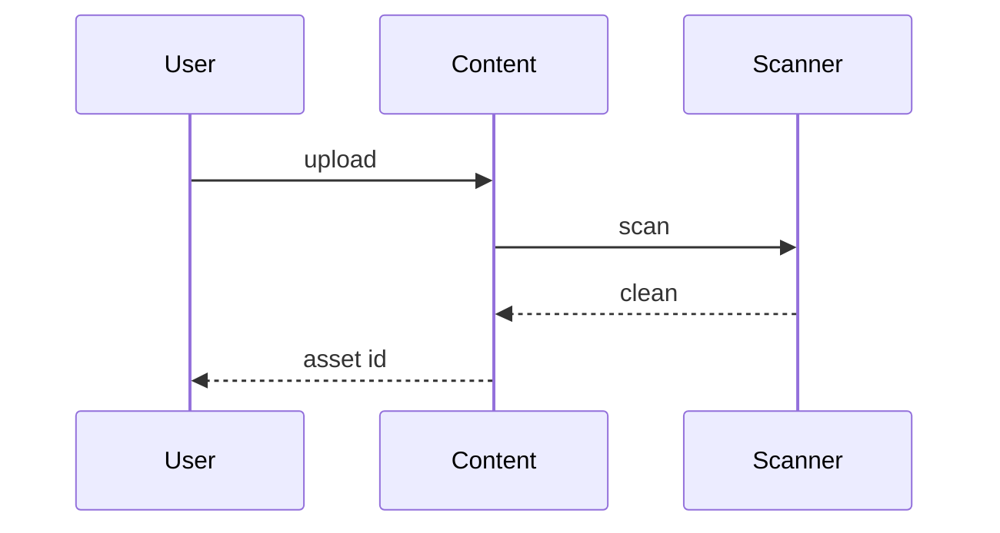

<a id="ucos-med-000001-state-diagrams"></a>
##### State Diagrams

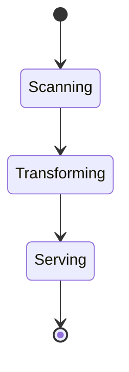

---

<a id="d-ofg"></a>
### D-OFG · Offering

| | |
|---|---|
| **Category** | C11 Platform |
| **Owns** | [Offering](../UCOS-MASTER.md#t-offering), [Plan](../UCOS-MASTER.md#t-plan), [Licence](../UCOS-MASTER.md#t-licence) |
| **Responsible for** | Offerings, Plans, Metering, Platform Invoices, Licences, Publishing |
| **Not responsible for** | Commerce Projections, Value Units |
| **Contract** | [UCOS-OFG-000001 Offering Architecture](#ucos-ofg-000001) |
| **Artifacts** | [UCOS-OFG-000001](#ucos-ofg-000001) |
| **Concepts** | 20 — `node _registry/compile.js --search <words> --kind concept --owner "Offering"` |
| **Code** | `lib/billing.js`, `lib/modules.js`, `lib/capabilities.js`, `lib/seed/capabilities.json`, `lib/seed/modules.json` |
| **Managed in** | `_registry/domains.json` → `D-OFG` |

<a id="ucos-ofg-000001"></a>
#### UCOS-OFG-000001 · Offering Architecture

Owner [Offering](#d-ofg) · managed in `_registry/manifest.json` → `UCOS-OFG-000001`, content `_registry/content-platform.json` → `OFG` · inherits the [standard contract](../UCOS-MASTER.md#standard-contract)

<a id="ucos-ofg-000001-concepts"></a>
##### Concepts

Offering Architecture owns everything LUXORA sells and on what terms: an offering on every option (free, paid, metered, trial, included), plans, subscriptions, metering, the platform's own invoices, licences and the publishing of domain catalogues and packages to other platforms.

<a id="ucos-ofg-000001-ontology"></a>
##### Ontology

An Offering attaches terms to an option; a Plan bundles offerings; a Licence grants a subscriber a view; metering counts usage from events against quotas.

<a id="ucos-ofg-000001-taxonomy"></a>
##### Taxonomy

Terms: free / paid / metered / trial / included. Options: sign-in methods, connectors, agents, themes, packages, domain catalogues and their hierarchies, depth and regions, update feeds, API usage, seats, any declared.

<a id="ucos-ofg-000001-data-model"></a>
##### Data Model

```yaml
Offering:
  offeringId: <Identity>
  option: <node of any domain>
  terms: <free | paid | metered | trial | included>
  charge: {amount, valueUnit} | null
  quota: <declared> | null
  plans: [<Plan>]
```

<a id="ucos-ofg-000001-graph-model"></a>
##### Graph Model

(:Offering)-[:FOR]->(:Option); (:Plan)-[:INCLUDES]->(:Offering); (:Licence)-[:GRANTS]->(:View); (:Subscriber)-[:HOLDS]->(:Licence)

<a id="ucos-ofg-000001-apis"></a>
##### APIs

- POST /ofg.v1.offering
- POST /ofg.v1.plan
- POST /ofg.v1.subscribe
- GET  /ofg.v1/bill-preview
- POST /ofg.v1.publish

<a id="ucos-ofg-000001-events"></a>
##### Events

- SubscriptionStarted
- UsageMetered
- QuotaExceeded
- InvoiceIssued
- CataloguePublished

<a id="ucos-ofg-000001-commands"></a>
##### Commands

- offering.declare
- plan.declare
- subscription.start
- catalogue.publish

<a id="ucos-ofg-000001-queries"></a>
##### Queries

- bill.preview
- usage.of
- licences.of

<a id="ucos-ofg-000001-state-machines"></a>
##### State Machines

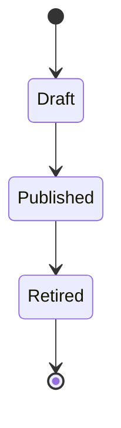

<a id="ucos-ofg-000001-workflows"></a>
##### Workflows

- declare offerings on options → bundle into plans → subscriber selects → metering from events → invoice → licence bounds what is readable

<a id="ucos-ofg-000001-authorities"></a>
##### Authorities

- The platform owner governs offerings, plans and publishing.

<a id="ucos-ofg-000001-permissions"></a>
##### Permissions

- offering.declare (platform)
- subscription.start (tenant owner)
- bill.read (tenant owner)

<a id="ucos-ofg-000001-privacy-model"></a>
##### Privacy Model

Billing contacts are personal data handled under Compliance.

<a id="ucos-ofg-000001-audit-model"></a>
##### Audit Model

Every price change, subscription and invoice is recorded.

<a id="ucos-ofg-000001-digital-twin-model"></a>
##### Digital Twin Model

A revenue twin tracks usage against quotas and plans.

<a id="ucos-ofg-000001-agent-model"></a>
##### Agent Model

Agents may recommend plans; changing a subscription follows approval rules.

<a id="ucos-ofg-000001-runtime-model"></a>
##### Runtime Model

Quotas are enforced by Integration; usage is metered from the event log.

<a id="ucos-ofg-000001-scaling-model"></a>
##### Scaling Model

Metering aggregates per period.

<a id="ucos-ofg-000001-multi-tenant-model"></a>
##### Multi-Tenant Model

Each tenant's subscription is isolated; publishing reaches other platforms through licences.

<a id="ucos-ofg-000001-geo-distribution-model"></a>
##### Geo-Distribution Model

Prices are in any value unit; tax on the platform's invoices comes from Rule.

<a id="ucos-ofg-000001-failure-model"></a>
##### Failure Model

An option with no offering, a quota not enforced, a licence wider than paid.

<a id="ucos-ofg-000001-recovery-model"></a>
##### Recovery Model

Invoices are immutable; corrections are credit notes.

<a id="ucos-ofg-000001-certification-model"></a>
##### Certification Model

Every option shown in a setup flow has an offering.

<a id="ucos-ofg-000001-migration-model"></a>
##### Migration Model

Today's platform billing, module catalogue and capability marketplace move here.

<a id="ucos-ofg-000001-implementation-blueprint"></a>
##### Implementation Blueprint

Build order for OFG: (1) offerings on options; (2) plans and subscriptions; (3) metering and quotas; (4) platform invoices; (5) licences and publishing; (6) migrate billing and the module catalogue. Every build step also inherits Kernel parts K1–K11 (kinds, nodes, hierarchies, identifiers, shape, attributes, versions, events, change lifecycle, views and scope, resolution).

<a id="ucos-ofg-000001-sequence-diagrams"></a>
##### Sequence Diagrams

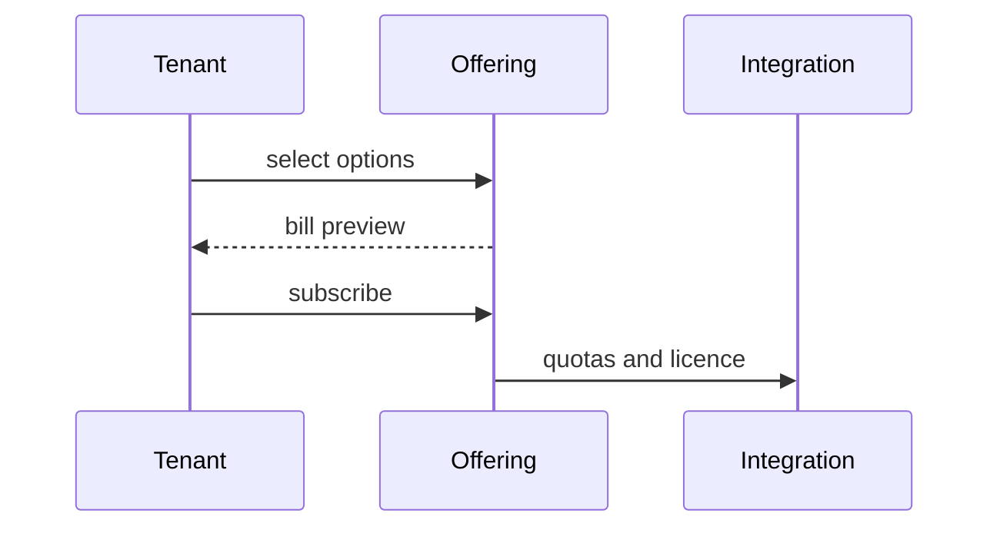

<a id="ucos-ofg-000001-state-diagrams"></a>
##### State Diagrams

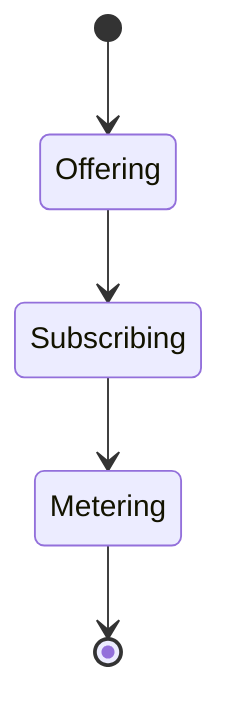

