# Volume V12 · Business

**Part of** [the master document](../UCOS-MASTER.md) · **Category** C12 · **Projected from** `_registry/` — never edit this file: change the registry and run `npm run registry`.

> Business projections composed from the domains; they own no truth.

## Contents

- [D-BIZ Commerce](#d-biz)
  - [UCOS-COM-000001 Universal Commerce Architecture](#ucos-com-000001)
  - [UCOS-GPS-000001 Global Products & Services Architecture](#ucos-gps-000001)
  - [UCOS-PRC-000001 Pricing Architecture](#ucos-prc-000001)
  - [UCOS-OFR-000001 Offer Architecture](#ucos-ofr-000001)
  - [UCOS-SUB-000001 Subscription Architecture](#ucos-sub-000001)
  - [UCOS-CNT-000001 Contract Architecture](#ucos-cnt-000001)
  - [UCOS-MKT-000001 Marketplace Architecture](#ucos-mkt-000001)
  - [UCOS-INV-000001 Inventory Architecture](#ucos-inv-000001)
  - [UCOS-ORD-000001 Order Architecture](#ucos-ord-000001)
  - [UCOS-FUL-000001 Fulfillment Architecture](#ucos-ful-000001)

---

<a id="d-biz"></a>
### D-BIZ · Commerce

| | |
|---|---|
| **Category** | C12 Business |
| **Build status** | partial |
| **Owns** | [Commerce Projection](../UCOS-MASTER.md#t-commerce-projection), [Fulfilment Mode](../UCOS-MASTER.md#t-fulfilment-mode) |
| **Responsible for** | Commerce Projections |
| **Not responsible for** | Truth Ownership, Offerings |
| **Contract** | [UCOS-COM-000001 Universal Commerce Architecture](#ucos-com-000001) |
| **Artifacts** | [UCOS-COM-000001](#ucos-com-000001), [UCOS-GPS-000001](#ucos-gps-000001), [UCOS-PRC-000001](#ucos-prc-000001), [UCOS-OFR-000001](#ucos-ofr-000001), [UCOS-SUB-000001](#ucos-sub-000001), [UCOS-CNT-000001](#ucos-cnt-000001), [UCOS-MKT-000001](#ucos-mkt-000001), [UCOS-INV-000001](#ucos-inv-000001), [UCOS-ORD-000001](#ucos-ord-000001), [UCOS-FUL-000001](#ucos-ful-000001) |
| **Concepts** | 1968 — `node _registry/compile.js --search <words> --kind concept --owner "Commerce"` |
| **Code** | `lib/trials.js`, `lib/fees.js`, `lib/tips.js`, `lib/deliverables.js`, `lib/health-records.js`, `lib/cases.js`, `lib/billing.js`, `lib/routes/offer.js`, `lib/offers.js`, `lib/goip.js`, `lib/shipping.js`, `lib/logistics.js`, `lib/fin.js`, `lib/fintech.js`, `lib/marketplace.js`, `lib/marketplace-ext.js`, `lib/lists.js`, `lib/alerts.js`, `lib/pickup.js`, `lib/richcontent.js`, `lib/brandreg.js`, `lib/lineterms.js`, `lib/options.js`, `lib/bookings.js`, `lib/listings.js`, `lib/negotiation.js`, `lib/auctions.js`, `lib/conversations.js`, `lib/groupbuy.js`, `lib/substitutions.js`, `lib/affiliate.js`, `lib/trade.js`, `lib/qcommerce.js`, `lib/mobility.js`, `lib/operations.js`, `lib/recurring.js`, `lib/ugc.js`, `lib/gcatalog.js`, `lib/seed/goip.json`, `lib/seed/offers.json` |
| **Managed in** | `_registry/domains.json` → `D-BIZ` |

**Live routes (342)** — what the platform serves today for this domain:

- `GET /api/qc/promise`
- `GET /api/qc/stores`
- `GET /api/qc/slots`
- `POST /api/qc/pin`
- `POST /api/qc/reserve`
- `GET /api/qc/runs`
- `POST /api/qc/runs`
- `POST /api/qc/runs/:id`
- `POST /api/qc/runs/:id/pod`
- `GET /api/qc/riders`
- `GET /api/fintech/upi`
- `POST /api/fintech/upi`
- `POST /api/fintech/upi/collect`
- `POST /api/fintech/upi/collect/:id`
- `POST /api/fintech/qr`
- `POST /api/fintech/qr/:id/scan`
- `POST /api/fintech/links`
- `POST /api/fintech/links/:token/pay`
- `POST /api/fintech/mandates`
- `POST /api/fintech/mandates/:id/charge`
- `POST /api/fintech/escrow`
- `POST /api/fintech/escrow/:id/release`
- `POST /api/fintech/escrow/:id/dispute`
- `POST /api/fintech/splits`
- `POST /api/fintech/kyc`
- `POST /api/fintech/kyc/:id/verify`
- `POST /api/fintech/payouts`
- `POST /api/fintech/payouts/:id/process`
- `GET /api/fintech/billers`
- `POST /api/fintech/bills`
- `GET /api/fintech/plans`
- `POST /api/fintech/recharge`
- `POST /api/fintech/transfer`
- `POST /api/fintech/bnpl`
- `POST /api/fintech/bnpl/:id/spend`
- `POST /api/fintech/emi/:id/pay`
- `POST /api/fintech/loans`
- `POST /api/fintech/loans/:id/disburse`
- `POST /api/fintech/insurance`
- `POST /api/fintech/insurance/:id/activate`
- `POST /api/marketplace/onboarding`
- `POST /api/marketplace/onboarding/:id/review`
- `GET /api/marketplace/offers/:productId`
- `POST /api/marketplace/buybox/:productId`
- `POST /api/marketplace/fba`
- `POST /api/marketplace/fba/:id/receive`
- `POST /api/marketplace/performance/:sellerId`
- `POST /api/marketplace/claims`
- `POST /api/marketplace/claims/:id/resolve`
- `POST /api/marketplace/smart-fulfilment`
- `GET /api/marketplace/portal/:sellerId`
- `POST /api/trade/assurance`
- `POST /api/trade/assurance/:id/milestone`
- `POST /api/trade/assurance/:id/confirm`
- `POST /api/trade/assurance/:id/dispute`
- `POST /api/trade/gold`
- `POST /api/trade/verification`
- `POST /api/trade/verification/:id/complete`
- `GET /api/trade/badges/:supplierId`
- `POST /api/trade/docs`
- `GET /api/trade/docs/:id`
- `POST /api/trade/lc`
- `POST /api/trade/lc/:id/present`
- `POST /api/trade/rfq/:id/quote`
- `POST /api/trade/quotes/:id/accept`
- `POST /api/trade/tenders/:id/bid`
- `POST /api/trade/tenders/:id/award`
- `GET /api/trade/price`
- `GET /api/trade/moq-check`
- `GET /api/compare`
- `POST /api/compare`
- `POST /api/compare/remove`
- `GET /api/lists`
- `POST /api/lists`
- `GET /api/lists/find`
- `GET /api/lists/:id`
- `PUT /api/lists/:id`
- `DELETE /api/lists/:id`
- `POST /api/lists/:id/items`
- `PUT /api/list-items/:id`
- `DELETE /api/list-items/:id`
- `GET /api/shared-lists/:token`
- `POST /api/shared-lists/:token/purchased`
- `GET /api/alerts`
- `POST /api/alerts`
- `DELETE /api/alerts/:id`
- `GET /api/pickup/points`
- `GET /api/marketplace/sponsored`
- `GET /api/admin/pickup`
- `POST /api/admin/pickup/points`
- `DELETE /api/admin/pickup/points/:id`
- `POST /api/admin/pickup/reservations/:id`
- `POST /api/admin/pickup/sweep`
- `GET /api/admin/rich-content`
- `POST /api/admin/rich-content`
- `POST /api/admin/rich-content/:id`
- `GET /api/admin/brand-registry`
- `POST /api/admin/brand-registry/claims`
- `POST /api/admin/brand-registry/claims/:id`
- `POST /api/admin/brand-registry/reports`
- `POST /api/admin/brand-registry/reports/:id`
- `GET /api/bookings/availability`
- `POST /api/bookings/hold`
- `GET /api/bookings`
- `POST /api/bookings/:id/cancel`
- `GET /api/price-offers`
- `POST /api/price-offers`
- `POST /api/price-offers/:id`
- `GET /api/auctions`
- `GET /api/auctions/mine`
- `POST /api/auctions`
- `POST /api/auctions/:id/bid`
- `POST /api/auctions/:id/buy-now`
- `POST /api/auctions/:id/cancel`
- `GET /api/listings`
- `POST /api/listings`
- `PUT /api/listings/:id`
- `POST /api/listings/:id/action`
- `GET /api/conversations`
- `POST /api/conversations`
- `GET /api/conversations/:id`
- `POST /api/conversations/:id`
- `GET /api/substitutions`
- `POST /api/substitutions/:id`
- `GET /api/admin/options`
- `POST /api/admin/options`
- `DELETE /api/admin/options/:id`
- `PUT /api/admin/options/products/:pid`
- `GET /api/admin/options/follow-ups`
- `POST /api/admin/options/follow-ups/:id`
- `GET /api/options/follow-ups`
- `GET /api/options/kinds`
- `GET /api/cases`
- `GET /api/case-kinds`
- `POST /api/cart/tip`
- `GET /api/health-records`
- `POST /api/health-records`
- `POST /api/health-records/shares`
- `DELETE /api/health-records/shares/:id`
- `GET /api/admin/health-records/shared`
- `GET /api/deliverable-kinds`
- `GET /api/deliverables`
- `POST /api/deliverables/:id/step`
- `GET /api/admin/deliverables/:kind`
- `POST /api/admin/deliverables/:kind/pool`
- `POST /api/admin/deliverables/item/:id`
- `GET /api/admin/per-minute`
- `GET /api/trials`
- `POST /api/trials/:id`
- `GET /api/admin/trials`
- `GET /api/admin/charges`
- `POST /api/admin/charges`
- `DELETE /api/admin/charges/:code`
- `GET /api/admin/tips`
- `POST /api/cases`
- `POST /api/cases/:id/withdraw`
- `GET /api/admin/cases`
- `POST /api/admin/cases/:id`
- `POST /api/options/follow-ups/:id`
- `GET /api/admin/bookings`
- `POST /api/admin/bookings/resources`
- `GET /api/admin/bookings/products/:pid`
- `PUT /api/admin/bookings/products/:pid`
- `DELETE /api/admin/bookings/products/:pid`
- `POST /api/admin/bookings/sweep`
- `POST /api/admin/bookings/:id`
- `GET /api/admin/price-offers`
- `POST /api/admin/price-offers/:id`
- `GET /api/admin/auctions`
- `POST /api/admin/auctions`
- `POST /api/admin/auctions/tick`
- `POST /api/admin/auctions/:id/cancel`
- `GET /api/admin/listings`
- `POST /api/admin/listings/:id`
- `GET /api/admin/conversations`
- `POST /api/admin/conversations/messages/:id`
- `GET /api/admin/conversations/:id`
- `POST /api/admin/conversations/:id`
- `GET /api/admin/substitutions/:orderId`
- `POST /api/admin/substitutions/:orderId`
- `POST /api/orders/:id/cancel`
- `POST /api/orders/:id/invoice`
- `GET /api/stores`
- `GET /api/platform/global-products`
- `POST /api/platform/global-products`
- `PUT /api/platform/global-products/:id`
- `DELETE /api/platform/global-products/:id`
- `GET /api/platform/store-product-config`
- `POST /api/platform/store-product-config`
- `DELETE /api/platform/store-product-config/:tenant_id/:global_id`
- `GET /api/platform/global-catalog`
- `POST /api/rfqs`
- `POST /api/returns`
- `POST /api/zip`
- `GET /api/products`
- `GET /api/shipments`
- `GET /api/shipments/:id`
- `POST /api/admin/shipments`
- `PUT /api/admin/shipments/:id/status`
- `POST /api/admin/warehouses/route`
- `PUT /api/admin/returns/:id/disposition`
- `GET /api/carriers`
- `GET /api/admin/fin/disputes`
- `POST /api/admin/fin/disputes`
- `PUT /api/admin/fin/disputes/:id`
- `POST /api/admin/fin/payments/:id/retry`
- `GET /api/admin/fin/payouts`
- `POST /api/admin/fin/payouts`
- `POST /api/admin/fin/payouts/:id/disburse`
- `POST /api/admin/fin/reconcile`
- `GET /api/admin/fin/ledger`
- `GET /api/marketplace/ads`
- `POST /api/admin/marketplace/ads`
- `GET /api/marketplace/rank`
- `POST /api/marketplace/ads/:id/event`
- `POST /api/admin/marketplace/attribute`
- `GET /api/admin/marketplace/metrics`
- `POST /api/admin/marketplace/settle`
- `GET /api/products/:id`
- `GET /api/cart`
- `POST /api/cart`
- `PUT /api/cart`
- `DELETE /api/cart/:id`
- `POST /api/saved`
- `DELETE /api/saved/:id`
- `POST /api/saved/:id/move`
- `GET /api/orders`
- `POST /api/checkout`
- `POST /api/checkout/quote`
- `POST /api/reviews/:id`
- `POST /api/reviews/:id/vote`
- `POST /api/reviews/:id/reply`
- `PUT /api/admin/reviews/:id/moderate`
- `GET /api/admin/ugc/queue`
- `POST /api/qna/:id/question`
- `POST /api/qna/question/:id/answer`
- `POST /api/qna/:id/vote`
- `PUT /api/admin/qna/:id/moderate`
- `POST /api/subscriptions`
- `GET /api/subscriptions`
- `PUT /api/subscriptions/:id`
- `GET /api/admin/recurring`
- `POST /api/admin/recurring/process`
- `GET /api/membership`
- `POST /api/membership/subscribe`
- `POST /api/membership/cancel`
- `GET /api/admin/memberships`
- `GET /api/admin/mobility`
- `POST /api/admin/mobility/rides`
- `PUT /api/admin/mobility/rides/:id`
- `POST /api/admin/mobility/rides/:id/rate`
- `POST /api/admin/mobility/drivers`
- `POST /api/admin/mobility/drivers/:id/toggle`
- `POST /api/admin/mobility/drivers/:id/deactivate`
- `POST /api/admin/mobility/vehicles`
- `POST /api/admin/mobility/zones`
- `GET /api/admin/operations`
- `POST /api/admin/ops/employees`
- `POST /api/admin/ops/attendance`
- `POST /api/admin/ops/payroll/run`
- `PUT /api/admin/ops/payroll/:id`
- `POST /api/admin/ops/requests`
- `PUT /api/admin/ops/requests/:id`
- `POST /api/admin/ops/work-orders`
- `POST /api/admin/ops/work-orders/:id/complete`
- `POST /api/admin/ops/projects`
- `POST /api/admin/ops/tasks`
- `POST /api/admin/ops/tasks/:id/time`
- `PUT /api/admin/ops/approvals/:id`
- `POST /api/viewed`
- `GET /api/admin/products`
- `GET /api/admin/products/:id`
- `POST /api/admin/products`
- `PUT /api/admin/products/:id`
- `PUT /api/admin/products/:id/meta`
- `POST /api/admin/products/:id/lifecycle`
- `POST /api/admin/products/:id/relationships`
- `DELETE /api/admin/products/:id`
- `POST /api/admin/skus`
- `PUT /api/admin/skus/:id`
- `DELETE /api/admin/skus/:id`
- `PUT /api/admin/inventory/:id`
- `GET /api/admin/warehouses`
- `POST /api/admin/warehouses`
- `PUT /api/admin/warehouses/:id`
- `GET /api/admin/sellers`
- `POST /api/admin/sellers`
- `PUT /api/admin/sellers/:id`
- `DELETE /api/admin/sellers/:id`
- `GET /api/admin/rfqs`
- `PUT /api/admin/rfqs/:id`
- `GET /api/admin/returns`
- `PUT /api/admin/returns/:id`
- `GET /api/admin/settlements`
- `POST /api/admin/settlements/generate`
- `GET /api/admin/orders`
- `PUT /api/admin/orders/:id/status`
- `GET /api/admin/reviews`
- `DELETE /api/admin/reviews/:id`
- `GET /api/admin/payments`
- `POST /api/admin/payments/:id/refund`
- `POST /api/admin/payments/:id/reconcile`
- `POST /api/admin/payments/:id/received`
- `POST /api/admin/contracts`
- `PUT /api/admin/contracts/:id/status`
- `POST /api/admin/tenders`
- `POST /api/admin/tenders/:id/award`
- `POST /api/admin/rfqs/:id/contract`
- `POST /api/admin/serialized/bulk`
- `GET /api/feeds/:slug`
- `GET /api/admin/transfers`
- `POST /api/admin/transfers`
- `GET /api/wallet/ledger`
- `GET /api/market`
- `GET /api/marketing/providers`
- `POST /api/marketing/save`
- `POST /api/marketing/send`
- `GET /api/affiliate/networks`
- `POST /api/affiliate/networks`
- `GET /api/affiliate/affiliates`
- `POST /api/affiliate/affiliates`
- `GET /api/affiliate/affiliates/:id`
- `PUT /api/affiliate/affiliates/:id`
- `POST /api/affiliate/click`
- `POST /api/affiliate/conversion`
- `GET /api/affiliate/conversions/:id`
- `POST /api/affiliate/conversions/:id/approve`
- `POST /api/affiliate/conversions/:id/reject`
- `GET /api/affiliate/payouts`
- `POST /api/affiliate/payouts`
- `POST /api/affiliate/payouts/:id/process`
- `GET /api/affiliate/reports`
- `GET /api/shipping/providers`
- `POST /api/shipping/providers/config`
- `GET /api/platform/shipping/providers`
- `POST /api/platform/shipping/providers/:id/disconnect`
- `POST /api/shipping/track`
- `GET /api/shipping/track/:trackingNumber`
- `POST /api/shipping/quote`
- `POST /api/shipping/label`
- `GET /api/shipping/orders/:id/labels`
- `POST /api/shipping/webhook/:provider`

<a id="ucos-com-000001"></a>
#### UCOS-COM-000001 · Universal Commerce Architecture

Owner [Commerce](#d-biz) · managed in `_registry/manifest.json` → `UCOS-COM-000001`, content `_registry/content-commerce.json` → `COM` · inherits the [standard contract](../UCOS-MASTER.md#standard-contract)

<a id="ucos-com-000001-concepts"></a>
##### Concepts

Universal Commerce projects commercial reality from primitives. A commercial object = Existence + Knowledge + Meaning + Relationships + Context + Policies + Authorities + Time. Products, services, bundles, offers, subscriptions, contracts, licenses, memberships, listings, assets, and experiences are all projections — never stored, never hardcoded.

<a id="ucos-com-000001-ontology"></a>
##### Ontology

Commerce is a Reality type (Commercial Reality), not a domain of stored objects. Commercial projection is a pure function of primitives resolved within a Context.

<a id="ucos-com-000001-taxonomy"></a>
##### Taxonomy

By projection: Product / Service / Bundle / Offer / Subscription / Contract / License / Membership / Listing / Asset / Experience. By model: One-time / Recurring / Usage / Consignment / Marketplace / Hybrid. By channel: Any (channel is a Context, not a type).

<a id="ucos-com-000001-data-model"></a>
##### Data Model

```yaml
CommercialProjection:
  projectionId: <Identity>
  existence: <Identity>
  knowledge: [<Knowledge>]
  meaning: <SemanticModel>
  relationships: [<Relationship>]
  context: <Context>
  policies: [<Policy>]
  authorities: [<Authority>]
  temporal: {asOf, validIn}
  projectionHash: <content-addressed>
```

<a id="ucos-com-000001-graph-model"></a>
##### Graph Model

(:Projection)-[:PROJECTS]->(:Existence); (:Projection)-[:VALID_IN]->(:Context); (:Projection)-[:PRICED_BY]->(:PricingProjection); (:Projection)-[:OFFERED_AS]->(:OfferProjection)

<a id="ucos-com-000001-apis"></a>
##### APIs

*Designed interface: the contract the domain is built towards. The routes it serves today are on its card.*

- POST /commerce.v1.project
- GET  /commerce.v1/{id}
- POST /commerce.v1.query
- GET  /commerce.v1.byContext/{contextId}

<a id="ucos-com-000001-events"></a>
##### Events

- CommerceProjected
- CommerceReprojected
- CommercePublished
- CommerceWithdrawn

<a id="ucos-com-000001-commands"></a>
##### Commands

- commerce.project
- commerce.reproject
- commerce.publish
- commerce.withdraw

<a id="ucos-com-000001-queries"></a>
##### Queries

- commerce.byId
- commerce.byContext
- commerce.catalog
- commerce.timeline

<a id="ucos-com-000001-state-machines"></a>
##### State Machines

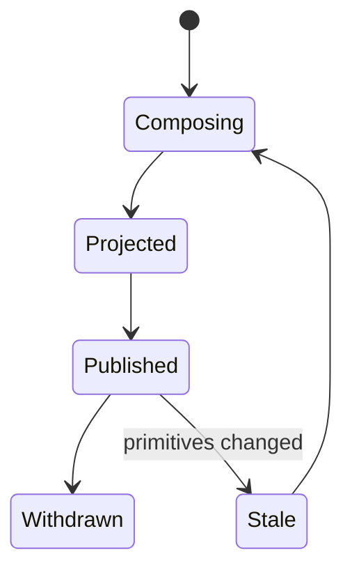

<a id="ucos-com-000001-workflows"></a>
##### Workflows

- resolve existence → gather knowledge + meaning → traverse relationships → apply context + policies → project → publish with hash

<a id="ucos-com-000001-authorities"></a>
##### Authorities

- Context Authority (what may be projected in scope); Merchant Authority (publication).

<a id="ucos-com-000001-permissions"></a>
##### Permissions

- commerce.project (context-scoped writer)
- commerce.publish (merchant authority)
- commerce.read (context-scoped)

<a id="ucos-com-000001-privacy-model"></a>
##### Privacy Model

Projections involving personal data minimize via Perspective before publication; commercial identity is pseudonymous by default.

<a id="ucos-com-000001-audit-model"></a>
##### Audit Model

Every projection records its primitive inputs and hash, so any commercial object is reproducible and its history reconstructable.

<a id="ucos-com-000001-digital-twin-model"></a>
##### Digital Twin Model

Commercial Twin mirrors the real-world commercial state (availability, status, ownership) continuously from observations.

<a id="ucos-com-000001-agent-model"></a>
##### Agent Model

Commerce Agent detects projection staleness when primitives change and re-projects under governance.

<a id="ucos-com-000001-runtime-model"></a>
##### Runtime Model

Projections are computed and content-hashed; caching keyed by input primitive versions guarantees consistency.

<a id="ucos-com-000001-scaling-model"></a>
##### Scaling Model

Projection is parallelizable per existence; catalog reads serve cached hashes with primitive-version invalidation.

<a id="ucos-com-000001-multi-tenant-model"></a>
##### Multi-Tenant Model

Commerce projections are strictly tenant-scoped; cross-tenant catalog requires published marketplace relationship.

<a id="ucos-com-000001-geo-distribution-model"></a>
##### Geo-Distribution Model

Contextual distribution is projection-time: language, currency, tax, compliance are applied from the Context registry — never compiled in.

<a id="ucos-com-000001-failure-model"></a>
##### Failure Model

Primitive staleness, context policy conflict, authority gap, hash mismatch on re-projection.

<a id="ucos-com-000001-recovery-model"></a>
##### Recovery Model

Projections are pure functions of primitives — recovery is re-derivation, never restore.

<a id="ucos-com-000001-certification-model"></a>
##### Certification Model

Projection must pass primitive-conformance (zero hardcoded commerce terms), context validity, and hash reproducibility.

<a id="ucos-com-000001-migration-model"></a>
##### Migration Model

New commercial models are registry additions to projection types; no schema migration ever touches primitives.

<a id="ucos-com-000001-implementation-blueprint"></a>
##### Implementation Blueprint

Build order for COM: (1) define registry entries — this domain owns by projection: product / service / bundle / offer / subscription / contract / license / membership / listing / asset / experience as registry truth, not code; (2) implement the contract surface first (commerce.project, commerce.reproject, commerce.publish) and validate against COM boundaries; (3) event-source all state so history is reconstructable; (4) wire the enforcement points — authority check, policy guard, evidence binding, trace — in-line, with no bypass path; (5) add tests per the Testing Architecture, citing evidence per gate; (6) obtain Verification and Certification before activation. Acceptance: the Zero Partial and Law 001 audits pass, every action answers the seven explainability questions, and this domain mutates no other domain internals.

<a id="ucos-com-000001-sequence-diagrams"></a>
##### Sequence Diagrams

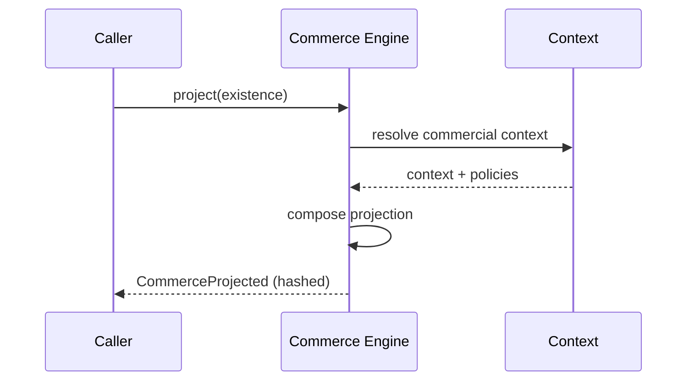

<a id="ucos-com-000001-state-diagrams"></a>
##### State Diagrams

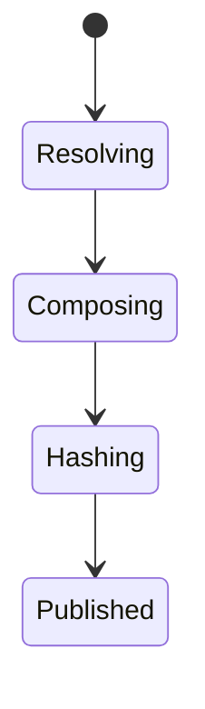

<a id="ucos-gps-000001"></a>
#### UCOS-GPS-000001 · Global Products & Services Architecture

Owner [Commerce](#d-biz) · managed in `_registry/manifest.json` → `UCOS-GPS-000001`, content `_registry/content-commerce.json` → `GPS` · inherits the [standard contract](../UCOS-MASTER.md#standard-contract)

<a id="ucos-gps-000001-concepts"></a>
##### Concepts

Global Products & Services supports all industries, categories, product types, service types, business models, languages, currencies, regions, countries, territories, marketplaces, channels, and future commercial domains without redesign. This is achieved because none of those concepts exist in the platform — they are registry entries projected at runtime.

<a id="ucos-gps-000001-ontology"></a>
##### Ontology

A product or service is an Existence with commercial projections. Industry, category, brand, and channel are Context and Semantic constructs, not schema fields.

<a id="ucos-gps-000001-taxonomy"></a>
##### Taxonomy

By projection type: Product / Service / Digital / Physical / Hybrid / Future. By model: any registry-defined commercial model. By reach: Local / National / Global / Future.

<a id="ucos-gps-000001-data-model"></a>
##### Data Model

```yaml
GlobalCatalogEntry:
  existence: <Identity>
  semanticConcept: <SemanticModel>   # 'phone' across all languages
  classifications: [<Taxonomy node>]
  contexts: [<Context>]               # where it is offered
  commercialProjections: [<CommercialProjection>]
  localization: [{locale, projection}]
```

<a id="ucos-gps-000001-graph-model"></a>
##### Graph Model

(:Entry)-[:SEMANTIC_CONCEPT]->(:Concept); (:Entry)-[:CLASSIFIED_AS]->(:Category); (:Entry)-[:OFFERED_IN]->(:Context); (:Entry)-[:LOCALIZED_AS]->(:Localization)

<a id="ucos-gps-000001-apis"></a>
##### APIs

*Designed interface: the contract the domain is built towards. The routes it serves today are on its card.*

- GET  /catalog.v1.entry/{id}
- POST /catalog.v1.query
- GET  /catalog.v1.localized/{id}/{locale}
- POST /catalog.v1.resolve

<a id="ucos-gps-000001-events"></a>
##### Events

- CatalogResolved
- CatalogLocalized
- CatalogDelisted
- CatalogFeatured

<a id="ucos-gps-000001-commands"></a>
##### Commands

- catalog.resolve
- catalog.localize
- catalog.feature
- catalog.delist

<a id="ucos-gps-000001-queries"></a>
##### Queries

- catalog.search
- catalog.byCategory
- catalog.byContext
- catalog.timeline

<a id="ucos-gps-000001-state-machines"></a>
##### State Machines

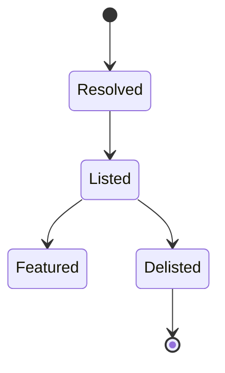

<a id="ucos-gps-000001-workflows"></a>
##### Workflows

- resolve existence + semantic concept → classify per context → localize per locale → list under context policy

<a id="ucos-gps-000001-authorities"></a>
##### Authorities

- Catalog Authority (listing), Locale Authority (localization validity).

<a id="ucos-gps-000001-permissions"></a>
##### Permissions

- catalog.list (catalog authority)
- catalog.localize (locale authority)
- catalog.read (context-scoped)

<a id="ucos-gps-000001-privacy-model"></a>
##### Privacy Model

Catalog entries with personal attribution (e.g., artisan provenance) require consent scope.

<a id="ucos-gps-000001-audit-model"></a>
##### Audit Model

Every listing and localization records authority, context, and semantic version.

<a id="ucos-gps-000001-digital-twin-model"></a>
##### Digital Twin Model

Catalog Twin tracks real-world availability and lifecycle state across all contexts.

<a id="ucos-gps-000001-agent-model"></a>
##### Agent Model

Catalog Agent auto-completes semantics, detects duplicates across locales, and proposes classifications.

<a id="ucos-gps-000001-runtime-model"></a>
##### Runtime Model

Resolution is locale-aware with semantic disambiguation; catalog reads are the hottest path and heavily cached.

<a id="ucos-gps-000001-scaling-model"></a>
##### Scaling Model

Globally replicated read layer; write path is authority-gated and low-throughput.

<a id="ucos-gps-000001-multi-tenant-model"></a>
##### Multi-Tenant Model

Catalogs are tenant-scoped; a shared marketplace aggregates with explicit published relationship.

<a id="ucos-gps-000001-geo-distribution-model"></a>
##### Geo-Distribution Model

Localization and compliance projection are per-region; the same existence projects differently per jurisdiction.

<a id="ucos-gps-000001-failure-model"></a>
##### Failure Model

Semantic ambiguity across locales, category orphaning, context policy conflict, stale localization.

<a id="ucos-gps-000001-recovery-model"></a>
##### Recovery Model

Entries re-project from primitives; localization history is versioned and reversible.

<a id="ucos-gps-000001-certification-model"></a>
##### Certification Model

Entry must pass semantic uniqueness, classification validity, and localization completeness.

<a id="ucos-gps-000001-migration-model"></a>
##### Migration Model

New locales/industries are registry additions — zero downtime, zero schema change.

<a id="ucos-gps-000001-implementation-blueprint"></a>
##### Implementation Blueprint

Build order for GPS: (1) define registry entries — this domain owns by projection type: product / service / digital / physical / hybrid / future as registry truth, not code; (2) implement the contract surface first (catalog.resolve, catalog.localize, catalog.feature) and validate against GPS boundaries; (3) event-source all state so history is reconstructable; (4) wire the enforcement points — authority check, policy guard, evidence binding, trace — in-line, with no bypass path; (5) add tests per the Testing Architecture, citing evidence per gate; (6) obtain Verification and Certification before activation. Acceptance: the Zero Partial and Law 001 audits pass, every action answers the seven explainability questions, and this domain mutates no other domain internals.

<a id="ucos-gps-000001-sequence-diagrams"></a>
##### Sequence Diagrams

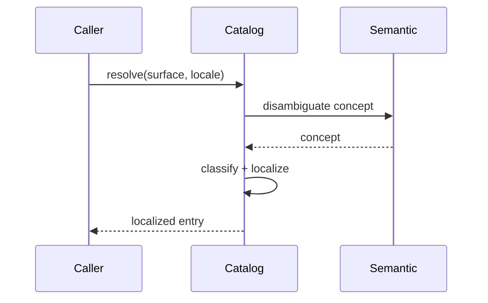

<a id="ucos-gps-000001-state-diagrams"></a>
##### State Diagrams

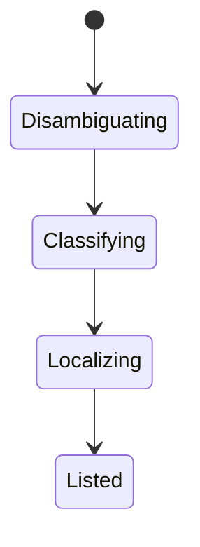

<a id="ucos-prc-000001"></a>
#### UCOS-PRC-000001 · Pricing Architecture

Owner [Commerce](#d-biz) · managed in `_registry/manifest.json` → `UCOS-PRC-000001`, content `_registry/content-commerce.json` → `PRC` · inherits the [standard contract](../UCOS-MASTER.md#standard-contract)

<a id="ucos-prc-000001-concepts"></a>
##### Concepts

Pricing is a projection of value under context — never a stored attribute. Price depends on cost knowledge, market context, customer context, competitive relationships, time, and policy. The same existence has infinitely many valid prices across contexts.

<a id="ucos-prc-000001-ontology"></a>
##### Ontology

Price is a function: f(cost, market, customer, competitor, time, policy) → monetary expression. Currency is a Context property; tax is a Policy projection.

<a id="ucos-prc-000001-taxonomy"></a>
##### Taxonomy

By model: Static / Dynamic / Usage / Tiered / Negotiated / Auction / Future model (registry). By dimension: List / Spot / Contract / Promotional.

<a id="ucos-prc-000001-data-model"></a>
##### Data Model

```yaml
PricingProjection:
  existence: <Identity>
  baseExpression: <registry expression>
  modifiers: [<registry modifier>]
  currencyUnit: <Context-derived>
  taxProjection: <Policy-derived>
  context: <Context>
  temporal: {asOf}
  confidence: <0..1>
```

<a id="ucos-prc-000001-graph-model"></a>
##### Graph Model

(:Price)-[:PRICES]->(:Existence); (:Price)-[:MODIFIED_BY]->(:Context|:Policy); (:Price)-[:COMPETES_WITH]->(:Price); (:Price)-[:VALID_IN]->(:Context)

<a id="ucos-prc-000001-apis"></a>
##### APIs

*Designed interface: the contract the domain is built towards. The routes it serves today are on its card.*

- POST /pricing.v1.quote
- GET  /pricing.v1.history/{id}
- POST /pricing.v1.simulate
- GET  /pricing.v1.byContext/{contextId}

<a id="ucos-prc-000001-events"></a>
##### Events

- PricingQuoted
- PricingAdjusted
- PricingSimulated
- PricingFrozen

<a id="ucos-prc-000001-commands"></a>
##### Commands

- pricing.quote
- pricing.adjust
- pricing.simulate
- pricing.freeze

<a id="ucos-prc-000001-queries"></a>
##### Queries

- pricing.history
- pricing.byContext
- pricing.competitors
- pricing.timeline

<a id="ucos-prc-000001-state-machines"></a>
##### State Machines

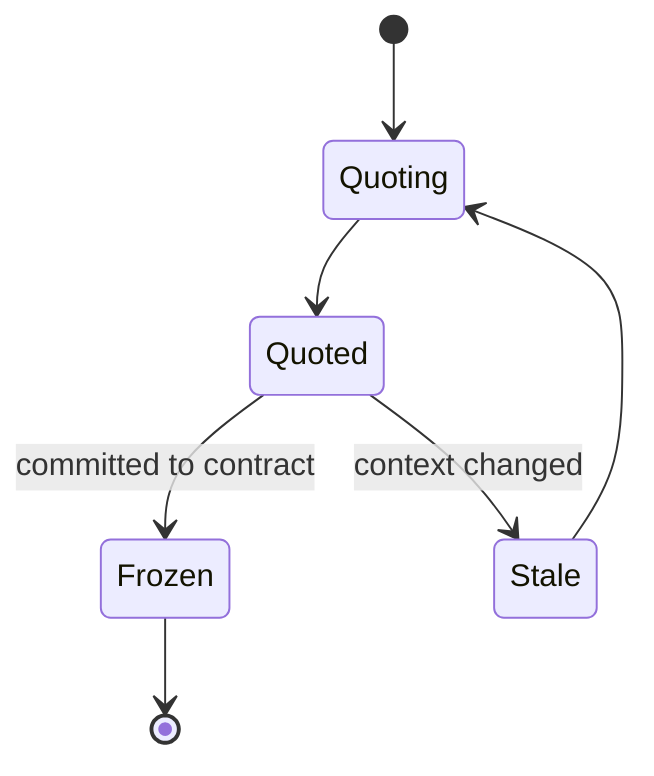

<a id="ucos-prc-000001-workflows"></a>
##### Workflows

- resolve cost knowledge → apply market context → apply customer context → apply policy modifiers → project currency + tax → quote

<a id="ucos-prc-000001-authorities"></a>
##### Authorities

- Pricing Authority (model governance); merchant authority sets base within policy bounds.

<a id="ucos-prc-000001-permissions"></a>
##### Permissions

- pricing.quote (any authenticated, context-scoped)
- pricing.adjust (pricing authority)
- pricing.simulate (simulation authority)

<a id="ucos-prc-000001-privacy-model"></a>
##### Privacy Model

Customer-specific pricing is personal data; quotes are consent-scoped and retention-limited.

<a id="ucos-prc-000001-audit-model"></a>
##### Audit Model

Every quote records the full input set — cost, context, policy version — so it is reproducible and explainable.

<a id="ucos-prc-000001-digital-twin-model"></a>
##### Digital Twin Model

Pricing Twin mirrors real-world price observations (competitor feeds, market data) and flags drift from model output.

<a id="ucos-prc-000001-agent-model"></a>
##### Agent Model

Pricing Agent continuously re-quotes on context change and runs simulations before applying adjustments.

<a id="ucos-prc-000001-runtime-model"></a>
##### Runtime Model

Quoting is a deterministic function evaluation cached by input hash; staleness invalidates on context/policy change.

<a id="ucos-prc-000001-scaling-model"></a>
##### Scaling Model

Quote caching is the critical path; evaluation is sub-millisecond with precompiled modifier chains.

<a id="ucos-prc-000001-multi-tenant-model"></a>
##### Multi-Tenant Model

Pricing models are tenant-scoped; a shared marketplace sees only published prices, not competitor internals.

<a id="ucos-prc-000001-geo-distribution-model"></a>
##### Geo-Distribution Model

Currency, tax, and duty projection are jurisdiction-derived at quote time — never hardcoded per market.

<a id="ucos-prc-000001-failure-model"></a>
##### Failure Model

Circular modifier dependencies, policy conflict, stale market feed, currency conversion failure.

<a id="ucos-prc-000001-recovery-model"></a>
##### Recovery Model

Quotes recompute from inputs; frozen prices are immutable contract artifacts.

<a id="ucos-prc-000001-certification-model"></a>
##### Certification Model

Pricing model must pass determinism, policy conformance, and currency/tax projection validity.

<a id="ucos-prc-000001-migration-model"></a>
##### Migration Model

New pricing models and modifiers are registry additions.

<a id="ucos-prc-000001-implementation-blueprint"></a>
##### Implementation Blueprint

Build order for PRC: (1) define registry entries — this domain owns by model: static / dynamic / usage / tiered / negotiated / auction / future model (registry) as registry truth, not code; (2) implement the contract surface first (pricing.quote, pricing.adjust, pricing.simulate) and validate against PRC boundaries; (3) event-source all state so history is reconstructable; (4) wire the enforcement points — authority check, policy guard, evidence binding, trace — in-line, with no bypass path; (5) add tests per the Testing Architecture, citing evidence per gate; (6) obtain Verification and Certification before activation. Acceptance: the Zero Partial and Law 001 audits pass, every action answers the seven explainability questions, and this domain mutates no other domain internals.

<a id="ucos-prc-000001-sequence-diagrams"></a>
##### Sequence Diagrams

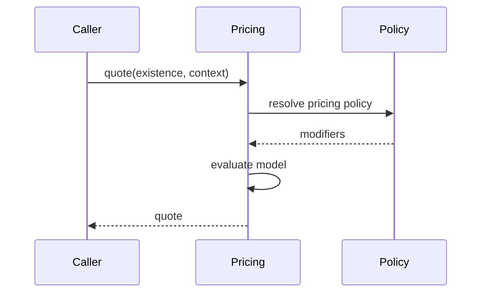

<a id="ucos-prc-000001-state-diagrams"></a>
##### State Diagrams

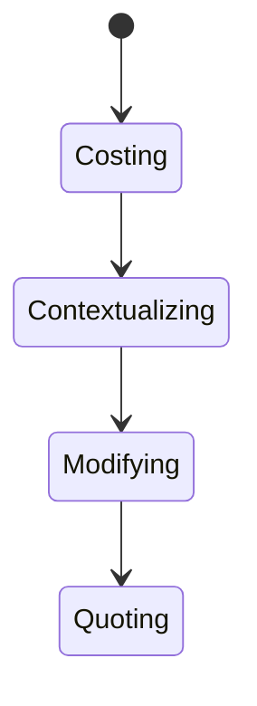

<a id="ucos-ofr-000001"></a>
#### UCOS-OFR-000001 · Offer Architecture

Owner [Commerce](#d-biz) · managed in `_registry/manifest.json` → `UCOS-OFR-000001`, content `_registry/content-commerce.json` → `OFR` · inherits the [standard contract](../UCOS-MASTER.md#standard-contract)

<a id="ucos-ofr-000001-concepts"></a>
##### Concepts

An Offer is a time-bounded, context-bound commercial projection bundling existence, pricing, and terms under policy. Offers are ephemeral by nature — they are not things, they are proposals.

<a id="ucos-ofr-000001-ontology"></a>
##### Ontology

Offer has a subject existence, a pricing projection, terms (policy-derived), a temporal window, and a context. Bundles are offers over multiple existences with relationship rules.

<a id="ucos-ofr-000001-taxonomy"></a>
##### Taxonomy

By structure: Single / Bundle / Configurable / Tiered. By temporality: Flash / Standing / Seasonal / Evergreen. By targeting: Universal / Segment / Individual (consent-gated).

<a id="ucos-ofr-000001-data-model"></a>
##### Data Model

```yaml
OfferProjection:
  offerId: <Identity>
  subjects: [<Identity>]
  pricingProjection: <PricingProjection>
  terms: [<Policy>]
  context: <Context>
  temporal: {startsAt, endsAt}
  eligibility: <registry expression>
  status: <Draft|Active|Expired|Redeemed>
```

<a id="ucos-ofr-000001-graph-model"></a>
##### Graph Model

(:Offer)-[:OFFERS]->(:Existence); (:Offer)-[:PRICED_BY]->(:Price); (:Offer)-[:GOVERNED_BY]->(:Policy); (:Offer)-[:VALID_IN]->(:Context)

<a id="ucos-ofr-000001-apis"></a>
##### APIs

*Designed interface: the contract the domain is built towards. The routes it serves today are on its card.*

- POST /offer.v1.create
- GET  /offer.v1/{id}
- POST /offer.v1.eligible
- POST /offer.v1.redeem

<a id="ucos-ofr-000001-events"></a>
##### Events

- OfferCreated
- OfferActivated
- OfferRedeemed
- OfferExpired
- OfferExtended

<a id="ucos-ofr-000001-commands"></a>
##### Commands

- offer.create
- offer.activate
- offer.expire
- offer.redeem
- offer.extend

<a id="ucos-ofr-000001-queries"></a>
##### Queries

- offer.byId
- offer.eligible
- offer.byContext
- offer.expiring

<a id="ucos-ofr-000001-state-machines"></a>
##### State Machines

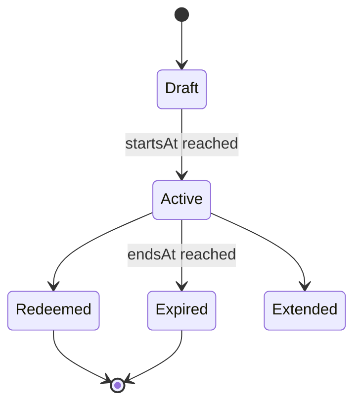

<a id="ucos-ofr-000001-workflows"></a>
##### Workflows

- compose subjects + pricing → attach terms → set eligibility → activate → redeem under policy → expire

<a id="ucos-ofr-000001-authorities"></a>
##### Authorities

- Merchant Authority (creation), Pricing Authority (price validity), Policy Authority (terms).

<a id="ucos-ofr-000001-permissions"></a>
##### Permissions

- offer.create (merchant authority)
- offer.redeem (subject of offer, policy-checked)
- offer.read (context-scoped)

<a id="ucos-ofr-000001-privacy-model"></a>
##### Privacy Model

Individual-targeted offers require consent; segment targeting is aggregated only.

<a id="ucos-ofr-000001-audit-model"></a>
##### Audit Model

Every redemption records offer version, pricing inputs, and policy evaluation — the basis of revenue audit.

<a id="ucos-ofr-000001-digital-twin-model"></a>
##### Digital Twin Model

Offer Twin tracks real-world redemption patterns and predicts uptake for simulation.

<a id="ucos-ofr-000001-agent-model"></a>
##### Agent Model

Offer Agent proposes and tunes offers from observed demand, under pricing and policy governance.

<a id="ucos-ofr-000001-runtime-model"></a>
##### Runtime Model

Eligibility is a policy evaluation cached per (offer, subject-segment); redemption is idempotent.

<a id="ucos-ofr-000001-scaling-model"></a>
##### Scaling Model

Read-heavy during active windows; redemption is transactional and sharded by offer.

<a id="ucos-ofr-000001-multi-tenant-model"></a>
##### Multi-Tenant Model

Offers are tenant-scoped; cross-tenant offers require marketplace relationship and both merchants' authority.

<a id="ucos-ofr-000001-geo-distribution-model"></a>
##### Geo-Distribution Model

Offer validity is jurisdiction-projected — terms legal in one region may not be offered in another.

<a id="ucos-ofr-000001-failure-model"></a>
##### Failure Model

Temporal inversion, eligibility policy conflict, over-redemption, pricing drift mid-offer.

<a id="ucos-ofr-000001-recovery-model"></a>
##### Recovery Model

Redemptions are immutable events; expired offers are historical artifacts, never deleted.

<a id="ucos-ofr-000001-certification-model"></a>
##### Certification Model

Offer must pass temporal validity, policy conformance, pricing version pinning, and eligibility determinism.

<a id="ucos-ofr-000001-migration-model"></a>
##### Migration Model

New offer structures are registry additions.

<a id="ucos-ofr-000001-implementation-blueprint"></a>
##### Implementation Blueprint

Build order for OFR: (1) define registry entries — this domain owns by structure: single / bundle / configurable / tiered as registry truth, not code; (2) implement the contract surface first (offer.create, offer.activate, offer.expire) and validate against OFR boundaries; (3) event-source all state so history is reconstructable; (4) wire the enforcement points — authority check, policy guard, evidence binding, trace — in-line, with no bypass path; (5) add tests per the Testing Architecture, citing evidence per gate; (6) obtain Verification and Certification before activation. Acceptance: the Zero Partial and Law 001 audits pass, every action answers the seven explainability questions, and this domain mutates no other domain internals.

<a id="ucos-ofr-000001-sequence-diagrams"></a>
##### Sequence Diagrams

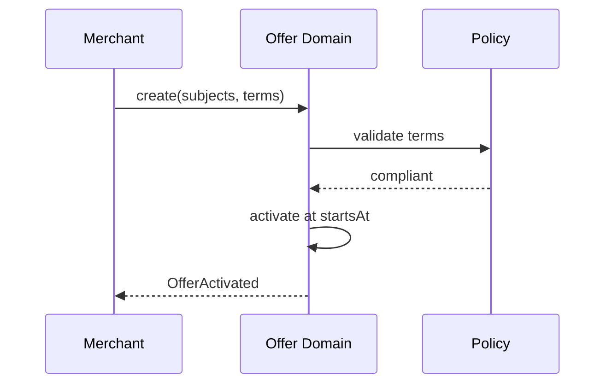

<a id="ucos-ofr-000001-state-diagrams"></a>
##### State Diagrams

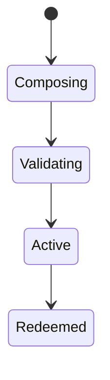

<a id="ucos-sub-000001"></a>
#### UCOS-SUB-000001 · Subscription Architecture

Owner [Commerce](#d-biz) · managed in `_registry/manifest.json` → `UCOS-SUB-000001`, content `_registry/content-commerce.json` → `SUB` · inherits the [standard contract](../UCOS-MASTER.md#standard-contract)

<a id="ucos-sub-000001-concepts"></a>
##### Concepts

A Subscription is a temporal, policy-governed recurring relationship — not a stored object. It is the projection of an ongoing commercial relationship with entitlement, obligation, and lifecycle.

<a id="ucos-sub-000001-ontology"></a>
##### Ontology

Subscription has a subject, a subscriber, an entitlement (policy projection), a billing schedule (projection), and a lifecycle state machine. It is a specialized Relationship type projected commercially.

<a id="ucos-sub-000001-taxonomy"></a>
##### Taxonomy

By cadence: Fixed-period / Usage-based / Milestone / Event-driven. By commitment: Evergreen / Term / Auto-renew / Trial. By entitlement: Tiered / Per-seat / Volume / Custom.

<a id="ucos-sub-000001-data-model"></a>
##### Data Model

```yaml
SubscriptionProjection:
  subscriptionId: <Identity>
  relationship: <Relationship>   # the underlying truth
  entitlements: [<Policy>]
  cadence: <registry expression>
  temporal: {startedAt, currentPeriod, renewAt}
  lifecycleState: <registry state>
  context: <Context>
```

<a id="ucos-sub-000001-graph-model"></a>
##### Graph Model

(:Subscription)-[:PROJECTS]->(:Relationship); (:Subscription)-[:ENTITLED_BY]->(:Policy); (:Subscription)-[:BILLED_BY]->(:BillingProjection); (:Subscription)-[:HELD_BY]->(:Identity)

<a id="ucos-sub-000001-apis"></a>
##### APIs

*Designed interface: the contract the domain is built towards. The routes it serves today are on its card.*

- POST /subscription.v1.create
- GET  /subscription.v1/{id}
- POST /subscription.v1/{id}/renew
- POST /subscription.v1/{id}/cancel
- GET  /subscription.v1.entitlements/{id}

<a id="ucos-sub-000001-events"></a>
##### Events

- SubscriptionCreated
- SubscriptionRenewed
- SubscriptionCancelled
- SubscriptionUpgraded
- SubscriptionSuspended
- EntitlementChanged

<a id="ucos-sub-000001-commands"></a>
##### Commands

- subscription.create
- subscription.renew
- subscription.cancel
- subscription.upgrade
- subscription.downgrade
- subscription.suspend

<a id="ucos-sub-000001-queries"></a>
##### Queries

- subscription.byId
- subscription.byHolder
- subscription.entitlements
- subscription.expiring

<a id="ucos-sub-000001-state-machines"></a>
##### State Machines

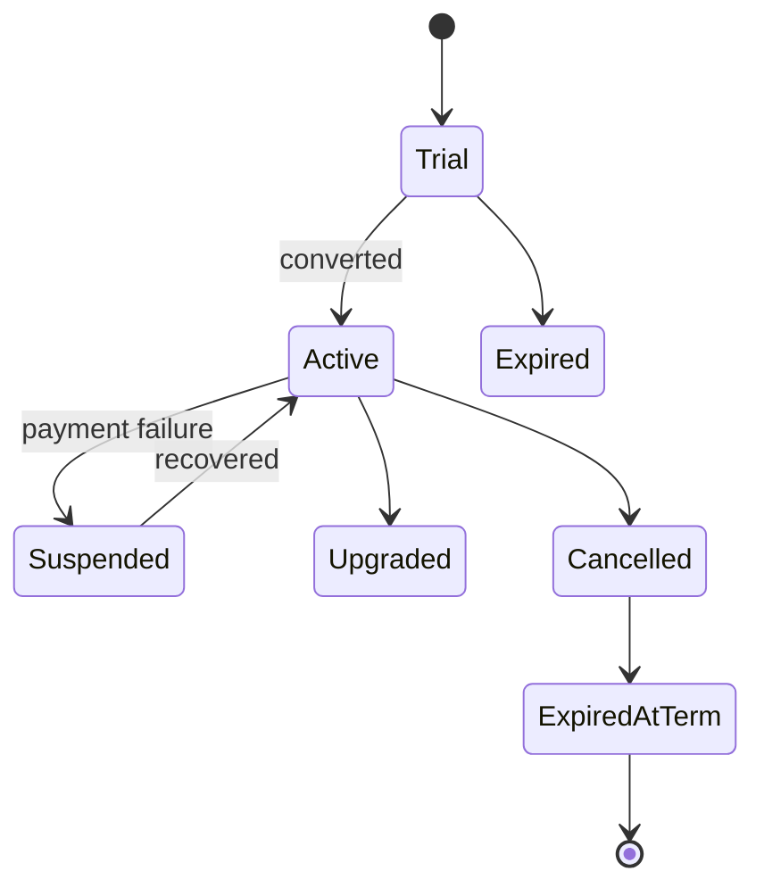

<a id="ucos-sub-000001-workflows"></a>
##### Workflows

- create relationship → attach entitlement policy → schedule cadence → bill → renew/cancel per policy → expire

<a id="ucos-sub-000001-authorities"></a>
##### Authorities

- Merchant Authority (terms), Holder Authority (cancel/modify), Billing Authority (schedule).

<a id="ucos-sub-000001-permissions"></a>
##### Permissions

- subscription.create (merchant authority)
- subscription.cancel (holder authority)
- subscription.read (holder or merchant)

<a id="ucos-sub-000001-privacy-model"></a>
##### Privacy Model

Subscription history is personal data; retention follows consent and legal basis (contract performance).

<a id="ucos-sub-000001-audit-model"></a>
##### Audit Model

Every lifecycle transition records the triggering event, policy applied, and authority — full reconstructable history.

<a id="ucos-sub-000001-digital-twin-model"></a>
##### Digital Twin Model

Subscription Twin mirrors real-world service delivery state against entitlement — detecting over- or under-delivery.

<a id="ucos-sub-000001-agent-model"></a>
##### Agent Model

Subscription Agent monitors renewal risk, payment failures, and usage-vs-entitlement gaps, acting within policy.

<a id="ucos-sub-000001-runtime-model"></a>
##### Runtime Model

Lifecycle is an event-driven state machine; cadence is a scheduler projection, not a polling loop.

<a id="ucos-sub-000001-scaling-model"></a>
##### Scaling Model

Renewal waves are smoothed across periods; billing is sharded by holder.

<a id="ucos-sub-000001-multi-tenant-model"></a>
##### Multi-Tenant Model

Subscriptions never cross tenants; marketplace subscriptions involve both tenants' authority.

<a id="ucos-sub-000001-geo-distribution-model"></a>
##### Geo-Distribution Model

Cancellation and renewal terms are jurisdiction-projected — consumer protection policy applies locally.

<a id="ucos-sub-000001-failure-model"></a>
##### Failure Model

Entitlement drift, cadence slip, orphaned billing, policy conflict on upgrade.

<a id="ucos-sub-000001-recovery-model"></a>
##### Recovery Model

State machine is event-sourced; recovery replays transitions. Suspended state auto-recovers per policy.

<a id="ucos-sub-000001-certification-model"></a>
##### Certification Model

Subscription must pass entitlement-policy conformance, cadence validity, and lifecycle determinism.

<a id="ucos-sub-000001-migration-model"></a>
##### Migration Model

New cadences and entitlement models are registry additions.

<a id="ucos-sub-000001-implementation-blueprint"></a>
##### Implementation Blueprint

Build order for SUB: (1) define registry entries — this domain owns by cadence: fixed-period / usage-based / milestone / event-driven as registry truth, not code; (2) implement the contract surface first (subscription.create, subscription.renew, subscription.cancel) and validate against SUB boundaries; (3) event-source all state so history is reconstructable; (4) wire the enforcement points — authority check, policy guard, evidence binding, trace — in-line, with no bypass path; (5) add tests per the Testing Architecture, citing evidence per gate; (6) obtain Verification and Certification before activation. Acceptance: the Zero Partial and Law 001 audits pass, every action answers the seven explainability questions, and this domain mutates no other domain internals.

<a id="ucos-sub-000001-sequence-diagrams"></a>
##### Sequence Diagrams

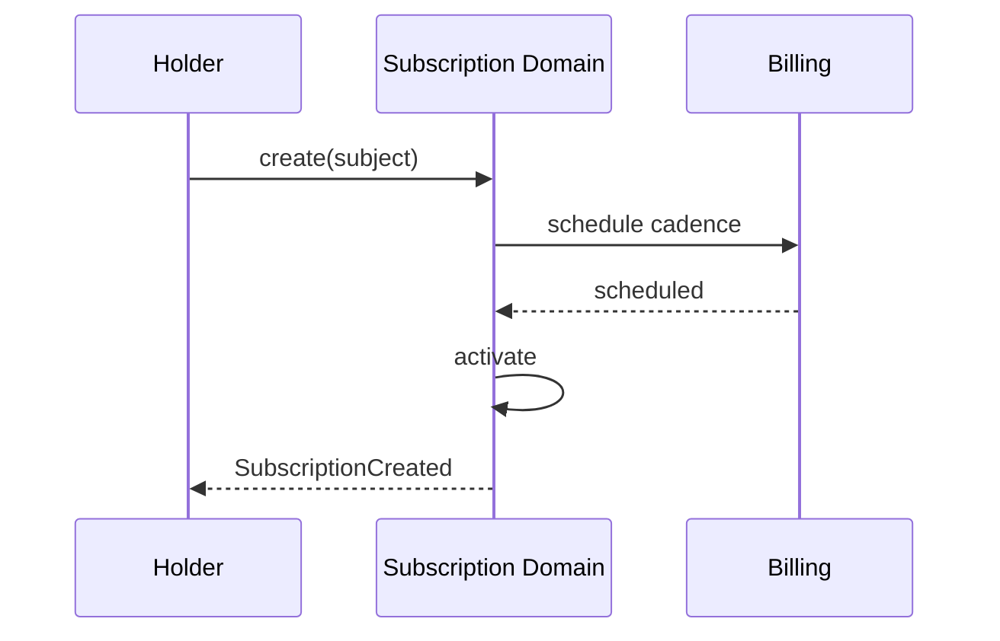

<a id="ucos-sub-000001-state-diagrams"></a>
##### State Diagrams

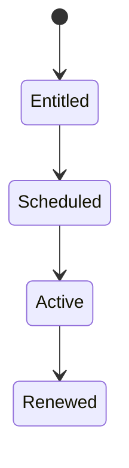

<a id="ucos-cnt-000001"></a>
#### UCOS-CNT-000001 · Contract Architecture

Owner [Commerce](#d-biz) · managed in `_registry/manifest.json` → `UCOS-CNT-000001`, content `_registry/content-commerce.json` → `CNT` · inherits the [standard contract](../UCOS-MASTER.md#standard-contract)

<a id="ucos-cnt-000001-concepts"></a>
##### Concepts

A Contract is a projection — an agreement whose truth lives in relationships, policies, authorities, evidence, and signatures. The platform never stores 'a contract' as a business object; it stores the primitives that make one enforceable and projects the contract at runtime.

<a id="ucos-cnt-000001-ontology"></a>
##### Ontology

Contract = Parties (relationships) + Terms (policies) + Signatures (evidence) + Obligations (rules) + Jurisdiction (context). Its enforceability is computed, not assumed.

<a id="ucos-cnt-000001-taxonomy"></a>
##### Taxonomy

By formation: Signed / Implicit / Programmatic / Smart. By duration: One-time / Term / Evergreen. By enforceability: Executed / Executory / Void / Voidable.

<a id="ucos-cnt-000001-data-model"></a>
##### Data Model

```yaml
ContractProjection:
  contractId: <Identity>
  parties: [<Relationship>]
  terms: [<Policy>]
  obligations: [<Rule>]
  signatures: [<Evidence>]
  jurisdiction: <Context>
  temporal: {executedAt, effectiveFrom, terminatesAt}
  enforceability: <Trust>
```

<a id="ucos-cnt-000001-graph-model"></a>
##### Graph Model

(:Contract)-[:BINDS]->(:Relationship); (:Contract)-[:TERMED_BY]->(:Policy); (:Contract)-[:SIGNED_BY]->(:Evidence); (:Contract)-[:GOVERNED_IN]->(:Context)

<a id="ucos-cnt-000001-apis"></a>
##### APIs

*Designed interface: the contract the domain is built towards. The routes it serves today are on its card.*

- POST /contract.v1.form
- GET  /contract.v1/{id}
- POST /contract.v1/{id}/amend
- POST /contract.v1/{id}/execute
- GET  /contract.v1.enforceability/{id}

<a id="ucos-cnt-000001-events"></a>
##### Events

- ContractFormed
- ContractAmended
- ContractExecuted
- ContractTerminated
- ContractDisputed
- ObligationTriggered

<a id="ucos-cnt-000001-commands"></a>
##### Commands

- contract.form
- contract.amend
- contract.execute
- contract.terminate
- contract.dispute

<a id="ucos-cnt-000001-queries"></a>
##### Queries

- contract.byId
- contract.byParty
- contract.enforceability
- contract.obligations
- contract.timeline

<a id="ucos-cnt-000001-state-machines"></a>
##### State Machines

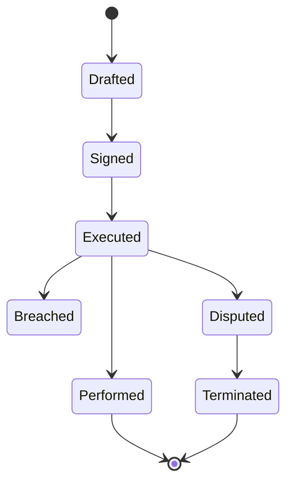

<a id="ucos-cnt-000001-workflows"></a>
##### Workflows

- form terms → bind parties → collect signature evidence → compute enforceability → execute → trigger obligations → perform/terminate

<a id="ucos-cnt-000001-authorities"></a>
##### Authorities

- Each party's authority signs; jurisdiction authority governs enforceability computation.

<a id="ucos-cnt-000001-permissions"></a>
##### Permissions

- contract.form (party authorities)
- contract.execute (all party authorities)
- contract.read (party or jurisdiction authority)

<a id="ucos-cnt-000001-privacy-model"></a>
##### Privacy Model

Contract contents are access-restricted to parties and jurisdiction authorities; metadata is auditable.

<a id="ucos-cnt-000001-audit-model"></a>
##### Audit Model

Every amendment, obligation trigger, and dispute is preserved with evidence. The contract's full lifecycle is reconstructable.

<a id="ucos-cnt-000001-digital-twin-model"></a>
##### Digital Twin Model

Contract Twin tracks real-world performance against obligations — delivering, delaying, breaching.

<a id="ucos-cnt-000001-agent-model"></a>
##### Agent Model

Contract Agent monitors obligation triggers, detects breach risk, and escalates disputes under governance.

<a id="ucos-cnt-000001-runtime-model"></a>
##### Runtime Model

Obligation evaluation is rule-driven and event-triggered; enforceability is a trust computation over signatures.

<a id="ucos-cnt-000001-scaling-model"></a>
##### Scaling Model

Contracts are low-write, high-audit; sharded by jurisdiction for sovereignty.

<a id="ucos-cnt-000001-multi-tenant-model"></a>
##### Multi-Tenant Model

Contracts bind tenants via relationships; cross-tenant contracts require both authorities.

<a id="ucos-cnt-000001-geo-distribution-model"></a>
##### Geo-Distribution Model

Jurisdiction is a first-class field — the same terms project differently across legal systems.

<a id="ucos-cnt-000001-failure-model"></a>
##### Failure Model

Missing signature authority, term conflict, jurisdiction gap, evidence revocation.

<a id="ucos-cnt-000001-recovery-model"></a>
##### Recovery Model

Amendments append; nothing is overwritten. Voiding is a recorded outcome with full history retained.

<a id="ucos-cnt-000001-certification-model"></a>
##### Certification Model

Contract must pass signature completeness, term-policy conformance, and jurisdiction validity to be enforceable.

<a id="ucos-cnt-000001-migration-model"></a>
##### Migration Model

New term types and contract kinds are registry additions.

<a id="ucos-cnt-000001-implementation-blueprint"></a>
##### Implementation Blueprint

Build order for CNT: (1) define registry entries — this domain owns by formation: signed / implicit / programmatic / smart as registry truth, not code; (2) implement the contract surface first (contract.form, contract.amend, contract.execute) and validate against CNT boundaries; (3) event-source all state so history is reconstructable; (4) wire the enforcement points — authority check, policy guard, evidence binding, trace — in-line, with no bypass path; (5) add tests per the Testing Architecture, citing evidence per gate; (6) obtain Verification and Certification before activation. Acceptance: the Zero Partial and Law 001 audits pass, every action answers the seven explainability questions, and this domain mutates no other domain internals.

<a id="ucos-cnt-000001-sequence-diagrams"></a>
##### Sequence Diagrams

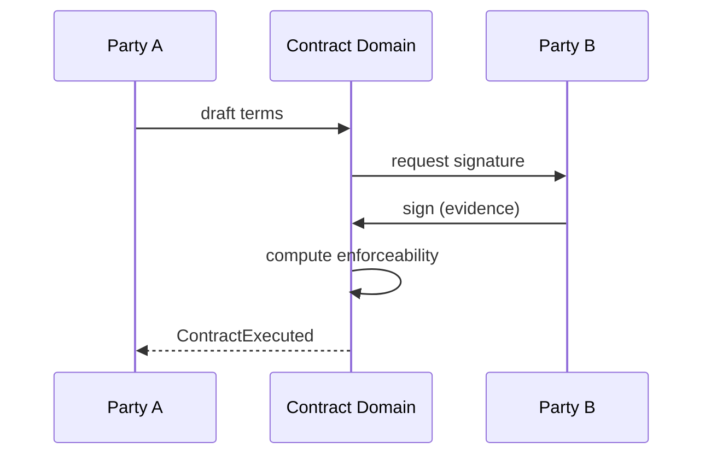

<a id="ucos-cnt-000001-state-diagrams"></a>
##### State Diagrams

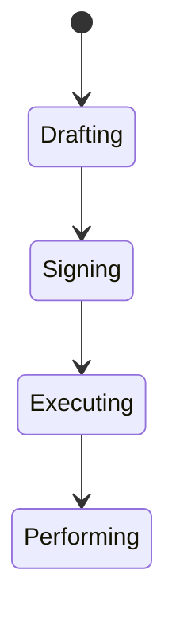

<a id="ucos-mkt-000001"></a>
#### UCOS-MKT-000001 · Marketplace Architecture

Owner [Commerce](#d-biz) · managed in `_registry/manifest.json` → `UCOS-MKT-000001`, content `_registry/content-commerce.json` → `MKT` · inherits the [standard contract](../UCOS-MASTER.md#standard-contract)

<a id="ucos-mkt-000001-concepts"></a>
##### Concepts

A Marketplace is a Context type — a governed environment where multiple tenants' projections are visible under a shared policy set. It is not a stored object; it is a scope in which commerce projections aggregate.

<a id="ucos-mkt-000001-ontology"></a>
##### Ontology

Marketplace has Participants (tenants with published relationships), Listing policies, Discovery mechanisms, and a governing Context. Participation is governed by relationship, not by code.

<a id="ucos-mkt-000001-taxonomy"></a>
##### Taxonomy

By model: First-party / Third-party / Hybrid / Consignment. By governance: Open / Curated / Invite-only. By scope: Local / National / Global.

<a id="ucos-mkt-000001-data-model"></a>
##### Data Model

```yaml
MarketplaceContext:
  marketplaceId: <Identity>
  context: <Context>
  participants: [<Relationship>]
  listingPolicy: <Policy>
  discoveryPolicy: <Policy>
  governance: <Authority>
  temporal: {effectiveFrom}
```

<a id="ucos-mkt-000001-graph-model"></a>
##### Graph Model

(:Marketplace)-[:PARTICIPATED_IN]->(:Identity); (:Marketplace)-[:LISTED_UNDER]->(:Policy); (:Marketplace)-[:DISCOVERED_VIA]->(:Policy); (:Marketplace)-[:GOVERNED_BY]->(:Authority)

<a id="ucos-mkt-000001-apis"></a>
##### APIs

*Designed interface: the contract the domain is built towards. The routes it serves today are on its card.*

- POST /marketplace.v1.join
- GET  /marketplace.v1/{id}
- POST /marketplace.v1.search
- POST /marketplace.v1.leave

<a id="ucos-mkt-000001-events"></a>
##### Events

- MarketplaceJoined
- MarketplaceLeft
- MarketplaceListed
- MarketplaceDelisted

<a id="ucos-mkt-000001-commands"></a>
##### Commands

- marketplace.join
- marketplace.leave
- marketplace.list
- marketplace.delist

<a id="ucos-mkt-000001-queries"></a>
##### Queries

- marketplace.search
- marketplace.participants
- marketplace.listings
- marketplace.timeline

<a id="ucos-mkt-000001-state-machines"></a>
##### State Machines

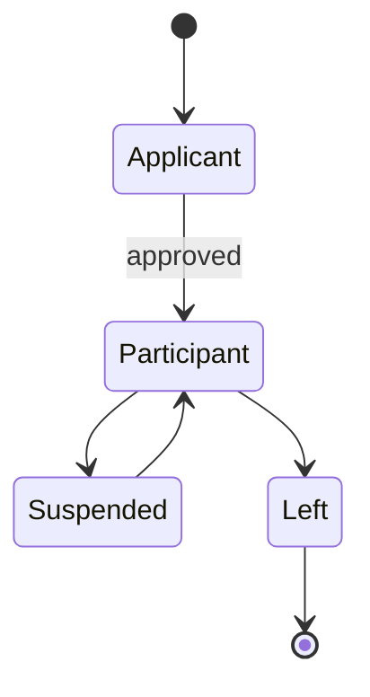

<a id="ucos-mkt-000001-workflows"></a>
##### Workflows

- apply under listing policy → approve via governance relationship → list projections → govern discovery → exit

<a id="ucos-mkt-000001-authorities"></a>
##### Authorities

- Marketplace Authority (governance), Merchant Authority (their own listings).

<a id="ucos-mkt-000001-permissions"></a>
##### Permissions

- marketplace.join (merchant authority + listing policy)
- marketplace.list (participant)
- marketplace.read (context-scoped)

<a id="ucos-mkt-000001-privacy-model"></a>
##### Privacy Model

Participant identity exposure follows the marketplace's published privacy policy and participant consent.

<a id="ucos-mkt-000001-audit-model"></a>
##### Audit Model

Every listing and governance action records authority and policy version.

<a id="ucos-mkt-000001-digital-twin-model"></a>
##### Digital Twin Model

Marketplace Twin aggregates participant twins into fleet-level health and emergence monitoring.

<a id="ucos-mkt-000001-agent-model"></a>
##### Agent Model

Marketplace Agent curates quality, detects policy violations, and proposes discovery optimizations.

<a id="ucos-mkt-000001-runtime-model"></a>
##### Runtime Model

Discovery is a context-filtered search over aggregated projections; ranking is policy-driven.

<a id="ucos-mkt-000001-scaling-model"></a>
##### Scaling Model

Search is the scaling bottleneck — handled by the Search Architecture with context-aware sharding.

<a id="ucos-mkt-000001-multi-tenant-model"></a>
##### Multi-Tenant Model

Marketplace is inherently multi-tenant — the only place projections aggregate, under explicit policy.

<a id="ucos-mkt-000001-geo-distribution-model"></a>
##### Geo-Distribution Model

A marketplace spanning jurisdictions partitions by jurisdiction policy; illegal cross-listings are projected out.

<a id="ucos-mkt-000001-failure-model"></a>
##### Failure Model

Policy conflict between marketplace and participant, discovery bias, listing spam, governance deadlock.

<a id="ucos-mkt-000001-recovery-model"></a>
##### Recovery Model

Participation is relationship-driven; leaving is clean and reversible by re-application.

<a id="ucos-mkt-000001-certification-model"></a>
##### Certification Model

Marketplace must publish its listing and discovery policies and prove their enforcement.

<a id="ucos-mkt-000001-migration-model"></a>
##### Migration Model

New marketplace models are registry additions.

<a id="ucos-mkt-000001-implementation-blueprint"></a>
##### Implementation Blueprint

Build order for MKT: (1) define registry entries — this domain owns by model: first-party / third-party / hybrid / consignment as registry truth, not code; (2) implement the contract surface first (marketplace.join, marketplace.leave, marketplace.list) and validate against MKT boundaries; (3) event-source all state so history is reconstructable; (4) wire the enforcement points — authority check, policy guard, evidence binding, trace — in-line, with no bypass path; (5) add tests per the Testing Architecture, citing evidence per gate; (6) obtain Verification and Certification before activation. Acceptance: the Zero Partial and Law 001 audits pass, every action answers the seven explainability questions, and this domain mutates no other domain internals.

<a id="ucos-mkt-000001-sequence-diagrams"></a>
##### Sequence Diagrams

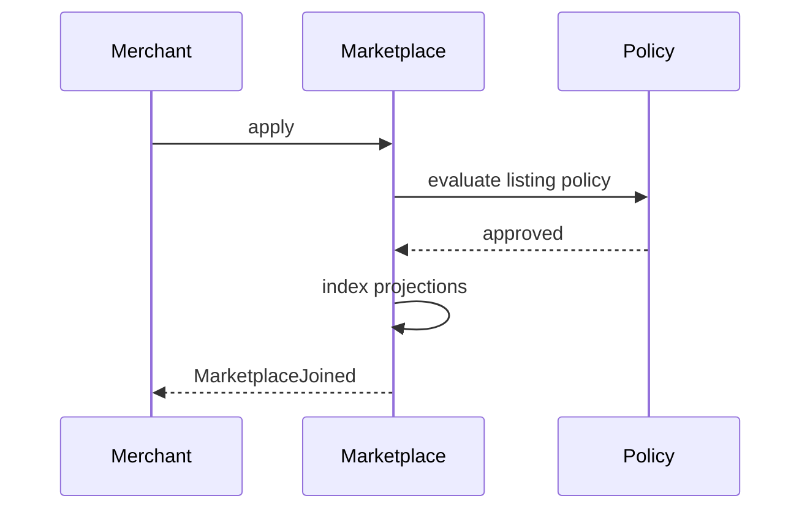

<a id="ucos-mkt-000001-state-diagrams"></a>
##### State Diagrams

```mermaid
stateDiagram-v2
    [*] --> Applying
    Applying --> Vetting
    Vetting --> Participating
    Participating --> Indexed
```

<a id="ucos-inv-000001"></a>
#### UCOS-INV-000001 · Inventory Architecture

Owner [Commerce](#d-biz) · managed in `_registry/manifest.json` → `UCOS-INV-000001`, content `_registry/content-commerce.json` → `INV` · inherits the [standard contract](../UCOS-MASTER.md#standard-contract)

<a id="ucos-inv-000001-concepts"></a>
##### Concepts

Inventory is a projection of availability — the relationship between an existence and a location-context, quantified and time-stamped. It is a continuously-observed approximation, never absolute truth.

<a id="ucos-inv-000001-ontology"></a>
##### Ontology

Inventory has a subject existence, a location Context, a quantity, an observation basis, and uncertainty. Multiple inventory projections may disagree across contexts — the contradiction is preserved, not averaged away.

<a id="ucos-inv-000001-taxonomy"></a>
##### Taxonomy

By location: Physical / Digital / Virtual / Transit. By certainty: Observed / Computed / Projected / Unknown. By reservation: Available / Reserved / Committed / Quarantined.

<a id="ucos-inv-000001-data-model"></a>
##### Data Model

```yaml
InventoryProjection:
  inventoryId: <Identity>
  subject: <Identity>
  location: <Context>
  quantity: <number>
  unit: <registry id>
  observationBasis: <Observation|null>
  uncertainty: <Uncertainty>
  reservationState: <registry state>
  temporal: {asOf}
```

<a id="ucos-inv-000001-graph-model"></a>
##### Graph Model

(:Inventory)-[:LOCATED_IN]->(:Context); (:Inventory)-[:OBSERVED_BY]->(:Observation); (:Inventory)-[:RESERVED_BY]->(:Relationship); (:Inventory)-[:CONTRADICTS]->(:Inventory)

<a id="ucos-inv-000001-apis"></a>
##### APIs

*Designed interface: the contract the domain is built towards. The routes it serves today are on its card.*

- GET  /inventory.v1/{subjectId}/{contextId}
- POST /inventory.v1.observe
- POST /inventory.v1.reserve
- GET  /inventory.v1.timeline/{subjectId}

<a id="ucos-inv-000001-events"></a>
##### Events

- InventoryObserved
- InventoryReserved
- InventoryReleased
- InventoryQuarantined
- InventoryReconciled
- InventoryContradicted

<a id="ucos-inv-000001-commands"></a>
##### Commands

- inventory.observe
- inventory.reserve
- inventory.release
- inventory.quarantine
- inventory.reconcile

<a id="ucos-inv-000001-queries"></a>
##### Queries

- inventory.bySubject
- inventory.byLocation
- inventory.timeline
- inventory.contradictions

<a id="ucos-inv-000001-state-machines"></a>
##### State Machines

```mermaid
stateDiagram-v2
    [*] --> Observed
    Observed --> Available
    Available --> Reserved
    Reserved --> Committed
    Reserved --> Released
    Available --> Quarantined
    Quarantined --> Available
    Committed --> [*]
```

<a id="ucos-inv-000001-workflows"></a>
##### Workflows

- observe → apply uncertainty → resolve contradictions per policy → expose availability → reserve under policy → commit on fulfillment

<a id="ucos-inv-000001-authorities"></a>
##### Authorities

- Location Authority (observation validity), Merchant Authority (reservation policy).

<a id="ucos-inv-000001-permissions"></a>
##### Permissions

- inventory.observe (authorized source)
- inventory.reserve (merchant authority)
- inventory.read (context-scoped)

<a id="ucos-inv-000001-privacy-model"></a>
##### Privacy Model

Inventory over personal holdings is consent-scoped; aggregate availability is public per marketplace policy.

<a id="ucos-inv-000001-audit-model"></a>
##### Audit Model

Every observation and reservation records source, time, and uncertainty — stock claims are evidence-backed.

<a id="ucos-inv-000001-digital-twin-model"></a>
##### Digital Twin Model

Inventory Twin mirrors real-world stock continuously and predicts stockout risk for simulation.

<a id="ucos-inv-000001-agent-model"></a>
##### Agent Model

Inventory Agent detects drift between observed and computed inventory and triggers reconciliation under policy.

<a id="ucos-inv-000001-runtime-model"></a>
##### Runtime Model

Availability is a read-side projection over the observation stream; reservations are transactional and short-lived.

<a id="ucos-inv-000001-scaling-model"></a>
##### Scaling Model

Observation stream is high-throughput; availability is cached per (subject, location) with stream invalidation.

<a id="ucos-inv-000001-multi-tenant-model"></a>
##### Multi-Tenant Model

Inventories are tenant-scoped; marketplace aggregates only published availability.

<a id="ucos-inv-000001-geo-distribution-model"></a>
##### Geo-Distribution Model

Location context implies residency — cross-border availability respects export and sovereignty policy.

<a id="ucos-inv-000001-failure-model"></a>
##### Failure Model

Contradiction deadlock, observation starvation, over-reservation, unit mismatch.

<a id="ucos-inv-000001-recovery-model"></a>
##### Recovery Model

Availability recomputes from the observation stream; reservations expire safely by policy.

<a id="ucos-inv-000001-certification-model"></a>
##### Certification Model

Inventory claim must carry observation basis and uncertainty — unsourced quantities are non-certifiable.

<a id="ucos-inv-000001-migration-model"></a>
##### Migration Model

New units and location types are registry additions.

<a id="ucos-inv-000001-implementation-blueprint"></a>
##### Implementation Blueprint

Build order for INV: (1) define registry entries — this domain owns by location: physical / digital / virtual / transit as registry truth, not code; (2) implement the contract surface first (inventory.observe, inventory.reserve, inventory.release) and validate against INV boundaries; (3) event-source all state so history is reconstructable; (4) wire the enforcement points — authority check, policy guard, evidence binding, trace — in-line, with no bypass path; (5) add tests per the Testing Architecture, citing evidence per gate; (6) obtain Verification and Certification before activation. Acceptance: the Zero Partial and Law 001 audits pass, every action answers the seven explainability questions, and this domain mutates no other domain internals.

<a id="ucos-inv-000001-sequence-diagrams"></a>
##### Sequence Diagrams

```mermaid
sequenceDiagram
    participant S as Source
    participant IN as Inventory Domain
    participant OB as Observation
    S->>IN: observe(quantity, location)
    IN->>OB: record observation
    OB-->>IN: acknowledged
    IN->>IN: reconcile + expose
    IN-->>S: InventoryObserved
```

<a id="ucos-inv-000001-state-diagrams"></a>
##### State Diagrams

```mermaid
stateDiagram-v2
    [*] --> Observing
    Observing --> Reconciling
    Reconciling --> Exposing
    Exposing --> Reservable
```

<a id="ucos-ord-000001"></a>
#### UCOS-ORD-000001 · Order Architecture

Owner [Commerce](#d-biz) · managed in `_registry/manifest.json` → `UCOS-ORD-000001`, content `_registry/content-commerce.json` → `ORD` · inherits the [standard contract](../UCOS-MASTER.md#standard-contract)

<a id="ucos-ord-000001-concepts"></a>
##### Concepts

An Order is a projection of intent — a sequence of decisions committing parties to exchanges. Its truth lives in the underlying relationships, policies, decisions, and evidence, not in a stored order object.

<a id="ucos-ord-000001-ontology"></a>
##### Ontology

Order = Intent + Parties (relationships) + Terms (policy) + Decisions (lifecycle) + Evidence (fulfillment). State transitions are governed decisions, not mutations.

<a id="ucos-ord-000001-taxonomy"></a>
##### Taxonomy

By fulfillment: Immediate / Scheduled / Pre-order / Backorder / Digital-instant. By origin: Direct / Marketplace / Subscription / Agent-initiated. By state: Pre-purchase / Committed / In-progress / Complete / Disrupted.

<a id="ucos-ord-000001-data-model"></a>
##### Data Model

```yaml
OrderProjection:
  orderId: <Identity>
  intent: <Intent>
  parties: [<Relationship>]
  lines: [{existence, quantity, pricingProjection}]
  decisions: [<Decision>]
  evidence: [<Evidence>]
  lifecycleState: <registry state>
  context: <Context>
  temporal: {placedAt}
```

<a id="ucos-ord-000001-graph-model"></a>
##### Graph Model

(:Order)-[:COMPOSED_OF]->(:Line); (:Order)-[:DECIDED_BY]->(:Decision); (:Order)-[:EVIDENCED_BY]->(:Evidence); (:Order)-[:PLACED_IN]->(:Context); (:Order)-[:FULFILLED_BY]->(:FulfillmentProjection)

<a id="ucos-ord-000001-apis"></a>
##### APIs

*Designed interface: the contract the domain is built towards. The routes it serves today are on its card.*

- POST /order.v1.place
- GET  /order.v1/{id}
- POST /order.v1/{id}/transition
- GET  /order.v1.timeline/{id}

<a id="ucos-ord-000001-events"></a>
##### Events

- OrderPlaced
- OrderTransitioned
- OrderCancelled
- OrderModified
- OrderDisrupted
- OrderCompleted

<a id="ucos-ord-000001-commands"></a>
##### Commands

- order.place
- order.transition
- order.cancel
- order.modify
- order.reroute

<a id="ucos-ord-000001-queries"></a>
##### Queries

- order.byId
- order.byParty
- order.timeline
- order.disrupted

<a id="ucos-ord-000001-state-machines"></a>
##### State Machines

```mermaid
stateDiagram-v2
    [*] --> Cart
    Cart --> Placed
    Placed --> Confirmed: payment evidence
    Confirmed --> InProgress
    InProgress --> Shipped
    Shipped --> Delivered
    Delivered --> Completed
    Placed --> Cancelled
    Confirmed --> Disputed
    Disputed --> Resolved
    Completed --> [*]
```

<a id="ucos-ord-000001-workflows"></a>
##### Workflows

- capture intent → validate under policy → confirm with payment evidence → progress via governed decisions → complete with fulfillment evidence

<a id="ucos-ord-000001-authorities"></a>
##### Authorities

- Buyer Authority (place/cancel), Merchant Authority (fulfill), Platform Authority (dispute resolution).

<a id="ucos-ord-000001-permissions"></a>
##### Permissions

- order.place (buyer authority)
- order.transition (state-owner authority per policy)
- order.read (party or platform authority)

<a id="ucos-ord-000001-privacy-model"></a>
##### Privacy Model

Orders are rich personal data — access strictly party-scoped, retention per legal basis and consent.

<a id="ucos-ord-000001-audit-model"></a>
##### Audit Model

Every transition is a recorded decision with authority, policy, and evidence. The order's full history is an audit artifact.

<a id="ucos-ord-000001-digital-twin-model"></a>
##### Digital Twin Model

Order Twin mirrors real-world fulfillment and flags disruption between committed and observed state.

<a id="ucos-ord-000001-agent-model"></a>
##### Agent Model

Order Agent monitors progression, predicts disruption, and initiates recovery actions within policy.

<a id="ucos-ord-000001-runtime-model"></a>
##### Runtime Model

Lifecycle is an event-sourced state machine; transitions are policy-guarded and idempotent.

<a id="ucos-ord-000001-scaling-model"></a>
##### Scaling Model

Placed orders are transactional and sharded by buyer; reads are served from the event projection.

<a id="ucos-ord-000001-multi-tenant-model"></a>
##### Multi-Tenant Model

Orders bind tenants via relationships; marketplace orders carry both authorities.

<a id="ucos-ord-000001-geo-distribution-model"></a>
##### Geo-Distribution Model

Order terms project per jurisdiction — tax, duty, and consumer rights applied locally.

<a id="ucos-ord-000001-failure-model"></a>
##### Failure Model

Evidence gap at confirmation, transition policy conflict, split-brain on reroute, dispute deadlock.

<a id="ucos-ord-000001-recovery-model"></a>
##### Recovery Model

Event sourcing replays to any state; cancellations are compensating events, not deletes.

<a id="ucos-ord-000001-certification-model"></a>
##### Certification Model

Every transition must be policy-authorized and evidence-backed — silent mutations void certification.

<a id="ucos-ord-000001-migration-model"></a>
##### Migration Model

New lifecycle states are registry additions; existing orders keep their state-machine version.

<a id="ucos-ord-000001-implementation-blueprint"></a>
##### Implementation Blueprint

Build order for ORD: (1) define registry entries — this domain owns by fulfillment: immediate / scheduled / pre-order / backorder / digital-instant as registry truth, not code; (2) implement the contract surface first (order.place, order.transition, order.cancel) and validate against ORD boundaries; (3) event-source all state so history is reconstructable; (4) wire the enforcement points — authority check, policy guard, evidence binding, trace — in-line, with no bypass path; (5) add tests per the Testing Architecture, citing evidence per gate; (6) obtain Verification and Certification before activation. Acceptance: the Zero Partial and Law 001 audits pass, every action answers the seven explainability questions, and this domain mutates no other domain internals.

<a id="ucos-ord-000001-sequence-diagrams"></a>
##### Sequence Diagrams

```mermaid
sequenceDiagram
    participant B as Buyer
    participant OR as Order Domain
    participant EV as Evidence
    B->>OR: place(intent, lines)
    OR->>OR: validate under policy
    OR->>EV: bind payment evidence
    EV-->>OR: confirmed
    OR-->>B: OrderPlaced
```

<a id="ucos-ord-000001-state-diagrams"></a>
##### State Diagrams

```mermaid
stateDiagram-v2
    [*] --> Intending
    Intending --> Validating
    Validating --> Evidencing
    Evidencing --> Committed
```

<a id="ucos-ful-000001"></a>
#### UCOS-FUL-000001 · Fulfillment Architecture

Owner [Commerce](#d-biz) · managed in `_registry/manifest.json` → `UCOS-FUL-000001`, content `_registry/content-commerce.json` → `FUL` · inherits the [standard contract](../UCOS-MASTER.md#standard-contract)

<a id="ucos-ful-000001-concepts"></a>
##### Concepts

Fulfillment is the projection of commitment becoming reality — moving an order's promise to an observed outcome. It is the bridge between commercial projection and physical/digital reality, driven by evidence at every step.

<a id="ucos-ful-000001-ontology"></a>
##### Ontology

Fulfillment has an Order projection, a plan (workflow projection), checkpoints (decisions + evidence), and an outcome. Disruption is a first-class state, not an error.

<a id="ucos-ful-000001-taxonomy"></a>
##### Taxonomy

By mode: Ship / Pickup / Digital-delivery / Service-render / Return / Exchange. By stage: Planned / In-motion / Delivered / Verified / Disrupted / Recovered. By control: First-party / Third-party / Dropship / Hybrid.

<a id="ucos-ful-000001-data-model"></a>
##### Data Model

```yaml
FulfillmentProjection:
  fulfillmentId: <Identity>
  orderRef: <OrderProjection>
  plan: <workflow projection>
  checkpoints: [{decision, evidence, temporal}]
  outcome: <registry state>
  context: <Context>
  disruption: <Contradiction|null>
```

<a id="ucos-ful-000001-graph-model"></a>
##### Graph Model

(:Fulfillment)-[:FULFILLS]->(:Order); (:Fulfillment)-[:CHECKPOINT]->(:Decision); (:Fulfillment)-[:EVIDENCED_BY]->(:Evidence); (:Fulfillment)-[:DISRUPTED_BY]->(:Contradiction)

<a id="ucos-ful-000001-apis"></a>
##### APIs

*Designed interface: the contract the domain is built towards. The routes it serves today are on its card.*

- POST /fulfillment.v1.plan
- GET  /fulfillment.v1/{id}
- POST /fulfillment.v1/{id}/checkpoint
- POST /fulfillment.v1/{id}/recover

<a id="ucos-ful-000001-events"></a>
##### Events

- FulfillmentPlanned
- CheckpointRecorded
- FulfillmentDisrupted
- FulfillmentRecovered
- FulfillmentCompleted

<a id="ucos-ful-000001-commands"></a>
##### Commands

- fulfillment.plan
- fulfillment.checkpoint
- fulfillment.disrupt
- fulfillment.recover
- fulfillment.complete

<a id="ucos-ful-000001-queries"></a>
##### Queries

- fulfillment.byId
- fulfillment.byOrder
- fulfillment.disrupted
- fulfillment.timeline

<a id="ucos-ful-000001-state-machines"></a>
##### State Machines

```mermaid
stateDiagram-v2
    [*] --> Planned
    Planned --> InMotion
    InMotion --> Checkpointed
    Checkpointed --> InMotion
    Checkpointed --> Delivered
    Delivered --> Verified: evidence matches
    Delivered --> Disrupted: evidence contradicts
    Disrupted --> Recovered
    Verified --> Completed
    Completed --> [*]
```

<a id="ucos-ful-000001-workflows"></a>
##### Workflows

- plan workflow under policy → execute → record checkpoint decisions + evidence → verify delivery against promise → complete or disrupt+recover

<a id="ucos-ful-000001-authorities"></a>
##### Authorities

- Fulfiller Authority (execution), Merchant Authority (plan), Buyer Authority (acceptance evidence).

<a id="ucos-ful-000001-permissions"></a>
##### Permissions

- fulfillment.plan (merchant authority)
- fulfillment.checkpoint (fulfiller authority)
- fulfillment.read (party or platform)

<a id="ucos-ful-000001-privacy-model"></a>
##### Privacy Model

Fulfillment data is personal; tracking exposure follows consent and minimization — location granularity policy-governed.

<a id="ucos-ful-000001-audit-model"></a>
##### Audit Model

Every checkpoint records what happened, why, who authorized, which policy allowed, and what evidence supports it.

<a id="ucos-ful-000001-digital-twin-model"></a>
##### Digital Twin Model

Fulfillment Twin tracks the real-world movement and is the primary source of disruption detection.

<a id="ucos-ful-000001-agent-model"></a>
##### Agent Model

Fulfillment Agent detects disruption early, proposes recovery (reroute, expedite, substitute), and acts within policy bounds.

<a id="ucos-ful-000001-runtime-model"></a>
##### Runtime Model

Checkpoint ingestion is a high-throughput stream; state is an event-sourced machine with idempotent checkpoints.

<a id="ucos-ful-000001-scaling-model"></a>
##### Scaling Model

Sharded by fulfiller; tracking reads are cached with stream invalidation.

<a id="ucos-ful-000001-multi-tenant-model"></a>
##### Multi-Tenant Model

Third-party fulfillment is a governed relationship — data shared only within policy scope.

<a id="ucos-ful-000001-geo-distribution-model"></a>
##### Geo-Distribution Model

Cross-border fulfillment respects export controls, customs, and sovereignty policy at planning time.

<a id="ucos-ful-000001-failure-model"></a>
##### Failure Model

Evidence contradiction, checkpoint starvation, plan policy conflict, recovery loop.

<a id="ucos-ful-000001-recovery-model"></a>
##### Recovery Model

Disruption is a state with a governed recovery workflow — not an exception path. Every recovery is audited.

<a id="ucos-ful-000001-certification-model"></a>
##### Certification Model

Delivery claims require matching evidence; unverifiable deliveries are Disrupted, not Completed.

<a id="ucos-ful-000001-migration-model"></a>
##### Migration Model

New fulfillment modes are registry additions.

<a id="ucos-ful-000001-implementation-blueprint"></a>
##### Implementation Blueprint

Build order for FUL: (1) define registry entries — this domain owns by mode: ship / pickup / digital-delivery / service-render / return / exchange as registry truth, not code; (2) implement the contract surface first (fulfillment.plan, fulfillment.checkpoint, fulfillment.disrupt) and validate against FUL boundaries; (3) event-source all state so history is reconstructable; (4) wire the enforcement points — authority check, policy guard, evidence binding, trace — in-line, with no bypass path; (5) add tests per the Testing Architecture, citing evidence per gate; (6) obtain Verification and Certification before activation. Acceptance: the Zero Partial and Law 001 audits pass, every action answers the seven explainability questions, and this domain mutates no other domain internals.

<a id="ucos-ful-000001-sequence-diagrams"></a>
##### Sequence Diagrams

```mermaid
sequenceDiagram
    participant F as Fulfiller
    participant FU as Fulfillment Domain
    participant TW as Twin
    F->>FU: checkpoint(evidence)
    FU->>TW: compare to twin state
    TW-->>FU: match/contradiction
    alt match
        FU-->>F: CheckpointRecorded
    else contradiction
        FU-->>F: FulfillmentDisrupted
    end
```

<a id="ucos-ful-000001-state-diagrams"></a>
##### State Diagrams

```mermaid
stateDiagram-v2
    [*] --> Planning
    Planning --> Executing
    Executing --> Evidencing
    Evidencing --> Verifying
    Verifying --> Completed
```

