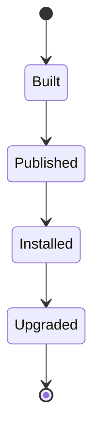
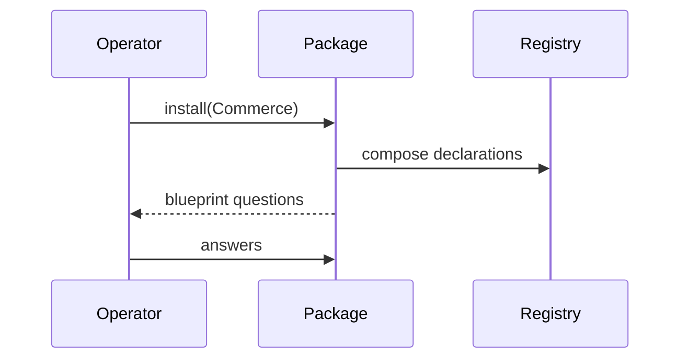
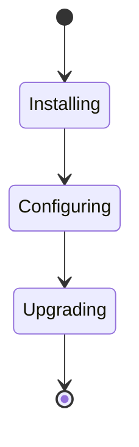

# Volume V13 · Composition

**Part of** [the master document](../UCOS-MASTER.md) · **Category** C13 · **Projected from** `_registry/` — never edit this file: change the registry and run `npm run registry`.

> Ready-made, editable compositions of domains.

## Contents

- [D-PKG Package](#d-pkg)
  - [UCOS-PKG-000001 Package Architecture](#ucos-pkg-000001)

---

<a id="d-pkg"></a>
### D-PKG · Package

| | |
|---|---|
| **Category** | C13 Composition |
| **Build status** | partial |
| **Owns** | [Package](../UCOS-MASTER.md#t-package), [Blueprint](../UCOS-MASTER.md#t-blueprint), [Overlay](../UCOS-MASTER.md#t-overlay), [Discovery](../UCOS-MASTER.md#t-discovery) |
| **Responsible for** | Packages, Blueprints, Overlays |
| **Not responsible for** | Domain Truth, Offerings |
| **Contract** | [UCOS-PKG-000001 Package Architecture](#ucos-pkg-000001) |
| **Artifacts** | [UCOS-PKG-000001](#ucos-pkg-000001) |
| **Concepts** | 251 — `node _registry/compile.js --search <words> --kind concept --owner "Package"` |
| **Code** | `lib/registry.js`, `lib/compose.js` |
| **Managed in** | `_registry/domains.json` → `D-PKG` |

**Live routes (8)** — what the platform serves today for this domain:

- `GET /api/compose/candidates`
- `GET /api/compose/ledger`
- `GET /api/compose/:key`
- `POST /api/compose/:key`
- `POST /api/compose/:key/recompose`
- `GET /api/platform/kinds`
- `POST /api/platform/kinds`
- `DELETE /api/platform/kinds/:key`

<a id="ucos-pkg-000001"></a>
#### UCOS-PKG-000001 · Package Architecture

Owner [Package](#d-pkg) · managed in `_registry/manifest.json` → `UCOS-PKG-000001`, content `_registry/content-platform.json` → `PKG` · inherits the [standard contract](../UCOS-MASTER.md#standard-contract)

<a id="ucos-pkg-000001-concepts"></a>
##### Concepts

Package Architecture owns ready-made, editable compositions of domains: the entities a kind of platform needs (mandatory and optional), their relationships, starting selections, workflows, templates and subscriptions, screens, agents, reports, connectors, a blueprint and offerings. Customisation is an overlay that survives upgrades.

<a id="ucos-pkg-000001-ontology"></a>
##### Ontology

A Package composes Entities (mandatory or optional) and declarations from every domain, includes other packages, and carries a Blueprint; an Overlay records a platform's changes on an installed package version.

<a id="ucos-pkg-000001-taxonomy"></a>
##### Taxonomy

Packages: Commerce, Marketplace, Quick commerce, Appointments, Mobility, Operations, Financial services, Marketing, any built. Parts: entities, relationships, selections, workflows, templates, subscriptions, screens, agents, reports, connectors, blueprint, offerings.

<a id="ucos-pkg-000001-data-model"></a>
##### Data Model

```yaml
Package:
  packageId: <Identity>
  version: <semantic version>
  includes: [<Package>]
  entities: [{kind, mandatory}]
  parts: [<declaration>]
  blueprint: <Blueprint>
  offerings: [<Offering>]
```

<a id="ucos-pkg-000001-graph-model"></a>
##### Graph Model

(:Package)-[:INCLUDES]->(:Package); (:Package)-[:COMPOSES]->(:Kind); (:Platform)-[:INSTALLED {version}]->(:Package); (:Overlay)-[:ON]->(:Installation)

<a id="ucos-pkg-000001-apis"></a>
##### APIs

*Designed interface: the contract the domain is built towards. The routes it serves today are on its card.*

- POST /pkg.v1.package
- POST /pkg.v1.install
- POST /pkg.v1.upgrade
- GET  /pkg.v1/overlay/{installation}
- POST /pkg.v1.save-as

<a id="ucos-pkg-000001-events"></a>
##### Events

- PackageInstalled
- PackageUpgraded
- OverlayConflict
- PackagePublished

<a id="ucos-pkg-000001-commands"></a>
##### Commands

- package.build
- package.install
- package.upgrade
- overlay.resolve
- package.saveAs

<a id="ucos-pkg-000001-queries"></a>
##### Queries

- package.contents
- installation.conflicts
- blueprint.questions

<a id="ucos-pkg-000001-state-machines"></a>
##### State Machines



<a id="ucos-pkg-000001-workflows"></a>
##### Workflows

- install package → answer its blueprint → customise through the overlay → on upgrade re-apply the overlay and resolve conflicts

<a id="ucos-pkg-000001-authorities"></a>
##### Authorities

- A package's publisher governs its versions; the installing platform governs its overlay.

<a id="ucos-pkg-000001-permissions"></a>
##### Permissions

- package.build (builder role)
- package.install (platform owner)
- overlay.edit (platform owner)

<a id="ucos-pkg-000001-privacy-model"></a>
##### Privacy Model

Packages carry declarations, never personal data.

<a id="ucos-pkg-000001-audit-model"></a>
##### Audit Model

Installs, upgrades and overlay changes are recorded.

<a id="ucos-pkg-000001-digital-twin-model"></a>
##### Digital Twin Model

An installation twin shows drift between an overlay and the package.

<a id="ucos-pkg-000001-agent-model"></a>
##### Agent Model

An agent walks a package's blueprint through the API, like a person with the manual.

<a id="ucos-pkg-000001-runtime-model"></a>
##### Runtime Model

Installing merges shared entities instead of duplicating them; mandatory entities can be extended or hidden but not removed.

<a id="ucos-pkg-000001-scaling-model"></a>
##### Scaling Model

Packages are versioned bundles.

<a id="ucos-pkg-000001-multi-tenant-model"></a>
##### Multi-Tenant Model

Packages are published master data; overlays are per platform or store.

<a id="ucos-pkg-000001-geo-distribution-model"></a>
##### Geo-Distribution Model

A blueprint's place question answers from Geo; everything place-dependent is inherited.

<a id="ucos-pkg-000001-failure-model"></a>
##### Failure Model

An overlay conflict on upgrade, removing a mandatory entity, two packages duplicating a shared entity.

<a id="ucos-pkg-000001-recovery-model"></a>
##### Recovery Model

Upgrades roll back to the previous package version with the overlay intact.

<a id="ucos-pkg-000001-certification-model"></a>
##### Certification Model

Every package's mandatory entities exist and its blueprint answers resolve to owning domains.

<a id="ucos-pkg-000001-migration-model"></a>
##### Migration Model

Today's deploy modes, capability blends and composition engine move here.

<a id="ucos-pkg-000001-implementation-blueprint"></a>
##### Implementation Blueprint

Build order for PKG: (1) package declarations and composition; (2) install with shared-entity merge; (3) overlays and upgrades; (4) the package builder; (5) first packages from today's platform kinds. Every build step also inherits Kernel parts K1–K11 (kinds, nodes, hierarchies, identifiers, shape, attributes, versions, events, change lifecycle, views and scope, resolution).

<a id="ucos-pkg-000001-sequence-diagrams"></a>
##### Sequence Diagrams



<a id="ucos-pkg-000001-state-diagrams"></a>
##### State Diagrams



